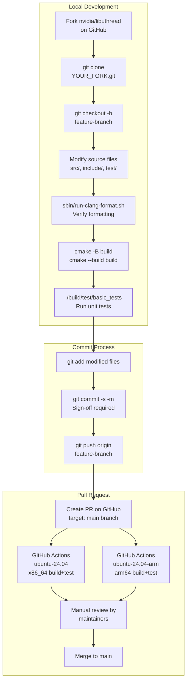
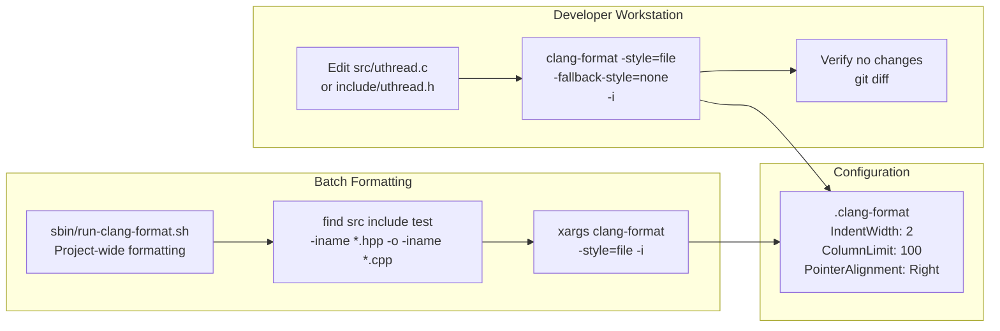
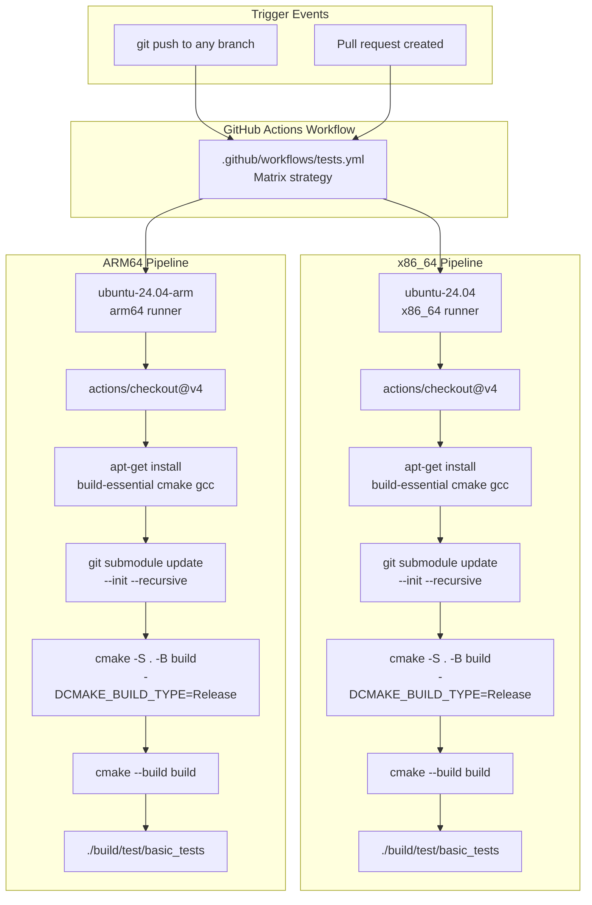

<!-- source: DeepWiki mcp.deepwiki.com · repo NVIDIA/libuthread · page 7 Development Guide · fetched 2026-10-26 -->

# Development Guide

<details>
<summary>Relevant source files</summary>

The following files were used as context for generating this wiki page:

- [.clang-format](.clang-format)
- [.github/workflows/tests.yml](.github/workflows/tests.yml)
- [CONTRIBUTING.md](CONTRIBUTING.md)

</details>


## Purpose and Scope

This document provides comprehensive guidance for developers contributing to the libuthread codebase. It covers the complete development workflow from initial setup through code submission, including coding standards, formatting requirements, testing procedures, and the CI/CD pipeline.

For detailed information on specific topics, see:
- [Contributing Guidelines](#7.1) for the formal contribution process and DCO requirements
- [Code Style and Formatting](#7.2) for clang-format configuration and conventions
- [CI/CD Pipeline](#7.3) for automated testing infrastructure
- [Project Structure](#7.4) for repository organization

For information on running the test suite, see [Unit Tests](#6.2). For build system details, see [Build System Architecture](#6.1).

## Development Workflow Overview

The libuthread project follows a standard fork-and-pull-request workflow with strict quality gates. All code changes must pass automated formatting checks and multi-architecture build verification before acceptance.



**Sources:** [CONTRIBUTING.md:63-81](), [.github/workflows/tests.yml:1-42]()

## Quick Start for Contributors

### Initial Setup

1. **Fork and clone the repository:**
   ```bash
   # Fork nvidia/libuthread on GitHub first
   git clone https://github.com/YOUR_USERNAME/libuthread.git
   cd libuthread
   git submodule update --init --recursive
   ```

2. **Create a feature branch:**
   ```bash
   git checkout -b my-feature-branch
   ```

3. **Verify build toolchain:**
   ```bash
   # Required: build-essential, cmake, gcc or clang
   cmake -S . -B build -DCMAKE_BUILD_TYPE=Release
   cmake --build build
   ```

**Sources:** [CONTRIBUTING.md:65-72](), [.github/workflows/tests.yml:26-38]()

### Making Changes

The typical development cycle involves:

| Step | Command | Purpose |
|------|---------|---------|
| Edit code | `vim src/uthread.c` | Implement changes |
| Format code | `clang-format -style=file -i <files>` | Apply formatting rules |
| Build | `cmake --build build` | Compile library |
| Test | `./build/test/basic_tests` | Run unit tests |
| Commit | `git commit -s -m "message"` | Sign-off and commit |

**Sources:** [CONTRIBUTING.md:24-31](), [CONTRIBUTING.md:89-92]()

## Code Quality Standards

### Formatting Requirements

All source files must conform to the clang-format configuration defined in [.clang-format:1-42](). Key formatting rules:

| Setting | Value | Description |
|---------|-------|-------------|
| `IndentWidth` | 2 | Two-space indentation |
| `ColumnLimit` | 100 | Maximum line length |
| `PointerAlignment` | Right | Pointer asterisk alignment (`int *ptr`) |
| `UseTab` | Never | Spaces only, no tabs |
| `AllowShortIfStatementsOnASingleLine` | true | Short conditionals allowed inline |

**Sources:** [.clang-format:16-42]()

### Formatting Enforcement



**Sources:** [CONTRIBUTING.md:24-37](), [.clang-format:1-42]()

### Build Warnings

The project enforces strict compiler warnings to maintain code quality. All builds must complete without warnings:

- `-Wall`: Enable all standard warnings
- `-Wextra`: Enable extra warning checks
- `-Wconversion`: Warn on implicit type conversions
- Clean build log required before submission

**Sources:** [CONTRIBUTING.md:46]()

## Commit and Sign-Off Requirements

Every commit must include a Developer Certificate of Origin (DCO) sign-off. This certifies that you have the right to submit the contribution under the project's license.

### DCO Sign-Off Process

```bash
# Add -s or --signoff flag when committing
git commit -s -m "Add feature: improve context switching"

# This appends to commit message:
# Signed-off-by: Your Name <your.email@example.com>
```

The sign-off certifies compliance with DCO 1.1, which requires that:
- The contribution is your original work, or
- You have rights to submit it under the project's Apache 2.0 license, or
- The contribution is based on compatible open source work

**Commits without sign-off will not be accepted.**

**Sources:** [CONTRIBUTING.md:83-96](), [CONTRIBUTING.md:98-134]()

## Testing Requirements

### Pre-Submission Testing

All changes must pass the complete test suite before submission:

```bash
# Configure with tests enabled
cmake -S . -B build -DCMAKE_BUILD_TYPE=Release

# Build library and tests
cmake --build build --config Release

# Execute test suite
./build/test/basic_tests
```

The test suite validates:
- Thread creation and lifecycle management
- Context switching correctness
- Pool and queue operations
- Register preservation across yields

**Sources:** [.github/workflows/tests.yml:31-42](), [CONTRIBUTING.md:48-50]()

### Test Coverage Requirements

- All new functionality must include accompanying unit tests
- Tests must validate behavior on both x86_64 and ARM64 architectures
- Test execution must complete successfully without failures

For detailed test implementation, see [Unit Tests](#6.2).

**Sources:** [CONTRIBUTING.md:50]()

## CI/CD Pipeline

The GitHub Actions workflow automatically validates all pull requests on multiple architectures. Manual testing by maintainers supplements automated checks.

### Multi-Architecture Testing Matrix



**Sources:** [.github/workflows/tests.yml:1-42]()

### Pipeline Stages

| Stage | x86_64 Steps | ARM64 Steps |
|-------|-------------|-------------|
| **Checkout** | `actions/checkout@v4` | `actions/checkout@v4` |
| **Dependencies** | `apt-get install build-essential cmake gcc` | `apt-get install build-essential cmake gcc` |
| **Submodules** | `git submodule update --init --recursive` | `git submodule update --init --recursive` |
| **Configure** | `cmake -S . -B build -DCMAKE_BUILD_TYPE=Release` | `cmake -S . -B build -DCMAKE_BUILD_TYPE=Release` |
| **Build** | `cmake --build build --config Release` | `cmake --build build --config Release` |
| **Test** | `./build/test/basic_tests` | `./build/test/basic_tests` |

Both pipelines must pass before manual review.

**Sources:** [.github/workflows/tests.yml:22-42]()

## Pull Request Guidelines

### Submission Requirements

When submitting a pull request:

1. **Target the correct branch**: PRs should target the `main` branch unless explicitly coordinating with maintainers
2. **Link related issues**: Reference issue numbers in the PR description if applicable
3. **Keep scope focused**: Each PR should address a single concern
4. **Mark work-in-progress**: Prefix PR title with `[WIP]` if not ready for final review
5. **Ensure clean build**: No warnings or errors in build output
6. **Pass all tests**: Both x86_64 and ARM64 test suites must pass

**Sources:** [CONTRIBUTING.md:62-81]()

### Code Organization Rules

- Follow existing conventions in each file/namespace
- Avoid introducing unnecessary complexity
- Do not commit commented-out code
- Keep pull requests concise and focused

For new features requiring configuration:
- Add a CMake option with a default value matching existing behavior
- Use selective compilation in `CMakeLists.txt` for entire files
- Use `#if` guards for minor changes to existing files

**Sources:** [CONTRIBUTING.md:20-56]()

## Manual Review Process

**Important**: The project currently relies on manual testing by maintainers. As noted in [CONTRIBUTING.md:80](): "Since there is no CI/CD process in place yet, the PR will be accepted and thereby resolved issues closed only after adequate testing has been manually completed by us."

This means:
- Automated CI/CD provides initial validation only
- Maintainers perform comprehensive manual testing
- PR acceptance requires maintainer approval
- Response times may vary based on testing complexity

**Sources:** [CONTRIBUTING.md:80]()

## Development Best Practices

### Code Maintainability

| Practice | Guideline |
|----------|-----------|
| **Complexity** | Avoid unnecessary complexity to preserve readability |
| **Documentation** | Comment non-obvious implementation details |
| **Consistency** | Follow existing patterns in modified files |
| **Testing** | Include tests for all new functionality |
| **Formatting** | Run clang-format before committing |

**Sources:** [CONTRIBUTING.md:20-59]()

### Architecture-Specific Code

When modifying platform-specific implementations:
- Test on both x86_64 and ARM64 if possible
- Understand register preservation requirements differ between architectures
- See [x86_64 Implementation](#5.2) and [ARM64 Implementation](#5.3) for architecture details

**Sources:** [.github/workflows/tests.yml:11-20]()

## Repository Structure

The libuthread repository follows a standard CMake project layout:

```
libuthread/
├── .clang-format              # Code formatting configuration
├── .github/
│   └── workflows/
│       └── tests.yml          # CI/CD pipeline definition
├── CMakeLists.txt             # Root build configuration
├── CONTRIBUTING.md            # Contribution guidelines
├── include/
│   └── uthread.h              # Public API header
├── src/
│   ├── uthread.c              # Core implementation
│   ├── uthread.x86_64.S       # x86_64 assembly
│   └── uthread.aarch64.S      # ARM64 assembly
├── test/
│   ├── CMakeLists.txt         # Test build configuration
│   └── basic_tests.c          # Unit test suite
└── third_party/
    └── unity/                 # Unity test framework (git submodule)
```

For detailed information on project organization, see [Project Structure](#7.4).

**Sources:** [CONTRIBUTING.md:1-135](), [.github/workflows/tests.yml:1-42]()

## Troubleshooting Common Issues

### Formatting Failures

If clang-format reports style violations:
```bash
# Format specific files
clang-format -style=file -fallback-style=none -i src/uthread.c

# Verify formatting
git diff src/uthread.c
```

### Build Failures

If CMake configuration fails:
- Verify compiler installation: `gcc --version` or `clang --version`
- Update submodules: `git submodule update --init --recursive`
- Check architecture detection matches your system

### Test Failures

If `basic_tests` fails:
- Ensure clean build: `rm -rf build && cmake -B build`
- Verify architecture-specific assembly is being compiled
- Check for stack corruption or register preservation issues

**Sources:** [CONTRIBUTING.md:24-48](), [.github/workflows/tests.yml:26-42]()

---

