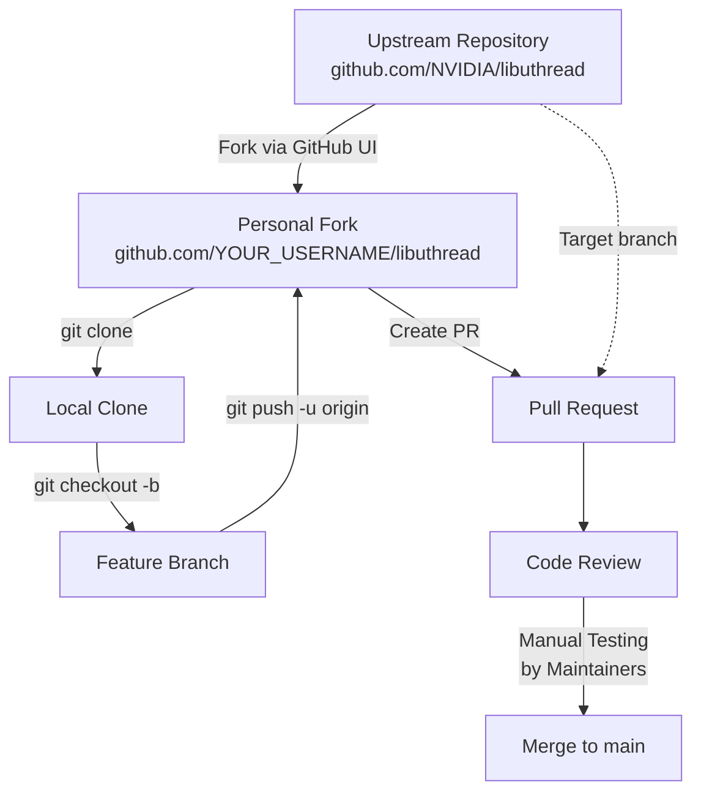
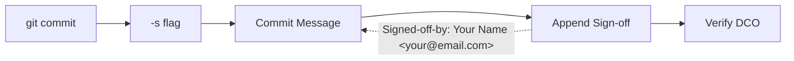
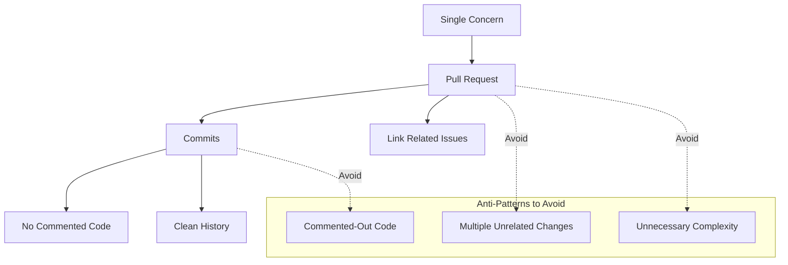
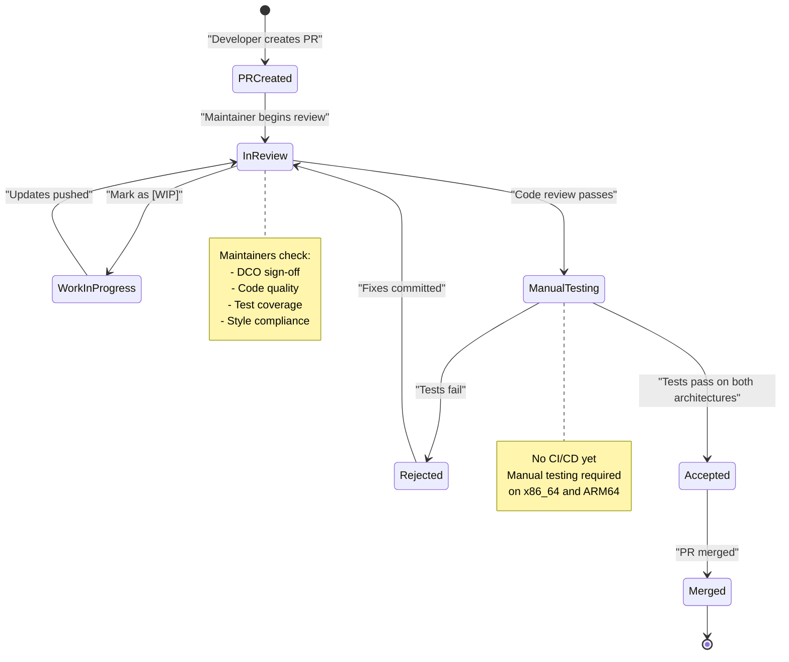
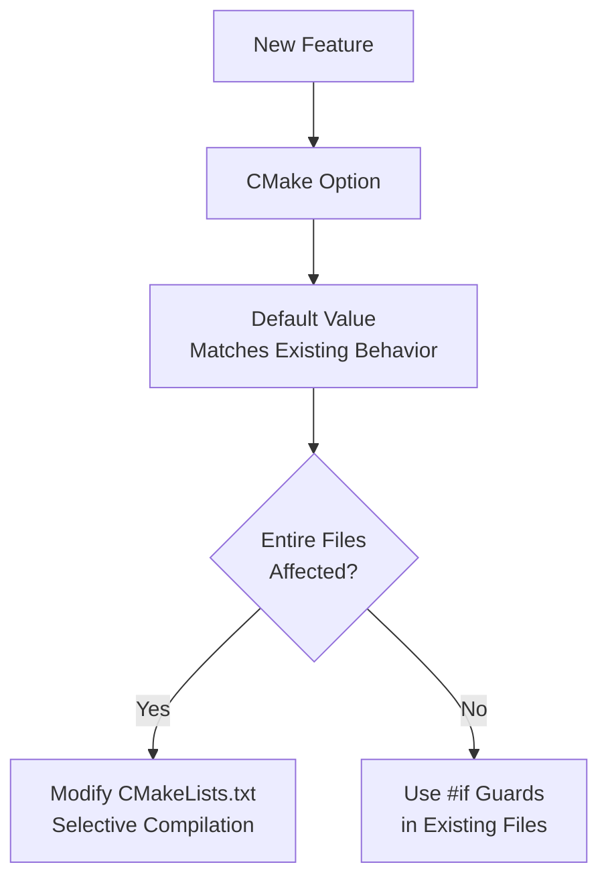

<!-- source: DeepWiki mcp.deepwiki.com · repo NVIDIA/libuthread · page 7.1 Contributing Guidelines · fetched 2026-10-26 -->

# Contributing Guidelines

<details>
<summary>Relevant source files</summary>

The following files were used as context for generating this wiki page:

- [.clang-format](.clang-format)
- [CONTRIBUTING.md](CONTRIBUTING.md)
- [sbin/run-clang-format.sh](sbin/run-clang-format.sh)

</details>


This page documents the process for contributing code to the libuthread project, including the pull request workflow, commit sign-off requirements, and quality standards that all contributions must meet. For information about code formatting rules, see [Code Style and Formatting](#7.2). For details on the automated build verification system, see [CI/CD Pipeline](#7.3).

## Purpose and Scope

This document covers:
- Fork-and-pull request workflow for code submissions
- Developer Certificate of Origin (DCO) sign-off requirements
- Code quality standards (warnings, tests, PR structure)
- Review process and acceptance criteria

The contribution guidelines are defined in [CONTRIBUTING.md:1-135]() and enforced through manual review by project maintainers.

---

## Pull Request Workflow

The contribution process follows a standard GitHub fork-and-pull-request model. All code changes must be submitted through pull requests from a personal fork of the repository.

### Fork and Clone Process



**Diagram: Pull Request Flow from Fork to Merge**

Sources: [CONTRIBUTING.md:62-81]()

### Step-by-Step Workflow

| Step | Action | Command |
|------|--------|---------|
| 1 | Fork upstream repository | Via GitHub web interface |
| 2 | Clone your fork | `git clone https://github.com/YOUR_USERNAME/libuthread.git` |
| 3 | Create feature branch | `git checkout -b feature-name` |
| 4 | Make and commit changes | `git commit -s -m "Description"` |
| 5 | Push to your fork | `git push -u origin feature-name` |
| 6 | Create pull request | Via GitHub web interface |
| 7 | Address review feedback | Additional commits to same branch |

As documented in [CONTRIBUTING.md:65-72](), developers must first fork the upstream repository at `https://github.com/nvidia/libuthread`, then clone their personal fork for local development.

Sources: [CONTRIBUTING.md:62-81]()

---

## Developer Certificate of Origin (DCO)

All contributions must include a sign-off certifying that you have the right to submit the code under the project's license. This is enforced through the Developer Certificate of Origin (DCO) Version 1.1.

### Sign-Off Requirement



**Diagram: Commit Sign-Off Process**

Every commit must be signed off using the `-s` or `--signoff` flag:

```bash
git commit -s -m "Add cool feature."
```

This appends the following to the commit message:
```
Signed-off-by: Your Name <your@email.com>
```

As stated in [CONTRIBUTING.md:87-88](), **contributions containing commits that are not signed-off will not be accepted**.

Sources: [CONTRIBUTING.md:83-96]()

### DCO Certification

By signing off, you certify that:

- **(a)** The contribution was created in whole or in part by you and you have the right to submit it under the open source license indicated in the file
- **(b)** The contribution is based upon previous work covered under an appropriate open source license and you have the right to submit modifications under the same license
- **(c)** The contribution was provided directly to you by someone who certified (a), (b), or (c) and you have not modified it
- **(d)** You understand that the contribution and all personal information submitted with it is maintained indefinitely and may be redistributed

The full DCO text is available in [CONTRIBUTING.md:98-134]().

Sources: [CONTRIBUTING.md:98-134]()

---

## Code Quality Requirements

All contributions must meet the following quality standards before acceptance:

### Build and Test Requirements

| Requirement | Description | Verification |
|-------------|-------------|--------------|
| Clean build | No warnings or errors | `-Wall -Wextra -Wconversion` flags enabled |
| Passing tests | All unit tests pass | Run test suite on both architectures |
| Test coverage | New components have tests | Each feature requires accompanying test |
| Format compliance | Code follows style guide | Run `clang-format` with [.clang-format:1-42]() |

As mandated in [CONTRIBUTING.md:46](), **the build log must be clean, meaning no warnings or errors should be present**. All unit tests must pass prior to submission ([CONTRIBUTING.md:48]()), and new functionality must include accompanying tests ([CONTRIBUTING.md:50]()).

Sources: [CONTRIBUTING.md:46-50]()

### Pull Request Structure



**Diagram: Pull Request Quality Standards**

Pull requests must be concise ([CONTRIBUTING.md:41-44]()):

- **Single concern per PR**: Each PR should address one issue or feature
- **No commented-out code**: Remove debug code and old implementations
- **Dependency management**: If multiple PRs are related, indicate dependencies in descriptions
- **Issue linking**: Reference related issues in the PR description

Sources: [CONTRIBUTING.md:41-44]()

---

## Code Formatting Requirements

Before submitting code, run `clang-format` with the project configuration to ensure consistent style. The formatting rules are defined in [.clang-format:1-42]().

### Format Individual Files

For formatting specific files you've modified:

```bash
clang-format -style=file -fallback-style=none -i <file(s)>
```

The `-style=file` option instructs `clang-format` to use the [.clang-format:1-42]() configuration, and `-i` performs in-place modification.

### Format Entire Codebase

For project maintainers, the [sbin/run-clang-format.sh:1-7]() script formats the entire codebase:

```bash
./sbin/run-clang-format.sh
```

This script:
1. Locates the project directory via [sbin/run-clang-format.sh:3-4]()
2. Finds all `.h` and `.c` files in `src/`, `include/`, and `test/` directories via [sbin/run-clang-format.sh:6]()
3. Applies `clang-format` with verbose output via [sbin/run-clang-format.sh:7]()

**Note**: Detailed formatting rules and conventions are documented in [Code Style and Formatting](#7.2).

Sources: [CONTRIBUTING.md:24-37](), [sbin/run-clang-format.sh:1-7]()

---

## Review and Acceptance Process

The project currently uses manual review and testing by maintainers.

### Review Workflow



**Diagram: PR Review State Machine**

As documented in [CONTRIBUTING.md:80](), **there is no CI/CD process in place yet**. The PR acceptance process requires:

1. **Code review**: Maintainers review for quality, style, and correctness
2. **Work-in-progress marking**: Use `[WIP]` prefix in PR title during development ([CONTRIBUTING.md:78]())
3. **Manual testing**: Maintainers manually test on both x86_64 and ARM64 architectures
4. **Acceptance**: PR is merged and related issues are closed only after adequate testing

Sources: [CONTRIBUTING.md:78-80]()

### Branch Selection

Exercise caution when selecting source and target branches for pull requests ([CONTRIBUTING.md:76]()):

- **Source branch**: Your feature branch in your fork
- **Target branch**: Typically `main` in the upstream repository
- **Verification**: Double-check branch selection before creating the PR

Sources: [CONTRIBUTING.md:74-78]()

---

## Feature Addition Guidelines

When adding or disabling functionality, follow these architectural guidelines from [CONTRIBUTING.md:52-55]():

### CMake Option Pattern



**Diagram: Feature Addition Pattern**

| Scenario | Implementation | Example |
|----------|----------------|---------|
| Entire files can be included/excluded | Modify `CMakeLists.txt` to selectively compile files | `NVUT_BUILD_TESTS` option |
| Minor changes to existing files | Use `#if` preprocessor guards | Feature flags in source |
| Default behavior | Option default matches existing behavior | Backward compatibility maintained |

Sources: [CONTRIBUTING.md:52-56]()

---

## General Coding Principles

### Code Maintainability

The guidelines emphasize maintainability and consistency:

- **Follow existing conventions**: Adapt to the style in the file/namespace you're modifying ([CONTRIBUTING.md:22]())
- **Avoid unnecessary complexity**: Keep code readable and maintainable ([CONTRIBUTING.md:39]())
- **License compatibility**: Ensure no license or patent conflicts are introduced ([CONTRIBUTING.md:57]())

### Contribution Size

Keep contributions focused and reviewable:

- **Concise PRs**: Smaller, focused changes are easier to review
- **Single concern**: One feature or fix per PR
- **Dependency indication**: Note relationships between multiple PRs

Sources: [CONTRIBUTING.md:22-59]()

---

## Summary

The contribution workflow requires:

1. **Fork and clone** the repository from `github.com/NVIDIA/libuthread`
2. **Create feature branch** for your changes
3. **Commit with sign-off** using `git commit -s`
4. **Format code** using `clang-format` with [.clang-format:1-42]()
5. **Ensure clean build** with no warnings or errors
6. **Run all tests** and add tests for new functionality
7. **Submit PR** from your fork to upstream
8. **Address review feedback** and await manual testing

All commits must include DCO sign-off, and contributions must not introduce license conflicts. The project maintains high quality standards with comprehensive testing requirements despite the current absence of automated CI/CD.

Sources: [CONTRIBUTING.md:1-135](), [.clang-format:1-42](), [sbin/run-clang-format.sh:1-7]()

---

