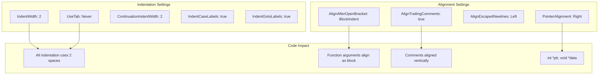
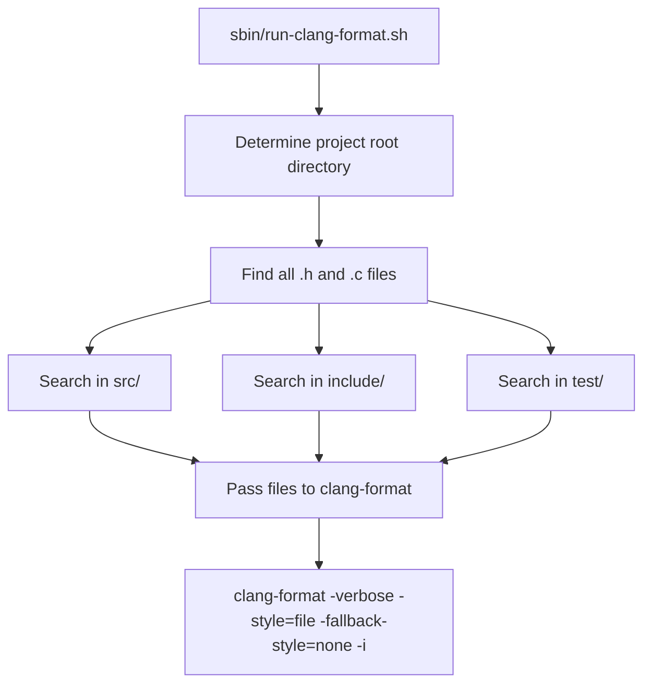
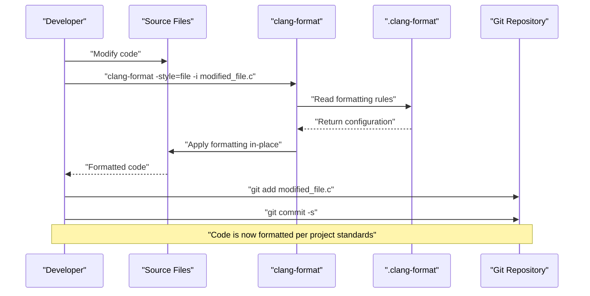
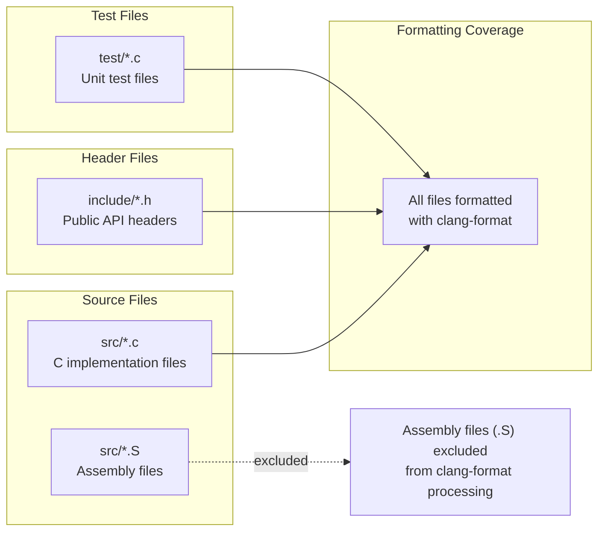
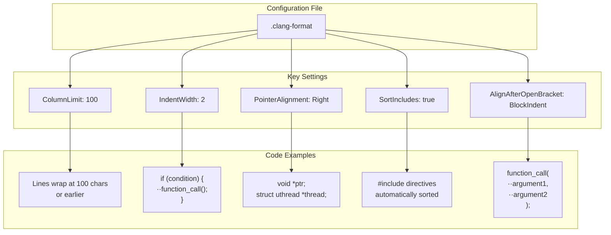

<!-- source: DeepWiki mcp.deepwiki.com · repo NVIDIA/libuthread · page 7.2 Code Style and Formatting · fetched 2026-10-26 -->

# Code Style and Formatting

<details>
<summary>Relevant source files</summary>

The following files were used as context for generating this wiki page:

- [.clang-format](.clang-format)
- [CONTRIBUTING.md](CONTRIBUTING.md)
- [sbin/run-clang-format.sh](sbin/run-clang-format.sh)

</details>


## Purpose and Scope

This document describes the code formatting standards and style conventions enforced in the libuthread codebase. It covers the clang-format configuration, formatting automation scripts, and coding conventions that contributors must follow. For information about the contribution workflow and pull request process, see [Contributing Guidelines](#7.1). For details on automated build verification, see [CI/CD Pipeline](#7.3).

---

## Overview

The libuthread project enforces consistent code formatting using `clang-format` with a project-specific configuration file. All contributors must format their code before submitting pull requests to maintain consistency across the codebase.

**Sources:** [CONTRIBUTING.md:1-135](), [.clang-format:1-42]()

---

## Clang-Format Configuration

The project's formatting rules are defined in [.clang-format:1-42](). This configuration file is automatically detected by clang-format when using the `-style=file` option.

### Key Formatting Rules

| Configuration Option | Value | Effect |
|---------------------|-------|--------|
| `ColumnLimit` | 100 | Maximum line length before wrapping |
| `IndentWidth` | 2 | Number of spaces per indentation level |
| `UseTab` | Never | Always use spaces, never tabs |
| `PointerAlignment` | Right | Pointers aligned to the right (e.g., `int *ptr`) |
| `AlignAfterOpenBracket` | BlockIndent | Multi-line function arguments use block indentation |
| `AllowShortIfStatementsOnASingleLine` | true | Short if statements can remain on one line |
| `AllowShortEnumsOnASingleLine` | false | Enum declarations must span multiple lines |
| `SpacesBeforeTrailingComments` | 2 | Two spaces before trailing comments |
| `SortIncludes` | true | Automatically sort #include directives |

**Sources:** [.clang-format:16-42]()

### Indentation and Alignment



**Sources:** [.clang-format:16-42]()

### Line Length and Wrapping

The configuration enforces a 100-character line limit ([.clang-format:23]()), with specific penalty settings to control how lines are broken:

- `PenaltyReturnTypeOnItsOwnLine: 1000` - Strongly discourages placing function return types on separate lines
- `ContinuationIndentWidth: 2` - Continued lines indent by 2 spaces

**Sources:** [.clang-format:23-25](), [.clang-format:33]()

### Special Comment Handling

The configuration includes a pragma to preserve SPDX license headers:

```
CommentPragmas: '^SPDX-FileCopyrightText:'
```

This ensures that SPDX copyright notices at the top of files are not reformatted or moved by clang-format.

**Sources:** [.clang-format:24]()

---

## Formatting Workflow

### Manual Formatting of Individual Files

For formatting specific files during development, use the following command:

```bash
clang-format -style=file -fallback-style=none -i <file(s) to process>
```

**Command Options:**
- `-style=file` - Uses the `.clang-format` configuration file in the project root
- `-fallback-style=none` - No fallback formatting if `.clang-format` is not found
- `-i` - In-place modification of the file

**Sources:** [CONTRIBUTING.md:26-31]()

### Automated Formatting Script

The project provides an automation script for formatting the entire codebase at [sbin/run-clang-format.sh:1-7]().



**Script Breakdown:**

1. **Project Root Detection** ([sbin/run-clang-format.sh:3-4]())
   - Determines the script's location using `readlink -f`
   - Navigates to parent directory to find project root

2. **File Discovery** ([sbin/run-clang-format.sh:6-7]())
   - Searches `src/`, `include/`, and `test/` directories
   - Matches files with `.h` or `.c` extensions

3. **Formatting Execution**
   - Passes all discovered files to `clang-format`
   - Uses `-verbose` flag to show progress
   - Applies in-place modifications with `-i`

**Usage:**

```bash
./sbin/run-clang-format.sh
```

**Note:** This script is intended for project maintainers. Contributors should format only the files they modify.

**Sources:** [sbin/run-clang-format.sh:1-7](), [CONTRIBUTING.md:33-37]()

---

## Developer Formatting Workflow



**Integration Points:**

1. **Pre-commit**: Developers run clang-format on modified files
2. **Review**: Maintainers verify formatting compliance during PR review
3. **Enforcement**: No CI/CD automation yet, manual verification required

**Sources:** [CONTRIBUTING.md:24-31](), [CONTRIBUTING.md:80]()

---

## Coding Conventions

Beyond automated formatting, the project follows these conventions:

### General Guidelines

| Convention | Description |
|-----------|-------------|
| **Follow existing patterns** | Maintain consistency with code in the relevant file/namespace |
| **Clean build logs** | No warnings or errors should be present |
| **Minimal complexity** | Avoid unnecessary complexity to preserve maintainability |
| **No commented-out code** | Remove commented code before submitting PRs |
| **Concise PRs** | Each PR should address a single concern |

**Sources:** [CONTRIBUTING.md:22-46]()

### File Organization



**Sources:** [sbin/run-clang-format.sh:6-7]()

### SPDX License Headers

All source files must include SPDX copyright and license identifiers at the top:

```c
// SPDX-FileCopyrightText: Copyright (c) 2025 NVIDIA CORPORATION & AFFILIATES. All rights reserved.
// SPDX-License-Identifier: Apache-2.0
```

The clang-format configuration preserves these headers through the `CommentPragmas` setting ([.clang-format:24]()).

**Sources:** [.clang-format:1-14](), [.clang-format:24]()

---

## Configuration-to-Code Mapping



**Sources:** [.clang-format:16-42]()

---

## Enforcement and Verification

### Manual Review Process

Since automated CI/CD is not yet in place ([CONTRIBUTING.md:80]()), code formatting compliance is verified manually:

1. **Contributor Responsibility**: Format code before submitting PR
2. **Reviewer Verification**: Maintainers check formatting during review
3. **Testing Requirement**: PR accepted only after manual testing

**Sources:** [CONTRIBUTING.md:80]()

### Formatting Validation

To verify that code is properly formatted without modifying files:

```bash
# Check if files would be modified (dry-run)
clang-format -style=file -fallback-style=none --dry-run --Werror <file>
```

This command exits with an error if the file is not properly formatted, useful for future CI/CD integration.

**Sources:** [CONTRIBUTING.md:24-31]()

---

## Summary

The libuthread project maintains code quality through:

- **Automated formatting** via clang-format with project-specific configuration
- **Consistent style** enforced through `.clang-format` settings
- **Helper scripts** for batch formatting operations
- **Manual verification** during PR review process

Contributors must run clang-format on modified files before submitting pull requests. The configuration ensures consistent indentation (2 spaces), line length (100 characters), pointer alignment (right), and comment formatting across the entire codebase.

**Sources:** [.clang-format:1-42](), [CONTRIBUTING.md:20-59](), [sbin/run-clang-format.sh:1-7]()

---

