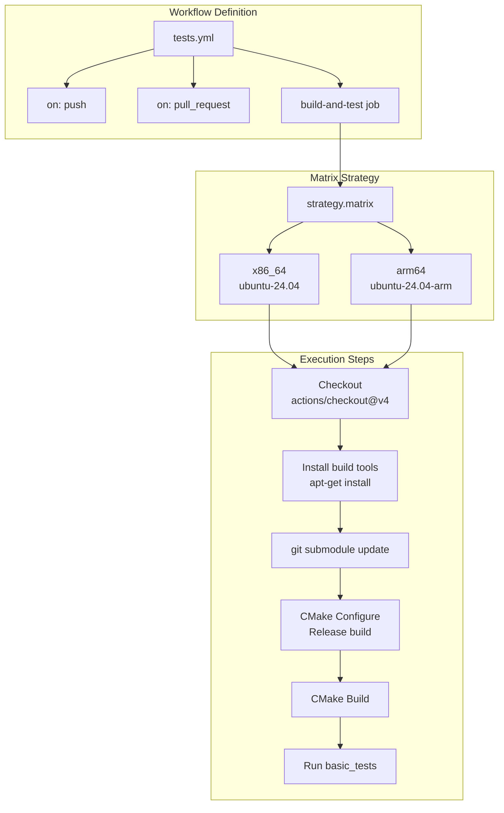
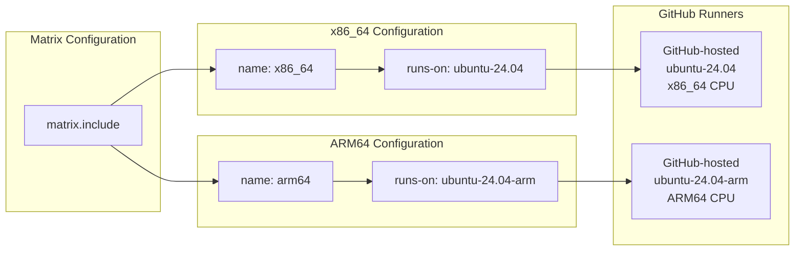
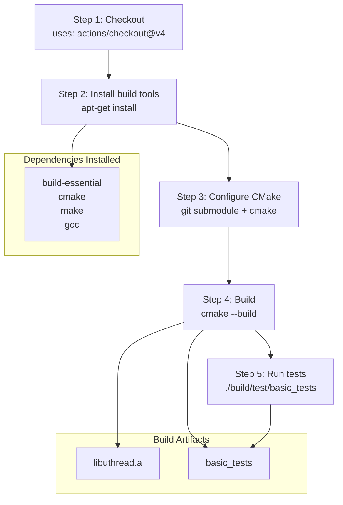
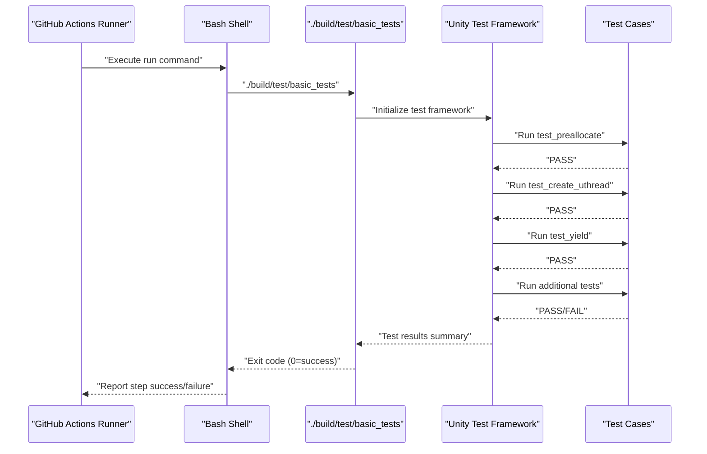
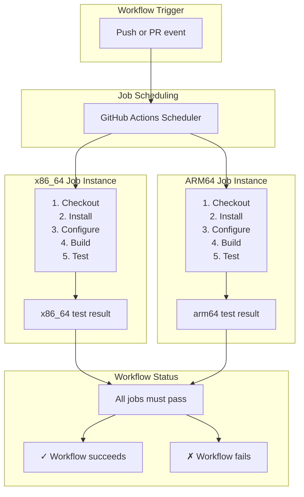
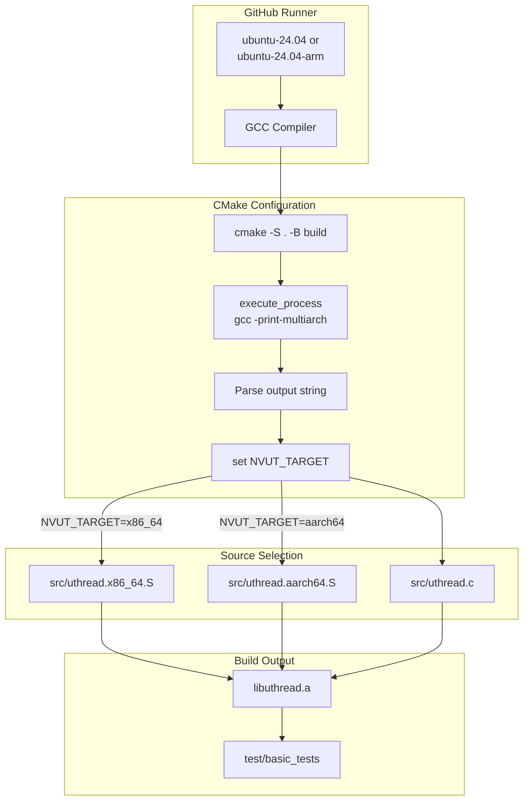
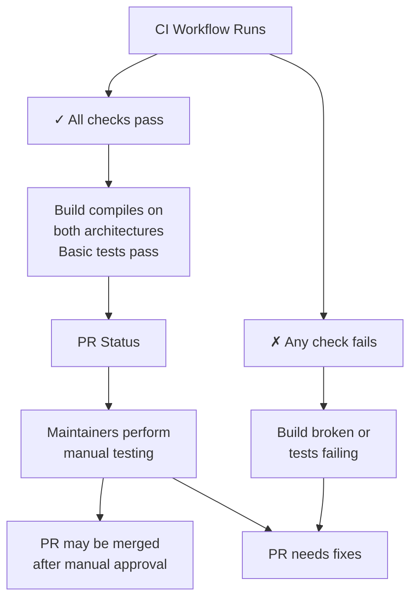

<!-- source: DeepWiki mcp.deepwiki.com · repo NVIDIA/libuthread · page 7.3 CI/CD Pipeline · fetched 2026-10-26 -->

# CI/CD Pipeline

<details>
<summary>Relevant source files</summary>

The following files were used as context for generating this wiki page:

- [.github/workflows/tests.yml](.github/workflows/tests.yml)
- [CONTRIBUTING.md](CONTRIBUTING.md)

</details>


## Purpose and Scope

This document describes the automated continuous integration and continuous deployment (CI/CD) infrastructure for the libuthread project. It covers the GitHub Actions workflow configuration, multi-architecture build verification, automated test execution, and the integration with the CMake build system. For information about code formatting and contribution workflow, see [Code Style and Formatting](#7.2) and [Contributing Guidelines](#7.1). For details about the test suite itself, see [Unit Tests](#6.2).

**Important Note**: While an automated CI/CD workflow exists, the project documentation states "there is no CI/CD process in place yet" [[CONTRIBUTING.md:80]()], meaning pull requests still require manual testing by maintainers before acceptance. The existing workflow provides automated build verification but does not gate merge decisions.

## Workflow Configuration

The CI/CD pipeline is defined in a single GitHub Actions workflow file that triggers on all push and pull request events.

### Workflow File Structure



The workflow is triggered on:
- All pushes to any branch [[.github/workflows/tests.yml:4-6]()]
- All pull request events [[.github/workflows/tests.yml:7]()]

**Sources**: [.github/workflows/tests.yml]()

### Job Configuration

| Property | Value | Description |
|----------|-------|-------------|
| Job Name | `build-and-test` | Single job that runs across multiple architectures [[.github/workflows/tests.yml:10]()] |
| Strategy | `matrix` | Enables parallel execution on different runners [[.github/workflows/tests.yml:11]()] |
| Matrix Dimension | `name`, `runs-on` | Defines architecture name and runner type [[.github/workflows/tests.yml:12-17]()] |
| Display Name | `${{ matrix.name }} tests` | Dynamic job name based on architecture [[.github/workflows/tests.yml:19]()] |

**Sources**: [.github/workflows/tests.yml]()

## Architecture Matrix Strategy

The workflow uses GitHub Actions matrix strategy to test across multiple CPU architectures in parallel.



### Matrix Entries

The matrix defines two architecture configurations:

**x86_64 Configuration** [[.github/workflows/tests.yml:14-15]()]:
- `name`: "x86_64"
- `runs-on`: "ubuntu-24.04"

**ARM64 Configuration** [[.github/workflows/tests.yml:16-17]()]:
- `name`: "arm64"
- `runs-on`: "ubuntu-24.04-arm"

This configuration ensures that both architecture-specific assembly implementations ([src/uthread.x86_64.S]() and [src/uthread.aarch64.S]()) are validated on their respective native platforms. The CMake build system automatically detects the runner architecture and selects the appropriate assembly file (see [Build System Architecture](#6.1)).

**Sources**: [.github/workflows/tests.yml]()

## Build Pipeline Steps

Each matrix job executes six sequential steps that prepare the environment, configure the build, compile the library, and run tests.

### Step Execution Flow



### Step Details

**Step 1: Checkout** [[.github/workflows/tests.yml:23-24]()]
- Action: `actions/checkout@v4`
- Purpose: Clone the repository at the commit being tested
- Version: Uses checkout action v4

**Step 2: Install build tools** [[.github/workflows/tests.yml:26-29]()]
- Updates apt package index with `sudo apt-get update`
- Installs build dependencies:
  - `build-essential`: Provides GCC, make, and standard development tools
  - `cmake`: Build system generator
  - `make`: Build automation tool
  - `gcc`: GNU C compiler (note: Clang is not explicitly installed)

**Step 3: Configure (CMake)** [[.github/workflows/tests.yml:31-34]()]
```bash
git submodule update --init --recursive
cmake -S . -B build -DCMAKE_BUILD_TYPE=Release
```
- Initializes git submodules recursively (fetches Unity framework from `third_party/unity`)
- Configures CMake with:
  - Source directory: `.` (repository root)
  - Build directory: `build`
  - Build type: `Release` (optimization enabled, no debug symbols)
- CMake automatically detects architecture using compiler queries (see [Build System Architecture](#6.1))
- Sets `NVUT_BUILD_TESTS=ON` implicitly (tests are enabled by default)

**Step 4: Build** [[.github/workflows/tests.yml:36-38]()]
```bash
cmake --build build --config Release
```
- Compiles all targets including:
  - `libuthread` static library
  - `basic_tests` executable
- Uses the build configuration specified during CMake configuration

**Step 5: Run GoogleTest binaries** [[.github/workflows/tests.yml:40-42]()]
```bash
./build/test/basic_tests
```
- Executes the test binary compiled in Step 4
- Returns non-zero exit code if any test fails, causing workflow failure
- Note: The step is named "Run GoogleTest binaries" but the project uses Unity framework, not GoogleTest (naming inconsistency)

**Sources**: [.github/workflows/tests.yml]()

## Test Execution

The workflow executes the compiled test binary and reports pass/fail status.

### Test Binary Execution Flow



The test binary [[.github/workflows/tests.yml:42]()] is a standalone executable that:
1. Links against `libuthread.a` and Unity framework
2. Executes test cases defined in [test/basic_tests.c]()
3. Returns exit code 0 on success, non-zero on failure
4. Workflow fails if any test case fails

For details on the test cases themselves, see [Unit Tests](#6.2).

**Sources**: [.github/workflows/tests.yml](), [test/basic_tests.c]()

## Parallel Execution Model

The matrix strategy enables parallel test execution across architectures.

### Parallel Job Execution



### Execution Characteristics

| Aspect | Behavior |
|--------|----------|
| Parallelism | Jobs run simultaneously on separate runners |
| Independence | Each architecture builds and tests in isolation |
| Failure Handling | If either architecture fails, the entire workflow fails |
| Duration | Total workflow time equals the slowest job |
| Resource Isolation | Each job has independent filesystem, environment, and build artifacts |

The workflow completes successfully only if both matrix jobs pass all steps. A failure in either x86_64 or ARM64 testing marks the entire workflow as failed.

**Sources**: [.github/workflows/tests.yml]()

## Integration with Build System

The CI/CD pipeline relies on the CMake build system for architecture detection and compilation.

### CMake Architecture Detection in CI



The workflow step [[.github/workflows/tests.yml:31-34]()] invokes CMake, which:
1. Detects the runner architecture by querying GCC with `-print-multiarch` flag
2. Parses the output to extract architecture prefix (`x86_64` or `aarch64`)
3. Sets CMake variable `NVUT_TARGET` to this value
4. Constructs assembly filename: `uthread.${NVUT_TARGET}.S`
5. Adds the appropriate assembly file to the build

This ensures that on `ubuntu-24.04` runners, [src/uthread.x86_64.S]() is compiled, while on `ubuntu-24.04-arm` runners, [src/uthread.aarch64.S]() is compiled.

For detailed CMake configuration logic, see [Build System Architecture](#6.1).

**Sources**: [.github/workflows/tests.yml](), [CMakeLists.txt]()

## Limitations and Manual Testing Requirements

While the CI/CD workflow provides automated build verification, the project has documented limitations in its automation coverage.

### Current State

The [CONTRIBUTING.md:80]() explicitly states:

> "Since there is no CI/CD process in place yet, the PR will be accepted and thereby resolved issues closed only after adequate testing has been manually completed by us."

This indicates:

**Automated Coverage**:
- ✓ Code checkout and submodule initialization
- ✓ Multi-architecture compilation (x86_64 and ARM64)
- ✓ Static library build verification
- ✓ Test binary compilation
- ✓ Basic test suite execution

**Manual Requirements**:
- Manual testing by maintainers before PR acceptance
- Manual validation of functionality beyond basic tests
- Manual review of security and correctness implications
- Manual decision to merge PRs (workflow does not gate merges)

### Workflow Status Interpretation



A passing CI workflow is a **necessary but not sufficient** condition for PR acceptance. Maintainers must still perform manual verification before merging.

**Sources**: [CONTRIBUTING.md:80](), [.github/workflows/tests.yml]()

## Workflow Dependencies

The CI/CD pipeline depends on several external systems and services.

### External Dependencies

| Dependency | Version/Identifier | Purpose |
|------------|-------------------|---------|
| GitHub Actions | Workflow runner infrastructure | Provides compute resources and orchestration |
| `actions/checkout` | v4 [[.github/workflows/tests.yml:24]()] | Repository checkout action |
| `ubuntu-24.04` | GitHub-hosted runner image | x86_64 execution environment |
| `ubuntu-24.04-arm` | GitHub-hosted runner image | ARM64 execution environment |
| Ubuntu packages | Latest from apt repos | Build tools (gcc, cmake, make, build-essential) |

### Repository Dependencies

| Dependency | Location | Purpose |
|------------|----------|---------|
| Unity Framework | `third_party/unity` (git submodule) | Test framework for C |
| CMake Configuration | [CMakeLists.txt]() | Build system definition |
| Test Configuration | [test/CMakeLists.txt]() | Test binary build rules |
| Test Source | [test/basic_tests.c]() | Test case implementations |

The workflow initializes git submodules [[.github/workflows/tests.yml:33]()] to fetch the Unity framework before building, as the test binary requires linking against Unity.

**Sources**: [.github/workflows/tests.yml](), [CONTRIBUTING.md]()

---

