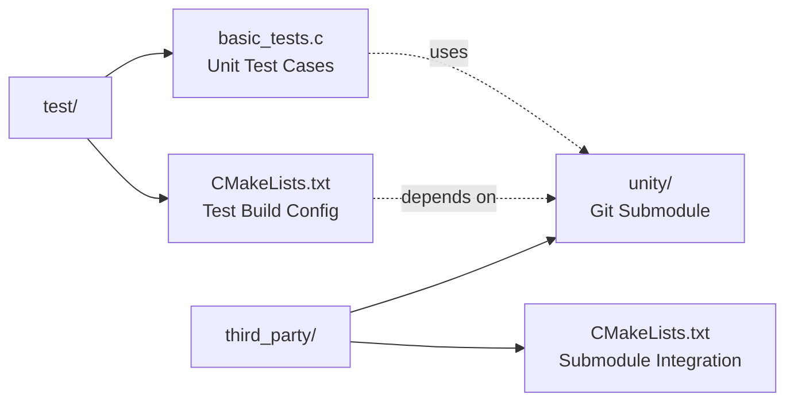
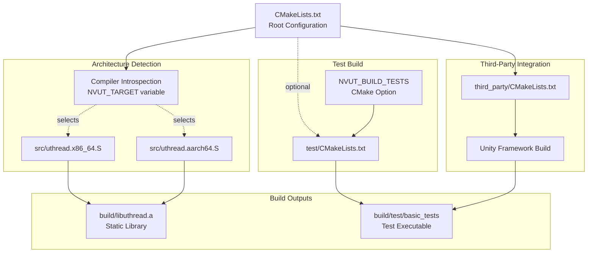
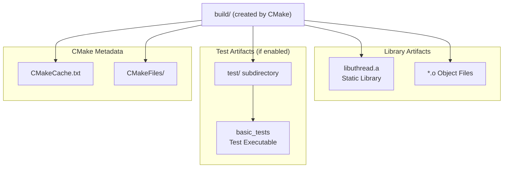
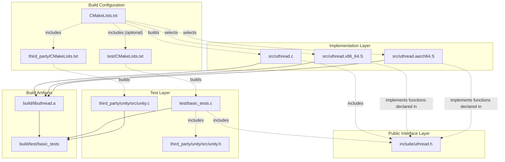

<!-- source: DeepWiki mcp.deepwiki.com · repo NVIDIA/libuthread · page 7.4 Project Structure · fetched 2026-10-26 -->

# Project Structure

<details>
<summary>Relevant source files</summary>

The following files were used as context for generating this wiki page:

- [.gitignore](.gitignore)
- [.gitmodules](.gitmodules)
- [third_party/CMakeLists.txt](third_party/CMakeLists.txt)

</details>


This document describes the physical organization of the libuthread repository, including the directory layout, file purposes, git submodule configuration, and build artifact locations. For information about the build system configuration and architecture detection, see [Build System Architecture](#6.1). For contribution workflow details, see [Contributing Guidelines](#7.1).

---

## Repository Overview

The libuthread repository follows a minimal, flat directory structure optimized for a single-purpose library. The codebase contains approximately 10 source files organized into logical directories by function: public headers in `include/`, implementation in `src/`, tests in `test/`, and third-party dependencies in `third_party/`.

The repository uses git submodules for external dependencies, specifically the Unity test framework. Build artifacts are generated in a `build/` directory that is excluded from version control via [.gitignore:16]().

---

## Directory Hierarchy

```mermaid
graph TB
    ROOT["libuthread/ (root)"]
    
    subgraph "Source Code"
        INCLUDE["include/<br/>Public API Headers"]
        SRC["src/<br/>Core Implementation"]
    end
    
    subgraph "Testing"
        TEST["test/<br/>Unit Tests"]
        THIRD_PARTY["third_party/<br/>External Dependencies"]
    end
    
    subgraph "Build System"
        CMAKE_ROOT["CMakeLists.txt<br/>Root Build Config"]
        CMAKE_TEST["test/CMakeLists.txt<br/>Test Build Config"]
        CMAKE_THIRD["third_party/CMakeLists.txt<br/>Dependency Integration"]
    end
    
    subgraph "Development Tools"
        SBIN["sbin/<br/>Utility Scripts"]
        GITHUB["/.github/workflows/<br/>CI/CD Pipelines"]
    end
    
    subgraph "Configuration"
        GITIGNORE[".gitignore<br/>Ignored Files"]
        GITMODULES[".gitmodules<br/>Submodule Config"]
        CLANGFMT[".clang-format<br/>Code Style"]
    end
    
    subgraph "Documentation"
        README["README.md<br/>Project Overview"]
        CONTRIB["CONTRIBUTING.md<br/>Contributor Guide"]
        SECURITY["SECURITY.md<br/>Security Policy"]
    end
    
    subgraph "Build Artifacts (ignored)"
        BUILD["build/<br/>Generated Binaries"]
    end
    
    ROOT --> INCLUDE
    ROOT --> SRC
    ROOT --> TEST
    ROOT --> THIRD_PARTY
    ROOT --> CMAKE_ROOT
    ROOT --> SBIN
    ROOT --> GITHUB
    ROOT --> GITIGNORE
    ROOT --> GITMODULES
    ROOT --> CLANGFMT
    ROOT --> README
    ROOT --> CONTRIB
    ROOT --> SECURITY
    ROOT --> BUILD
    
    TEST --> CMAKE_TEST
    THIRD_PARTY --> CMAKE_THIRD
```



**Sources:** [.gitignore:16](), [.gitmodules:1-4](), [third_party/CMakeLists.txt:16]()

---

## Source Code Organization

### Public API Directory

| Directory | Purpose | Key Files |
|-----------|---------|-----------|
| `include/` | Public header files exposed to library users | `uthread.h` |

The `include/` directory contains the single public header file `uthread.h` that declares all 8 API functions for thread management. This header is installed to the system include path during library installation and is the only file that client applications need to include.

### Core Implementation Directory

| Directory | Purpose | Key Files |
|-----------|---------|-----------|
| `src/` | Core library implementation | `uthread.c`, `uthread.x86_64.S`, `uthread.aarch64.S` |

The `src/` directory contains the platform-agnostic C implementation (`uthread.c`) and architecture-specific assembly files:
- `uthread.x86_64.S` - x86_64 context switching with 7 saved registers
- `uthread.aarch64.S` - ARM64 context switching with 21 saved registers (including floating-point)

The build system automatically selects the appropriate assembly file based on the target architecture detected via compiler introspection (see [Build System Architecture](#6.1)).

**Sources:** High-level system diagrams (Diagram 1), [third_party/CMakeLists.txt:16]()

---

## Testing Infrastructure

### Test Directory Structure



The `test/` directory contains unit tests implemented using the Unity framework. Test compilation is controlled by the `NVUT_BUILD_TESTS` CMake option and is disabled by default. When enabled, tests are linked against both the libuthread static library and the Unity framework.

The `third_party/` directory houses external dependencies. Currently, it contains only the Unity test framework, integrated as a git submodule at `third_party/unity/`. The [third_party/CMakeLists.txt:16]() file includes Unity's build system via `add_subdirectory(unity)`.

**Sources:** [.gitmodules:1-4](), [third_party/CMakeLists.txt:16]()

---

## Git Submodule Configuration

The repository uses git submodules to manage the Unity test framework dependency. The submodule configuration is defined in [.gitmodules:1-4]():

```
[submodule "third_party/unity"]
    path = third_party/unity
    url = https://github.com/ThrowTheSwitch/Unity.git
```

### Submodule Management

| Command | Purpose |
|---------|---------|
| `git submodule update --init` | Initialize and fetch Unity after cloning |
| `git submodule update --remote` | Update Unity to latest upstream version |

Developers must initialize submodules after cloning the repository to access the Unity framework. The Unity code is not included directly in the libuthread repository, only referenced via the git submodule mechanism.

**Sources:** [.gitmodules:1-4]()

---

## Build System Files



### CMake Configuration Files

| File | Purpose |
|------|---------|
| `CMakeLists.txt` | Root build configuration, architecture detection, library compilation |
| `test/CMakeLists.txt` | Test executable build configuration |
| `third_party/CMakeLists.txt` | Third-party dependency integration via `add_subdirectory(unity)` |

The root `CMakeLists.txt` detects the target architecture by querying the compiler and sets the `NVUT_TARGET` variable to either `x86_64` or `aarch64`. This variable is used to construct the assembly file path: `src/uthread.${NVUT_TARGET}.S`.

**Sources:** [third_party/CMakeLists.txt:16](), High-level system diagrams (Diagram 3)

---

## Development Tools

### Script Directory

| Directory | Purpose | Key Files |
|-----------|---------|-----------|
| `sbin/` | Utility scripts for development | `run-clang-format.sh` |

The `sbin/` directory contains development utility scripts. The `run-clang-format.sh` script applies code formatting rules defined in `.clang-format` to ensure consistent style across the codebase (see [Code Style and Formatting](#7.2)).

### CI/CD Configuration

| Directory | Purpose | Key Files |
|-----------|---------|-----------|
| `.github/workflows/` | GitHub Actions workflow definitions | `tests.yml` |

The `.github/workflows/` directory contains YAML configurations for automated testing. The `tests.yml` workflow builds and tests libuthread on both `ubuntu-24.04` (x86_64) and `ubuntu-24.04-arm` (ARM64) runners to ensure cross-platform compatibility (see [CI/CD Pipeline](#7.3)).

**Sources:** High-level system diagrams (Diagram 6)

---

## Configuration Files

### Version Control Configuration

| File | Purpose |
|------|---------|
| `.gitignore` | Excludes `build/` directory from version control |
| `.gitmodules` | Defines Unity test framework submodule at `third_party/unity` |

The [.gitignore:16]() file specifies that the `build/` directory should not be tracked in git. This directory is created by CMake during the build process and contains all generated artifacts including object files, libraries, and executables.

### Code Style Configuration

| File | Purpose |
|------|---------|
| `.clang-format` | Defines code formatting rules for clang-format |

The `.clang-format` file specifies formatting conventions such as indentation width, brace placement, and line length limits. This file is referenced by `sbin/run-clang-format.sh` to automatically format code according to project standards.

**Sources:** [.gitignore:16](), [.gitmodules:1-4](), High-level system diagrams (Diagram 6)

---

## Build Artifacts and Ignored Files

### Generated Directory Structure



The `build/` directory is automatically created by CMake and contains all compilation outputs:

| Artifact Type | Location | Description |
|---------------|----------|-------------|
| Static library | `build/libuthread.a` | Main library artifact for linking |
| Object files | `build/CMakeFiles/uthread.dir/src/*.o` | Compiled C and assembly objects |
| Test executable | `build/test/basic_tests` | Unit test runner (if `NVUT_BUILD_TESTS=ON`) |
| CMake metadata | `build/CMakeCache.txt`, `build/CMakeFiles/` | Build system internal files |

All contents of the `build/` directory are excluded from version control via [.gitignore:16]().

**Sources:** [.gitignore:16]()

---

## Documentation Files

The repository root contains three primary documentation files:

| File | Purpose |
|------|---------|
| `README.md` | Project overview, build instructions, usage examples |
| `CONTRIBUTING.md` | Contribution guidelines, PR workflow, DCO requirements |
| `SECURITY.md` | Security vulnerability reporting process (NVIDIA PSIRT) |
| `LICENSE` | Apache License 2.0 full text |

These files provide essential information for users and contributors. The `README.md` serves as the entry point for new users, while `CONTRIBUTING.md` outlines the development workflow including commit sign-off requirements (`git commit -s`) and code formatting expectations.

**Sources:** High-level system diagrams (Diagram 6)

---

## File Dependency Map



This diagram illustrates the compilation dependencies between source files, headers, build configurations, and final artifacts. The assembly files (`uthread.x86_64.S` and `uthread.aarch64.S`) are mutually exclusive—only one is compiled based on the detected architecture. Test builds depend on both the main library and the Unity framework.

**Sources:** [third_party/CMakeLists.txt:16](), High-level system diagrams (Diagrams 1, 3)

---

