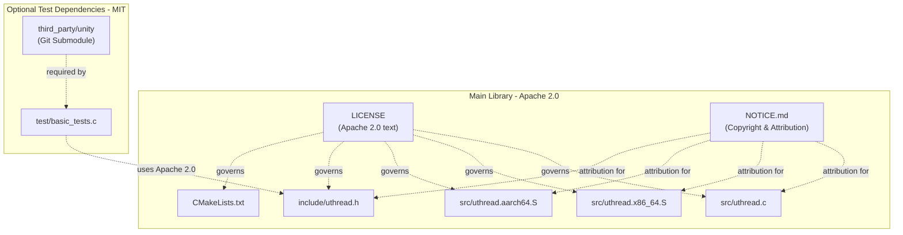
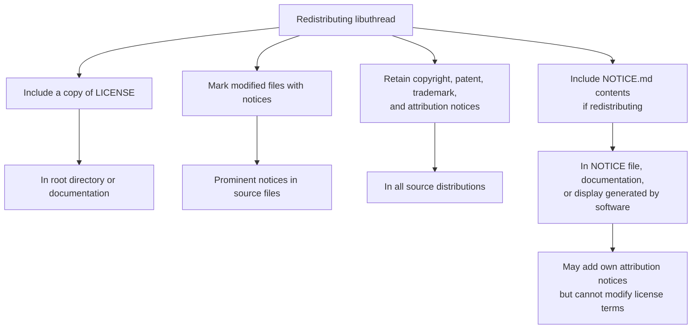
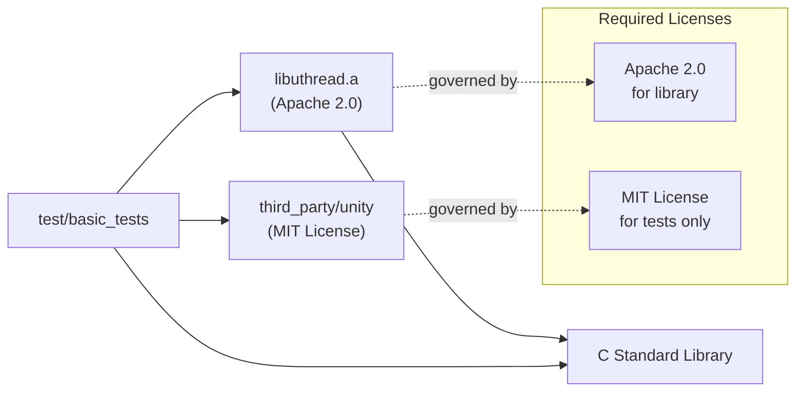
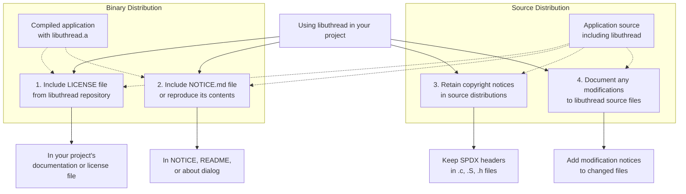

<!-- source: DeepWiki mcp.deepwiki.com · repo NVIDIA/libuthread · page 8.1 License · fetched 2026-10-26 -->

# License

<details>
<summary>Relevant source files</summary>

The following files were used as context for generating this wiki page:

- [LICENSE](LICENSE)
- [NOTICE.md](NOTICE.md)

</details>


## Purpose and Scope

This page describes the licensing terms for libuthread and its third-party dependencies. The main library is distributed under the Apache License 2.0, while the optional Unity test framework uses the MIT License. This document explains the legal requirements for using, modifying, and redistributing libuthread in your projects.

For information about reporting security vulnerabilities, see [Security Policy](#8.2). For contribution requirements including code sign-off, see [Contributing Guidelines](#7.1).

---

## License Overview



**Sources:** [LICENSE:1-203](), [NOTICE.md:1-55]()

---

## Main Library License: Apache 2.0

The libuthread library is licensed under the **Apache License, Version 2.0** (January 2004). The complete license text is available at [LICENSE:1-203]().

### Copyright Information

**Copyright holder:** NVIDIA CORPORATION & AFFILIATES  
**Copyright year:** 2025  
**SPDX License Identifier:** `Apache-2.0`

This copyright notice appears in all source files using the SPDX format, as seen in [NOTICE.md:2-3]():

```
SPDX-FileCopyrightText: Copyright (c) 2025 NVIDIA CORPORATION & AFFILIATES. All rights reserved.
SPDX-License-Identifier: Apache-2.0
```

**Sources:** [NOTICE.md:2-3](), [NOTICE.md:18-19]()

### Key License Terms

The Apache License 2.0 provides the following permissions and conditions:

| Permission/Condition | Description | License Reference |
|---------------------|-------------|-------------------|
| **Copyright License** | Perpetual, worldwide, non-exclusive, no-charge, royalty-free, irrevocable license to reproduce, prepare derivative works, publicly display, perform, sublicense, and distribute | [LICENSE:67-72]() |
| **Patent License** | Perpetual, worldwide, non-exclusive, no-charge, royalty-free, irrevocable patent license for use, sale, and transfer (with termination clause for patent litigation) | [LICENSE:74-88]() |
| **Redistribution** | Permitted in source or object form with modifications, subject to specific conditions | [LICENSE:90-93]() |
| **Warranty Disclaimer** | Software provided "AS IS" without warranties of any kind | [LICENSE:144-152]() |
| **Liability Limitation** | No liability for damages arising from use or inability to use | [LICENSE:154-164]() |

**Sources:** [LICENSE:67-88](), [LICENSE:90-93](), [LICENSE:144-164]()

### Redistribution Requirements

When redistributing libuthread (in source or binary form), you must comply with the following conditions from [LICENSE:90-129]():



**Specific requirements:**

1. **License inclusion**: Provide recipients with a copy of the Apache License 2.0 ([LICENSE:95-96]())
2. **Modification notices**: Modified files must carry prominent notices stating the changes ([LICENSE:98-99]())
3. **Copyright retention**: Retain all copyright, patent, trademark, and attribution notices from the source ([LICENSE:101-105]())
4. **NOTICE file**: If present, include a readable copy in at least one of: a NOTICE text file, source documentation, or generated display ([LICENSE:107-122]())

**Sources:** [LICENSE:90-129]()

---

## Third-Party Dependencies

### Unity Test Framework (MIT License)

The optional unit test suite requires the Unity test framework, included as a git submodule in `third_party/unity`. This dependency is **only required when building tests** (controlled by the `NVUT_BUILD_TESTS` CMake option).

**License:** MIT License  
**Authors:** Mike Karlesky, Mark VanderVoord, and Greg Williams  
**Copyright:** 2007-2025  
**Repository:** [https://github.com/ThrowTheSwitch/Unity](https://github.com/ThrowTheSwitch/Unity)

The complete MIT License text for Unity is reproduced in [NOTICE.md:31-53]():



**Key points from [NOTICE.md:23-27]():**

- The **libuthread library itself** only depends on the C standard library
- Unity is **not required** for library functionality
- Unity is **only needed** when building and running unit tests
- The MIT License is more permissive than Apache 2.0 and fully compatible

**Sources:** [NOTICE.md:23-54]()

### MIT License Summary

The MIT License permits:
- Commercial use, modification, distribution, and private use
- No attribution required beyond copyright notice and license text
- No warranty provided ("AS IS" basis)

Unlike Apache 2.0, the MIT License does not include explicit patent grants or trademark restrictions.

**Sources:** [NOTICE.md:31-53]()

---

## Dependency Summary Table

| Component | License | Required For | Dependencies |
|-----------|---------|--------------|--------------|
| `src/uthread.c` | Apache 2.0 | Library core | C standard library |
| `src/uthread.x86_64.S` | Apache 2.0 | x86_64 builds | None |
| `src/uthread.aarch64.S` | Apache 2.0 | ARM64 builds | None |
| `include/uthread.h` | Apache 2.0 | Public API | None |
| `third_party/unity` | MIT | Unit tests only | C standard library |
| `test/basic_tests.c` | Apache 2.0 | Unit tests only | libuthread + Unity |

**Sources:** [NOTICE.md:23-27](), [NOTICE.md:29-54]()

---

## License Compliance for Users

### Using libuthread in Your Project

When incorporating libuthread into your application, you must:



**Sources:** [LICENSE:90-129](), [NOTICE.md:1-19]()

### Attribution Requirements

The minimum required attribution text (from [NOTICE.md:18-19]()):

```
libuthread includes software developed at NVIDIA CORPORATION (https://www.nvidia.com).

Copyright (c) 2025 NVIDIA CORPORATION & AFFILIATES. All rights reserved.
Licensed under the Apache License, Version 2.0.
```

If building with unit tests, also include the Unity MIT license attribution from [NOTICE.md:31-53]().

**Sources:** [NOTICE.md:18-19](), [NOTICE.md:29-54]()

### Derivative Works

If you create derivative works (modifications or extensions of libuthread):

1. **You may** apply your own copyright to your modifications ([LICENSE:124-129]())
2. **You may** provide additional or different license terms for your modifications
3. **You must** ensure your use of the original work complies with Apache 2.0 terms
4. **You must** not remove or modify existing copyright notices ([LICENSE:101-105]())
5. **You must** mark modified files with prominent change notices ([LICENSE:98-99]())

**Sources:** [LICENSE:98-105](), [LICENSE:124-129]()

---

## File-Level License Headers

All source files in libuthread use SPDX identifiers for license tracking. The standard header format (as seen in [NOTICE.md:2-15]()):

```
SPDX-FileCopyrightText: Copyright (c) 2025 NVIDIA CORPORATION & AFFILIATES. All rights reserved.
SPDX-License-Identifier: Apache-2.0

Licensed under the Apache License, Version 2.0 (the "License");
you may not use this file except in compliance with the License.
You may obtain a copy of the License at

http://www.apache.org/licenses/LICENSE-2.0

Unless required by applicable law or agreed to in writing, software
distributed under the License is distributed on an "AS IS" BASIS,
WITHOUT WARRANTIES OR CONDITIONS OF ANY KIND, either express or implied.
See the License for the specific language governing permissions and
limitations under the License.
```

This header appears in:
- `src/uthread.c`
- `src/uthread.x86_64.S`
- `src/uthread.aarch64.S`
- `include/uthread.h`
- `CMakeLists.txt`
- `test/basic_tests.c`
- Documentation files (`NOTICE.md`, `README.md`, etc.)

**Sources:** [NOTICE.md:1-16]()

---

## Trademark Notice

Per [LICENSE:139-142](), the Apache License 2.0 does not grant permission to use:
- Trade names
- Trademarks
- Service marks
- Product names of NVIDIA CORPORATION

Exception: Reasonable and customary use when describing the origin of libuthread or reproducing the NOTICE file is permitted.

**Sources:** [LICENSE:139-142]()

---

## Patent Grant and Termination

The Apache License 2.0 includes an explicit patent grant from contributors ([LICENSE:74-88]()):

- **Grant**: Each contributor grants a perpetual, worldwide, royalty-free patent license for patents necessarily infringed by their contributions
- **Scope**: Applies only to patent claims that would be infringed by the contribution alone or in combination with the work
- **Termination**: If you initiate patent litigation alleging that libuthread constitutes patent infringement, your patent licenses terminate on the date litigation is filed

This patent grant is a key differentiator from permissive licenses like MIT.

**Sources:** [LICENSE:74-88]()

---

## Contribution Licensing

All contributions submitted to libuthread are made under the Apache License 2.0 terms ([LICENSE:131-137]()):

- Contributions are submitted under Apache 2.0 unless explicitly stated otherwise
- Contributors must sign off on commits (Developer Certificate of Origin - see [Contributing Guidelines](#7.1))
- The license cannot be modified by separate contributor agreements
- Contributors provide the same patent grant as described above

**Sources:** [LICENSE:131-137]()

---

## License Compatibility

| Scenario | Compatible? | Notes |
|----------|-------------|-------|
| Link with MIT-licensed code | ✓ Yes | MIT is permissive; no conflicts |
| Link with BSD-licensed code | ✓ Yes | BSD is permissive; no conflicts |
| Link with GPL v3 code | ✓ Yes | Apache 2.0 is GPLv3-compatible |
| Link with GPL v2 code | ✗ No | Apache 2.0 is not GPLv2-compatible |
| Use in proprietary software | ✓ Yes | Apache 2.0 allows proprietary use |
| Sublicense under different terms | Partial | Can sublicense modifications, but must retain Apache 2.0 for original work |

Note: License compatibility is complex. Consult legal counsel for specific use cases.

**Sources:** [LICENSE:67-72](), [LICENSE:90-129]()

---

## Full License Text Locations

| License | File Path | Lines |
|---------|-----------|-------|
| Apache License 2.0 (full text) | `LICENSE` | [LICENSE:1-203]() |
| Apache 2.0 (boilerplate header) | `NOTICE.md` | [NOTICE.md:5-15]() |
| MIT License (Unity framework) | `NOTICE.md` | [NOTICE.md:31-53]() |
| MIT License (upstream Unity) | `third_party/unity/LICENSE.txt` | External file |

**Sources:** [LICENSE:1-203](), [NOTICE.md:1-55]()

---

