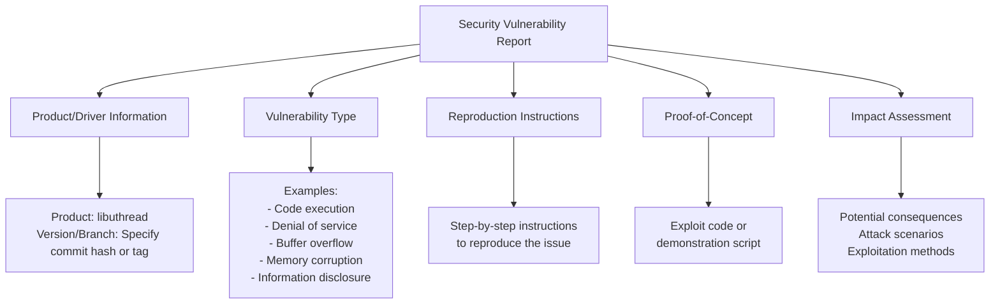
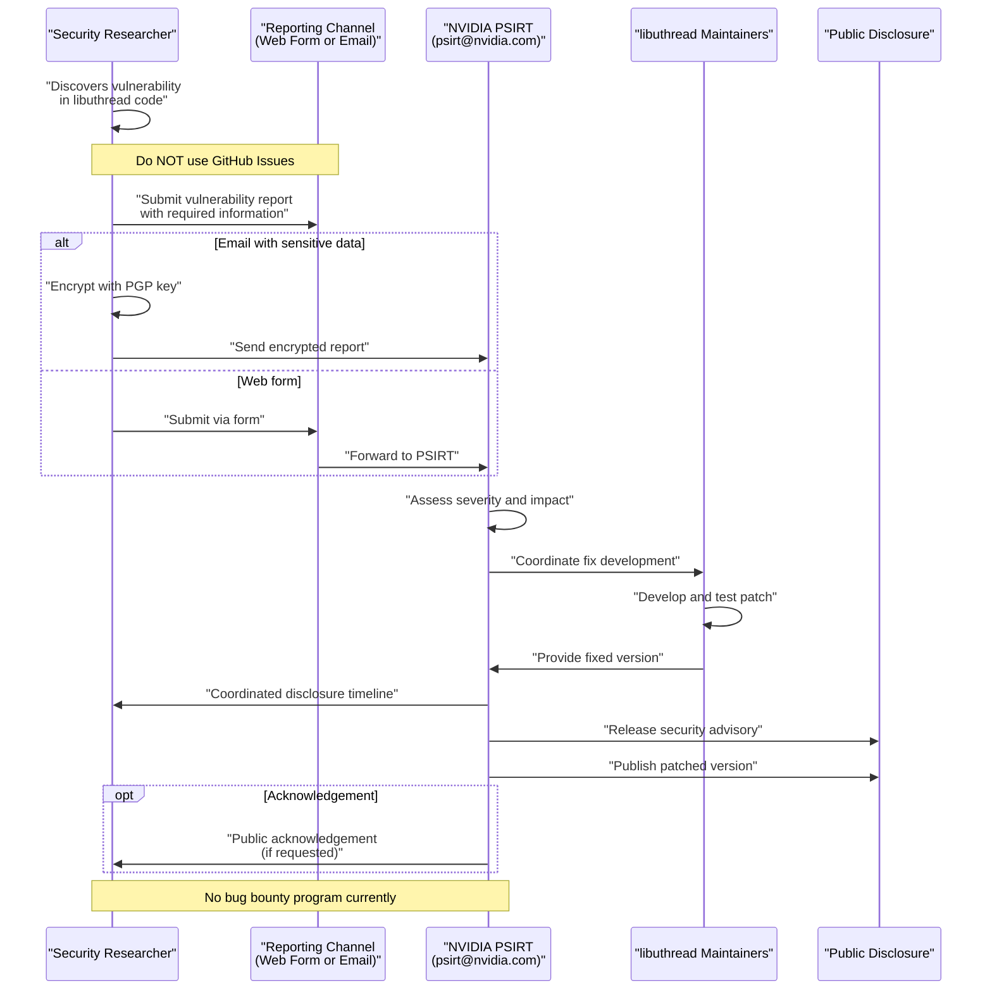
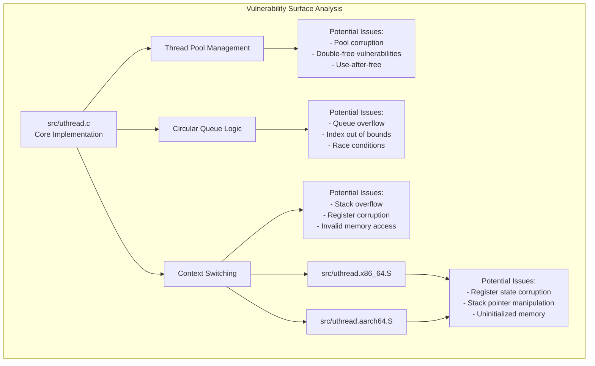

<!-- source: DeepWiki mcp.deepwiki.com · repo NVIDIA/libuthread · page 8.2 Security Policy · fetched 2026-10-26 -->

# Security Policy

Relevant source files

The following files were used as context for generating this wiki page:

- [SECURITY.md](SECURITY.md)

## Purpose and Scope

This document describes the security vulnerability reporting process for the libuthread project. It covers the proper channels for reporting potential security issues, required information for vulnerability submissions, and NVIDIA's coordinated disclosure policy. This policy applies to all code in the libuthread repository, including core implementation files, architecture-specific assembly routines, and the build system.

For information about the project's open source license terms, see [License](#8.1).

---

## Security Commitment

NVIDIA is dedicated to the security and trust of all software products and services, including all source code repositories managed through the organization. The libuthread project follows NVIDIA's standard Product Security Incident Response Team (PSIRT) policies and procedures for handling security vulnerabilities.

**Important**: Security vulnerabilities must not be reported through public GitHub issues or pull requests. If a potential security issue is inadvertently reported via a public channel, NVIDIA maintainers will limit public discussion and redirect the reporter to appropriate private disclosure channels.

Sources: [SECURITY.md:1-5]()

---

## Reporting Security Vulnerabilities

### Contact Channels

Security vulnerabilities in libuthread should be reported through NVIDIA's official security channels. Two primary methods are available:

| Channel | Details | Use Case |
|---------|---------|----------|
| **Web Form** | [Security Vulnerability Submission Form](https://www.nvidia.com/object/submit-security-vulnerability.html) | Standard reporting method for most users |
| **Email** | psirt@nvidia.com | Direct contact, supports PGP encryption for sensitive information |

### Secure Communication via PGP

For sensitive vulnerability information, NVIDIA provides a public PGP key for encrypted email communication:

- **PGP Key Location**: [NVIDIA Public PGP Key](https://www.nvidia.com/en-us/security/pgp-key)
- **Recommended for**: Proof-of-concept exploit code, detailed technical analysis, or any information that could enable exploitation before a fix is available

Sources: [SECURITY.md:7-12]()

---

## Required Vulnerability Information

When reporting a security vulnerability in libuthread, include the following information to facilitate efficient assessment and remediation:

**Vulnerability Reporting Checklist**

The following table summarizes the required information for comprehensive vulnerability reports:

| Component | Description | Example for libuthread |
|-----------|-------------|------------------------|
| **Product/Driver Name** | Identify the affected product | `libuthread` |
| **Version/Branch** | Specific version or branch containing the vulnerability | Git commit hash, tag (e.g., `v1.0.0`), or branch name (e.g., `main`) |
| **Vulnerability Type** | Classification of the security issue | Buffer overflow in [src/uthread.c](), use-after-free, integer overflow, etc. |
| **Reproduction Steps** | Detailed instructions to trigger the vulnerability | Step-by-step process with specific function calls, thread configurations, etc. |
| **Proof-of-Concept** | Code or script demonstrating the vulnerability | C program using libuthread API that triggers the issue |
| **Impact Analysis** | Potential consequences and exploitation methods | Memory corruption leading to code execution, DoS via crash, etc. |

Sources: [SECURITY.md:13-18]()

---

## Vulnerability Disclosure Process

The following diagram illustrates the complete workflow for security vulnerability reporting and handling:

### Coordinated Disclosure Policy

NVIDIA follows a coordinated vulnerability disclosure policy:

1. **Private Reporting**: Vulnerabilities are initially reported privately through designated channels
2. **Assessment**: NVIDIA PSIRT evaluates the severity and impact of the reported issue
3. **Fix Development**: Maintainers develop and test patches in coordination with PSIRT
4. **Coordinated Release**: Fixes are released publicly with appropriate security advisories
5. **Acknowledgement**: Researchers who report vulnerabilities may receive public acknowledgement (upon request)

**Note**: NVIDIA does not currently operate a bug bounty program. However, externally reported security issues that are addressed receive acknowledgement under the coordinated disclosure policy.

Sources: [SECURITY.md:20-20]()

---

## Context-Specific Vulnerability Considerations

Given libuthread's architecture and implementation, security researchers should consider the following potential vulnerability surfaces:

### Core Implementation Security Surface

### Areas of Security Focus

| Component | File Path | Security Considerations |
|-----------|-----------|-------------------------|
| **Thread Pool Allocation** | [src/uthread.c]() | Memory management, allocation failures, pool exhaustion |
| **Queue Operations** | [src/uthread.c]() | Circular buffer logic, index bounds checking, concurrent access |
| **Context Switch (x86_64)** | [src/uthread.x86_64.S]() | Register save/restore, stack pointer manipulation, 7 saved registers |
| **Context Switch (ARM64)** | [src/uthread.aarch64.S]() | Register save/restore, FP register handling, 21 saved registers |
| **API Entry Points** | [include/uthread.h]() | Input validation, error handling, state consistency |
| **Build System** | [CMakeLists.txt]() | Compiler flags, architecture detection, linking security |

Sources: [SECURITY.md:7-18](), Inferred from architecture diagrams

---

## Additional Security Resources

### NVIDIA Product Security Portal

For comprehensive information about NVIDIA's security practices and policies, visit:

**Primary Resource**: https://www.nvidia.com/en-us/security

This portal provides:
- Current security advisories
- Product security policies
- Vulnerability disclosure timelines
- Security bulletins for NVIDIA products

### PSIRT Policies

Detailed information about NVIDIA's Product Security Incident Response Team policies is available at:

**PSIRT Policies**: https://www.nvidia.com/en-us/security/psirt-policies/

This resource covers:
- Coordinated vulnerability disclosure procedures
- Response timelines and SLAs
- Acknowledgement and attribution policies
- Communication protocols

Sources: [SECURITY.md:22-24]()

---

## Summary

The libuthread security policy ensures responsible disclosure and handling of security vulnerabilities:

1. **Report Privately**: Use the web form or email (psirt@nvidia.com), never GitHub issues
2. **Provide Details**: Include product version, vulnerability type, reproduction steps, POC, and impact analysis
3. **Use Encryption**: For sensitive information, encrypt emails with NVIDIA's PGP key
4. **Coordinated Disclosure**: NVIDIA PSIRT coordinates fixes and public disclosure
5. **Acknowledgement**: Reporters receive recognition for valid security findings

By following these procedures, security researchers help maintain the integrity and trustworthiness of the libuthread project while ensuring vulnerabilities are addressed responsibly.

Sources: [SECURITY.md:1-24]()