# Page: Home

# Home

<details>
<summary>Relevant source files</summary>

The following files were used as context for generating this wiki page:

- [NOTICE.md](NOTICE.md)
- [README.md](README.md)

</details>


This page introduces `libuthread`, a minimalist user-level threading library for ARM64 and x86 Linux systems. It explains the fundamental problem the library solves (memory latency hiding), how it accomplishes this through cooperative multitasking, and provides an architectural overview of the system components.

For detailed build instructions, see [Getting Started](#2). For a deep dive into how context switching works, see [Architecture and Implementation](#5). For API documentation, see [API Reference](#4).

## Overview

`libuthread` is a user-level threading library that provides software-controlled thread management and context switching to alleviate low CPU utilization caused by memory access latencies. The library enables individual operating system threads to execute multiple largely independent command sequences in a pseudo-parallel manner, switching between them at points where memory stalls are expected.

The library is implemented in C with architecture-specific assembly code for context switching. It compiles to a static library (`libuthread.a`) and exposes eight public functions through [include/uthread.h:1-100]().

**Key Characteristics:**
- User-level threads managed entirely in user space
- Cooperative scheduling via explicit `this_uthread_yield()` calls
- Minimal context switching overhead (no kernel involvement)
- Architecture-specific implementations for x86_64 and aarch64
- Thread pool and circular queue for efficient memory management

**Sources:** [README.md:1-91]()

## Problem Statement: Memory Latency

Modern processors experience significant performance degradation when accessing data not present in cache. When a cache miss occurs, the CPU stalls while waiting for data to be fetched from main memory—a delay that can span hundreds of CPU cycles. Traditional approaches leave the CPU idle during these stalls, resulting in poor utilization.

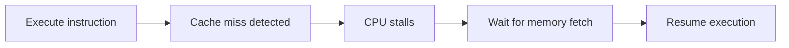

The problem is particularly acute for memory-intensive workloads where:
- Data access patterns are irregular
- Working sets exceed cache capacity
- Memory bandwidth is the bottleneck

`libuthread` addresses this by enabling productive work during these memory fetch periods rather than leaving the CPU idle.

**Sources:** [README.md:20-26]()

## Solution Overview: User-Level Threading

`libuthread` solves the memory latency problem by allowing a single OS thread to manage multiple execution contexts (user-level threads or "uthreads"). When a uthread anticipates a cache miss, it issues a prefetch operation and immediately yields control via `this_uthread_yield()`. The library then switches to another uthread, effectively hiding the memory latency behind useful computation.

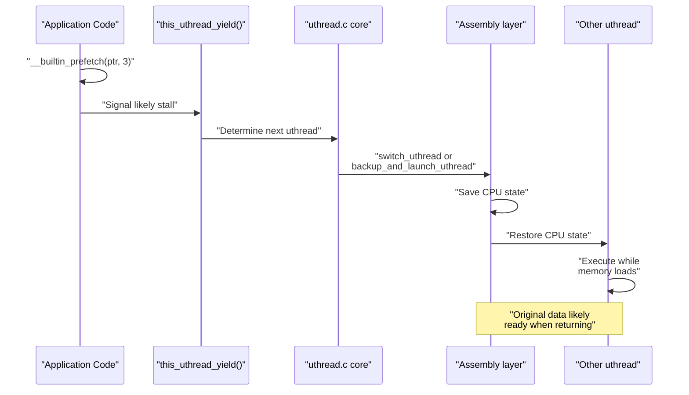

This approach differs from OS-level threading because:
- **No kernel involvement:** Context switches happen entirely in user space via assembly code
- **Cooperative scheduling:** Threads explicitly yield rather than being preempted
- **Low overhead:** Only essential CPU registers are saved/restored
- **Single OS thread:** All uthreads execute within one OS thread context

The cooperative model means applications must explicitly place yield points, typically after prefetch operations. This gives the application fine-grained control over when context switches occur.

**Sources:** [README.md:22-26]()

## Core Components

The library consists of four main layers that work together to provide user-level threading:

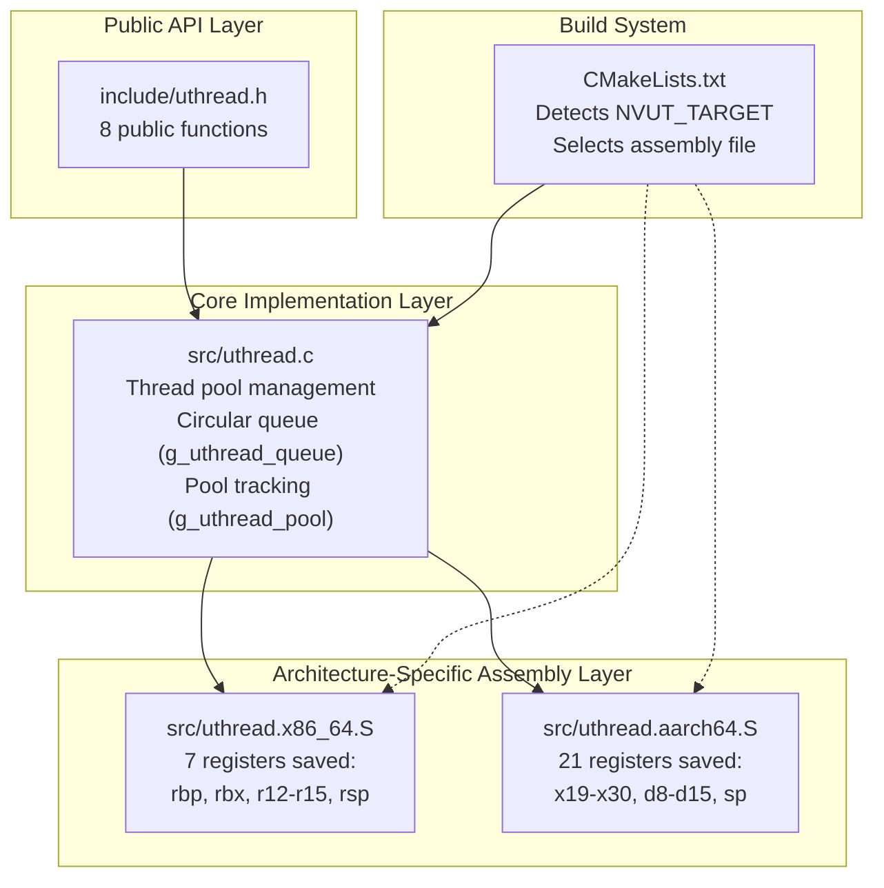

### Public API Layer

[include/uthread.h:1-100]() defines the public interface with eight functions organized into three categories:

| Function | Purpose | Category |
|----------|---------|----------|
| `preallocate_uthreads()` | Pre-allocate thread pool | Resource Management |
| `free_unused_uthreads()` | Release unused threads | Resource Management |
| `uthread_pool_size()` | Query pool capacity | Resource Management |
| `create_uthread()` | Enqueue new thread | Thread Lifecycle |
| `uthread_queue_size()` | Query active threads | Thread Lifecycle |
| `this_uthread_yield()` | Cooperative yield | Execution Control |
| `this_uthread_id()` | Get current thread ID | Execution Control |
| `this_uthread_run_count()` | Get execution count | Execution Control |

### Core Implementation

[src/uthread.c:1-500]() implements thread management using two primary data structures:

- **Thread Pool (`g_uthread_pool`)**: Array of pre-allocated `struct uthread_info` structures for reuse
- **Thread Queue (`g_uthread_queue`)**: Circular queue of active uthreads waiting to execute

The core manages thread state transitions, queue operations, and delegates context switching to the assembly layer.

### Assembly Layer

Architecture-specific assembly files implement low-level context switching:

- **x86_64 ([src/uthread.x86_64.S:1-200]())**: Saves 7 callee-saved registers (rbp, rbx, r12-r15, rsp)
- **aarch64 ([src/uthread.aarch64.S:1-300]())**: Saves 21 registers including floating-point (x19-x30, d8-d15, sp)

Both implementations provide functions like `launch_first_uthread`, `backup_and_launch_uthread`, `switch_uthread`, and `restore_main_thread`.

**Sources:** [README.md:1-91](), Diagram 1 from high-level systems overview

## Execution Model

The library operates through a cooperative scheduling model with explicit yield points:

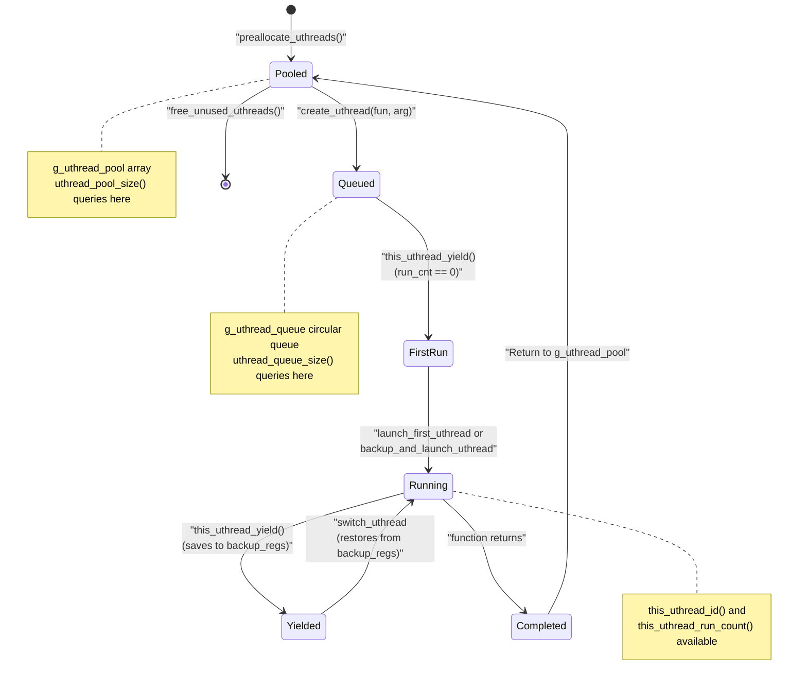

### Thread States

1. **Pooled**: Thread structure exists in `g_uthread_pool` but is not assigned work
2. **Queued**: Thread assigned a function and arguments, waiting in `g_uthread_queue`
3. **FirstRun**: Special state for threads that have never executed (`run_cnt == 0`)
4. **Running**: Thread actively executing its assigned function
5. **Yielded**: Thread suspended with CPU state saved in `backup_regs`
6. **Completed**: Thread function returned, structure returns to pool

### Context Switch Functions

The assembly layer provides four main context switch primitives:

- **`launch_first_uthread`**: Initial transition from main thread to first uthread
- **`backup_and_launch_uthread`**: Launch a new uthread for the first time (saves current state to `backup_regs`)
- **`switch_uthread`**: Switch between already-running uthreads (swap `backup_regs`)
- **`restore_main_thread`**: Return control to main application thread

These functions are called from [src/uthread.c:1-500]() based on thread state and queue conditions.

**Sources:** [README.md:22-26](), Diagram 2 and Diagram 4 from high-level systems overview

## Typical Usage Pattern

A typical application using `libuthread` follows this pattern:

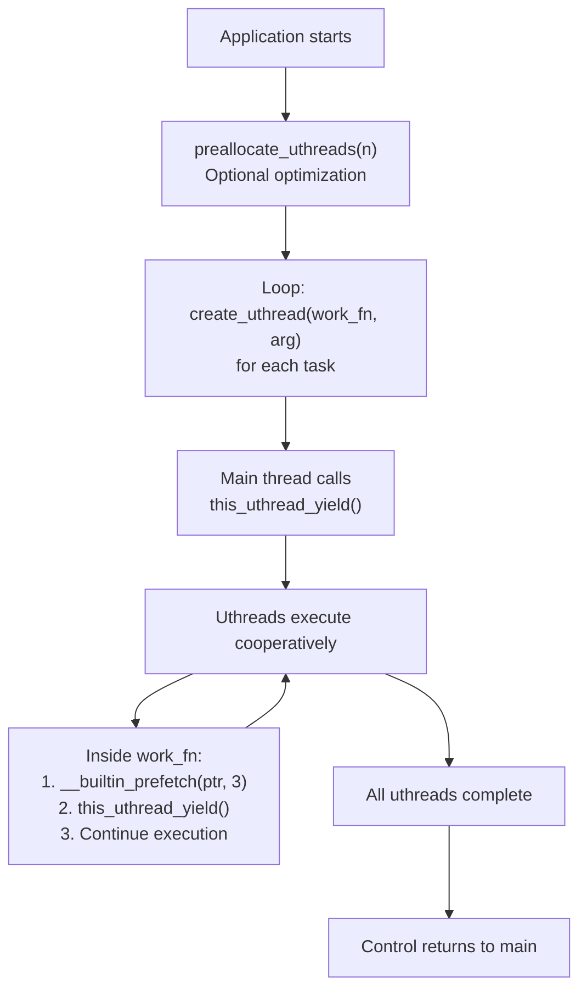

The key insight is that memory prefetch operations (`__builtin_prefetch(ptr, 3)`) followed immediately by `this_uthread_yield()` allow other uthreads to execute while the prefetched data loads into cache. By the time control returns to the original uthread, the data is typically ready, effectively hiding the memory latency.

**Sources:** [README.md:22-24]()

## Supported Platforms

`libuthread` supports two processor architectures on Linux systems:

| Architecture | Assembly File | Saved Registers | Notes |
|--------------|---------------|-----------------|-------|
| x86_64 | [src/uthread.x86_64.S:1-200]() | 7 (rbp, rbx, r12-r15, rsp) | Callee-saved per System V ABI |
| aarch64 (ARM64) | [src/uthread.aarch64.S:1-300]() | 21 (x19-x30, d8-d15, sp) | Includes floating-point registers |

The build system automatically detects the target architecture through [CMakeLists.txt:1-100]() by querying the compiler with flags like `-print-target-triple` (Clang) or `-print-multiarch` (GCC). The detected architecture is stored in the `NVUT_TARGET` variable and used to select the appropriate assembly file: `uthread.${NVUT_TARGET}.S`.

**Supported Compilers:**
- GCC
- Clang

**Operating Systems:**
- Linux (Ubuntu, Debian, and compatible distributions)

**Sources:** [README.md:29-66](), Diagram 3 from high-level systems overview

## Build Artifacts

The library compiles to a static library:

```
build/libuthread.a
```

This static library can be linked into any application requiring user-level threading capabilities. When tests are enabled (`-DNVUT_BUILD_TESTS=ON`), an additional test executable is built:

```
build/test/basic_tests
```

The test suite uses the Unity testing framework from [third_party/unity:1-100](), linked as a git submodule.

**Sources:** [README.md:46-66]()

## Project Status

The project is **actively maintained** by NVIDIA. It is distributed under the Apache License 2.0, with the Unity testing framework (if used) distributed under the MIT License.

**Sources:** [README.md:69-90](), [NOTICE.md:1-55]()

## Next Steps

To get started with `libuthread`:

- **Building the library:** See [Getting Started](#2) for compilation instructions with different compilers
- **Understanding concepts:** See [Core Concepts](#3) for detailed explanations of memory latency hiding and the threading model
- **Using the API:** See [API Reference](#4) for complete function documentation
- **Understanding implementation:** See [Architecture and Implementation](#5) for deep dives into context switching and assembly code
- **Contributing:** See [Development Guide](#7) for contribution guidelines and code style requirements

---

**Sources:** [README.md:1-91](), [NOTICE.md:1-55]()

---

# Page: Getting Started

# Getting Started

<details>
<summary>Relevant source files</summary>

The following files were used as context for generating this wiki page:

- [CMakeLists.txt](CMakeLists.txt)
- [README.md](README.md)

</details>


This guide provides instructions for building `libuthread` and running your first example. It covers system requirements, building the static library, and verifying the installation. For detailed build configuration options and platform-specific considerations, see [Building the Library](#2.1). For usage patterns and code examples, see [Basic Usage Example](#2.2).

## Overview

The `libuthread` library is distributed as source code and must be compiled on the target platform. The build process uses CMake to automatically detect the target architecture (x86_64 or aarch64) and compile the appropriate assembly implementation. The output is a static library file `libuthread.a` that can be linked into applications.

**Build Requirements:**
- Linux operating system (ARM64 or x86_64)
- CMake 3.13 or later
- C compiler (GCC or Clang)
- Git (for cloning the repository)
- Make

Sources: [README.md:29-66]()

## Quick Start

### Step 1: Install Build Dependencies

For Debian/Ubuntu systems with GCC:

```bash
sudo apt-get update
sudo apt-get install -y make cmake gcc
export CC="gcc"
```

For Debian/Ubuntu systems with Clang:

```bash
sudo apt-get update
sudo apt-get install -y make cmake clang
export CC="clang"
```

The `CC` environment variable specifies which compiler CMake will use. The choice between GCC and Clang does not affect functionality; both compilers are supported.

Sources: [README.md:32-44]()

### Step 2: Clone the Repository

```bash
git clone https://github.com/NVIDIA/libuthread.git
cd libuthread
```

If you plan to build and run tests, initialize the Unity test framework submodule:

```bash
git submodule update --init --recursive
```

The Unity framework is located in `third_party/unity` and is only required if `NVUT_BUILD_TESTS=ON`.

Sources: [README.md:48-59]()

### Step 3: Build the Library

Create a build directory and invoke CMake:

```bash
mkdir -p build
cd build
cmake -DCMAKE_BUILD_TYPE=Release -DNVUT_BUILD_TESTS=OFF ..
make -j
```

This produces `libuthread.a` in the build directory. The `-DNVUT_BUILD_TESTS=OFF` flag disables test compilation for faster builds.

**Build Process Diagram:**

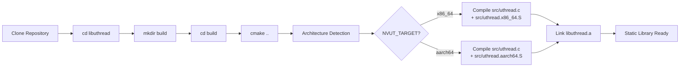

Sources: [README.md:46-54](), [CMakeLists.txt:16-43]()

## Architecture Detection

CMake automatically detects the target architecture by querying the compiler. The detection logic differs based on compiler type:

| Compiler | Detection Command | Output Format |
|----------|------------------|---------------|
| Clang | `clang -print-target-triple` | `x86_64-pc-linux-gnu` or `aarch64-unknown-linux-gnu` |
| GCC | `gcc -print-multiarch` | `x86_64-linux-gnu` or `aarch64-linux-gnu` |

The CMake script extracts the architecture prefix from this output and stores it in the `NVUT_TARGET` variable, which determines which assembly file to compile.

**Architecture Selection Logic:**

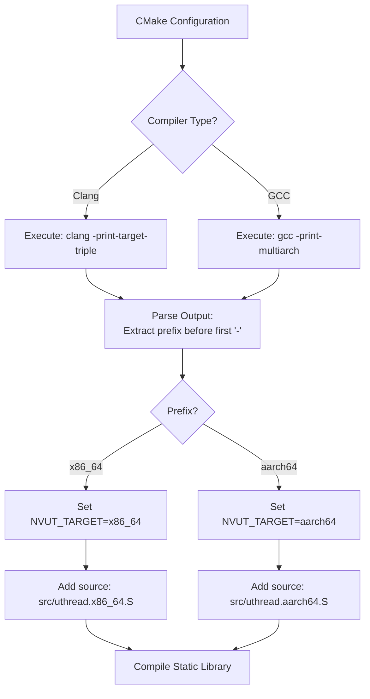

Sources: [CMakeLists.txt:22-34]()

## Build Output Structure

After a successful build, the directory structure looks like this:

```
libuthread/
├── build/
│   ├── libuthread.a              # Static library output
│   ├── CMakeCache.txt            # CMake configuration cache
│   └── CMakeFiles/               # Build system internals
├── include/
│   └── uthread.h                 # Public API header
├── src/
│   ├── uthread.c                 # Core implementation
│   ├── uthread.x86_64.S          # x86_64 assembly
│   └── uthread.aarch64.S         # ARM64 assembly
└── CMakeLists.txt                # Build configuration
```

The key output file is `build/libuthread.a`, which contains compiled code from:
- [src/uthread.c]() - Thread pool management and queue logic
- [src/uthread.x86_64.S]() or [src/uthread.aarch64.S]() - Context switching routines

Sources: [CMakeLists.txt:39-43]()

## Verification

### Option 1: Build and Run Tests

To verify the build with included unit tests:

```bash
cd libuthread
mkdir -p build
cd build
cmake -DCMAKE_BUILD_TYPE=Release -DNVUT_BUILD_TESTS=ON ..
make -j
test/basic_tests
```

The test executable runs validation tests for thread creation, yielding, and context switching. Successful output indicates the library is functioning correctly.

**Test Build Dependencies:**

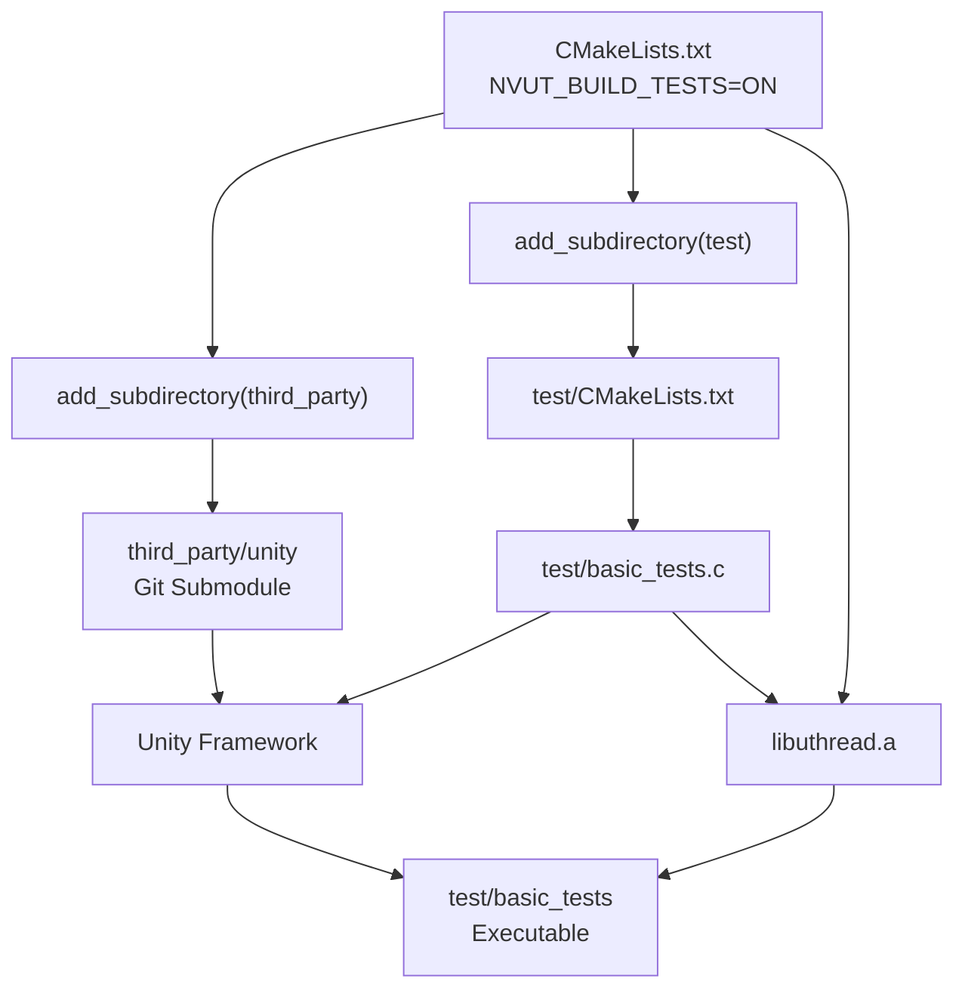

Sources: [README.md:56-66](), [CMakeLists.txt:45-48]()

### Option 2: Integrate into Application

To use `libuthread` in your own application:

1. Include the header: `#include <uthread.h>`
2. Link against the static library: `gcc myapp.c -Ilibuthread/include -Llibuthread/build -luthread -o myapp`
3. Call `create_uthread()` to enqueue work and `this_uthread_yield()` to enable context switching

A minimal integration looks like:

```c
#include <uthread.h>

void worker(void* arg) {
    // Your work here
    this_uthread_yield();
}

int main() {
    preallocate_uthreads(10);
    create_uthread(worker, NULL);
    this_uthread_yield();  // Start execution
    return 0;
}
```

For complete examples with memory latency hiding patterns, see [Basic Usage Example](#2.2).

Sources: [README.md:18-27]()

## Configuration Options

The build system provides the following CMake options:

| Option | Default | Description |
|--------|---------|-------------|
| `NVUT_BUILD_TESTS` | `ON` | Enable compilation of test suite |
| `CMAKE_BUILD_TYPE` | Debug | Build configuration (Debug/Release/RelWithDebInfo) |

Additional compiler flags are set in [CMakeLists.txt:20]():
- `-Wall` - Enable all warnings
- `-Wextra` - Enable extra warnings
- `-Wconversion` - Warn on implicit type conversions

To customize the build:

```bash
cmake -DCMAKE_BUILD_TYPE=Debug \
      -DNVUT_BUILD_TESTS=OFF \
      -DCMAKE_C_FLAGS="-O3" \
      ..
```

Sources: [CMakeLists.txt:16-37]()

## Next Steps

After successfully building `libuthread`, proceed to:

- **[Building the Library](#2.1)** - Detailed platform-specific build instructions and troubleshooting
- **[Basic Usage Example](#2.2)** - Complete code examples demonstrating latency hiding patterns
- **[Core Concepts](#3)** - Understand the threading model and design principles
- **[API Reference](#4)** - Comprehensive documentation of all public functions

For contribution guidelines and development workflows, see [Development Guide](#7).

Sources: [README.md:1-91]()

---

# Page: Building the Library

# Building the Library

<details>
<summary>Relevant source files</summary>

The following files were used as context for generating this wiki page:

- [CMakeLists.txt](CMakeLists.txt)
- [README.md](README.md)

</details>


## Purpose and Scope

This page provides detailed instructions for compiling libuthread from source on Linux systems (ARM64 and x86_64). It covers prerequisite installation, build configurations, and the CMake-based build process. For information about the internal build system architecture and how CMake selects platform-specific assembly files, see [Build System Architecture](#6.1). For instructions on running tests after building, see [Unit Tests](#6.2).

## Prerequisites

libuthread requires a C compiler (GCC or Clang), CMake, and Make. The library supports both x86_64 and aarch64 architectures and automatically detects the target platform during configuration.

### Debian/Ubuntu Systems

| Compiler | Required Packages | Environment Setup |
|----------|------------------|-------------------|
| GCC | `make`, `cmake`, `gcc` | `export CC="gcc"` |
| Clang | `make`, `cmake`, `clang` | `export CC="clang"` |

**Installation Commands:**

For GCC:
```bash
sudo apt-get update
sudo apt-get install -y make cmake gcc
export CC="gcc"
```

For Clang:
```bash
sudo apt-get update
sudo apt-get install -y make cmake clang
export CC="clang"
```

**Sources:** [README.md:32-44]()

## Build Process Overview

The following diagram illustrates the complete build workflow from repository cloning to library compilation:

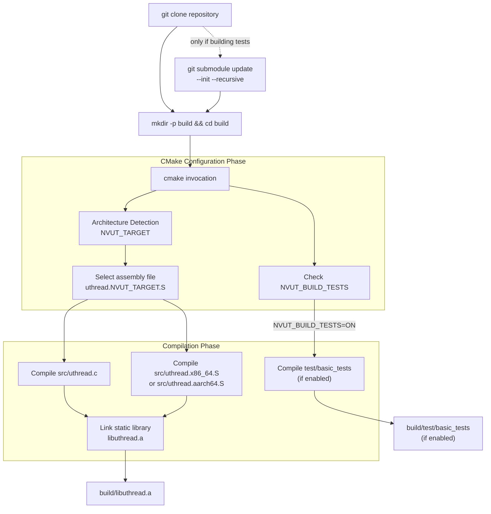

**Sources:** [README.md:29-66](), [CMakeLists.txt:16-48]()

## Building Without Tests

This configuration produces only the static library `libuthread.a` without compiling the test suite. This is the minimal build suitable for integration into other projects.

### Build Commands

```bash
git clone https://github.com/NVIDIA/libuthread
cd libuthread
mkdir -p build
cd build
cmake -DCMAKE_BUILD_TYPE=Release -DNVUT_BUILD_TESTS=OFF ..
make -j
```

### Configuration Options

| CMake Variable | Value | Effect |
|----------------|-------|--------|
| `CMAKE_BUILD_TYPE` | `Release` | Enables compiler optimizations |
| `NVUT_BUILD_TESTS` | `OFF` | Excludes test compilation |

The resulting library will be located at `build/libuthread.a`.

**Sources:** [README.md:46-54]()

## Building With Tests

This configuration compiles both the library and the unit test suite. It requires the Unity testing framework, which is included as a git submodule.

### Build Commands

```bash
git clone https://github.com/NVIDIA/libuthread
cd libuthread
git submodule update --init --recursive
mkdir -p build
cd build
cmake -DCMAKE_BUILD_TYPE=Release -DNVUT_BUILD_TESTS=ON ..
make -j
test/basic_tests
```

### Important Notes

1. **Submodule Initialization**: The `git submodule update --init --recursive` command is **required** when building with tests, as it fetches the Unity framework from [third_party/unity]().

2. **Test Execution**: After building, run `test/basic_tests` from the build directory to execute the unit test suite.

### Configuration Options

| CMake Variable | Value | Effect |
|----------------|-------|--------|
| `CMAKE_BUILD_TYPE` | `Release` | Enables compiler optimizations |
| `NVUT_BUILD_TESTS` | `ON` | Includes test compilation |

**Sources:** [README.md:56-66](), [CMakeLists.txt:36-48]()

## Architecture Detection Mechanism

CMake automatically detects the target architecture by querying the C compiler. This detection determines which assembly implementation file is compiled into the library.

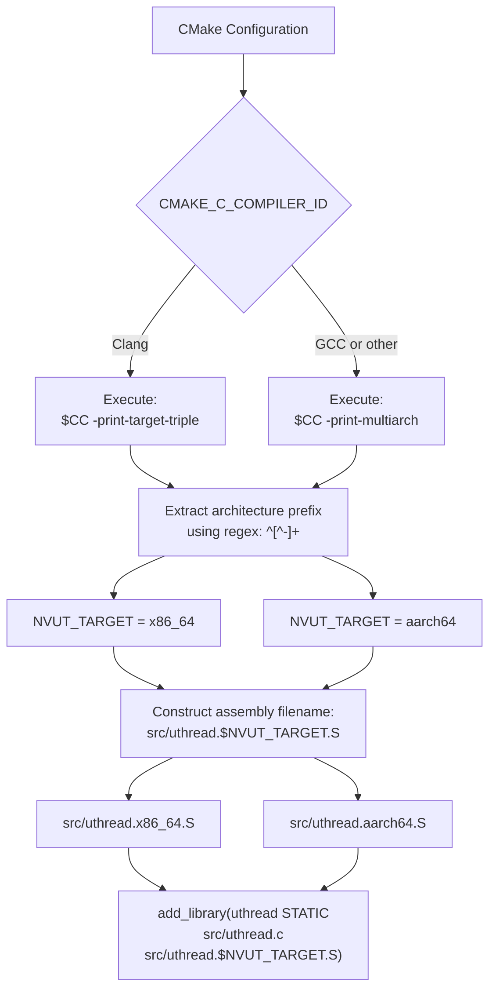

### Detection Logic

The detection mechanism is implemented in [CMakeLists.txt:22-34]():

1. **Compiler Type Check**: CMake checks if the compiler is Clang or assumes GCC otherwise
2. **Query Execution**: 
   - Clang: Uses `-print-target-triple` flag
   - GCC: Uses `-print-multiarch` flag
3. **Output Parsing**: Extracts the architecture prefix using regex pattern `^[^-]+`
4. **Variable Assignment**: Sets `NVUT_TARGET` to either `x86_64` or `aarch64`

### Target-Specific Assembly Files

| Architecture | NVUT_TARGET | Assembly File | Register Count |
|-------------|-------------|---------------|----------------|
| x86_64 | `x86_64` | [src/uthread.x86_64.S]() | 7 registers saved |
| ARM64 | `aarch64` | [src/uthread.aarch64.S]() | 21 registers saved (including FP) |

The selected assembly file is then passed to `add_library()` at [CMakeLists.txt:43]().

**Sources:** [CMakeLists.txt:22-43]()

## Compiler Flags and Build Configuration

The build system applies strict warning flags to ensure code quality:

```cmake
set(CMAKE_C_FLAGS "${CMAKE_C_FLAGS} -Wall -Wextra -Wconversion")
```

| Flag | Purpose |
|------|---------|
| `-Wall` | Enable all common warnings |
| `-Wextra` | Enable additional warnings beyond `-Wall` |
| `-Wconversion` | Warn about implicit type conversions that may alter values |

These flags are set at [CMakeLists.txt:20]() and apply to all C source files.

**Sources:** [CMakeLists.txt:20]()

## Build Outputs

After successful compilation, the following artifacts are generated:

### Library Build (NVUT_BUILD_TESTS=OFF)

```
build/
└── libuthread.a          # Static library
```

### Library + Tests Build (NVUT_BUILD_TESTS=ON)

```
build/
├── libuthread.a          # Static library
└── test/
    └── basic_tests       # Test executable
```

### Integration with Other Projects

To use `libuthread.a` in another CMake project:

```cmake
# In your CMakeLists.txt
add_library(uthread STATIC IMPORTED)
set_target_properties(uthread PROPERTIES
    IMPORTED_LOCATION "/path/to/libuthread/build/libuthread.a"
)
target_include_directories(your_target PRIVATE /path/to/libuthread/include)
target_link_libraries(your_target PRIVATE uthread)
```

The public API is exposed through [include/uthread.h](), which should be added to your project's include path.

**Sources:** [CMakeLists.txt:39-48](), [README.md:46-66]()

## Troubleshooting Common Build Issues

### Issue: "Architecture not detected"

**Symptom**: CMake fails during configuration with an error about `NVUT_TARGET`.

**Cause**: The compiler does not support `-print-target-triple` (Clang) or `-print-multiarch` (GCC).

**Solution**: Verify your compiler installation:
```bash
$CC --version
$CC -print-target-triple  # For Clang
$CC -print-multiarch      # For GCC
```

### Issue: "git submodule is empty"

**Symptom**: Build fails when `NVUT_BUILD_TESTS=ON` with missing Unity framework files.

**Cause**: Submodules were not initialized.

**Solution**: Run `git submodule update --init --recursive` before building.

### Issue: "No such file or directory: src/uthread.<arch>.S"

**Symptom**: Compilation fails because the assembly file is not found.

**Cause**: Either the architecture is not supported, or the file naming doesn't match.

**Solution**: Verify that [src/uthread.x86_64.S]() or [src/uthread.aarch64.S]() exists for your target architecture. Currently, only x86_64 and aarch64 are supported.

**Sources:** [README.md:29-66](), [CMakeLists.txt:22-43]()

---

# Page: Basic Usage Example

# Basic Usage Example

<details>
<summary>Relevant source files</summary>

The following files were used as context for generating this wiki page:

- [README.md](README.md)
- [include/uthread.h](include/uthread.h)

</details>


## Purpose and Scope

This page demonstrates the minimal code patterns required to use libuthread for hiding memory latencies through cooperative multitasking. It shows how to create user-level threads, yield control between them, and leverage prefetch operations to hide cache miss latencies. For detailed explanations of the underlying concepts, see [Memory Latency Hiding](#3.1) and [User-Level Threading Model](#3.2). For comprehensive API documentation, see [API Reference](#4).

---

## Core API Functions

The following functions from [include/uthread.h:27-48]() form the minimal API surface needed for basic usage:

| Function | Purpose | Return Type |
|----------|---------|-------------|
| `create_uthread(fun, arg)` | Enqueue a new thread with function and argument | `uthread_status_t` |
| `this_uthread_yield()` | Yield control to another thread | `void` |
| `preallocate_uthreads(n)` | Pre-allocate thread pool structures | `uthread_status_t` |
| `this_uthread_id()` | Query current thread's unique identifier | `size_t` |
| `this_uthread_run_count()` | Query how many times current thread has executed | `size_t` |

The return type `uthread_status_t` [include/uthread.h:29-32]() indicates success (`UTHREAD_SUCCESS`) or allocation failure (`UTHREAD_ERROR_ALLOC`).

**Sources:** [include/uthread.h:27-48](), [README.md:20-26]()

---

## Basic Execution Flow

The following diagram illustrates the minimal execution pattern for using libuthread:

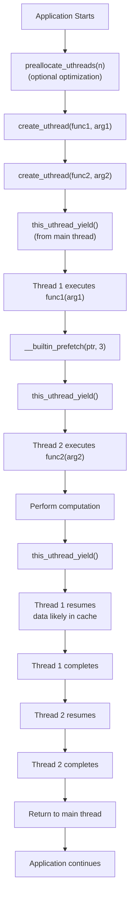

**Sources:** [README.md:22-26](), [include/uthread.h:40-48]()

---

## Thread Function Structure

Each user-level thread executes a function with the signature defined by `uthread_fun_t` [include/uthread.h:27](). The typical pattern for a thread function is:

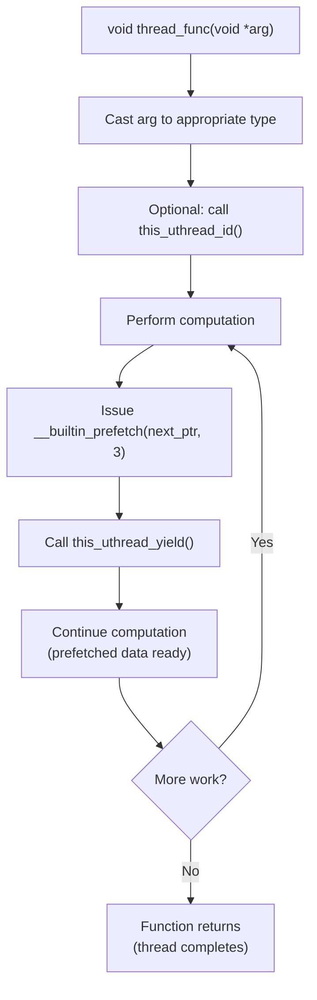

Key characteristics of thread functions:
- Accept a single `void *` argument [include/uthread.h:27]()
- Can call `this_uthread_yield()` at any point to cooperatively yield [include/uthread.h:48]()
- Should issue prefetch operations before yielding to hide latencies
- Automatically return to the pool when the function returns
- Can query their own ID via `this_uthread_id()` [include/uthread.h:44]()

**Sources:** [include/uthread.h:27](), [include/uthread.h:44-48](), [README.md:24]()

---

## Thread Creation and Execution Pattern

The following sequence diagram shows the interaction between application code and the libuthread API:

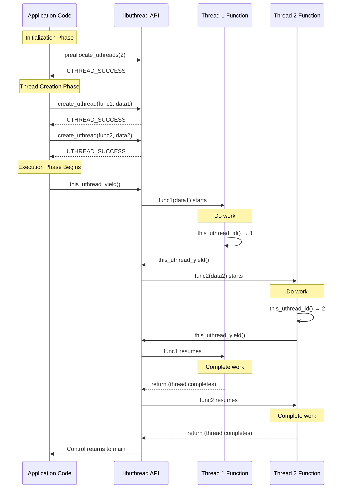

**Critical points:**
1. **Thread creation** via `create_uthread()` [include/uthread.h:40]() enqueues threads but does not execute them immediately
2. **First yield from main** triggers the context switch into user-level thread execution
3. **Subsequent yields** rotate between active threads in the queue
4. **Thread completion** (function return) automatically removes the thread from the queue and returns it to the pool

**Sources:** [include/uthread.h:36-48](), [README.md:22-24]()

---

## Memory Latency Hiding Pattern

The primary use case for libuthread is hiding memory access latencies. The recommended pattern is:

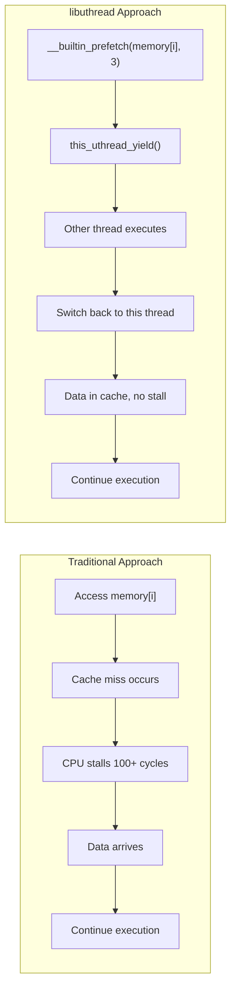

**Implementation pattern:**
1. Identify a memory access that may cause a cache miss
2. Issue a prefetch operation using compiler intrinsics (e.g., `__builtin_prefetch(ptr, 3)` for write-intent prefetch)
3. Immediately call `this_uthread_yield()` [include/uthread.h:48]()
4. The library switches to another thread, allowing productive work during the memory fetch
5. When control returns, the prefetched data is typically available in cache

This pattern transforms idle stall cycles into productive computation, increasing overall throughput without creating additional OS threads.

**Sources:** [README.md:23-26](), [include/uthread.h:48]()

---

## Multiple Thread Coordination Example

The following diagram shows how three threads coordinate through the yield mechanism:

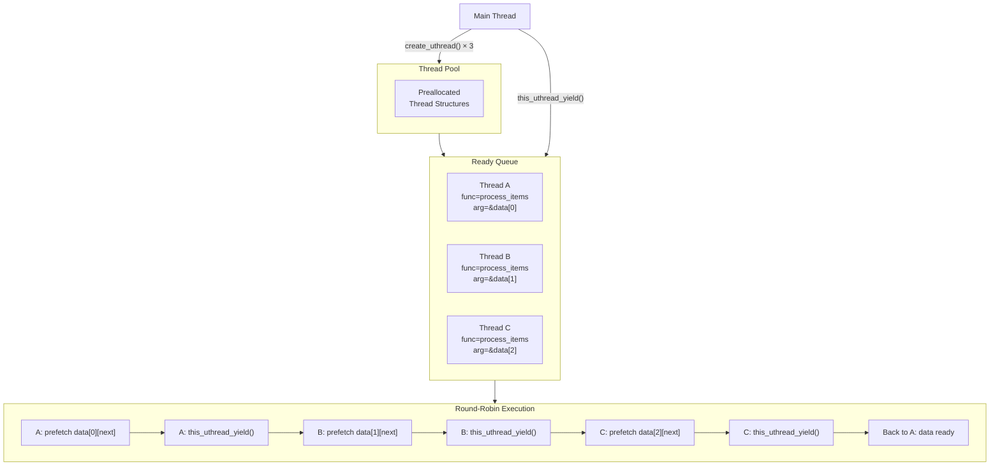

In this pattern:
- Each thread processes different data segments
- Each thread prefetches the next item in its segment
- Yields happen immediately after prefetch
- By the time control returns, the prefetched data is likely in cache
- The queue size can be monitored via `uthread_queue_size()` [include/uthread.h:42]()

**Sources:** [include/uthread.h:40-42](), [README.md:22-24]()

---

## Error Handling

All functions that can fail return `uthread_status_t` [include/uthread.h:29-32]():

| Status Code | Value | Meaning |
|-------------|-------|---------|
| `UTHREAD_SUCCESS` | 0 | Operation completed successfully |
| `UTHREAD_ERROR_ALLOC` | 1 | Memory allocation failed |

**Functions requiring error checks:**
- `preallocate_uthreads(n)` [include/uthread.h:36]() - may fail if malloc fails
- `create_uthread(fun, arg)` [include/uthread.h:40]() - may fail if no pool threads exist and malloc fails
- `free_unused_uthreads()` [include/uthread.h:38]() - returns status for consistency

**Pattern for error handling:**
```
uthread_status_t status = preallocate_uthreads(10);
if (status != UTHREAD_SUCCESS) {
    // Handle allocation failure
}

status = create_uthread(my_function, my_arg);
if (status != UTHREAD_SUCCESS) {
    // Handle thread creation failure
}
```

Functions that cannot fail:
- `this_uthread_yield()` [include/uthread.h:48]() - returns `void`
- `this_uthread_id()` [include/uthread.h:44]() - always returns valid ID
- `this_uthread_run_count()` [include/uthread.h:46]() - always returns valid count
- `uthread_pool_size()` [include/uthread.h:34]() - query function
- `uthread_queue_size()` [include/uthread.h:42]() - query function

**Sources:** [include/uthread.h:29-48]()

---

## Summary of Basic Usage Steps

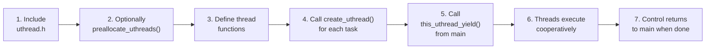

This minimal pattern enables latency hiding on both x86_64 and ARM64 Linux systems. For advanced patterns and optimization techniques, see [Thread State Machine](#5.4) and [Context Switching Mechanism](#5.1).

**Sources:** [include/uthread.h:18-54](), [README.md:18-26]()

---

# Page: Core Concepts

# Core Concepts

<details>
<summary>Relevant source files</summary>

The following files were used as context for generating this wiki page:

- [README.md](README.md)
- [src/uthread.c](src/uthread.c)

</details>


This page provides an overview of the fundamental design principles and mechanisms that enable libuthread to hide memory latencies through user-level cooperative multitasking. It introduces the key data structures, execution flow, and architectural decisions that underpin the library's operation.

For detailed explanations of specific mechanisms, see:
- [Memory Latency Hiding](#3.1) for the latency hiding strategy
- [User-Level Threading Model](#3.2) for cooperative scheduling details
- [Thread Pool and Queue Management](#3.3) for internal data structure management

---

## Overview

libuthread implements a **cooperative user-level threading system** that operates entirely in userspace without kernel involvement. The library enables a single OS thread to manage multiple execution contexts (uthreads) and switch between them at explicit yield points. This design serves one primary purpose: **hiding memory access latencies** by switching to productive work while waiting for cache misses to resolve.

The system consists of three main components:

| Component | Implementation | Purpose |
|-----------|---------------|---------|
| **Thread Contexts** | `struct uthread` in [src/uthread.c:80-90]() | Storage for saved registers, stack, and metadata |
| **Thread Management** | Pool and queue via thread-local variables in [src/uthread.c:94-97]() | Lifecycle management and scheduling |
| **Context Switching** | Assembly routines in `src/uthread.x86_64.S` and `src/uthread.aarch64.S` | Low-level register save/restore operations |

Sources: [src/uthread.c:80-90](), [src/uthread.c:94-97](), [README.md:18-26]()

---

## Key Data Structures

### Thread Context: `struct uthread`

The `struct uthread` type encapsulates all state needed to suspend and resume a uthread's execution:

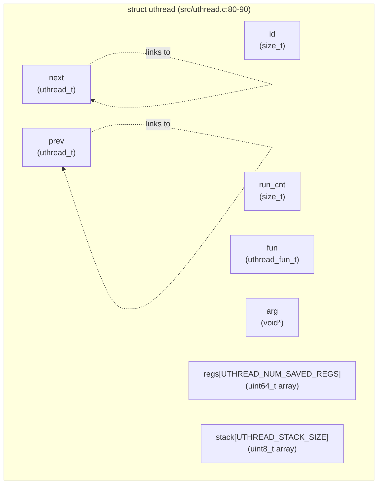

**Architecture-Specific Register Counts**

| Architecture | Macro | Value | Registers Saved |
|--------------|-------|-------|-----------------|
| x86_64 | `UTHREAD_NUM_SAVED_REGS` ([src/uthread.c:40]()) | 7 | rbx, rsp, rbp, r12, r13, r14, r15 |
| aarch64 | `UTHREAD_NUM_SAVED_REGS` ([src/uthread.c:51]()) | 21 | d8-d15 (FP), sp, x19-x30 (GP) |

The `run_cnt` field tracks whether a thread has ever executed (`run_cnt == 0` means first run), which determines the context switch mechanism used. The `regs` array stores callee-saved registers according to the platform ABI.

Sources: [src/uthread.c:80-90](), [src/uthread.c:35-54]()

---

## Thread-Local State Management

libuthread maintains three critical thread-local variables that coordinate all uthread operations:

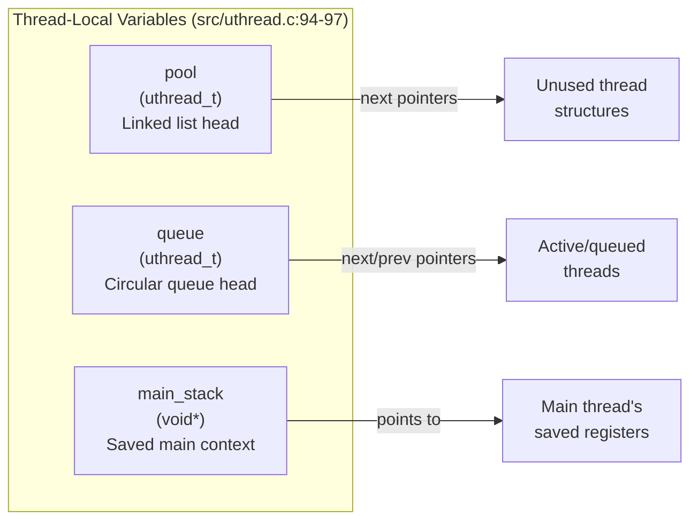

| Variable | Type | Scope | Purpose |
|----------|------|-------|---------|
| `pool` | `uthread_t` | `__thread` static | Head of singly-linked list of unused threads |
| `queue` | `uthread_t` | `__thread` static | Head of circular doubly-linked list of active threads |
| `main_stack` | `void*` | `__thread` static | Pointer to main thread's saved register state |
| `next_uthread_id` | `size_t` | `__thread` static | Monotonic ID generator for new threads |

The `__thread` storage class ensures each OS thread has its own independent set of uthreads, enabling thread-safe operation in multi-threaded programs.

Sources: [src/uthread.c:94-97]()

---

## Execution Flow and Function Dispatch

### Main API Functions

The following diagram maps user-visible API functions to their internal implementations:

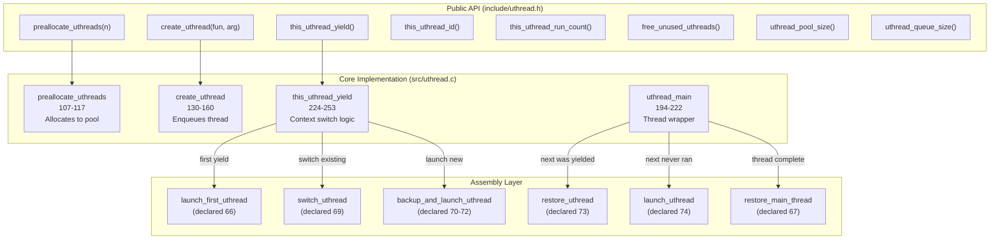

Sources: [src/uthread.c:66-78](), [src/uthread.c:107-253]()

### Context Switch Decision Tree

The `this_uthread_yield()` function implements a decision tree that selects the appropriate context switch mechanism:

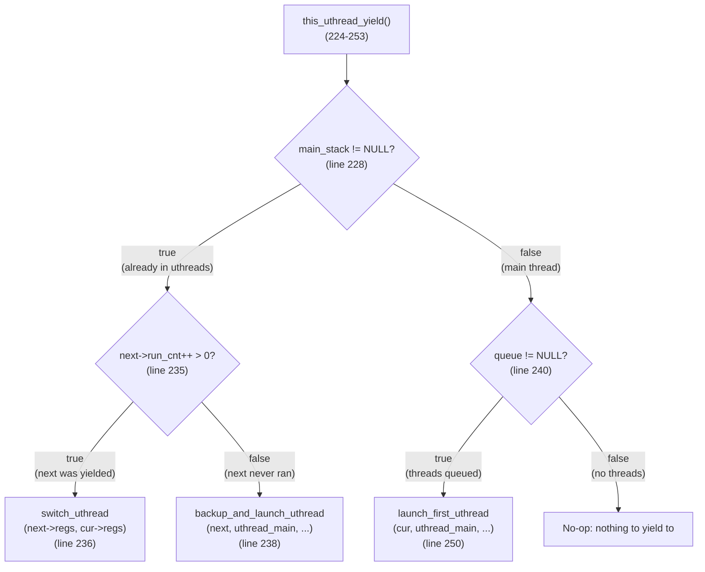

**Key Invariants:**
- `main_stack == NULL` indicates execution is in the main thread context
- `run_cnt == 0` indicates a thread has never executed, requiring initial stack setup
- `run_cnt > 0` indicates saved register state exists in `regs[]` array

Sources: [src/uthread.c:224-253]()

---

## Context Switch Mechanics

### Register Preservation Requirements

Each architecture defines which registers must be preserved across context switches according to its calling convention:

**x86_64 Callee-Saved Registers** ([src/uthread.c:36-40]()):
- General-purpose: `rbx`, `rbp`, `r12`, `r13`, `r14`, `r15`
- Stack pointer: `rsp`

**aarch64 Callee-Saved Registers** ([src/uthread.c:42-51]()):
- Floating-point: `d8`-`d15` (8 registers)
- General-purpose: `x19`-`x30` (12 registers)
- Stack pointer: `sp`

The assembly routines manipulate these registers directly to perform context switches without OS kernel involvement.

Sources: [src/uthread.c:35-54]()

### Assembly Function Roles

| Function | Declared | Purpose |
|----------|----------|---------|
| `launch_first_uthread` | [src/uthread.c:66]() | First entry into uthread context, saves main thread state |
| `switch_uthread` | [src/uthread.c:69]() | Switch between two yielded threads with saved state |
| `backup_and_launch_uthread` | [src/uthread.c:70-72]() | Save current thread, launch a new thread for first time |
| `restore_uthread` | [src/uthread.c:73]() | Restore a yielded thread's registers and resume |
| `launch_uthread` | [src/uthread.c:74]() | Launch a new thread without saving current state |
| `restore_main_thread` | [src/uthread.c:67]() | Return to main thread context when all uthreads complete |

These functions are implemented in architecture-specific assembly files (`src/uthread.x86_64.S` and `src/uthread.aarch64.S`) but declared as external C functions for type safety.

Sources: [src/uthread.c:66-78]()

---

## Cooperative Scheduling Model

libuthread uses **explicit cooperative scheduling**: threads only switch at `this_uthread_yield()` call sites. This has several implications:

| Aspect | Behavior |
|--------|----------|
| **Preemption** | None - threads run until they explicitly yield |
| **Fairness** | Round-robin when all threads yield regularly |
| **Starvation** | Possible if a thread never yields |
| **Performance** | Minimal overhead - no timer interrupts or kernel scheduling |
| **Debugging** | Deterministic execution order simplifies reasoning |

The typical usage pattern is:

1. Issue memory prefetch: `__builtin_prefetch(ptr, 3)`
2. Immediately yield: `this_uthread_yield()`
3. Other threads execute while memory loads
4. Eventually return when data is ready

This pattern is most effective when:
- Memory access patterns are predictable enough for prefetching
- Multiple independent work items exist to switch between
- Cache miss latencies dominate execution time

Sources: [README.md:18-26]()

---

## Thread Lifecycle Summary

The complete lifecycle of a uthread involves transitions through these conceptual states:

```mermaid
stateDiagram-v2
    [*] --> Pooled: "preallocate_uthreads<br/>or malloc"
    
    Pooled --> Queued: "create_uthread<br/>assigns fun, arg"
    
    Queued --> FirstRun: "this_uthread_yield<br/>run_cnt == 0"
    
    FirstRun --> Running: "launch_first_uthread or<br/>backup_and_launch_uthread"
    
    Running --> Yielded: "this_uthread_yield<br/>saves to regs[]"
    
    Yielded --> Running: "switch_uthread or<br/>restore_uthread"
    
    Running --> Completed: "function returns<br/>uthread_main catches"
    
    Completed --> Pooled: "remove from queue<br/>add to pool"
    
    Pooled --> [*]: "free_unused_uthreads"
    
    note right of Pooled
        pool linked list
        uthread_pool_size()
    end note
    
    note right of Queued
        queue circular list
        uthread_queue_size()
    end note
    
    note right of Running
        this_uthread_id()
        this_uthread_run_count()
    end note
```

**State Transitions:**
- **Pooled → Queued**: [src/uthread.c:130-160]() - `create_uthread()` retrieves from pool or allocates
- **Queued → Running**: [src/uthread.c:224-253]() - `this_uthread_yield()` initiates execution
- **Running → Yielded**: [src/uthread.c:224-253]() - `this_uthread_yield()` saves state
- **Running → Completed**: [src/uthread.c:194-222]() - `uthread_main()` wrapper catches return
- **Completed → Pooled**: [src/uthread.c:203-208]() - Thread removed from queue, added to pool

The pool and queue structures enable efficient memory reuse without frequent allocation/deallocation.

Sources: [src/uthread.c:130-160](), [src/uthread.c:194-253]()

---

## Memory Layout

Each `struct uthread` contains a fixed-size stack allocated inline within the structure:

```mermaid
graph TD
    subgraph "struct uthread Memory Layout"
        PTRS["Linked list pointers<br/>(next, prev)"]
        META["Metadata<br/>(id, run_cnt, fun, arg)"]
        REGS["Register save area<br/>(regs[UTHREAD_NUM_SAVED_REGS])<br/>16-byte aligned"]
        STACK["Execution stack<br/>(stack[UTHREAD_STACK_SIZE])<br/>2MB, 16-byte aligned"]
        STACK_TOP["Stack top (initial SP)<br/>stack + UTHREAD_STACK_SIZE - 16"]
    end
    
    PTRS --> META
    META --> REGS
    REGS --> STACK
    STACK --> STACK_TOP
```

**Constants** ([src/uthread.c:55]()):
- `UTHREAD_STACK_SIZE = 1 << 21` (2,097,152 bytes = 2 MB)
- Stack pointer initialized via `stack_of()` helper ([src/uthread.c:92]()): returns `&thr->stack[UTHREAD_STACK_SIZE - 16]`

The 16-byte alignment ensures compatibility with SIMD instructions and ABI requirements. The stack grows downward from the high address returned by `stack_of()`.

Sources: [src/uthread.c:55](), [src/uthread.c:80-92]()

---

## Design Principles

libuthread's architecture embodies several key design decisions:

| Principle | Rationale | Trade-off |
|-----------|-----------|-----------|
| **User-level only** | Avoid kernel context switch overhead | No preemption or time-slicing |
| **Cooperative scheduling** | Predictable switching points | Application must place yields correctly |
| **Fixed-size stacks** | Simple allocation, no overflow detection | 2MB per thread may waste memory |
| **Thread-local storage** | Each OS thread has independent uthreads | No cross-thread uthread migration |
| **Inline stacks** | Better cache locality | Large structure size (2MB+) |
| **Circular queue** | Constant-time round-robin | More complex pointer management |
| **Pool recycling** | Minimize malloc/free calls | Memory held for process lifetime |

These choices optimize for the target use case: hiding memory latencies in compute-intensive workloads where explicit yield points can be strategically placed after prefetch operations.

Sources: [src/uthread.c:80-90](), [README.md:18-26]()

---

# Page: Memory Latency Hiding

# Memory Latency Hiding

<details>
<summary>Relevant source files</summary>

The following files were used as context for generating this wiki page:

- [README.md](README.md)

</details>


## Purpose and Scope

This document explains how libuthread hides memory access latencies through cooperative multitasking and context switching. It covers the fundamental problem of CPU idle time during cache misses, the prefetch-and-yield pattern that applications use to signal potential stalls, and the internal mechanisms that enable switching execution to other work while waiting for memory operations to complete.

For information about the broader user-level threading model and cooperative scheduling principles, see [User-Level Threading Model](#3.2). For implementation details about how context switching is performed at the assembly level, see [Context Switching Mechanism](#5.1).

---

## The Memory Latency Problem

Modern CPUs execute instructions significantly faster than memory systems can supply data. When a CPU needs data that is not in cache (a cache miss), it must fetch the data from main memory, which can take hundreds of CPU cycles. During this time, the CPU remains idle waiting for the memory operation to complete, resulting in poor utilization.

| Memory Level | Typical Latency | Relative Speed |
|--------------|----------------|----------------|
| L1 Cache | ~4 cycles | 1x |
| L2 Cache | ~12 cycles | 3x |
| L3 Cache | ~40 cycles | 10x |
| Main Memory (DRAM) | ~200-300 cycles | 50-75x |

This problem is particularly acute in memory-intensive workloads such as:
- Large data structure traversal (linked lists, trees, graphs)
- Random memory access patterns
- Data streaming and processing pipelines
- Hash table lookups with poor locality

The traditional single-threaded execution model leaves the CPU completely idle during these memory stalls, wasting cycles that could be spent on productive work.

**Sources:** [README.md:20-26]()

---

## Traditional Latency Hiding Approaches

### Software Prefetching

Compilers and programmers can use prefetch instructions to request data before it is actually needed:

```c
__builtin_prefetch(ptr, 0, 3);  // Read prefetch with high temporal locality
__builtin_prefetch(ptr, 1, 3);  // Write prefetch with high temporal locality
```

However, this approach has limitations:
- The CPU still stalls when it reaches the actual memory access if the prefetch hasn't completed
- Prefetching too early wastes cache capacity on data that won't be used immediately
- Prefetching too late doesn't hide the full latency

### OS-Level Multithreading

Operating systems can schedule multiple threads to share CPU time, switching to another thread when one blocks on I/O or memory. However, OS thread switching has significant overheads:
- Context switch requires kernel mode transition (~1000s of cycles)
- Thread metadata management (scheduler, TLB flushes)
- Limited control over when switches occur

**Sources:** [README.md:20-26]()

---

## The libuthread Solution

libuthread enables applications to explicitly indicate potential memory stalls and immediately switch to other work within the same OS thread. This eliminates OS scheduling overhead while providing fine-grained control over when context switches occur.

The key insight is that applications often know when cache misses are likely to occur. By combining software prefetch operations with an explicit yield primitive, applications can:

1. Issue a prefetch for data that will be needed soon
2. Immediately yield control to other work
3. Let other command sequences execute while the memory fetch completes
4. Resume execution when scheduled again, with data likely already in cache

This approach achieves the throughput benefits of multithreading without the overhead of OS thread management.

```mermaid
graph TB
    subgraph Traditional["Traditional: CPU Idle During Miss"]
        T1["Execute instruction"]
        T2["Cache miss detected"]
        T3["CPU waits for memory"]
        T4["Data arrives"]
        T5["Continue execution"]
        T1 --> T2
        T2 --> T3
        T3 --> T4
        T4 --> T5
    end
    
    subgraph Uthread["libuthread: Switch to Other Work"]
        U1["Execute instruction"]
        U2["Detect likely miss"]
        U3["__builtin_prefetch()"]
        U4["this_uthread_yield()"]
        U5["Switch to uthread B"]
        U6["Uthread B executes"]
        U7["Switch back to uthread A"]
        U8["Data ready in cache"]
        U9["Continue execution"]
        U1 --> U2
        U2 --> U3
        U3 --> U4
        U4 --> U5
        U5 --> U6
        U6 --> U7
        U7 --> U8
        U8 --> U9
    end
```

**Diagram: Comparison of Traditional vs libuthread Latency Hiding**

**Sources:** [README.md:20-26]()

---

## Prefetch and Yield Pattern

The fundamental pattern for hiding memory latencies with libuthread involves three steps:

### Step 1: Issue Prefetch Operations

Applications use compiler intrinsics to request data that will be needed soon:

```c
// Prefetch for read access with high temporal locality
__builtin_prefetch(ptr, 0, 3);

// Prefetch the next element in a traversal
__builtin_prefetch(node->next, 0, 3);
```

The prefetch operation is non-blocking—it initiates the memory fetch but doesn't wait for completion.

### Step 2: Yield Execution

Immediately after issuing prefetches, the application calls the yield primitive:

```c
this_uthread_yield();
```

This function is defined in [include/uthread.h:97-102]() and implemented in [src/uthread.c:294-340](). When called, it signals to libuthread that this is a good opportunity to switch to another command sequence.

### Step 3: Resume When Ready

libuthread switches to another enqueued uthread. When control eventually returns to the original uthread (after one or more round-robin passes through the queue), the prefetched data is typically already available in cache, eliminating or significantly reducing the memory stall.

```mermaid
sequenceDiagram
    participant App as "Application Code"
    participant Prefetch as "__builtin_prefetch"
    participant Yield as "this_uthread_yield()"
    participant Core as "libuthread Core"
    participant ASM as "Assembly Layer"
    participant Cache as "Memory Hierarchy"
    
    App->>Prefetch: "prefetch(data_ptr, 0, 3)"
    Prefetch->>Cache: "Issue prefetch request"
    Note over Cache: "Fetch starts (100s of cycles)"
    
    App->>Yield: "this_uthread_yield()"
    Yield->>Core: "next_uthread = dequeue()"
    Core->>ASM: "backup_and_launch_uthread() or switch_uthread()"
    ASM->>ASM: "Save current registers"
    ASM->>ASM: "Restore next uthread registers"
    
    Note over ASM: "Switch to uthread B"
    Note over Cache: "Prefetch completes while B executes"
    
    ASM->>ASM: "Eventually switch back"
    ASM->>App: "Resume execution"
    Note over App: "Data now in cache!"
```

**Diagram: Prefetch and Yield Execution Flow**

**Sources:** [README.md:22-24](), [include/uthread.h:97-102](), [src/uthread.c:294-340]()

---

## Context Switching Mechanics

When `this_uthread_yield()` is called, libuthread performs a lightweight context switch entirely in user space. This involves:

### Register State Management

The current CPU register state is saved to the current uthread's context structure, and the next uthread's register state is restored. The number of registers saved depends on the architecture:

| Architecture | Registers Saved | Files |
|--------------|----------------|-------|
| x86_64 | 7 registers (RBX, RBP, R12-R15, RSP) | [src/uthread.x86_64.S]() |
| ARM64 | 21 registers (X19-X30, SP, D8-D15) | [src/uthread.aarch64.S]() |

### Stack Switching

Each uthread maintains its own execution stack. During a context switch, the stack pointer is saved and the new uthread's stack pointer is restored, allowing execution to continue from where the uthread previously yielded.

### First-Run vs Resume

libuthread distinguishes between two types of context switches:

1. **First-run**: When a uthread executes for the first time (`run_cnt == 0`), special assembly functions like `launch_first_uthread` or `backup_and_launch_uthread` are used to initialize its stack and begin execution at the function pointer provided to `create_uthread()`.

2. **Resume**: When switching between already-running uthreads, `switch_uthread` is used to simply save/restore register state and continue from the previous yield point.

```mermaid
graph LR
    subgraph Context["Context Switch Components"]
        Y["this_uthread_yield()"]
        C["src/uthread.c:294-340"]
        Q["Dequeue next uthread"]
        CHK["Check run_cnt"]
        FIRST["backup_and_launch_uthread()"]
        SWITCH["switch_uthread()"]
        ASM_X86["uthread.x86_64.S"]
        ASM_ARM["uthread.aarch64.S"]
    end
    
    Y --> C
    C --> Q
    Q --> CHK
    CHK -->|"run_cnt == 0"| FIRST
    CHK -->|"run_cnt > 0"| SWITCH
    FIRST --> ASM_X86
    FIRST --> ASM_ARM
    SWITCH --> ASM_X86
    SWITCH --> ASM_ARM
```

**Diagram: Context Switch Code Path**

The core implementation in [src/uthread.c:294-340]() determines which assembly function to invoke:

- `launch_first_uthread` for the first yield from the main thread
- `backup_and_launch_uthread` for launching a new uthread from another uthread
- `switch_uthread` for switching between executing uthreads

**Sources:** [src/uthread.c:294-340](), [src/uthread.x86_64.S](), [src/uthread.aarch64.S]()

---

## Performance Characteristics

### Latency Hiding Efficiency

The effectiveness of memory latency hiding depends on several factors:

1. **Memory access patterns**: Random access patterns with poor spatial locality benefit most
2. **Number of uthreads**: More uthreads provide more opportunities to hide individual latencies
3. **Work between yields**: Sufficient computation must occur in other uthreads to cover the memory latency
4. **Context switch overhead**: libuthread's user-space switching (~10-50 cycles) is negligible compared to memory latency (~200-300 cycles)

### Optimal Usage Pattern

Best results are achieved when:
- Each uthread performs substantial work between yield points (avoiding excessive switching overhead)
- Prefetch operations target data that will be used after other uthreads complete their work
- Multiple uthreads are enqueued to maximize latency hiding opportunities
- Yield points are placed immediately after prefetch operations

### Comparison to Alternatives

| Approach | Context Switch Cost | Latency Hiding | Control Granularity |
|----------|-------------------|----------------|---------------------|
| Single-threaded | None | None | N/A |
| OS threads | ~1000s of cycles | Good | Coarse (kernel scheduler) |
| libuthread | ~10-50 cycles | Good | Fine (explicit yields) |

The low overhead of user-space context switching makes it feasible to switch much more frequently than with OS threads, enabling fine-grained latency hiding.

**Sources:** [README.md:20-26]()

---

## Integration with Application Code

Applications integrate latency hiding by restructuring memory-intensive operations to use the prefetch-and-yield pattern:

### Before: Traditional Sequential Access

```c
// Without libuthread: CPU idles during cache misses
for (Node *n = head; n != NULL; n = n->next) {
    process(n->data);  // Potential cache miss causes stall
}
```

### After: Latency Hiding with libuthread

```c
// With libuthread: overlap computation with memory fetches
void traverse_with_prefetch(void *arg) {
    Node *n = (Node *)arg;
    while (n != NULL) {
        // Prefetch next node before accessing current
        if (n->next) {
            __builtin_prefetch(n->next, 0, 3);
            __builtin_prefetch(&n->next->data, 0, 3);
        }
        
        // Yield to allow other work while prefetch completes
        this_uthread_yield();
        
        // By now, data is likely in cache
        process(n->data);
        
        n = n->next;
    }
}

// Create uthreads for different traversal starting points
for (int i = 0; i < num_lists; i++) {
    create_uthread(traverse_with_prefetch, list_heads[i]);
}
```

The application explicitly indicates where memory stalls are likely and cooperatively yields control, allowing libuthread to efficiently overlap computation with memory operations.

**Sources:** [README.md:22-24](), [include/uthread.h:97-102]()

---

# Page: User-Level Threading Model

# User-Level Threading Model

<details>
<summary>Relevant source files</summary>

The following files were used as context for generating this wiki page:

- [README.md](README.md)
- [src/uthread.c](src/uthread.c)

</details>


## Purpose and Scope

This page describes the user-level threading model employed by libuthread, explaining how it differs from traditional operating system threads and why cooperative scheduling is used. For information about how threads hide memory latencies, see [Memory Latency Hiding](#3.1). For details on the internal thread pool and queue data structures, see [Thread Pool and Queue Management](#3.3). For implementation details of context switching, see [Context Switching Mechanism](#5.1).

---

## User-Level vs Kernel-Level Threading

User-level threads (uthreads) are managed entirely in user space without kernel involvement, contrasting with traditional OS threads that require kernel scheduling.

### Comparison Table

| Aspect | Kernel Threads (pthreads) | User-Level Threads (uthreads) |
|--------|---------------------------|-------------------------------|
| **Scheduling** | Preemptive (kernel scheduler) | Cooperative (explicit `this_uthread_yield()`) |
| **Context Switch** | Kernel mode transition (expensive) | User-space register save/restore (cheap) |
| **State Storage** | Kernel thread control block | `struct uthread` in user memory |
| **Stack Management** | Kernel-allocated stack | `uint8_t stack[UTHREAD_STACK_SIZE]` per thread |
| **Creation Overhead** | System call (`clone()`) | Memory allocation or pool reuse |
| **Visibility** | OS scheduler sees threads | Single OS thread executes all uthreads |

### The `struct uthread` Data Structure

Each user-level thread is represented by a `struct uthread` [src/uthread.c:80-90]() which contains all state necessary to suspend and resume execution:

```mermaid
graph TB
    subgraph "struct uthread"
        ID["id<br/>Unique thread identifier"]
        RUN_CNT["run_cnt<br/>Execution counter"]
        FUN["fun<br/>uthread_fun_t function pointer"]
        ARG["arg<br/>void* argument"]
        REGS["regs[UTHREAD_NUM_SAVED_REGS]<br/>Saved register state"]
        STACK["stack[UTHREAD_STACK_SIZE]<br/>2MB execution stack"]
        NEXT["next<br/>Queue/pool link"]
        PREV["prev<br/>Queue link"]
    end
    
    subgraph "Links"
        NEXT --> NEXT_THR["Next thread in queue/pool"]
        PREV --> PREV_THR["Previous thread in queue"]
    end
    
    subgraph "Saved Registers"
        REGS --> X86["x86_64: 7 registers<br/>rbx, rsp, rbp, r12-r15"]
        REGS --> ARM["aarch64: 21 registers<br/>d8-d15, sp, x19-x30"]
    end
```

**Sources:** [src/uthread.c:80-90](), [src/uthread.c:35-54]()

---

## Cooperative Scheduling Model

Unlike preemptive kernel threads that can be interrupted at any time, uthreads use **cooperative scheduling** where threads explicitly yield control by calling `this_uthread_yield()`.

### Yield Points

The application programmer must explicitly insert yield points at locations where context switching is beneficial:

```mermaid
sequenceDiagram
    participant App as "Application Code"
    participant Yield as "this_uthread_yield()"
    participant Queue as "queue (current thread)"
    participant NextThr as "queue->next"
    
    App->>Yield: Call at strategic location
    Note over Yield: main_stack != NULL?
    Yield->>Queue: Read current thread
    Yield->>NextThr: Advance to next thread
    Note over Yield: next->run_cnt++ check
    alt run_cnt > 0 (already ran)
        Yield->>Yield: switch_uthread(next->regs, cur->regs)
        Note over Yield: Save current registers,<br/>restore next registers
    else run_cnt == 0 (first run)
        Yield->>Yield: backup_and_launch_uthread(...)
        Note over Yield: Save current registers,<br/>launch new thread
    end
    Yield-->>App: Returns when switched back
```

**Sources:** [src/uthread.c:224-253](), [src/uthread.c:66-74]()

### First Yield: Entering uthread Processing

The first call to `this_uthread_yield()` from the main application context transitions from normal execution into uthread processing [src/uthread.c:240-251]():

```mermaid
graph LR
    subgraph "Before First Yield"
        MAIN1["main() context<br/>main_stack == NULL<br/>queue points to first thread"]
    end
    
    subgraph "First this_uthread_yield()"
        CHECK["Check: main_stack == NULL<br/>and queue != NULL"]
        SAVE["launch_first_uthread()"]
        EXEC["Execute first thread"]
    end
    
    subgraph "After First Yield"
        MAIN2["main_stack saved<br/>Thread 1 executing<br/>can yield to other threads"]
    end
    
    MAIN1 --> CHECK
    CHECK --> SAVE
    SAVE --> EXEC
    EXEC --> MAIN2
```

The `main_stack` variable [src/uthread.c:97]() is a critical sentinel value that distinguishes between "not yet entered uthread processing" (`main_stack == NULL`) and "inside uthread processing" (`main_stack != NULL`).

**Sources:** [src/uthread.c:224-253](), [src/uthread.c:97](), [src/uthread.c:66]()

---

## Round-Robin Execution Model

Uthreads execute in a circular queue pattern, where each yield advances to the next thread:

```mermaid
graph TB
    subgraph "Circular Queue Structure"
        T1["Thread 1<br/>queue pointer<br/>run_cnt=5"]
        T2["Thread 2<br/>run_cnt=5"]
        T3["Thread 3<br/>run_cnt=3"]
        T4["Thread 4<br/>run_cnt=2"]
    end
    
    T1 -->|"next"| T2
    T2 -->|"next"| T3
    T3 -->|"next"| T4
    T4 -->|"next"| T1
    
    T1 -.->|"prev"| T4
    T2 -.->|"prev"| T1
    T3 -.->|"prev"| T2
    T4 -.->|"prev"| T3
    
    subgraph "Yield Behavior"
        Y1["this_uthread_yield() from Thread 1"]
        Y2["queue = cur->next (Thread 2)"]
        Y3["Context switch to Thread 2"]
    end
    
    T1 --> Y1
    Y1 --> Y2
    Y2 --> Y3
```

### Queue Management Implementation

The `queue` variable [src/uthread.c:96]() is a thread-local pointer that always points to the currently executing uthread. When `this_uthread_yield()` is called:

1. `cur = queue` — get current thread
2. `next = cur->next` — get next thread in circular list
3. `queue = next` — update to new current thread
4. Perform context switch (either `switch_uthread()` or `backup_and_launch_uthread()`)

**Sources:** [src/uthread.c:224-239](), [src/uthread.c:96]()

---

## Thread Lifecycle in the User-Level Model

Each uthread transitions through states entirely in user space:

```mermaid
stateDiagram-v2
    [*] --> Created: "create_uthread(fun, arg)"
    
    Created --> Queued: "Append to circular queue<br/>thr->run_cnt = 0"
    
    Queued --> FirstLaunch: "this_uthread_yield()<br/>run_cnt == 0"
    
    FirstLaunch --> Running: "backup_and_launch_uthread()<br/>or launch_first_uthread()"
    
    Running --> Yielded: "this_uthread_yield()<br/>saves to thr->regs"
    
    Yielded --> Running: "Switched back via<br/>switch_uthread()"
    
    Running --> Completed: "fun() returns"
    
    Completed --> PoolReturn: "uthread_main() cleanup<br/>remove from queue"
    
    PoolReturn --> [*]: "Thread available for reuse"
    
    note right of Created
        struct uthread allocated
        from pool or malloc()
    end note
    
    note right of Running
        queue points to this thread
        this_uthread_id() available
    end note
    
    note right of Yielded
        Registers in thr->regs[]
        Still in circular queue
    end note
```

### The `uthread_main()` Wrapper

Every uthread executes inside the `uthread_main()` wrapper function [src/uthread.c:194-222]() which:

1. Calls the user-provided function: `self->fun(self->arg)`
2. Removes the thread from the queue upon completion
3. Returns the thread to the pool for reuse
4. Either launches the next thread or returns to the main application context

**Sources:** [src/uthread.c:194-222](), [src/uthread.c:130-160]()

---

## Benefits of User-Level Threading

### Performance Advantages

| Benefit | Explanation | Code Evidence |
|---------|-------------|---------------|
| **Fast Context Switching** | No kernel involvement; only register save/restore | Assembly functions in [src/uthread.x86_64.S](), [src/uthread.aarch64.S]() |
| **No Syscall Overhead** | Thread creation via `malloc()` or pool reuse | [src/uthread.c:107-117](), [src/uthread.c:130-160]() |
| **Memory Efficiency** | All threads share OS thread's resources | Single OS thread executes all uthreads |
| **Predictable Scheduling** | Explicit yield points prevent race conditions | Deterministic round-robin via [src/uthread.c:234]() |

### Thread Pool Optimization

The thread pool [src/uthread.c:95]() enables thread structure reuse, avoiding repeated allocations:

```mermaid
graph LR
    subgraph "Thread Creation"
        CREATE["create_uthread(fun, arg)"]
        CHECK{"pool != NULL?"}
        REUSE["Reuse from pool"]
        ALLOC["malloc(sizeof(struct uthread))"]
        QUEUE["Add to circular queue"]
    end
    
    CREATE --> CHECK
    CHECK -->|"Yes"| REUSE
    CHECK -->|"No"| ALLOC
    REUSE --> QUEUE
    ALLOC --> QUEUE
    
    subgraph "Thread Completion"
        COMPLETE["fun() returns in uthread_main()"]
        RETURN["Add to pool"]
    end
    
    COMPLETE --> RETURN
    RETURN -.->|"Available for reuse"| CHECK
```

**Sources:** [src/uthread.c:130-160](), [src/uthread.c:95](), [src/uthread.c:203-208]()

---

## Programming Model Constraints

### Explicit Yield Requirement

Developers must manually insert `this_uthread_yield()` calls at appropriate locations. The library provides no automatic yielding or time-slicing:

- **Latency Hiding**: Call after issuing prefetch operations [README.md:24]()
- **Fairness**: Ensure all threads get execution time periodically
- **Deadlock Prevention**: Avoid infinite loops without yield points

### Thread-Local Storage

Critical state variables use `__thread` storage class [src/uthread.c:94-97]():

- `next_uthread_id` — monotonically increasing ID counter
- `pool` — head of free thread pool
- `queue` — current executing uthread
- `main_stack` — saved main application context

This ensures each OS thread has independent uthread management, preventing conflicts in multi-threaded applications.

**Sources:** [src/uthread.c:94-97]()

---

## Comparison with OS Thread Model

```mermaid
graph TB
    subgraph "OS Thread Model (pthreads)"
        APP1["Application Code"]
        PT1["pthread_create()"]
        KERN1["Kernel Scheduler"]
        THR1["OS Thread 1"]
        THR2["OS Thread 2"]
        THR3["OS Thread 3"]
        
        APP1 --> PT1
        PT1 --> KERN1
        KERN1 -.->|"Preemptive scheduling"| THR1
        KERN1 -.->|"Preemptive scheduling"| THR2
        KERN1 -.->|"Preemptive scheduling"| THR3
    end
    
    subgraph "User-Level Thread Model (libuthread)"
        APP2["Application Code"]
        CREATE["create_uthread()"]
        OSTHR["Single OS Thread"]
        YIELD["this_uthread_yield()"]
        UT1["uthread 1"]
        UT2["uthread 2"]
        UT3["uthread 3"]
        
        APP2 --> CREATE
        CREATE --> OSTHR
        OSTHR --> YIELD
        YIELD -->|"Cooperative"| UT1
        YIELD -->|"Cooperative"| UT2
        YIELD -->|"Cooperative"| UT3
        UT1 -.-> YIELD
        UT2 -.-> YIELD
        UT3 -.-> YIELD
    end
```

### Key Architectural Differences

1. **Scheduling Authority**: Kernel decides in pthread model; application decides in uthread model
2. **Isolation**: OS threads have separate kernel structures; uthreads share a single OS thread
3. **Synchronization**: OS threads need mutexes/locks; uthreads have deterministic execution order
4. **Debugging**: OS threads visible in debuggers; uthreads appear as single thread with custom stack

**Sources:** [README.md:18-26](), [src/uthread.c:80-90]()

---

## Integration with Application Code

### Introspection Functions

The user-level model exposes thread identity and state through functions that query the `queue` pointer:

- `this_uthread_id()` [src/uthread.c:174-182]() — returns `queue->id`
- `this_uthread_run_count()` [src/uthread.c:184-192]() — returns `queue->run_cnt`
- `uthread_queue_size()` [src/uthread.c:162-172]() — counts threads in circular queue

These functions return zero or fail if called outside uthread context (when `queue == NULL`).

### State Query Example

| Function | Returns When | Code Reference |
|----------|--------------|----------------|
| `this_uthread_id()` | Inside uthread | [src/uthread.c:174-182]() |
| `this_uthread_id()` | Outside uthread | Returns `0` with debug message |
| `this_uthread_run_count()` | Inside uthread | [src/uthread.c:184-192]() |
| `uthread_queue_size()` | Anytime | [src/uthread.c:162-172]() |
| `uthread_pool_size()` | Anytime | [src/uthread.c:99-105]() |

**Sources:** [src/uthread.c:174-192](), [src/uthread.c:162-172](), [src/uthread.c:99-105]()

---

## Summary

The user-level threading model in libuthread provides:

- **Cooperative scheduling** via explicit `this_uthread_yield()` calls
- **Fast context switches** performed entirely in user space without kernel involvement
- **Memory efficiency** through thread pool reuse and single OS thread execution
- **Predictable execution** with deterministic round-robin scheduling
- **Simple programming model** requiring only yield point insertion

This design enables efficient memory latency hiding by allowing rapid switching between independent command sequences within a single OS thread, avoiding the overhead of kernel thread management.

**Sources:** [README.md:18-26](), [src/uthread.c:80-253]()

---

# Page: Thread Pool and Queue Management

# Thread Pool and Queue Management

<details>
<summary>Relevant source files</summary>

The following files were used as context for generating this wiki page:

- [include/uthread.h](include/uthread.h)
- [src/uthread.c](src/uthread.c)

</details>


## Purpose and Scope

This document explains the internal data structures used by libuthread to manage thread contexts efficiently. It covers the **thread pool** (a cache of unused thread structures) and the **ready queue** (a circular doubly-linked list of threads waiting to execute). This page focuses on the memory management and data structure aspects of thread management.

For information about how threads transition between execution states, see [Thread State Machine](#5.4). For details on context switching mechanisms, see [Context Switching Mechanism](#5.1). For the public API functions that interact with these structures, see [Resource Management Functions](#4.1) and [Thread Lifecycle Functions](#4.2).

---

## Data Structures Overview

### Thread Context Structure

The `struct uthread` defined in [src/uthread.c:80-90]() contains all state necessary to represent a user-level thread:

```c
struct uthread {
  uthread_t next, prev;           // List pointers
  size_t id;                      // Unique thread identifier
  size_t run_cnt;                 // Execution count
  uthread_fun_t fun;              // Thread function
  void *arg;                      // Function argument
  uint64_t regs[UTHREAD_NUM_SAVED_REGS];  // Saved register state
  uint8_t stack[UTHREAD_STACK_SIZE];      // Thread stack
};
```

| Field | Purpose | Size |
|-------|---------|------|
| `next`, `prev` | Pointers for linked list structures | 16 bytes |
| `id` | Unique identifier assigned at allocation | 8 bytes |
| `run_cnt` | Number of times thread has executed (0 = never run) | 8 bytes |
| `fun`, `arg` | Function pointer and argument for thread entry point | 16 bytes |
| `regs` | Saved register state (7 regs on x86_64, 21 on ARM64) | 56-168 bytes |
| `stack` | Thread's execution stack (2 MB by default) | 2,097,152 bytes |

**Sources:** [src/uthread.c:80-90]()

### Thread-Local State Variables

The implementation maintains four thread-local static variables in [src/uthread.c:94-97]():

| Variable | Type | Purpose |
|----------|------|---------|
| `next_uthread_id` | `size_t` | Counter for assigning unique thread IDs |
| `pool` | `uthread_t` | Head pointer to singly-linked list of unused threads |
| `queue` | `uthread_t` | Head pointer to circular doubly-linked list of active threads |
| `main_stack` | `void*` | Saved stack pointer for the main application thread |

**Sources:** [src/uthread.c:94-97]()

---

## Thread Pool Architecture

The thread pool is a **singly-linked list** of unused thread structures maintained to avoid repeated allocation overhead. Threads in the pool have their `id` assigned but are not configured with function pointers or execution state.

### Pool Structure Diagram

```mermaid
graph LR
    pool["pool<br/>(head pointer)"]
    t1["Thread 1<br/>id=5<br/>next→"]
    t2["Thread 2<br/>id=8<br/>next→"]
    t3["Thread 3<br/>id=12<br/>next→"]
    null["NULL"]
    
    pool --> t1
    t1 --> t2
    t2 --> t3
    t3 --> null
```

**Diagram: Singly-linked list structure of the thread pool**

**Sources:** [src/uthread.c:94-97](), [src/uthread.c:99-105]()

### Preallocation

The `preallocate_uthreads(size_t n)` function in [src/uthread.c:107-117]() creates `n` thread structures and adds them to the pool:

```c
for (size_t i = 0; i < n; ++i) {
  uthread_t thr = (uthread_t)malloc(sizeof(*thr));
  if (!thr) return UTHREAD_ERROR_ALLOC;
  thr->id = next_uthread_id++;
  thr->next = pool;
  pool = thr;
}
```

Threads are prepended to the pool (constant-time insertion). Each thread receives a unique `id` from the `next_uthread_id` counter.

**Sources:** [src/uthread.c:107-117]()

### Allocation on Demand

When `create_uthread()` is called in [src/uthread.c:130-160](), it first attempts to reuse a thread from the pool:

```c
if (pool) {
  thr = pool;
  pool = thr->next;
} else {
  thr = (uthread_t)malloc(sizeof(*thr));
  if (!thr) return UTHREAD_ERROR_ALLOC;
  thr->id = next_uthread_id++;
}
```

This two-tier approach optimizes for the common case where threads can be recycled, while falling back to dynamic allocation when the pool is empty.

**Sources:** [src/uthread.c:130-160]()

### Pool Size Query

The `uthread_pool_size()` function in [src/uthread.c:99-105]() traverses the singly-linked list to count available threads:

```c
size_t n = 0;
for (uthread_t thr = pool; thr; thr = thr->next) {
  ++n;
}
return n;
```

**Time Complexity:** O(n) where n is the number of threads in the pool.

**Sources:** [src/uthread.c:99-105]()

### Freeing the Pool

The `free_unused_uthreads()` function in [src/uthread.c:119-128]() deallocates all threads in the pool:

```c
uthread_t thr = pool;
while (thr) {
  uthread_t next = thr->next;
  free(thr);
  thr = next;
}
pool = NULL;
```

This releases memory for threads that are no longer needed. It does **not** affect threads currently in the queue.

**Sources:** [src/uthread.c:119-128]()

---

## Ready Queue Architecture

The ready queue is a **circular doubly-linked list** of threads waiting to execute. The `queue` pointer always points to the currently executing thread (or the next thread to execute).

### Queue Structure Diagram

```mermaid
graph TD
    queue["queue<br/>(current thread)"]
    t1["Thread A<br/>id=3, run_cnt=2<br/>fun=work_fn"]
    t2["Thread B<br/>id=7, run_cnt=0<br/>fun=compute_fn"]
    t3["Thread C<br/>id=11, run_cnt=5<br/>fun=process_fn"]
    
    queue --> t1
    
    t1 -->|"next"| t2
    t2 -->|"next"| t3
    t3 -->|"next"| t1
    
    t1 -->|"prev"| t3
    t3 -->|"prev"| t2
    t2 -->|"prev"| t1
    
    style t1 fill:#f9f9f9
```

**Diagram: Circular doubly-linked list structure of the ready queue. The queue pointer always references the current thread.**

**Sources:** [src/uthread.c:94-97](), [src/uthread.c:162-172]()

### Adding Threads to Queue

When `create_uthread(uthread_fun_t fun, void *arg)` is called in [src/uthread.c:130-160](), it appends the thread to the **end** of the queue:

```c
// Get thread from pool or allocate
uthread_t thr = /* ... */;

// Append to end of circular list
uthread_t beg = queue, end;
if (beg) {
  end = beg->prev;      // End is the previous of head
  end->next = thr;      // Link end to new thread
  beg->prev = thr;      // Update head's prev to new thread
} else {
  beg = thr;            // First thread in queue
  end = thr;
  queue = thr;
}
thr->next = beg;        // New thread's next points to head
thr->prev = end;        // New thread's prev points to old end
```

This maintains a circular structure where:
- `queue->prev` always points to the **last** thread
- `queue->next` points to the **second** thread (or itself if only one thread)

**Sources:** [src/uthread.c:130-160]()

### Queue Insertion Flow Diagram

```mermaid
graph TB
    subgraph "Before Insertion"
        q1["queue → Thread A"]
        t1a["Thread A"]
        t1b["Thread B"]
        t1c["Thread C"]
        
        t1a -->|"next"| t1b
        t1b -->|"next"| t1c
        t1c -->|"next"| t1a
        t1a -->|"prev"| t1c
    end
    
    subgraph "After create_uthread"
        q2["queue → Thread A<br/>(unchanged)"]
        t2a["Thread A"]
        t2b["Thread B"]
        t2c["Thread C"]
        t2d["Thread D<br/>(NEW)"]
        
        t2a -->|"next"| t2b
        t2b -->|"next"| t2c
        t2c -->|"next"| t2d
        t2d -->|"next"| t2a
        t2a -->|"prev"| t2d
        t2d -->|"prev"| t2c
    end
```

**Diagram: Thread insertion flow - new threads are appended to the end of the circular list**

**Sources:** [src/uthread.c:130-160]()

### Queue Size Query

The `uthread_queue_size()` function in [src/uthread.c:162-172]() traverses the circular list to count active threads:

```c
uthread_t beg = queue;
if (!beg) return 0;

uthread_t end = beg->prev;
size_t n = 1;
for (uthread_t thr = beg; thr != end; thr = thr->next) {
  ++n;
}
return n;
```

The traversal starts at `queue` and continues until it reaches `queue->prev` (the last thread), counting all threads in between.

**Time Complexity:** O(n) where n is the number of threads in the queue.

**Sources:** [src/uthread.c:162-172]()

### Removing Threads from Queue

When a thread completes execution in `uthread_main()` in [src/uthread.c:194-222](), it removes itself from the queue and returns to the pool:

```c
void uthread_main(uthread_t self) {
  assert(self && self == queue);
  self->fun(self->arg);           // Execute thread function
  
  uthread_t prev = self->prev;
  uthread_t next = self->next;
  
  // Remove from circular list
  prev->next = next;
  next->prev = prev;
  
  // Add to pool
  self->next = pool;
  pool = self;
  
  // Update queue pointer
  if (next != self) {             // Not the last thread
    queue = next;
    // Continue execution with next thread
  } else {                        // Last thread
    queue = NULL;
    restore_main_thread(&main_stack);
  }
}
```

**Sources:** [src/uthread.c:194-222]()

---

## Thread Lifecycle Through Pool and Queue

The following diagram illustrates how threads move between the pool and queue throughout their lifecycle:

```mermaid
stateDiagram-v2
    [*] --> PoolAllocated: preallocate_uthreads()<br/>or malloc()
    
    PoolAllocated --> Queued: create_uthread()<br/>assigns fun, arg<br/>run_cnt=0
    
    Queued --> Executing: this_uthread_yield()<br/>switches to thread
    
    Executing --> Yielded: this_uthread_yield()<br/>saves registers
    
    Yielded --> Executing: this_uthread_yield()<br/>from another thread
    
    Executing --> Completed: function returns
    
    Completed --> PoolReturned: uthread_main()<br/>removes from queue<br/>adds to pool
    
    PoolReturned --> Queued: create_uthread()<br/>reuses thread
    
    PoolReturned --> [*]: free_unused_uthreads()
    
    note right of PoolAllocated
        In pool singly-linked list
        id assigned, no fun/arg
    end note
    
    note right of Queued
        In queue circular list
        run_cnt=0, not yet executed
    end note
    
    note right of PoolReturned
        Back in pool
        Available for reuse
    end note
```

**Diagram: Thread lifecycle showing transitions between pool and queue**

**Sources:** [src/uthread.c:107-117](), [src/uthread.c:130-160](), [src/uthread.c:194-222]()

---

## Pool and Queue Interaction Flow

```mermaid
sequenceDiagram
    participant App as Application
    participant API as libuthread API
    participant Pool as pool (singly-linked)
    participant Queue as queue (circular doubly-linked)
    participant Thr as Thread Structure
    
    App->>API: preallocate_uthreads(3)
    API->>Pool: malloc 3 threads
    Pool->>Pool: T1 → T2 → T3 → NULL
    
    App->>API: create_uthread(fn1, arg1)
    API->>Pool: Remove T1 from head
    Pool->>Pool: T2 → T3 → NULL
    API->>Thr: Initialize T1 (fun, arg, run_cnt=0)
    API->>Queue: Append T1 to end
    Queue->>Queue: T1 ⇄ T1 (single thread)
    
    App->>API: create_uthread(fn2, arg2)
    API->>Pool: Remove T2 from head
    Pool->>Pool: T3 → NULL
    API->>Thr: Initialize T2
    API->>Queue: Append T2 to end
    Queue->>Queue: T1 ⇄ T2 (circular)
    
    App->>API: this_uthread_yield()
    Note over Queue: T1 executes
    
    Thr->>Thr: T1 completes execution
    Thr->>Queue: Remove T1 from queue
    Queue->>Queue: T2 ⇄ T2 (single thread)
    Thr->>Pool: Add T1 to head
    Pool->>Pool: T1 → T3 → NULL
```

**Diagram: Interaction between pool and queue during thread creation and completion**

**Sources:** [src/uthread.c:107-117](), [src/uthread.c:130-160](), [src/uthread.c:194-222]()

---

## Implementation Details

### Thread ID Assignment

Thread IDs are assigned sequentially from the thread-local `next_uthread_id` counter in [src/uthread.c:94]():

- IDs start at 1 (initialized at line 94)
- IDs are assigned when a thread is allocated (either in `preallocate_uthreads()` or `create_uthread()`)
- IDs persist even when threads are recycled through the pool
- Each thread keeps its original ID throughout all reuses

**Sources:** [src/uthread.c:94](), [src/uthread.c:107-117](), [src/uthread.c:130-160]()

### Run Count Tracking

The `run_cnt` field in [src/uthread.c:84]() tracks how many times a thread has been executed:

- Initialized to 0 when a thread is added to the queue in [src/uthread.c:156]()
- Incremented before each context switch in [src/uthread.c:213](), [src/uthread.c:235](), and [src/uthread.c:242]()
- Used to determine whether to call `launch_uthread()` (first execution) or `restore_uthread()` (subsequent executions)

**Sources:** [src/uthread.c:84](), [src/uthread.c:156](), [src/uthread.c:213-217](), [src/uthread.c:235-239]()

### Queue Head Management

The `queue` pointer always references the **currently executing thread** or the **next thread to execute**:

- Set during thread creation in [src/uthread.c:150]() (when queue was empty)
- Updated during thread switching in [src/uthread.c:234]() (`queue = next`)
- Updated when a thread completes in [src/uthread.c:212]() (`queue = next`) or set to NULL in [src/uthread.c:219]() (last thread)

This invariant ensures that `this_uthread_id()` and `this_uthread_run_count()` can always dereference `queue` to get the current thread's information.

**Sources:** [src/uthread.c:150](), [src/uthread.c:212](), [src/uthread.c:219](), [src/uthread.c:234](), [src/uthread.c:174-182](), [src/uthread.c:184-192]()

### Memory Layout

Each `struct uthread` is aligned to 16-byte boundaries as specified in [src/uthread.c:88-89]():

```c
uint64_t regs[UTHREAD_NUM_SAVED_REGS] __attribute__((aligned(16)));
uint8_t stack[UTHREAD_STACK_SIZE] __attribute__((aligned(16)));
```

This alignment ensures compatibility with SIMD instructions and platform ABI requirements. The stack size is 2 MB (2²¹ bytes) as defined by `UTHREAD_STACK_SIZE` in [src/uthread.c:55]().

**Sources:** [src/uthread.c:55](), [src/uthread.c:88-89]()

### Thread Stack Pointer Calculation

The `stack_of()` helper function in [src/uthread.c:92]() calculates the top of a thread's stack:

```c
static void *stack_of(uthread_t thr) {
  return &thr->stack[UTHREAD_STACK_SIZE - 16];
}
```

The stack grows downward from this address. The 16-byte offset maintains stack alignment for the initial frame.

**Sources:** [src/uthread.c:92]()

---

# Page: API Reference

# API Reference

<details>
<summary>Relevant source files</summary>

The following files were used as context for generating this wiki page:

- [include/uthread.h](include/uthread.h)
- [src/uthread.c](src/uthread.c)

</details>


This document provides a comprehensive reference for all public functions, types, and constants exposed by the libuthread library through [include/uthread.h](). The API consists of 8 functions organized into three functional categories: resource management, thread lifecycle management, and execution control. For detailed explanations of the underlying concepts, see [Core Concepts](#3). For implementation details of how these functions work internally, see [Architecture and Implementation](#5).

---

## API Overview

The libuthread API provides a minimal yet complete interface for user-level cooperative threading. All functions are declared in [include/uthread.h:1-54]() and implemented in [src/uthread.c:1-254]().

```mermaid
graph TB
    subgraph "Resource Management"
        PRE["preallocate_uthreads(n)"]
        FREE["free_unused_uthreads()"]
        POOL["uthread_pool_size()"]
    end
    
    subgraph "Thread Lifecycle"
        CREATE["create_uthread(fun, arg)"]
        QUEUE["uthread_queue_size()"]
    end
    
    subgraph "Execution Control"
        YIELD["this_uthread_yield()"]
        ID["this_uthread_id()"]
        RUN["this_uthread_run_count()"]
    end
    
    PRE -.->|"pre-allocates threads"| POOL
    FREE -.->|"frees pooled threads"| POOL
    CREATE -.->|"allocates from pool"| POOL
    CREATE -.->|"enqueues thread"| QUEUE
    YIELD -.->|"switches between threads in"| QUEUE
    ID -.->|"queries current thread"| QUEUE
    RUN -.->|"queries current thread"| QUEUE
```

**Sources:** [include/uthread.h:1-54](), Diagram 7 from high-level overview

---

## Type Definitions

### Function Pointer Type

```c
typedef void (*uthread_fun_t)(void *);
```

Defined at [include/uthread.h:27](). Represents a thread entry point function that accepts a single `void *` argument and returns `void`. This function will be executed when the thread is scheduled via `this_uthread_yield()`.

### Status Return Type

```c
typedef enum {
  UTHREAD_SUCCESS = 0,
  UTHREAD_ERROR_ALLOC = 1
} uthread_status_t;
```

Defined at [include/uthread.h:29-32](). Returned by functions that can fail due to memory allocation errors.

| Value | Description |
|-------|-------------|
| `UTHREAD_SUCCESS` | Operation completed successfully |
| `UTHREAD_ERROR_ALLOC` | Memory allocation failed (`malloc` returned `NULL`) |

**Sources:** [include/uthread.h:27-32]()

---

## Function Reference Summary

The following table summarizes all 8 public API functions:

| Function | Return Type | Category | Primary Purpose |
|----------|-------------|----------|-----------------|
| `preallocate_uthreads` | `uthread_status_t` | Resource Management | Pre-allocate thread structures to avoid runtime allocation overhead |
| `free_unused_uthreads` | `uthread_status_t` | Resource Management | Free all threads currently in the pool |
| `uthread_pool_size` | `size_t` | Resource Management | Query number of threads available in the pool |
| `create_uthread` | `uthread_status_t` | Thread Lifecycle | Create and enqueue a new thread with specified function and argument |
| `uthread_queue_size` | `size_t` | Thread Lifecycle | Query number of threads currently in the ready queue |
| `this_uthread_yield` | `void` | Execution Control | Cooperatively yield CPU to the next thread in the queue |
| `this_uthread_id` | `size_t` | Execution Control | Get the unique identifier of the currently executing thread |
| `this_uthread_run_count` | `size_t` | Execution Control | Get the number of times the current thread has been scheduled |

For detailed documentation of each function, including parameters, return values, and usage examples, see:
- [Resource Management Functions](#4.1)
- [Thread Lifecycle Functions](#4.2)
- [Execution Control Functions](#4.3)

**Sources:** [include/uthread.h:34-48]()

---

## Return Value Handling

Functions that allocate memory return `uthread_status_t` to indicate success or failure. The following diagram shows the error handling flow:

```mermaid
graph LR
    CALL["Function Call"]
    CHECK{status == UTHREAD_SUCCESS?}
    SUCCESS["Continue Execution"]
    HANDLE["Handle Allocation Error"]
    
    CALL --> CHECK
    CHECK -->|"true"| SUCCESS
    CHECK -->|"false"| HANDLE
```

The two functions that can fail with `UTHREAD_ERROR_ALLOC` are:
- `preallocate_uthreads(n)` - fails if any of the `n` allocations fail at [src/uthread.c:109-110]()
- `create_uthread(fun, arg)` - fails if pool is empty and `malloc` fails at [src/uthread.c:136-137]()

All other functions either return informational values (`size_t`) or have no return value (`void`).

**Sources:** [src/uthread.c:107-117](), [src/uthread.c:130-159]()

---

## Thread-Local State

All libuthread state is thread-local (using `__thread` storage class). Each OS thread maintains independent thread pools and queues. The following diagram shows the thread-local variables:

```mermaid
graph TB
    subgraph "Thread-Local Variables"
        NEXT_ID["next_uthread_id<br/>size_t"]
        POOL["pool<br/>uthread_t"]
        QUEUE["queue<br/>uthread_t"]
        MAIN["main_stack<br/>void*"]
    end
    
    NEXT_ID -.->|"assigned to new threads"| POOL
    NEXT_ID -.->|"assigned to new threads"| QUEUE
    POOL -.->|"provides threads"| QUEUE
    MAIN -.->|"NULL = not started"| QUEUE
```

Defined at [src/uthread.c:94-97]():
- `next_uthread_id` - monotonically increasing ID counter starting at 1
- `pool` - linked list head of unused thread structures
- `queue` - circular doubly-linked list head of active threads
- `main_stack` - saved stack pointer of the main thread, `NULL` before first yield

This means multiple OS threads can safely use libuthread without coordination, as each maintains separate state.

**Sources:** [src/uthread.c:94-97]()

---

## Typical Call Sequences

### Initialization and Execution Pattern

```mermaid
sequenceDiagram
    participant App as "Application Code"
    participant API as "libuthread API"
    
    App->>API: preallocate_uthreads(10)
    Note over API: Allocates 10 thread structures<br/>to pool
    
    App->>API: create_uthread(task1, arg1)
    Note over API: Moves thread from pool to queue<br/>initializes fun and arg
    
    App->>API: create_uthread(task2, arg2)
    App->>API: create_uthread(task3, arg3)
    
    App->>API: this_uthread_yield()
    Note over API: First yield: saves main stack<br/>launches task1
    
    Note over App: task1 executes
    App->>API: this_uthread_yield()
    Note over API: Switches to task2
    
    Note over App: task2 executes
    App->>API: this_uthread_yield()
    Note over API: Switches to task3
    
    Note over App: task3 completes
    Note over API: Returns task3 to pool<br/>restores main stack
    
    App->>API: free_unused_uthreads()
    Note over API: Frees all pooled threads
```

**Sources:** [src/uthread.c:224-253]()

### Query Functions Pattern

```mermaid
graph LR
    POOL_SIZE["uthread_pool_size()"]
    QUEUE_SIZE["uthread_queue_size()"]
    THIS_ID["this_uthread_id()"]
    THIS_RUN["this_uthread_run_count()"]
    
    POOL_SIZE -.->|"walks pool list"| POOL_DATA["Returns count"]
    QUEUE_SIZE -.->|"walks queue list"| QUEUE_DATA["Returns count"]
    THIS_ID -.->|"reads queue->id"| ID_DATA["Returns ID or 0"]
    THIS_RUN -.->|"reads queue->run_cnt"| RUN_DATA["Returns count or 0"]
```

Query functions that access the current thread (`this_uthread_id` and `this_uthread_run_count`) return `0` if called outside of a uthread context (i.e., when `queue` is `NULL`). In debug builds, they print an error message via `UTHREAD_DEBUG_PRINT_` at [src/uthread.c:177]() and [src/uthread.c:187]().

**Sources:** [src/uthread.c:99-105](), [src/uthread.c:162-172](), [src/uthread.c:174-182](), [src/uthread.c:184-192]()

---

## Function Categories and Dependencies

The following diagram shows how the three API categories depend on internal state and interact with each other:

```mermaid
graph TB
    subgraph "Internal State"
        POOL_VAR["pool<br/>(linked list)"]
        QUEUE_VAR["queue<br/>(circular list)"]
        NEXT_ID_VAR["next_uthread_id"]
        MAIN_VAR["main_stack"]
    end
    
    subgraph "Resource Management API"
        PREALLOC["preallocate_uthreads"]
        FREE["free_unused_uthreads"]
        POOL_SIZE["uthread_pool_size"]
    end
    
    subgraph "Lifecycle API"
        CREATE["create_uthread"]
        QUEUE_SIZE["uthread_queue_size"]
    end
    
    subgraph "Control API"
        YIELD["this_uthread_yield"]
        ID["this_uthread_id"]
        RUN["this_uthread_run_count"]
    end
    
    PREALLOC -->|"prepends to"| POOL_VAR
    PREALLOC -->|"increments"| NEXT_ID_VAR
    FREE -->|"frees all in"| POOL_VAR
    POOL_SIZE -->|"counts"| POOL_VAR
    
    CREATE -->|"allocates from"| POOL_VAR
    CREATE -->|"appends to"| QUEUE_VAR
    CREATE -->|"increments if pool empty"| NEXT_ID_VAR
    QUEUE_SIZE -->|"counts"| QUEUE_VAR
    
    YIELD -->|"switches threads in"| QUEUE_VAR
    YIELD -->|"saves to / restores from"| MAIN_VAR
    ID -->|"reads from"| QUEUE_VAR
    RUN -->|"reads from"| QUEUE_VAR
```

Key dependency rules:
1. `create_uthread` first attempts to reuse threads from `pool`, only allocating if pool is empty
2. `this_uthread_yield` requires at least one thread in `queue` to perform a context switch
3. Introspection functions (`this_uthread_id`, `this_uthread_run_count`) return meaningful values only when called from within a uthread context

**Sources:** [src/uthread.c:94-97](), [src/uthread.c:107-117](), [src/uthread.c:119-128](), [src/uthread.c:130-160]()

---

## Architecture-Specific Considerations

While the C API in [include/uthread.h]() is platform-independent, the implementation relies on architecture-specific assembly functions declared as external symbols in [src/uthread.c:66-74]():

| Assembly Function | x86_64 | aarch64 | Purpose |
|-------------------|--------|---------|---------|
| `launch_first_uthread` | ✓ | ✓ | Initial entry into uthread execution from main thread |
| `restore_main_thread` | ✓ | ✓ | Return from uthread execution back to main thread |
| `switch_uthread` | ✓ | ✓ | Switch between two running uthreads |
| `backup_and_launch_uthread` | ✓ | ✓ | Save current uthread and launch a new one |
| `restore_uthread` | ✓ | ✓ | Resume a previously-saved uthread |
| `launch_uthread` | ✓ | ✓ | Start a new uthread (never-before-run) |

For details on how these functions save and restore registers, see:
- [x86_64 Implementation](#5.2)
- [ARM64 (aarch64) Implementation](#5.3)

**Sources:** [src/uthread.c:66-74](), [src/uthread.c:35-54]()

---

## Header File Structure

The complete public API surface is defined in a single header file with the following structure:

```mermaid
graph TB
    HEADER["include/uthread.h"]
    
    subgraph "Header Contents"
        GUARDS["Include Guards<br/>#ifndef __UTHREAD_H__"]
        INCLUDES["Includes<br/>#include &lt;stddef.h&gt;"]
        EXTERN["C Linkage<br/>extern C blocks"]
        TYPEDEF["Type Definitions<br/>uthread_fun_t<br/>uthread_status_t"]
        FUNCTIONS["Function Declarations<br/>8 public functions"]
    end
    
    HEADER --> GUARDS
    HEADER --> INCLUDES
    HEADER --> EXTERN
    HEADER --> TYPEDEF
    HEADER --> FUNCTIONS
```

The header is self-contained, requiring only `<stddef.h>` for the `size_t` type at [include/uthread.h:21](). It uses standard include guards at [include/uthread.h:18-19]() and provides C++ compatibility via `extern "C"` blocks at [include/uthread.h:23-25]() and [include/uthread.h:50-52]().

**Sources:** [include/uthread.h:1-54]()

---

# Page: Resource Management Functions

# Resource Management Functions

<details>
<summary>Relevant source files</summary>

The following files were used as context for generating this wiki page:

- [include/uthread.h](include/uthread.h)
- [src/uthread.c](src/uthread.c)

</details>


## Purpose and Scope

This document covers the resource management functions in libuthread that control thread pool allocation, deallocation, and monitoring. These functions allow applications to optimize memory usage by preallocating thread structures and querying system capacity.

For information about creating and scheduling threads, see [Thread Lifecycle Functions](#4.2). For execution control and introspection during thread execution, see [Execution Control Functions](#4.3). For details on the internal pool and queue data structures, see [Thread Pool and Queue Management](#3.3).

**Sources**: [include/uthread.h:1-54](), [src/uthread.c:1-254]()

---

## Overview

libuthread manages two distinct collections of thread structures:

| Collection | Purpose | Location | Implementation |
|------------|---------|----------|----------------|
| **Pool** | Unused threads available for reuse | `pool` variable | Singly-linked list |
| **Queue** | Active/scheduled threads | `queue` variable | Circular doubly-linked list |

The resource management API provides functions to:
- Pre-allocate thread structures to avoid runtime allocation overhead
- Free unused threads to reclaim memory
- Query the size of both pool and queue for monitoring

All state is stored in thread-local storage, making libuthread safe for use in multi-threaded applications where each OS thread maintains its own independent pool and queue.

**Sources**: [src/uthread.c:94-97]()

---

## Memory Lifecycle

```mermaid
stateDiagram-v2
    [*] --> Pool: preallocate_uthreads
    [*] --> Pool: malloc during create_uthread
    
    Pool --> Queue: create_uthread
    
    Queue --> Running: this_uthread_yield
    Running --> Queue: this_uthread_yield
    
    Running --> Completed: function returns
    Completed --> Pool: uthread_main cleanup
    
    Pool --> [*]: free_unused_uthreads
    
    note right of Pool
        pool (linked list)
        uthread_pool_size()
        counts threads here
    end note
    
    note right of Queue
        queue (circular list)
        uthread_queue_size()
        counts threads here
    end note
```

**Diagram**: Thread structure memory lifecycle showing transitions between pool, queue, and freed states

Thread structures follow this lifecycle:
1. **Allocation**: Threads enter the pool via `preallocate_uthreads()` or are allocated on-demand by `create_uthread()`
2. **Activation**: `create_uthread()` moves a thread from pool to queue
3. **Execution**: Threads in the queue execute when scheduled
4. **Recycling**: After completion, `uthread_main()` returns threads to the pool
5. **Deallocation**: `free_unused_uthreads()` releases pool memory

**Sources**: [src/uthread.c:107-160](), [src/uthread.c:194-222]()

---

## Data Structures

### Thread-Local Storage

```mermaid
graph TB
    subgraph "Thread-Local Variables"
        TLS1["next_uthread_id<br/>(size_t)<br/>ID counter"]
        TLS2["pool<br/>(uthread_t)<br/>Unused threads"]
        TLS3["queue<br/>(uthread_t)<br/>Active threads"]
        TLS4["main_stack<br/>(void*)<br/>Main context"]
    end
    
    subgraph "Pool Structure"
        P1["uthread 1"]
        P2["uthread 2"]
        P3["uthread 3"]
        PNULL["NULL"]
        
        P1 -->|"next"| P2
        P2 -->|"next"| P3
        P3 -->|"next"| PNULL
    end
    
    subgraph "Queue Structure"
        Q1["uthread A"]
        Q2["uthread B"]
        Q3["uthread C"]
        
        Q1 -->|"next"| Q2
        Q2 -->|"next"| Q3
        Q3 -->|"next"| Q1
        
        Q3 -->|"prev"| Q2
        Q2 -->|"prev"| Q1
        Q1 -->|"prev"| Q3
    end
    
    TLS2 -.->|"points to head"| P1
    TLS3 -.->|"points to current"| Q1
```

**Diagram**: Thread-local storage variables and data structure topology

The key thread-local variables are:

- **`next_uthread_id`** [src/uthread.c:94](): Monotonically increasing counter for unique thread IDs
- **`pool`** [src/uthread.c:95](): Head pointer to singly-linked list of unused threads
- **`queue`** [src/uthread.c:96](): Current thread pointer in circular doubly-linked list
- **`main_stack`** [src/uthread.c:97](): Saved main thread context for return

**Sources**: [src/uthread.c:94-97]()

### struct uthread

```mermaid
classDiagram
    class uthread {
        +uthread_t next
        +uthread_t prev
        +size_t id
        +size_t run_cnt
        +uthread_fun_t fun
        +void* arg
        +uint64_t regs[UTHREAD_NUM_SAVED_REGS]
        +uint8_t stack[UTHREAD_STACK_SIZE]
    }
    
    note for uthread "UTHREAD_NUM_SAVED_REGS:<br/>x86_64: 7 registers<br/>aarch64: 21 registers<br/><br/>UTHREAD_STACK_SIZE:<br/>2MB (1 << 21)"
```

**Diagram**: Structure definition of `struct uthread` showing memory layout

Each thread structure [src/uthread.c:80-90]() contains:

| Field | Type | Purpose |
|-------|------|---------|
| `next`, `prev` | `uthread_t` | Linked list/circular queue pointers |
| `id` | `size_t` | Unique identifier assigned from `next_uthread_id` |
| `run_cnt` | `size_t` | Number of times thread has been scheduled |
| `fun` | `uthread_fun_t` | User function to execute |
| `arg` | `void*` | Argument passed to user function |
| `regs` | `uint64_t[]` | Saved register state (7 for x86_64, 21 for aarch64) |
| `stack` | `uint8_t[]` | 2MB execution stack, 16-byte aligned |

**Sources**: [src/uthread.c:80-90](), [src/uthread.c:35-54]()

---

## Function Reference

### preallocate_uthreads

```c
uthread_status_t preallocate_uthreads(size_t n);
```

Pre-allocates `n` thread structures and adds them to the pool.

**Parameters**:
- `n`: Number of thread structures to allocate

**Returns**:
- `UTHREAD_SUCCESS` (0) if all allocations succeeded
- `UTHREAD_ERROR_ALLOC` (1) if any allocation failed

**Implementation Details**:

The function [src/uthread.c:107-117]() performs these operations:

```mermaid
flowchart TD
    Start["preallocate_uthreads(n)"]
    Loop{{"for i = 0 to n-1"}}
    Malloc["thr = malloc(sizeof(*thr))"]
    Check{"thr == NULL?"}
    AssignID["thr->id = next_uthread_id++"]
    Prepend["thr->next = pool<br/>pool = thr"]
    Continue["Continue loop"]
    ErrorReturn["return UTHREAD_ERROR_ALLOC"]
    SuccessReturn["return UTHREAD_SUCCESS"]
    
    Start --> Loop
    Loop -->|"iteration"| Malloc
    Malloc --> Check
    Check -->|"yes"| ErrorReturn
    Check -->|"no"| AssignID
    AssignID --> Prepend
    Prepend --> Continue
    Continue --> Loop
    Loop -->|"done"| SuccessReturn
```

**Diagram**: Control flow for `preallocate_uthreads()` function

Key behaviors:
1. Allocates threads one at a time using `malloc()`
2. Assigns monotonically increasing IDs from `next_uthread_id`
3. Prepends each thread to the `pool` linked list
4. Returns immediately on first allocation failure
5. Partial allocations before failure are not rolled back

**Usage Pattern**:
```c
// Pre-allocate 100 threads to avoid runtime allocation overhead
if (preallocate_uthreads(100) != UTHREAD_SUCCESS) {
    // Handle allocation failure
}
```

**Sources**: [src/uthread.c:107-117](), [include/uthread.h:36]()

---

### free_unused_uthreads

```c
uthread_status_t free_unused_uthreads(void);
```

Frees all thread structures currently in the pool.

**Returns**:
- `UTHREAD_SUCCESS` (0) - always succeeds

**Implementation Details**:

The function [src/uthread.c:119-128]() walks the pool linked list and frees each node:

```mermaid
flowchart TD
    Start["free_unused_uthreads()"]
    Init["thr = pool"]
    Check{"thr != NULL?"}
    SaveNext["next = thr->next"]
    Free["free(thr)"]
    Advance["thr = next"]
    SetNull["pool = NULL"]
    Return["return UTHREAD_SUCCESS"]
    
    Start --> Init
    Init --> Check
    Check -->|"yes"| SaveNext
    SaveNext --> Free
    Free --> Advance
    Advance --> Check
    Check -->|"no"| SetNull
    SetNull --> Return
```

**Diagram**: Control flow for `free_unused_uthreads()` function

Key behaviors:
1. Only frees threads in the `pool`, not active threads in the `queue`
2. Resets `pool` to `NULL` after freeing all threads
3. Always returns `UTHREAD_SUCCESS`
4. Does not affect `next_uthread_id` counter

**Usage Pattern**:
```c
// Clean up all unused threads when done
free_unused_uthreads();
```

**Warning**: This function does not free threads in the queue. Calling it while threads are still active leaves those threads allocated. They will be returned to the pool after completion, but won't be freed until `free_unused_uthreads()` is called again.

**Sources**: [src/uthread.c:119-128](), [include/uthread.h:38]()

---

### uthread_pool_size

```c
size_t uthread_pool_size(void);
```

Returns the number of thread structures currently in the pool.

**Returns**:
- Count of threads available for reuse (unused threads)

**Implementation Details**:

The function [src/uthread.c:99-105]() walks the `pool` linked list and counts nodes:

```mermaid
flowchart TD
    Start["uthread_pool_size()"]
    Init["n = 0<br/>thr = pool"]
    Check{"thr != NULL?"}
    Increment["n++"]
    Advance["thr = thr->next"]
    Return["return n"]
    
    Start --> Init
    Init --> Check
    Check -->|"yes"| Increment
    Increment --> Advance
    Advance --> Check
    Check -->|"no"| Return
```

**Diagram**: Control flow for `uthread_pool_size()` function

**Complexity**: O(n) where n is the number of pooled threads

**Usage Pattern**:
```c
// Check how many pre-allocated threads are available
size_t available = uthread_pool_size();
printf("Pool has %zu threads\n", available);
```

**Sources**: [src/uthread.c:99-105](), [include/uthread.h:34]()

---

### uthread_queue_size

```c
size_t uthread_queue_size(void);
```

Returns the number of thread structures currently in the queue (active or scheduled threads).

**Returns**:
- Count of threads in the circular queue
- 0 if queue is empty

**Implementation Details**:

The function [src/uthread.c:162-172]() traverses the circular doubly-linked list:

```mermaid
flowchart TD
    Start["uthread_queue_size()"]
    CheckEmpty{"queue == NULL?"}
    ReturnZero["return 0"]
    Init["beg = queue<br/>end = beg->prev<br/>n = 1<br/>thr = beg"]
    Loop{"thr != end?"}
    Increment["n++"]
    Advance["thr = thr->next"]
    Return["return n"]
    
    Start --> CheckEmpty
    CheckEmpty -->|"yes"| ReturnZero
    CheckEmpty -->|"no"| Init
    Init --> Loop
    Loop -->|"yes"| Increment
    Increment --> Advance
    Advance --> Loop
    Loop -->|"no"| Return
```

**Diagram**: Control flow for `uthread_queue_size()` function

Key behaviors:
1. Returns 0 immediately if `queue` is `NULL`
2. Handles single-thread circular queue (where `beg == end`)
3. Walks forward from `queue` to `queue->prev` to count all threads
4. Includes both running and yielded threads

**Complexity**: O(n) where n is the number of queued threads

**Usage Pattern**:
```c
// Monitor active thread count
size_t active = uthread_queue_size();
printf("%zu threads in queue\n", active);

// Check if any threads are scheduled
if (uthread_queue_size() == 0) {
    printf("No threads to execute\n");
}
```

**Sources**: [src/uthread.c:162-172](), [include/uthread.h:42]()

---

## Return Status Codes

```mermaid
classDiagram
    class uthread_status_t {
        <<enumeration>>
        UTHREAD_SUCCESS = 0
        UTHREAD_ERROR_ALLOC = 1
    }
```

**Diagram**: Return status enumeration for resource management functions

The `uthread_status_t` enum [include/uthread.h:29-32]() defines:

| Code | Value | Meaning |
|------|-------|---------|
| `UTHREAD_SUCCESS` | 0 | Operation completed successfully |
| `UTHREAD_ERROR_ALLOC` | 1 | Memory allocation failed |

Functions returning `uthread_status_t`:
- `preallocate_uthreads()` - may fail if malloc fails
- `free_unused_uthreads()` - always returns `UTHREAD_SUCCESS`
- `create_uthread()` (see [Thread Lifecycle Functions](#4.2)) - may fail if malloc fails

**Sources**: [include/uthread.h:29-32]()

---

## Usage Patterns

### Pattern 1: Pre-allocation for Predictable Performance

```c
// Pre-allocate threads to avoid malloc overhead during execution
if (preallocate_uthreads(1000) != UTHREAD_SUCCESS) {
    fprintf(stderr, "Failed to preallocate threads\n");
    exit(1);
}

// Create threads without allocation overhead
for (int i = 0; i < 1000; i++) {
    create_uthread(worker_func, &tasks[i]);
}

// Execute all threads
this_uthread_yield();

// Clean up
free_unused_uthreads();
```

This pattern ensures deterministic performance by eliminating malloc calls during the critical execution phase.

**Sources**: [src/uthread.c:107-117](), [src/uthread.c:119-128]()

---

### Pattern 2: Dynamic Monitoring

```c
// Monitor system capacity
printf("Pool: %zu threads, Queue: %zu threads\n",
       uthread_pool_size(), uthread_queue_size());

// Dynamically adjust pre-allocation
size_t pool_size = uthread_pool_size();
if (pool_size < MIN_POOL_SIZE) {
    preallocate_uthreads(MIN_POOL_SIZE - pool_size);
}
```

This pattern uses size queries to implement adaptive resource management policies.

**Sources**: [src/uthread.c:99-105](), [src/uthread.c:162-172]()

---

### Pattern 3: Gradual Cleanup

```c
// Process work in batches
for (int batch = 0; batch < NUM_BATCHES; batch++) {
    // Create threads for this batch
    for (int i = 0; i < BATCH_SIZE; i++) {
        create_uthread(worker_func, &data[batch * BATCH_SIZE + i]);
    }
    
    // Execute batch
    this_uthread_yield();
    
    // Threads auto-return to pool after completion
    // Pool now has BATCH_SIZE threads for next iteration
}

// Final cleanup
free_unused_uthreads();
```

This pattern leverages automatic thread recycling to reuse allocations across multiple batches.

**Sources**: [src/uthread.c:194-222]()

---

## Relationship to Thread Lifecycle

```mermaid
sequenceDiagram
    participant App as "Application"
    participant Pre as "preallocate_uthreads"
    participant Create as "create_uthread"
    participant Pool as "pool"
    participant Queue as "queue"
    participant Main as "uthread_main"
    participant Free as "free_unused_uthreads"
    
    App->>Pre: preallocate_uthreads(10)
    Pre->>Pool: Add 10 threads
    
    App->>Create: create_uthread(fun, arg)
    Pool->>Create: Provide thread
    Create->>Queue: Enqueue thread
    
    Note over Queue: Thread executes...
    
    Queue->>Main: Function returns
    Main->>Pool: Return thread to pool
    
    App->>Free: free_unused_uthreads()
    Free->>Pool: Free all threads
```

**Diagram**: Interaction between resource management and thread lifecycle functions

The resource management functions interact with other libuthread APIs:

1. **`preallocate_uthreads()`** populates the pool before any threads are created
2. **`create_uthread()`** (see [Thread Lifecycle Functions](#4.2)) consumes from pool or allocates
3. **`uthread_main()`** [src/uthread.c:194-222]() returns completed threads to pool
4. **`free_unused_uthreads()`** reclaims pool memory

This design allows threads to be efficiently recycled across multiple execution cycles without repeated allocation/deallocation overhead.

**Sources**: [src/uthread.c:107-117](), [src/uthread.c:130-160](), [src/uthread.c:194-222](), [src/uthread.c:119-128]()

---

## Thread-Local Behavior

All resource management state is stored in thread-local storage (using the `__thread` qualifier [src/uthread.c:94-97]()). This means:

| Aspect | Behavior |
|--------|----------|
| **Isolation** | Each OS thread has independent pool and queue |
| **Safety** | No synchronization needed between OS threads |
| **Independence** | `preallocate_uthreads()` in thread A doesn't affect thread B |
| **Cleanup** | Each OS thread must call `free_unused_uthreads()` separately |

**Example**:
```c
void* thread_func(void* arg) {
    // This thread has its own pool and queue
    preallocate_uthreads(100);  // Separate from main thread
    
    // Create and execute uthreads
    create_uthread(worker, data);
    this_uthread_yield();
    
    // Clean up this thread's pool
    free_unused_uthreads();
    return NULL;
}

int main() {
    preallocate_uthreads(100);  // Main thread's pool
    
    pthread_t pt;
    pthread_create(&pt, NULL, thread_func, NULL);
    pthread_join(pt, NULL);
    
    // Main thread still has its 100 threads
    printf("Main pool: %zu\n", uthread_pool_size());  // Prints 100
    
    free_unused_uthreads();
    return 0;
}
```

**Sources**: [src/uthread.c:94-97]()

---

## Performance Considerations

### Memory Overhead

Each `struct uthread` [src/uthread.c:80-90]() consumes:
- **x86_64**: ~2 MB + 56 bytes + (7 × 8 bytes) = ~2,097,208 bytes
- **aarch64**: ~2 MB + 56 bytes + (21 × 8 bytes) = ~2,097,224 bytes

The stack accounts for most of the memory (`UTHREAD_STACK_SIZE = 1 << 21` = 2 MB).

**Pre-allocation Trade-off**:
- **Benefit**: Eliminates malloc/free overhead during execution
- **Cost**: Memory usage of `preallocate_uthreads(n)` = n × ~2 MB

### Allocation Performance

Measured behaviors:

| Operation | Complexity | Notes |
|-----------|------------|-------|
| `preallocate_uthreads(n)` | O(n) | n malloc calls |
| `free_unused_uthreads()` | O(p) | p = pool size |
| `uthread_pool_size()` | O(p) | Linked list traversal |
| `uthread_queue_size()` | O(q) | q = queue size |
| Pool reuse in `create_uthread()` | O(1) | Single pointer manipulation |

**Recommendation**: Pre-allocate threads when predictable performance is required, especially in latency-sensitive code paths.

**Sources**: [src/uthread.c:80-90](), [src/uthread.c:55](), [src/uthread.c:107-117](), [src/uthread.c:119-128]()

---

# Page: Thread Lifecycle Functions

# Thread Lifecycle Functions

<details>
<summary>Relevant source files</summary>

The following files were used as context for generating this wiki page:

- [include/uthread.h](include/uthread.h)
- [src/uthread.c](src/uthread.c)

</details>


## Purpose and Scope

This page documents the `create_uthread()` function, which is responsible for initializing user-level threads and adding them to the execution queue. This function handles memory allocation (either from the thread pool or via `malloc()`), assigns unique thread IDs, and prepares threads for execution.

For information about executing threads and cooperative scheduling, see [Execution Control Functions](#4.3). For information about preallocating and freeing thread pool memory, see [Resource Management Functions](#4.1). For details on the complete thread state machine, see [Thread State Machine](#5.4).

---

## Function Signature

```c
uthread_status_t create_uthread(uthread_fun_t fun, void *arg);
```

The `create_uthread()` function is declared at [include/uthread.h:40]() and implemented at [src/uthread.c:130-160]().

**Parameters:**
- `fun` - Function pointer of type `uthread_fun_t` (defined as `typedef void (*uthread_fun_t)(void *)` at [include/uthread.h:27]()). This is the entry point for the thread's execution.
- `arg` - Opaque pointer passed to the thread function when it executes. Can be `NULL` if no context is needed.

**Return Value:**
- `UTHREAD_SUCCESS` (0) - Thread successfully created and enqueued
- `UTHREAD_ERROR_ALLOC` (1) - Memory allocation failed (only occurs when pool is empty and `malloc()` fails)

Sources: [include/uthread.h:27-40](), [src/uthread.c:130-160]()

---

## Thread Creation Workflow

The following diagram illustrates the complete flow of `create_uthread()`, showing the actual code constructs and variables involved:

```mermaid
flowchart TD
    Start["create_uthread(fun, arg)"]
    CheckPool{"pool != NULL?"}
    GetFromPool["thr = pool<br/>pool = thr->next"]
    Malloc["thr = malloc(sizeof(*thr))"]
    CheckMalloc{"thr != NULL?"}
    ReturnError["return UTHREAD_ERROR_ALLOC"]
    AssignID["thr->id = next_uthread_id++"]
    
    CheckQueue{"queue != NULL?"}
    EmptyQueue["beg = thr<br/>end = thr<br/>queue = thr"]
    AppendQueue["end = beg->prev<br/>end->next = thr<br/>beg->prev = thr"]
    
    LinkCircular["thr->next = beg<br/>thr->prev = end"]
    InitThread["thr->run_cnt = 0<br/>thr->fun = fun<br/>thr->arg = arg"]
    ReturnSuccess["return UTHREAD_SUCCESS"]
    
    Start --> CheckPool
    CheckPool -->|"Yes"| GetFromPool
    CheckPool -->|"No"| Malloc
    
    GetFromPool --> CheckQueue
    
    Malloc --> CheckMalloc
    CheckMalloc -->|"No"| ReturnError
    CheckMalloc -->|"Yes"| AssignID
    AssignID --> CheckQueue
    
    CheckQueue -->|"No (empty)"| EmptyQueue
    CheckQueue -->|"Yes"| AppendQueue
    
    EmptyQueue --> LinkCircular
    AppendQueue --> LinkCircular
    LinkCircular --> InitThread
    InitThread --> ReturnSuccess
```

Sources: [src/uthread.c:130-160]()

---

## Memory Allocation Strategy

The `create_uthread()` function implements a two-tier memory allocation strategy to minimize dynamic allocation overhead:

### Pool-First Allocation

The function first attempts to retrieve a thread structure from the thread-local `pool` variable at [src/uthread.c:132-134]():

```c
if (pool) {
    thr = pool;
    pool = thr->next;
}
```

The `pool` is a singly-linked list of unused `struct uthread` instances. When a thread completes execution, it is returned to this pool (see `uthread_main()` at [src/uthread.c:207-208]()). This approach reuses existing memory allocations and avoids repeated `malloc()/free()` cycles.

### Fallback to malloc()

If the pool is empty, the function allocates memory dynamically at [src/uthread.c:136-138]():

```c
thr = (uthread_t)malloc(sizeof(*thr));
if (!thr) return UTHREAD_ERROR_ALLOC;
thr->id = next_uthread_id++;
```

This is the only point in the function that can fail. The `UTHREAD_ERROR_ALLOC` error is returned only when `malloc()` returns `NULL`.

### Memory Layout

Each `struct uthread` instance is defined at [src/uthread.c:80-90]() and contains:

| Field | Type | Size | Purpose |
|-------|------|------|---------|
| `next`, `prev` | `uthread_t` | 16 bytes | Circular queue pointers |
| `id` | `size_t` | 8 bytes | Unique thread identifier |
| `run_cnt` | `size_t` | 8 bytes | Number of times thread has executed |
| `fun` | `uthread_fun_t` | 8 bytes | Entry point function pointer |
| `arg` | `void *` | 8 bytes | Opaque argument for function |
| `regs` | `uint64_t[7 or 21]` | 56-168 bytes | Saved register state (architecture-dependent) |
| `stack` | `uint8_t[2MB]` | 2097152 bytes | Thread execution stack |

The `stack` array size is defined by `UTHREAD_STACK_SIZE` (1 << 21 = 2MB) at [src/uthread.c:55]().

Sources: [src/uthread.c:80-90](), [src/uthread.c:132-139](), [src/uthread.c:55]()

---

## Queue Management

### Circular Doubly-Linked Queue Structure

The `queue` variable at [src/uthread.c:96]() is a thread-local pointer to the currently active thread. All enqueued threads form a circular doubly-linked list, where each thread's `next` pointer eventually leads back to the first thread.

The following diagram shows the queue structure with actual field names:

```mermaid
graph LR
    subgraph "queue variable"
        Q["queue<br/>(points to current thread)"]
    end
    
    subgraph "Circular Queue Structure"
        T1["Thread A<br/>thr->next = B<br/>thr->prev = C"]
        T2["Thread B<br/>thr->next = C<br/>thr->prev = A"]
        T3["Thread C<br/>thr->next = A<br/>thr->prev = B"]
    end
    
    Q --> T1
    T1 -->|"next"| T2
    T2 -->|"next"| T3
    T3 -->|"next"| T1
    
    T1 -->|"prev"| T3
    T2 -->|"prev"| T1
    T3 -->|"prev"| T2
```

### Append Operation

When `create_uthread()` is called, the new thread is always appended to the end of the queue. The code at [src/uthread.c:141-153]() implements this:

**Case 1: Empty Queue**
```c
if (!beg) {
    beg = thr;
    end = thr;
    queue = thr;
}
```
The new thread becomes both the beginning and end, and points to itself.

**Case 2: Non-Empty Queue**
```c
uthread_t beg = queue, end;
if (beg) {
    end = beg->prev;      // End is the node before beginning
    end->next = thr;      // Old end now points to new thread
    beg->prev = thr;      // Beginning's prev points to new end
}
```

**Final Circular Linkage** (applies to both cases):
```c
thr->next = beg;
thr->prev = end;
```

This maintains the circular property where the last thread's `next` points back to the first thread, and the first thread's `prev` points to the last thread.

Sources: [src/uthread.c:141-153](), [src/uthread.c:96]()

---

## Thread Initialization

After memory allocation and queue insertion, the thread is initialized at [src/uthread.c:156-158]():

```c
thr->run_cnt = 0;
thr->fun = fun;
thr->arg = arg;
```

### Field Initialization Details

| Field | Initialized Value | Purpose |
|-------|------------------|---------|
| `run_cnt` | `0` | Indicates the thread has never executed. This triggers special "first run" logic in `this_uthread_yield()` at [src/uthread.c:242]() and `uthread_main()` at [src/uthread.c:213-217](). |
| `fun` | Caller-provided function pointer | Entry point that will be invoked when the thread first executes via `uthread_main()` at [src/uthread.c:196](). |
| `arg` | Caller-provided context pointer | Opaque data passed to the entry point function. |

### Fields NOT Initialized

The following fields are **not** initialized by `create_uthread()` because they are managed by other parts of the system:

- `next`, `prev` - Set during queue insertion (lines 141-153)
- `id` - Set during allocation (line 111 or 138)
- `regs` - Saved/restored by assembly context switch functions (see [Context Switching Mechanism](#5.1))
- `stack` - Used as raw memory by assembly functions; never explicitly initialized

Sources: [src/uthread.c:156-158](), [src/uthread.c:196](), [src/uthread.c:213-217](), [src/uthread.c:242]()

---

## Thread ID Assignment

Each thread receives a unique identifier stored in the `id` field. The ID is assigned from the thread-local variable `next_uthread_id` at [src/uthread.c:94]():

```c
static __thread size_t next_uthread_id = 1;
```

### ID Assignment Locations

IDs are assigned in two places, depending on the memory allocation path:

1. **Pool allocation** - ID is assigned when thread is first created via `preallocate_uthreads()` at [src/uthread.c:111]()
2. **Dynamic allocation** - ID is assigned when `malloc()` succeeds at [src/uthread.c:138]()

### ID Properties

- **Monotonically increasing** - Each ID is larger than the previous one
- **Thread-local** - Different OS threads have independent ID sequences starting at 1
- **Never zero** - IDs start at 1, so zero can indicate "no thread" or error conditions
- **Never reused** - Once assigned, an ID is never reassigned, even after the thread completes and returns to the pool
- **Persistent across runs** - A thread retrieved from the pool retains its original ID

The ID can be queried by a running thread using `this_uthread_id()` documented in [Execution Control Functions](#4.3).

Sources: [src/uthread.c:94](), [src/uthread.c:111](), [src/uthread.c:138]()

---

## State Transitions

The `create_uthread()` function moves a thread through the following state transitions:

```mermaid
stateDiagram-v2
    direction LR
    
    [*] --> Unallocated: "Application starts"
    Unallocated --> Pooled: "preallocate_uthreads()"
    
    Pooled --> Queued: "create_uthread()<br/>from pool"
    
    Unallocated --> Queued: "create_uthread()<br/>malloc() path"
    
    Queued --> FirstRun: "this_uthread_yield()<br/>run_cnt == 0"
    
    note right of Pooled
        Thread in pool list
        Linked via next pointer
        ID already assigned
    end note
    
    note right of Queued
        Thread in circular queue
        run_cnt = 0
        fun and arg set
        Waiting for first yield
    end note
```

After `create_uthread()` returns `UTHREAD_SUCCESS`, the thread is in the **Queued** state with `run_cnt == 0`. It will remain in this state until `this_uthread_yield()` is called (see [Execution Control Functions](#4.3)).

The `run_cnt == 0` condition is checked at multiple points:
- [src/uthread.c:242]() - First yield from main thread
- [src/uthread.c:235]() - Switching between threads
- [src/uthread.c:213]() - After a thread completes

When `run_cnt == 0`, special assembly functions are called to set up the thread's initial stack and register state:
- `launch_first_uthread()` - Called from main thread ([src/uthread.c:250]())
- `backup_and_launch_uthread()` - Called when switching from another thread ([src/uthread.c:238]())
- `launch_uthread()` - Called when previous thread completes ([src/uthread.c:216]())

Sources: [src/uthread.c:156](), [src/uthread.c:213](), [src/uthread.c:235](), [src/uthread.c:238](), [src/uthread.c:242](), [src/uthread.c:250]()

---

## Usage Patterns

### Basic Thread Creation

```c
void my_task(void *arg) {
    int *data = (int *)arg;
    // Perform work...
}

int main() {
    int context = 42;
    uthread_status_t status = create_uthread(my_task, &context);
    if (status != UTHREAD_SUCCESS) {
        // Handle allocation failure
        return -1;
    }
    
    // Thread is now queued and ready to execute
    this_uthread_yield();  // Begin execution
}
```

### Multiple Thread Creation

```c
for (size_t i = 0; i < 100; i++) {
    uthread_status_t status = create_uthread(worker_function, contexts[i]);
    if (status != UTHREAD_SUCCESS) {
        // Handle error - some threads may have been created
        break;
    }
}

// All threads are queued in the order created
// First yield will execute the first thread created
this_uthread_yield();
```

### Thread Creation with Preallocation

```c
// Preallocate pool to avoid malloc() during execution
preallocate_uthreads(1000);

for (size_t i = 0; i < 1000; i++) {
    // Guaranteed to succeed (no malloc failures)
    create_uthread(task_function, &tasks[i]);
}

this_uthread_yield();
```

This pattern is recommended for performance-critical code where deterministic allocation behavior is required.

Sources: [src/uthread.c:130-160](), [include/uthread.h:40]()

---

## Thread-Local Storage

All thread management data structures are stored in thread-local variables at [src/uthread.c:94-97]():

```c
static __thread size_t next_uthread_id = 1;
static __thread uthread_t pool = NULL;
static __thread uthread_t queue = NULL;
static __thread void *main_stack = NULL;
```

This means:
- Each **OS thread** maintains its own independent set of user-level threads
- Thread IDs are scoped to the OS thread that created them
- The pool and queue are not shared between OS threads
- No synchronization primitives are needed within libuthread
- Applications can use libuthread from multiple OS threads simultaneously without conflicts

**Important:** User-level threads created in one OS thread cannot be accessed or yielded from a different OS thread. They are completely isolated.

Sources: [src/uthread.c:94-97]()

---

## Error Handling

The `create_uthread()` function has only one failure mode:

### UTHREAD_ERROR_ALLOC

This error is returned when:
1. The thread pool is empty (`pool == NULL`)
2. Dynamic memory allocation fails (`malloc()` returns `NULL`)

This can occur when:
- The system has exhausted available memory
- Memory allocation limits have been reached (e.g., `ulimit -v`)
- Large numbers of threads are created without preallocation

### Recovery Strategies

When `create_uthread()` returns `UTHREAD_ERROR_ALLOC`:

1. **Stop creating threads** - Do not continue creating threads, as subsequent calls will likely fail too
2. **Free unused threads** - Call `free_unused_uthreads()` to release pool memory (see [Resource Management Functions](#4.1))
3. **Wait for completion** - Allow currently queued threads to execute and complete, which will return them to the pool
4. **Preallocate in advance** - Use `preallocate_uthreads()` before entering critical sections to guarantee allocation success

### No Other Error Conditions

The function does not validate:
- Whether `fun` is NULL (undefined behavior if NULL)
- Whether `arg` is valid (caller's responsibility)
- Whether the queue is full (no queue size limit exists)

Sources: [src/uthread.c:136-139](), [include/uthread.h:29-32]()

---

## Relationship to Other APIs

The following table shows how `create_uthread()` interacts with other libuthread functions:

| Function | Relationship | Description |
|----------|--------------|-------------|
| `preallocate_uthreads()` | Produces pool entries | Pre-populates the `pool` to make `create_uthread()` allocation-failure-proof |
| `free_unused_uthreads()` | Consumes pool entries | Releases memory held by the `pool`, making future `create_uthread()` calls depend on `malloc()` |
| `uthread_pool_size()` | Query pool state | Returns the number of threads available in the pool for reuse |
| `uthread_queue_size()` | Query queue state | Returns the number of threads created but not yet completed, including those created by `create_uthread()` |
| `this_uthread_yield()` | Executes created threads | Transfers control to threads in the queue, causing their `fun` function to execute |
| `this_uthread_id()` | Accesses thread ID | Returns the `id` field assigned by `create_uthread()` (callable from within the thread's `fun` function) |

See the respective sections for detailed documentation:
- [Resource Management Functions](#4.1) - Pool and queue management APIs
- [Execution Control Functions](#4.3) - Thread execution and introspection APIs

Sources: [include/uthread.h:34-48](), [src/uthread.c:107-117](), [src/uthread.c:119-128](), [src/uthread.c:130-160](), [src/uthread.c:162-172]()

---

# Page: Execution Control Functions

# Execution Control Functions

<details>
<summary>Relevant source files</summary>

The following files were used as context for generating this wiki page:

- [include/uthread.h](include/uthread.h)
- [src/uthread.c](src/uthread.c)

</details>


## Purpose and Scope

This page documents the three execution control functions that enable cooperative scheduling and runtime introspection within uthreads. These functions provide the core mechanism for yielding control between threads and querying the current thread's state.

For information about creating and managing thread lifecycles, see [Thread Lifecycle Functions](#4.2). For resource management operations, see [Resource Management Functions](#4.1). For details on the underlying context switching mechanisms, see [Context Switching Mechanism](#5.1).

---

## Overview

The execution control API consists of three functions defined in [include/uthread.h:44-48]():

| Function | Purpose | Return Type |
|----------|---------|-------------|
| `this_uthread_yield()` | Yield control to the next thread in the queue | `void` |
| `this_uthread_id()` | Retrieve the unique identifier of the current thread | `size_t` |
| `this_uthread_run_count()` | Query how many times the current thread has executed | `size_t` |

These functions operate on thread-local state and must be called from within a uthread context (except for the first call to `this_uthread_yield()` from the main thread).

Sources: [include/uthread.h:44-48]()

---

## Function: this_uthread_yield()

```c
void this_uthread_yield(void);
```

### Function Behavior

The `this_uthread_yield()` function implements cooperative multitasking by voluntarily relinquishing control to the next thread in the circular ready queue. This is the primary synchronization primitive in libuthread.

**Signature:** [include/uthread.h:48]()  
**Implementation:** [src/uthread.c:224-253]()

### Internal State Transitions

The function behaves differently depending on the execution context:

```mermaid
graph TD
    START["this_uthread_yield() called"]
    CHECK_MAIN{"main_stack != NULL?"}
    CHECK_QUEUE{"queue != NULL?"}
    
    TOGGLE["Toggle between threads"]
    CHECK_RUN{"next->run_cnt > 0?"}
    SWITCH["switch_uthread(next->regs, cur->regs)"]
    BACKUP["backup_and_launch_uthread(...)"]
    
    FIRST["First yield from main"]
    LAUNCH["launch_first_uthread(...)"]
    
    NO_OP["No-op: no threads"]
    
    START --> CHECK_MAIN
    CHECK_MAIN -->|"Yes (inside uthread)"| TOGGLE
    CHECK_MAIN -->|"No"| CHECK_QUEUE
    
    TOGGLE --> CHECK_RUN
    CHECK_RUN -->|"Yes"| SWITCH
    CHECK_RUN -->|"No"| BACKUP
    
    CHECK_QUEUE -->|"Yes"| FIRST
    CHECK_QUEUE -->|"No"| NO_OP
    
    FIRST --> LAUNCH
```

**Sources:** [src/uthread.c:224-253]()

### Execution Scenarios

#### Scenario 1: First Yield from Main Thread

When called for the first time from the main application thread:

- Precondition: `main_stack == NULL` and `queue != NULL` [src/uthread.c:240]()
- Action: Calls `launch_first_uthread()` to save main thread state and launch first uthread [src/uthread.c:250]()
- Effect: Control transfers to the first thread in queue; `main_stack` is set to preserve main context
- Thread-local variable `main_stack` is updated to store the main thread's register state

**Code Path:** [src/uthread.c:240-252]()

#### Scenario 2: Yield Within Uthread Context

When called from within a running uthread:

- Precondition: `main_stack != NULL` [src/uthread.c:228]()
- Action: Advances `queue` pointer to `next` thread [src/uthread.c:234]()
- Sub-case A: If `next->run_cnt > 0` (thread has run before), calls `switch_uthread()` [src/uthread.c:236]()
- Sub-case B: If `next->run_cnt == 0` (first execution), calls `backup_and_launch_uthread()` [src/uthread.c:238]()

**Code Path:** [src/uthread.c:224-239]()

#### Scenario 3: No Threads Enqueued

When called with an empty queue:

- Precondition: `main_stack == NULL` and `queue == NULL`
- Action: Function returns immediately without side effects [src/uthread.c:252]()

**Code Path:** [src/uthread.c:240-252]()

### Register State Management

```mermaid
flowchart LR
    subgraph "First Yield"
        MAIN_REGS["Main thread registers"]
        MAIN_STACK["main_stack"]
        UT1_STACK["First uthread stack"]
        
        MAIN_REGS -->|"saved by"| MAIN_STACK
        UT1_STACK -->|"initialized by"| LAUNCH_FIRST["launch_first_uthread"]
    end
    
    subgraph "Subsequent Yields"
        CUR_REGS["cur->regs[UTHREAD_NUM_SAVED_REGS]"]
        NEXT_REGS["next->regs[UTHREAD_NUM_SAVED_REGS]"]
        
        CUR_REGS -->|"saved by"| SWITCH_FN["switch_uthread"]
        NEXT_REGS -->|"restored by"| SWITCH_FN
    end
```

**Sources:** [src/uthread.c:224-253](), [src/uthread.c:88](), [src/uthread.c:66-74]()

### Critical Implementation Details

1. **Thread-Local Storage**: All state variables (`next_uthread_id`, `pool`, `queue`, `main_stack`) use `__thread` storage class [src/uthread.c:94-97]()

2. **Circular Queue**: The ready queue is implemented as a circular doubly-linked list. Advancing from the last thread wraps to the first [src/uthread.c:231-234]()

3. **Run Count Increment**: The `run_cnt` field is incremented before context switch, using the post-increment operator in the conditional [src/uthread.c:235-238]()

4. **Architecture-Specific Registers**: The number of saved registers varies by architecture:
   - x86_64: 7 registers [src/uthread.c:40]()
   - aarch64: 21 registers [src/uthread.c:51]()

**Sources:** [src/uthread.c:224-253](), [src/uthread.c:35-54](), [src/uthread.c:94-97]()

---

## Function: this_uthread_id()

```c
size_t this_uthread_id(void);
```

### Function Behavior

Returns the unique identifier of the currently executing uthread. Each thread receives a monotonically increasing ID when allocated.

**Signature:** [include/uthread.h:44]()  
**Implementation:** [src/uthread.c:174-182]()

### Return Values

| Condition | Return Value | Meaning |
|-----------|--------------|---------|
| Called from within a uthread | Non-zero `size_t` | Unique thread ID [src/uthread.c:181]() |
| Called outside uthread context | `0` | Error: not inside a uthread [src/uthread.c:178]() |

### Implementation Details

```mermaid
flowchart TD
    CALL["this_uthread_id() called"]
    CHECK{"queue != NULL?"}
    ERROR["Print debug message"]
    RETURN_ZERO["return 0"]
    GET_ID["thr = queue"]
    RETURN_ID["return thr->id"]
    
    CALL --> CHECK
    CHECK -->|"No"| ERROR
    ERROR --> RETURN_ZERO
    CHECK -->|"Yes"| GET_ID
    GET_ID --> RETURN_ID
```

**Sources:** [src/uthread.c:174-182]()

The function retrieves the ID from the current thread by reading `queue->id` [src/uthread.c:175-181](). The `id` field is set during allocation:
- From pool: ID was assigned when originally allocated [src/uthread.c:111]()
- Fresh allocation: ID comes from `next_uthread_id++` [src/uthread.c:138]()

Thread IDs start at 1 and increment for each allocated thread structure [src/uthread.c:94](). The ID is persistent across multiple executions of the same thread structure (when recycled from the pool).

**Sources:** [src/uthread.c:174-182](), [src/uthread.c:80-90](), [src/uthread.c:94]()

### Debug Mode Behavior

In debug builds (`NDEBUG` not defined), calling this function outside a uthread context prints an error message via `UTHREAD_DEBUG_PRINT_` [src/uthread.c:177](). The macro is defined at [src/uthread.c:23-30]().

**Sources:** [src/uthread.c:23-30](), [src/uthread.c:174-182]()

---

## Function: this_uthread_run_count()

```c
size_t this_uthread_run_count(void);
```

### Function Behavior

Returns the number of times the current uthread has been scheduled for execution. This counter increments each time control transfers to the thread.

**Signature:** [include/uthread.h:46]()  
**Implementation:** [src/uthread.c:184-192]()

### Return Values

| Condition | Return Value | Meaning |
|-----------|--------------|---------|
| Called from within a uthread | Non-zero `size_t` | Execution count (≥1) [src/uthread.c:191]() |
| Called outside uthread context | `0` | Error: not inside a uthread [src/uthread.c:188]() |

### Run Count Semantics

```mermaid
graph LR
    INIT["Thread created<br/>run_cnt = 0"]
    FIRST["First yield to thread<br/>run_cnt++"]
    EXECUTING["Thread executing<br/>run_cnt = 1"]
    YIELD1["Yield to other thread"]
    RESUME["Resume this thread<br/>run_cnt++"]
    EXECUTING2["Thread executing<br/>run_cnt = 2"]
    
    INIT --> FIRST
    FIRST --> EXECUTING
    EXECUTING --> YIELD1
    YIELD1 --> RESUME
    RESUME --> EXECUTING2
```

**Sources:** [src/uthread.c:156](), [src/uthread.c:235](), [src/uthread.c:242]()

### Increment Locations

The `run_cnt` field is incremented in three code paths:

1. **First yield from main** [src/uthread.c:242](): Increments before `launch_first_uthread()`
2. **Yield within uthread to existing thread** [src/uthread.c:235](): Pre-increment in conditional `if (next->run_cnt++)`
3. **Thread completion** [src/uthread.c:213](): Increments before launching next thread

The increment always occurs before transferring control, so `this_uthread_run_count()` returns the current execution number (starting from 1).

**Sources:** [src/uthread.c:184-192](), [src/uthread.c:213](), [src/uthread.c:235](), [src/uthread.c:242]()

### Usage Pattern for First-Time Detection

```c
// Inside a uthread function
if (this_uthread_run_count() == 1) {
    // First-time initialization
}
```

This pattern is reliable because the count is always at least 1 when the thread is executing [src/uthread.c:242]().

**Sources:** [src/uthread.c:184-192]()

---

## Interaction with Assembly Layer

The execution control functions delegate low-level context switching to architecture-specific assembly routines. The following table maps high-level operations to assembly functions:

| Scenario | C Function Called | Assembly Function | Purpose |
|----------|-------------------|-------------------|---------|
| First yield from main | `this_uthread_yield()` | `launch_first_uthread()` [src/uthread.c:66]() | Save main context, start first uthread |
| Yield to previously-run thread | `this_uthread_yield()` | `switch_uthread()` [src/uthread.c:69]() | Save current regs, restore next regs |
| Yield to never-run thread | `this_uthread_yield()` | `backup_and_launch_uthread()` [src/uthread.c:70-72]() | Save current regs, initialize new stack |
| Thread function returns | `uthread_main()` | `restore_uthread()` or `launch_uthread()` [src/uthread.c:73-74]() | Continue next thread |
| Last thread completes | `uthread_main()` | `restore_main_thread()` [src/uthread.c:67]() | Return to main application |

**Sources:** [src/uthread.c:66-74](), [src/uthread.c:224-253](), [src/uthread.c:194-222]()

### Context Switch Decision Tree

```mermaid
graph TD
    YIELD["this_uthread_yield()"]
    
    CHECK_MAIN{"First yield?<br/>(main_stack == NULL)"}
    CHECK_QUEUE{"queue != NULL?"}
    
    LAUNCH_FIRST["launch_first_uthread"]
    NO_OP["Return (no threads)"]
    
    CHECK_NEXT_RUN{"next->run_cnt > 0?"}
    SWITCH["switch_uthread"]
    BACKUP_LAUNCH["backup_and_launch_uthread"]
    
    YIELD --> CHECK_MAIN
    CHECK_MAIN -->|"Yes"| CHECK_QUEUE
    CHECK_MAIN -->|"No"| CHECK_NEXT_RUN
    
    CHECK_QUEUE -->|"Yes"| LAUNCH_FIRST
    CHECK_QUEUE -->|"No"| NO_OP
    
    CHECK_NEXT_RUN -->|"Yes"| SWITCH
    CHECK_NEXT_RUN -->|"No"| BACKUP_LAUNCH
```

**Sources:** [src/uthread.c:224-253]()

---

## Thread-Local State Variables

All execution control functions operate on thread-local storage to support multi-threaded applications where each OS thread has its own independent set of uthreads.

```mermaid
graph TB
    subgraph "Thread-Local Variables"
        NEXT_ID["__thread size_t next_uthread_id"]
        POOL["__thread uthread_t pool"]
        QUEUE["__thread uthread_t queue"]
        MAIN_STACK["__thread void* main_stack"]
    end
    
    subgraph "Used By"
        YIELD["this_uthread_yield()"]
        ID["this_uthread_id()"]
        RUN_CNT["this_uthread_run_count()"]
    end
    
    QUEUE --> ID
    QUEUE --> RUN_CNT
    QUEUE --> YIELD
    MAIN_STACK --> YIELD
    POOL --> YIELD
```

**Sources:** [src/uthread.c:94-97]()

| Variable | Type | Purpose | Modified By |
|----------|------|---------|-------------|
| `next_uthread_id` | `size_t` | Next ID to assign [src/uthread.c:94]() | `preallocate_uthreads()`, `create_uthread()` |
| `pool` | `uthread_t` | Linked list of unused threads [src/uthread.c:95]() | `preallocate_uthreads()`, `create_uthread()`, `uthread_main()` |
| `queue` | `uthread_t` | Head of circular ready queue [src/uthread.c:96]() | `create_uthread()`, `this_uthread_yield()`, `uthread_main()` |
| `main_stack` | `void*` | Saved main thread context [src/uthread.c:97]() | `launch_first_uthread()`, `restore_main_thread()` |

**Sources:** [src/uthread.c:94-97]()

---

## Error Handling and Edge Cases

### Calling from Invalid Context

Both `this_uthread_id()` and `this_uthread_run_count()` check whether they are being called from within a uthread by testing `queue != NULL` [src/uthread.c:176](), [src/uthread.c:186](). If called from an invalid context:

- **Debug builds**: Print error message "ERROR: Not inside a uthread.\n" [src/uthread.c:177]()
- **All builds**: Return `0` [src/uthread.c:178]()

**Sources:** [src/uthread.c:174-192]()

### Empty Queue Behavior

Calling `this_uthread_yield()` with no threads in the queue is safe but has no effect [src/uthread.c:240-252](). The function checks both conditions:
1. `main_stack == NULL` (not yet inside uthread processing)
2. `queue == NULL` (no threads to run)

When both are true, the function returns immediately without state changes.

**Sources:** [src/uthread.c:224-253]()

### Last Thread Completion

When a thread function returns and it is the last thread in the queue, `uthread_main()` detects this condition by comparing `next != self` [src/uthread.c:211](). If this is the last thread:
- Sets `queue = NULL` [src/uthread.c:219]()
- Calls `restore_main_thread(&main_stack)` to return to application [src/uthread.c:220]()

**Sources:** [src/uthread.c:194-222]()

---

## Usage Patterns

### Pattern 1: Prefetch and Yield

The primary use case for `this_uthread_yield()` is hiding memory latency:

```c
void process_data(void *arg) {
    struct my_data *data = (struct my_data *)arg;
    
    // Issue prefetch for next memory location
    __builtin_prefetch(data->next_ptr, 0, 3);
    
    // Immediately yield to allow other work during cache miss
    this_uthread_yield();
    
    // When control returns, data is likely in cache
    process(data->next_ptr);
}
```

**Sources:** Documentation reference to [Memory Latency Hiding](#3.1)

### Pattern 2: Round-Robin Scheduling

Calling `this_uthread_yield()` periodically implements cooperative round-robin scheduling:

```c
void long_computation(void *arg) {
    for (size_t i = 0; i < LARGE_N; i++) {
        compute_step(i);
        
        // Yield every 1000 iterations to share CPU
        if (i % 1000 == 0) {
            this_uthread_yield();
        }
    }
}
```

This prevents any single thread from monopolizing execution time.

**Sources:** [src/uthread.c:224-253]()

### Pattern 3: Thread Identification for Logging

Using `this_uthread_id()` for per-thread state tracking:

```c
void worker(void *arg) {
    size_t tid = this_uthread_id();
    printf("Thread %zu starting\n", tid);
    
    // Use tid for thread-specific logging or data structures
    perform_work(tid);
    
    printf("Thread %zu completed\n", tid);
}
```

**Sources:** [src/uthread.c:174-182]()

### Pattern 4: First-Run Initialization

Using `this_uthread_run_count()` to detect first execution:

```c
void stateful_worker(void *arg) {
    static __thread int initialized = 0;
    
    if (this_uthread_run_count() == 1 && !initialized) {
        // Perform one-time initialization
        setup_thread_resources();
        initialized = 1;
    }
    
    // Regular work
    do_work(arg);
}
```

**Sources:** [src/uthread.c:184-192]()

---

## Performance Considerations

### Context Switch Overhead

The cost of `this_uthread_yield()` depends on the code path taken:

1. **First yield from main**: Highest cost, requires saving main thread state [src/uthread.c:250]()
2. **Yield to existing thread**: Medium cost, saves and restores callee-saved registers [src/uthread.c:236]()
3. **Yield to new thread**: Higher cost, initializes new stack and saves current registers [src/uthread.c:238]()

The number of registers saved impacts overhead:
- x86_64: 7 registers × 8 bytes = 56 bytes [src/uthread.c:40]()
- aarch64: 21 registers × 8 bytes = 168 bytes [src/uthread.c:51]()

**Sources:** [src/uthread.c:35-54](), [src/uthread.c:224-253]()

### Introspection Function Overhead

Both `this_uthread_id()` and `this_uthread_run_count()` are trivial pointer dereferences:
- Load `queue` from thread-local storage
- Dereference `queue->id` or `queue->run_cnt`

These operations are extremely fast (1-2 CPU cycles) and suitable for hot paths.

**Sources:** [src/uthread.c:174-192]()

### Optimization Hints

The implementation uses compiler hints for branch prediction:
- `UTHREAD_LIKELY_` macro for common paths [src/uthread.c:32]()
- `UTHREAD_UNLIKELY_` macro for error paths [src/uthread.c:33]()

These expand to `__builtin_expect()` and help the compiler optimize instruction layout.

**Sources:** [src/uthread.c:32-33](), [src/uthread.c:211](), [src/uthread.c:228]()

---

## See Also

- [Thread Lifecycle Functions](#4.2) - Creating and managing uthreads
- [Resource Management Functions](#4.1) - Memory pool management
- [Context Switching Mechanism](#5.1) - Low-level implementation details
- [Thread State Machine](#5.4) - Complete lifecycle state transitions
- [Memory Latency Hiding](#3.1) - Core use case and optimization strategy

---

# Page: Architecture and Implementation

# Architecture and Implementation

<details>
<summary>Relevant source files</summary>

The following files were used as context for generating this wiki page:

- [src/uthread.aarch64.S](src/uthread.aarch64.S)
- [src/uthread.c](src/uthread.c)
- [src/uthread.x86_64.S](src/uthread.x86_64.S)

</details>


## Purpose and Scope

This page provides a comprehensive technical overview of libuthread's internal architecture and implementation. It covers the core data structures, the separation between platform-independent and platform-specific code, the assembly function interface, and key implementation decisions regarding memory management and register conventions.

For detailed information on specific topics, refer to:
- Context switching mechanics and register save/restore operations: [5.1](#5.1)
- x86_64-specific assembly implementation: [5.2](#5.2)
- ARM64 (aarch64)-specific assembly implementation: [5.3](#5.3)
- Complete thread lifecycle and state transitions: [5.4](#5.4)

---

## Overall Architecture

libuthread employs a clean layered architecture that separates platform-independent thread management logic from platform-specific context switching implementations.

### Architecture Layering

```mermaid
graph TB
    subgraph "Public API Layer"
        API["include/uthread.h<br/>8 public functions"]
    end
    
    subgraph "Platform-Independent Core"
        CORE["src/uthread.c<br/>uthread_main()<br/>this_uthread_yield()<br/>create_uthread()<br/>preallocate_uthreads()"]
        STRUCTS["struct uthread<br/>Thread-local storage:<br/>pool, queue, main_stack"]
    end
    
    subgraph "Platform Abstraction Interface"
        ASM_DECL["Assembly Function Declarations<br/>launch_first_uthread()<br/>restore_main_thread()<br/>switch_uthread()<br/>backup_and_launch_uthread()<br/>restore_uthread()<br/>launch_uthread()"]
    end
    
    subgraph "Platform-Specific Implementation"
        X86["src/uthread.x86_64.S<br/>7 callee-saved registers<br/>x86_64 calling convention"]
        ARM["src/uthread.aarch64.S<br/>21 callee-saved registers<br/>AAPCS64 calling convention"]
    end
    
    API --> CORE
    CORE --> STRUCTS
    CORE --> ASM_DECL
    ASM_DECL --> X86
    ASM_DECL --> ARM
```

**Sources:** [src/uthread.c:1-254](), [src/uthread.x86_64.S:1-115](), [src/uthread.aarch64.S:1-136]()

The C implementation in `uthread.c` handles all thread lifecycle management, queue manipulation, and pool management. It invokes six assembly functions to perform low-level context switching. The build system selects either the x86_64 or aarch64 assembly file based on the target architecture (see [6.1](#6.1) for build system details).

---

## Core Data Structures

### The `uthread` Struct

The `struct uthread` is the central data structure representing a user-level thread. It contains all state necessary for thread execution and management.

```mermaid
graph TB
    subgraph "struct uthread Layout"
        HEADER["next/prev: uthread_t<br/>Circular doubly-linked list pointers"]
        METADATA["id: size_t<br/>run_cnt: size_t<br/>fun: uthread_fun_t<br/>arg: void*"]
        REGS["regs[UTHREAD_NUM_SAVED_REGS]<br/>uint64_t array, 16-byte aligned<br/>x86_64: 7 registers<br/>aarch64: 21 registers"]
        STACK["stack[UTHREAD_STACK_SIZE]<br/>uint8_t array, 16-byte aligned<br/>Size: 2MB (1 << 21)"]
    end
    
    HEADER --> METADATA
    METADATA --> REGS
    REGS --> STACK
```

**Sources:** [src/uthread.c:80-90]()

| Field | Type | Purpose |
|-------|------|---------|
| `next`, `prev` | `uthread_t` | Doubly-linked list pointers for circular queue/pool |
| `id` | `size_t` | Unique thread identifier, assigned monotonically |
| `run_cnt` | `size_t` | Execution count, used to distinguish first launch from resume |
| `fun` | `uthread_fun_t` | User function to execute |
| `arg` | `void*` | Argument passed to user function |
| `regs` | `uint64_t[]` | Platform-specific saved register state |
| `stack` | `uint8_t[]` | Thread's private stack (2MB) |

**Sources:** [src/uthread.c:80-90]()

The `regs` array size varies by architecture:
- **x86_64**: 7 registers (rbx, rsp, rbp, r12-r15)
- **aarch64**: 21 registers (d8-d15, sp, x19-x30)

**Sources:** [src/uthread.c:35-54]()

### Thread-Local Storage

libuthread uses thread-local storage (TLS) to maintain per-OS-thread state without requiring explicit context passing:

```mermaid
graph LR
    subgraph "Thread-Local Variables"
        POOL["pool: uthread_t<br/>Singly-linked list of<br/>unused thread structures"]
        QUEUE["queue: uthread_t<br/>Circular doubly-linked list<br/>of active threads"]
        MAIN["main_stack: void*<br/>Saved main thread context<br/>NULL before first yield"]
        NEXT_ID["next_uthread_id: size_t<br/>Monotonically increasing<br/>thread ID counter"]
    end
```

**Sources:** [src/uthread.c:94-97]()

| Variable | Type | Purpose |
|----------|------|---------|
| `next_uthread_id` | `size_t` | Next available thread ID |
| `pool` | `uthread_t` | Head of unused thread pool (singly-linked) |
| `queue` | `uthread_t` | Current thread in active queue (circular doubly-linked) |
| `main_stack` | `void*` | Pointer to saved main thread register state |

**Sources:** [src/uthread.c:94-97]()

The `main_stack` variable serves a dual purpose:
1. When `NULL`, indicates that uthread processing has not started
2. When non-NULL, points to saved register state for the main OS thread

**Sources:** [src/uthread.c:228-252]()

---

## Assembly Function Interface

The platform-independent C code communicates with platform-specific assembly through six well-defined functions. These functions form a stable ABI that both implementations must provide.

### Assembly Function Contracts

```mermaid
graph TB
    subgraph "Initial Launch Functions"
        LFU["launch_first_uthread()<br/>Save main thread context<br/>Switch to first uthread<br/>Never returns normally"]
        RMT["restore_main_thread()<br/>Restore main thread context<br/>Clear main_stack pointer<br/>Return to caller"]
    end
    
    subgraph "Context Switch Functions"
        SU["switch_uthread()<br/>Save current thread registers<br/>Load next thread registers<br/>Resume execution"]
        BALU["backup_and_launch_uthread()<br/>Save current thread registers<br/>Launch uthread (first time)<br/>Never returns normally"]
        RU["restore_uthread()<br/>Load thread registers<br/>Resume execution"]
        LU["launch_uthread()<br/>Set stack pointer<br/>Call user function<br/>No register save"]
    end
    
    C_CODE["uthread.c<br/>this_uthread_yield()<br/>uthread_main()"]
    
    C_CODE --> LFU
    C_CODE --> RMT
    C_CODE --> SU
    C_CODE --> BALU
    C_CODE --> RU
    C_CODE --> LU
```

**Sources:** [src/uthread.c:66-74](), [src/uthread.x86_64.S:1-115](), [src/uthread.aarch64.S:1-136]()

| Function | Purpose | When Used |
|----------|---------|-----------|
| `launch_first_uthread()` | Save main context, launch first thread | First `this_uthread_yield()` call |
| `restore_main_thread()` | Return to main thread after all uthreads complete | Last thread in `uthread_main()` |
| `switch_uthread()` | Switch between two previously-run threads | `this_uthread_yield()` when both threads have `run_cnt > 0` |
| `backup_and_launch_uthread()` | Save current thread, launch new thread | `this_uthread_yield()` when next thread has `run_cnt == 0` |
| `restore_uthread()` | Resume previously-yielded thread | `uthread_main()` when launching next thread with `run_cnt > 0` |
| `launch_uthread()` | Launch thread without saving current state | `uthread_main()` when current thread completed |

**Sources:** [src/uthread.c:224-253](), [src/uthread.c:194-222]()

### Function Signatures

The assembly functions are declared in C with the following signatures:

```c
// Initial launch/restore
void launch_first_uthread(void *arg, uthread_main_fun_t fun, void *stack, void **main_stack);
void restore_main_thread(void **main_stack);

// Context switching
void switch_uthread(uint64_t *next_regs, uint64_t *this_regs);
void backup_and_launch_uthread(void *arg, uthread_main_fun_t fun, void *stack, uint64_t *this_regs);
void restore_uthread(uint64_t *next_regs);
void launch_uthread(void *arg, uthread_main_fun_t fun, void *stack);
```

**Sources:** [src/uthread.c:66-74]()

---

## Platform-Specific Register Conventions

Each architecture has different calling conventions and callee-saved register sets. libuthread must save exactly the registers that the ABI requires callees to preserve.

### Register Count Comparison

| Architecture | Callee-Saved Registers | Storage Size (bytes) |
|--------------|------------------------|----------------------|
| x86_64 | 7 | 56 (7 × 8) |
| aarch64 | 21 | 168 (21 × 8) |

**Sources:** [src/uthread.c:35-54]()

### x86_64 Register Set

The x86_64 System V ABI specifies seven callee-saved registers:

- **Integer registers**: `rbx`, `rbp`, `r12`, `r13`, `r14`, `r15`
- **Stack pointer**: `rsp`

**Sources:** [src/uthread.c:35-40](), [src/uthread.x86_64.S:62-80]()

### aarch64 Register Set

The ARM Architecture Procedure Call Standard (AAPCS64) requires saving 21 registers:

- **Floating-point registers**: `d8`-`d15` (8 registers)
- **Integer registers**: `x19`-`x30` (12 registers)
- **Stack pointer**: `sp` (1 register)

**Sources:** [src/uthread.c:41-51](), [src/uthread.aarch64.S:74-102]()

The aarch64 implementation saves significantly more registers because:
1. AAPCS64 designates more integer registers as callee-saved (x19-x30 vs x86_64's limited set)
2. Vector/floating-point registers d8-d15 must be preserved
3. The register file is larger overall in the ARM architecture

---

## Memory Layout and Alignment

### Stack Configuration

Each `uthread` allocates a 2MB stack:

```c
#define UTHREAD_STACK_SIZE (1 << 21)  // 2,097,152 bytes
```

**Sources:** [src/uthread.c:55]()

The stack size is deliberately large to accommodate deep call chains and local variables without risk of overflow. The stack is part of the `struct uthread` allocation, ensuring contiguous memory layout.

Stack initialization uses the helper function `stack_of()` which returns the top of the stack (growth direction is downward on both x86_64 and aarch64):

```c
static void *stack_of(uthread_t thr) { 
    return &thr->stack[UTHREAD_STACK_SIZE - 16]; 
}
```

**Sources:** [src/uthread.c:92]()

The `-16` offset ensures 16-byte stack alignment, which is required by both x86_64 and aarch64 ABIs for proper function call alignment.

### Alignment Requirements

```mermaid
graph TB
    subgraph "struct uthread Memory Layout"
        PTR["next/prev pointers<br/>16 bytes"]
        META["id, run_cnt, fun, arg<br/>32 bytes"]
        REGS["regs[] array<br/>__attribute__((aligned(16)))<br/>x86_64: 56 bytes<br/>aarch64: 168 bytes"]
        STACK["stack[] array<br/>__attribute__((aligned(16)))<br/>2,097,152 bytes"]
    end
    
    PTR --> META
    META --> REGS
    REGS --> STACK
```

**Sources:** [src/uthread.c:80-90]()

Both `regs` and `stack` arrays have explicit 16-byte alignment attributes:

```c
uint64_t regs[UTHREAD_NUM_SAVED_REGS] __attribute__((aligned(16)));
uint8_t stack[UTHREAD_STACK_SIZE] __attribute__((aligned(16)));
```

**Sources:** [src/uthread.c:88-89]()

This alignment is critical for:
1. **SIMD operations**: Many architectures require 16-byte alignment for vector/floating-point operations
2. **Performance**: Aligned memory accesses are faster on most architectures
3. **ABI compliance**: Stack pointers must maintain alignment for function calls

---

## Key Implementation Decisions

### Cooperative Scheduling

libuthread uses **cooperative multitasking** rather than preemptive scheduling. Threads explicitly yield control via `this_uthread_yield()`. This design choice:

- Eliminates need for signal handlers or timer interrupts
- Simplifies synchronization (no race conditions between uthreads)
- Provides deterministic behavior
- Requires explicit yield points in user code

**Sources:** [src/uthread.c:224-253]()

### Thread Pool Recycling

The library maintains a pool of unused thread structures to minimize allocation overhead:

```mermaid
graph LR
    subgraph "Thread Lifecycle"
        MALLOC["malloc()<br/>or from pool"]
        QUEUED["Queued<br/>circular list"]
        RUNNING["Running"]
        POOLED["Pooled<br/>singly-linked list"]
    end
    
    MALLOC --> QUEUED
    QUEUED --> RUNNING
    RUNNING --> POOLED
    POOLED --> QUEUED
```

**Sources:** [src/uthread.c:130-160](), [src/uthread.c:194-222]()

When `create_uthread()` is called:
1. If `pool` is non-empty, reuse a thread structure from the pool
2. Otherwise, allocate a new thread via `malloc()`

When a thread completes in `uthread_main()`:
1. Remove thread from the circular queue
2. Add thread to the pool for reuse

**Sources:** [src/uthread.c:130-160](), [src/uthread.c:203-208]()

### Run Count Dispatch

The `run_cnt` field serves as a discriminator for which assembly function to call:

```mermaid
graph TB
    YIELD["this_uthread_yield()"]
    CHECK{"next->run_cnt == 0?"}
    BACKUP["backup_and_launch_uthread()"]
    SWITCH["switch_uthread()"]
    
    YIELD --> CHECK
    CHECK -->|Yes - First time| BACKUP
    CHECK -->|No - Resume| SWITCH
```

**Sources:** [src/uthread.c:235-239]()

When `run_cnt == 0`, the thread has never executed, so:
- Use `backup_and_launch_uthread()` or `launch_first_uthread()`
- Initialize stack pointer to top of thread's stack
- Call `uthread_main()` to begin execution

When `run_cnt > 0`, the thread has yielded previously, so:
- Use `switch_uthread()` to restore saved registers
- Resume execution at the point where the thread yielded

This dispatch mechanism is critical for correctness, as launching an already-started thread would corrupt its stack and register state.

**Sources:** [src/uthread.c:235-239](), [src/uthread.c:211-217]()

### Main Thread Context Management

The `main_stack` variable serves a dual purpose for detecting initialization state:

```c
if (UTHREAD_LIKELY_(main_stack != NULL)) {
    // Uthread processing active - switch between threads
} else if (cur) {
    // First yield - save main thread and launch first uthread
}
```

**Sources:** [src/uthread.c:228-252]()

This pattern enables `this_uthread_yield()` to be called from both:
1. **Main thread context**: First call saves main thread state
2. **Uthread context**: Subsequent calls switch between uthreads

When all uthreads complete, `restore_main_thread()` clears `main_stack` back to `NULL` and returns control to the original OS thread.

**Sources:** [src/uthread.c:220](), [src/uthread.x86_64.S:48-60](), [src/uthread.aarch64.S:54-72]()

---

## Introspection APIs

The library provides introspection functions that query the current thread state:

```c
size_t this_uthread_id(void);
size_t this_uthread_run_count(void);
```

**Sources:** [src/uthread.c:174-192]()

These functions rely on the invariant that `queue` points to the currently executing thread:

```c
uthread_t thr = queue;
if (!thr) {
    UTHREAD_DEBUG_PRINT_("ERROR: Not inside a uthread.\n");
    return 0;
}
return thr->id;  // or thr->run_cnt
```

**Sources:** [src/uthread.c:174-192]()

This works because:
1. `queue` is updated before context switch: `queue = next;`
2. The assembly functions preserve this invariant across switches
3. When not inside a uthread (before first yield or after all complete), `queue` is `NULL`

**Sources:** [src/uthread.c:234](), [src/uthread.c:219]()

---

## Debugging Support

The implementation includes conditional debug logging controlled by the `NDEBUG` macro:

```c
#ifndef NDEBUG
#include <stdio.h>
#define UTHREAD_DEBUG_PRINT_(...) printf(__VA_ARGS__)
#else
#define UTHREAD_DEBUG_PRINT_(...) do { } while (0)
#endif
```

**Sources:** [src/uthread.c:23-30]()

Debug builds emit trace messages for key operations like `launch_first_uthread()`, while release builds compile to no-ops with zero overhead.

**Sources:** [src/uthread.c:249-251]()

---

## Summary

The architecture of libuthread demonstrates a clean separation of concerns:

1. **Platform-independent C layer** handles thread lifecycle, queue management, and dispatch logic
2. **Platform-specific assembly layer** performs low-level context switching with architecture-appropriate register conventions
3. **Stable ABI** between layers enables adding new architectures by implementing six assembly functions
4. **Cooperative scheduling** simplifies implementation and provides deterministic behavior
5. **Thread pool recycling** minimizes allocation overhead for repeated thread creation
6. **Run count dispatch** correctly handles first launch vs. resume operations

This design enables efficient user-level threading with minimal overhead, making it suitable for hiding memory latencies in high-performance applications.

**Sources:** [src/uthread.c:1-254](), [src/uthread.x86_64.S:1-115](), [src/uthread.aarch64.S:1-136]()

---

# Page: Context Switching Mechanism

# Context Switching Mechanism

<details>
<summary>Relevant source files</summary>

The following files were used as context for generating this wiki page:

- [src/uthread.aarch64.S](src/uthread.aarch64.S)
- [src/uthread.c](src/uthread.c)
- [src/uthread.x86_64.S](src/uthread.x86_64.S)

</details>


## Purpose and Scope

This page explains the core context switching mechanism that enables libuthread to perform cooperative multitasking. It covers the register state management, the assembly-level operations for saving and restoring execution contexts, and the coordination between C code and architecture-specific assembly routines. For architecture-specific implementation details, see [x86_64 Implementation](#5.2) and [ARM64 Implementation](#5.3).

## Overview of Context Switching

Context switching in libuthread involves saving the current thread's execution state (registers and stack pointer) and restoring a different thread's previously-saved state. Unlike OS-level context switches that involve kernel mode transitions, libuthread performs user-level context switches entirely in user space using inline assembly functions.

The context switch mechanism operates on **callee-saved registers** as defined by the System V ABI (x86_64) and AAPCS64 (ARM64). These registers must be preserved across function calls, making them the minimal set needed to resume execution correctly.

| Architecture | Callee-Saved Registers | Count |
|--------------|------------------------|-------|
| x86_64 | rbx, rsp, rbp, r12-r15 | 7 |
| aarch64 | sp, x19-x30, d8-d15 | 21 |

Sources: [src/uthread.c:35-54]()

## Register State Storage

Each `uthread` structure contains a `regs` array that stores the callee-saved register values for suspended threads. The array size is determined at compile time based on the target architecture.

```
struct uthread {
  uthread_t next, prev;
  size_t id;
  size_t run_cnt;
  uthread_fun_t fun;
  void *arg;
  uint64_t regs[UTHREAD_NUM_SAVED_REGS] __attribute__((aligned(16)));
  uint8_t stack[UTHREAD_STACK_SIZE] __attribute__((aligned(16)));
};
```

The `regs` array is 16-byte aligned to satisfy SIMD instruction requirements on both architectures. On x86_64, this array holds 7 registers (56 bytes). On aarch64, it holds 21 registers (168 bytes), including 8 floating-point registers (d8-d15) to support the full AAPCS64 calling convention.

Sources: [src/uthread.c:80-90]()

## Assembly Interface Functions

The C code in `uthread.c` delegates all register manipulation to architecture-specific assembly functions. Six assembly functions handle different context switch scenarios:

```mermaid
graph TB
    subgraph "Assembly Interface Functions"
        LF["launch_first_uthread()<br/>Save main, launch first uthread"]
        RM["restore_main_thread()<br/>Return to main context"]
        SU["switch_uthread()<br/>Switch between running uthreads"]
        BL["backup_and_launch_uthread()<br/>Save current, launch new"]
        RU["restore_uthread()<br/>Restore without saving"]
        LU["launch_uthread()<br/>Launch without saving"]
    end
    
    subgraph "Usage Context"
        FIRST["First yield from main"]
        BETWEEN["Yield between uthreads"]
        COMPLETE["Uthread completes"]
        FIRSTRUN["First run of queued thread"]
    end
    
    FIRST --> LF
    BETWEEN --> SU
    BETWEEN --> BL
    COMPLETE --> RU
    COMPLETE --> LU
    COMPLETE --> RM
    FIRSTRUN --> BL
    FIRSTRUN --> LU
```

Sources: [src/uthread.c:66-74](), [src/uthread.x86_64.S:33-114](), [src/uthread.aarch64.S:33-136]()

### Function Signatures

The assembly functions are declared as external C functions:

| Function | Parameters | Purpose |
|----------|-----------|---------|
| `launch_first_uthread` | `void *arg, uthread_main_fun_t fun, void *stack, void **main_stack` | First transition from main thread to uthread execution |
| `restore_main_thread` | `void **main_stack` | Return from uthread execution to main thread |
| `switch_uthread` | `uint64_t *next_regs, uint64_t *this_regs` | Switch between two running uthreads |
| `backup_and_launch_uthread` | `void *arg, uthread_main_fun_t fun, void *stack, uint64_t *this_regs` | Save current thread, launch new thread for first time |
| `restore_uthread` | `uint64_t *next_regs` | Restore a thread without saving current state |
| `launch_uthread` | `void *arg, uthread_main_fun_t fun, void *stack` | Launch a new thread without saving current state |

Sources: [src/uthread.c:66-74]()

## Context Switch Scenarios

The context switching mechanism handles four distinct scenarios, each using different combinations of assembly functions:

### Scenario 1: First Yield from Main Thread

```mermaid
sequenceDiagram
    participant Main as "Main Thread"
    participant CCode as "this_uthread_yield()"
    participant ASM as "launch_first_uthread"
    participant UT as "uthread_main()"
    
    Main->>CCode: "Call this_uthread_yield()"
    Note over CCode: "main_stack == NULL"
    Note over CCode: "queue != NULL"
    CCode->>ASM: "launch_first_uthread(cur, uthread_main, stack_of(cur), &main_stack)"
    ASM->>ASM: "Save main thread registers to *main_stack"
    ASM->>ASM: "Set stack pointer to cur->stack"
    ASM->>UT: "Call uthread_main(cur)"
    Note over UT: "Execute first uthread"
```

This scenario occurs when `main_stack` is `NULL` and `queue` is non-empty, indicating the application is transitioning into uthread execution for the first time. The `launch_first_uthread` function saves the main thread's callee-saved registers to a stack-allocated buffer (pointed to by `main_stack`) and jumps to `uthread_main` with the first uthread's stack.

Sources: [src/uthread.c:240-251]()

### Scenario 2: Switching Between Running Uthreads

```mermaid
sequenceDiagram
    participant UT1 as "Uthread 1 (running)"
    participant CCode as "this_uthread_yield()"
    participant ASM as "switch_uthread or backup_and_launch_uthread"
    participant UT2 as "Uthread 2"
    
    UT1->>CCode: "Call this_uthread_yield()"
    Note over CCode: "main_stack != NULL"
    Note over CCode: "Check next->run_cnt"
    alt "next->run_cnt > 0 (thread already ran)"
        CCode->>ASM: "switch_uthread(next->regs, cur->regs)"
        ASM->>ASM: "Save cur registers to cur->regs"
        ASM->>ASM: "Load next registers from next->regs"
        ASM->>UT2: "Resume Uthread 2"
    else "next->run_cnt == 0 (first run)"
        CCode->>ASM: "backup_and_launch_uthread(next, uthread_main, stack_of(next), cur->regs)"
        ASM->>ASM: "Save cur registers to cur->regs"
        ASM->>ASM: "Set stack to next->stack"
        ASM->>UT2: "Call uthread_main(next)"
    end
```

When yielding between uthreads (after the main thread context has been saved), the code checks whether the next thread has previously executed using `next->run_cnt`:
- If `run_cnt > 0`, use `switch_uthread` to save current registers and restore the next thread's saved registers
- If `run_cnt == 0`, use `backup_and_launch_uthread` to save current registers and launch the thread for the first time

Sources: [src/uthread.c:224-239]()

### Scenario 3: Uthread Completion

```mermaid
sequenceDiagram
    participant UT as "Uthread (completing)"
    participant Main as "uthread_main()"
    participant ASM as "restore_uthread or launch_uthread"
    participant Next as "Next Uthread"
    
    UT->>Main: "Function returns"
    Main->>Main: "Remove from queue, add to pool"
    alt "More uthreads in queue"
        Note over Main: "Check next->run_cnt"
        alt "next->run_cnt > 0"
            Main->>ASM: "restore_uthread(next->regs)"
            ASM->>ASM: "Load next registers"
            ASM->>Next: "Resume next uthread"
        else "next->run_cnt == 0"
            Main->>ASM: "launch_uthread(next, uthread_main, stack_of(next))"
            ASM->>ASM: "Set stack pointer"
            ASM->>Next: "Call uthread_main(next)"
        end
    else "No more uthreads"
        Main->>ASM: "restore_main_thread(&main_stack)"
        ASM->>ASM: "Restore main thread registers"
    end
```

When a uthread completes execution (its function returns), `uthread_main` removes it from the queue and returns it to the pool. It then determines the next action:
- If more uthreads exist, use `restore_uthread` (if already executed) or `launch_uthread` (if first run)
- If no more uthreads, use `restore_main_thread` to return to the application's main thread

Note that these functions do not save the completing thread's state because it has finished execution.

Sources: [src/uthread.c:194-222]()

### Scenario 4: Returning to Main Thread

When the last uthread completes, `restore_main_thread` is called to return control to the application's main thread. This function restores the callee-saved registers that were saved during the first `launch_first_uthread` call and clears the `main_stack` pointer.

Sources: [src/uthread.c:218-221]()

## Save and Restore Macros

Both architecture implementations use assembly macros to save and restore registers efficiently. These macros encapsulate the architecture-specific register layouts:

### x86_64 Macros

The x86_64 implementation uses simple `movq` instructions to save 7 registers to memory:

```
.macro save_regs  dst
  movq      %rbx, 0 (\dst)
  movq      %rsp, 8 (\dst)
  movq      %rbp, 16(\dst)
  movq      %r12, 24(\dst)
  movq      %r13, 32(\dst)
  movq      %r14, 40(\dst)
  movq      %r15, 48(\dst)
.endm
```

Sources: [src/uthread.x86_64.S:62-80]()

### aarch64 Macros

The aarch64 implementation saves 21 registers (8 FP + 13 general-purpose) using `stp` (store pair) instructions for efficiency:

```
.macro save_regs  dst
  mov     x10, sp
  stp     d8,  d9,  [\dst,   #0]
  stp     d10, d11, [\dst,  #16]
  stp     d12, d13, [\dst,  #32]
  stp     d14, d15, [\dst,  #48]
  stp     x10, x19, [\dst,  #64]
  stp     x20, x21, [\dst,  #80]
  stp     x22, x23, [\dst,  #96]
  stp     x24, x25, [\dst, #112]
  stp     x26, x27, [\dst, #128]
  stp     x28, x29, [\dst, #144]
  str     x30,      [\dst, #160]
.endm
```

Sources: [src/uthread.aarch64.S:74-102]()

## C Code Coordination

The C code in `this_uthread_yield` acts as the coordinator, determining which assembly function to call based on the current execution state:

```mermaid
graph TD
    YIELD["this_uthread_yield() called"]
    CHECK_MAIN{"main_stack != NULL?"}
    CHECK_QUEUE{"queue != NULL?"}
    CHECK_RUN{"next->run_cnt > 0?"}
    
    YIELD --> CHECK_MAIN
    CHECK_MAIN -->|"Yes (in uthread context)"| CHECK_RUN
    CHECK_MAIN -->|"No (in main context)"| CHECK_QUEUE
    
    CHECK_QUEUE -->|"Yes"| LF["launch_first_uthread()"]
    CHECK_QUEUE -->|"No"| NOOP["No-op (no uthreads)"]
    
    CHECK_RUN -->|"Yes (ran before)"| SWITCH["switch_uthread()"]
    CHECK_RUN -->|"No (first run)"| BACKUP["backup_and_launch_uthread()"]
```

The decision tree uses two key pieces of state:
- `main_stack`: NULL before first yield, non-NULL afterward
- `run_cnt`: 0 for threads that have never executed, >0 for threads that have yielded at least once

Sources: [src/uthread.c:224-253]()

## Stack Management

Each uthread has its own stack allocated as part of the `uthread` structure. The stack is 2MB (`UTHREAD_STACK_SIZE = 1 << 21`) and 16-byte aligned. The `stack_of` helper function returns a pointer to the top of the stack (high address) minus 16 bytes for alignment.

```
static void *stack_of(uthread_t thr) { 
  return &thr->stack[UTHREAD_STACK_SIZE - 16]; 
}
```

When launching a new thread, the assembly functions set the stack pointer (`rsp` on x86_64, `sp` on aarch64) to this address. The stack grows downward from this point as the thread executes. When switching back to a thread, the saved stack pointer is restored from the `regs` array.

The main thread's stack is managed differently: its stack pointer is saved to a thread-local variable `main_stack` during the first `launch_first_uthread` call, and restored when all uthreads complete.

Sources: [src/uthread.c:55](), [src/uthread.c:92](), [src/uthread.c:97]()

## Register State Transitions

The following diagram shows how register state flows through the various assembly functions:

```mermaid
stateDiagram-v2
    [*] --> MainRegs: "Application starts"
    MainRegs --> UThread1Regs: "launch_first_uthread<br/>(save main to main_stack)"
    
    UThread1Regs --> UThread2Regs: "switch_uthread<br/>(save to cur->regs, load from next->regs)"
    UThread2Regs --> UThread1Regs: "switch_uthread"
    
    UThread1Regs --> UThread3Regs: "backup_and_launch_uthread<br/>(save to cur->regs, new stack)"
    UThread2Regs --> UThread3Regs: "backup_and_launch_uthread"
    
    UThread1Regs --> MainRegs: "restore_main_thread<br/>(load from main_stack)"
    UThread2Regs --> MainRegs: "restore_main_thread"
    UThread3Regs --> MainRegs: "restore_main_thread"
    
    UThread3Regs --> [*]: "Uthread completes"
    
    note right of MainRegs
        "Saved in main_stack buffer"
    end note
    
    note right of UThread1Regs
        "Saved in uthread->regs[21]"
    end note
```

Sources: [src/uthread.c:224-253](), [src/uthread.c:194-222]()

## Performance Considerations

The context switch mechanism is designed for minimal overhead:

1. **Callee-saved registers only**: By saving only callee-saved registers (not caller-saved), the context switch avoids saving registers that the C compiler already manages.

2. **Aligned memory access**: The 16-byte alignment of the `regs` array enables efficient SIMD loads/stores on both architectures.

3. **Macro-based saves/restores**: Assembly macros reduce code duplication and enable compiler optimizations.

4. **Conditional switching**: The `run_cnt` check avoids unnecessary saves when launching new threads or restoring completed threads.

5. **No system calls**: All context switches occur entirely in user space without kernel involvement.

The actual overhead of a context switch is approximately:
- x86_64: 7 register saves + 7 register loads = ~14 memory operations
- aarch64: 21 register saves + 21 register loads = ~42 memory operations (using paired instructions)

Sources: [src/uthread.c:35-54](), [src/uthread.x86_64.S:62-80](), [src/uthread.aarch64.S:74-102]()

---

# Page: x86_64 Implementation

# x86_64 Implementation

<details>
<summary>Relevant source files</summary>

The following files were used as context for generating this wiki page:

- [CMakeLists.txt](CMakeLists.txt)
- [src/uthread.x86_64.S](src/uthread.x86_64.S)

</details>


This document details the x86_64-specific assembly implementation of libuthread's context switching mechanism. The implementation is contained in [src/uthread.x86_64.S]() and provides six assembly functions for managing thread state transitions on x86_64 Linux systems. This page covers the register preservation strategy (7 callee-saved registers), the System V AMD64 ABI calling conventions used, and the specific assembly routines that enable cooperative multitasking.

For general context switching concepts, see [Context Switching Mechanism](#5.1). For the ARM64 implementation, see [ARM64 (aarch64) Implementation](#5.3).

## Architecture Overview

The x86_64 implementation provides a minimal context switch by preserving only the callee-saved registers defined by the System V AMD64 ABI. This approach minimizes overhead while maintaining ABI compliance, allowing user-level threads to cooperatively yield execution to one another.

The implementation consists of six assembly functions called from the C code in [src/uthread.c]():

| Function | Purpose | Key Operation |
|----------|---------|---------------|
| `launch_first_uthread` | Save main thread state and launch first user thread | Saves 6 registers + rsp to main stack, switches to thread stack |
| `restore_main_thread` | Return control to main thread | Restores 6 registers + rsp from main stack |
| `switch_uthread` | Switch between two running threads | Saves 7 registers, loads 7 registers |
| `backup_and_launch_uthread` | Save current thread and launch new thread | Saves 7 registers, switches to new thread stack |
| `restore_uthread` | Resume a yielded thread | Loads 7 registers and returns |
| `launch_uthread` | Start a new thread without saving state | Sets stack pointer and calls function |

Sources: [src/uthread.x86_64.S:1-115]()

## Register Preservation Strategy

The x86_64 implementation saves exactly 7 registers per thread context, minimizing the size of each thread's saved state to 56 bytes (7 × 8 bytes).

### Callee-Saved Registers

According to the System V AMD64 ABI, the following registers must be preserved across function calls:

```mermaid
graph LR
    subgraph "Saved Registers (7 total)"
        RBX["rbx<br/>General purpose"]
        RSP["rsp<br/>Stack pointer"]
        RBP["rbp<br/>Frame pointer"]
        R12["r12<br/>General purpose"]
        R13["r13<br/>General purpose"]
        R14["r14<br/>General purpose"]
        R15["r15<br/>General purpose"]
    end
    
    subgraph "Not Saved (caller-saved)"
        RAX["rax<br/>Return value"]
        RDI["rdi<br/>Arg 0"]
        RSI["rsi<br/>Arg 1"]
        RDX["rdx<br/>Arg 2"]
        RCX["rcx<br/>Arg 3"]
        R8["r8-r11<br/>Temp registers"]
        XMM["xmm0-xmm15<br/>Floating point"]
    end
```

The implementation preserves only callee-saved registers because:
- Caller-saved registers (rax, rdi, rsi, rdx, rcx, r8-r11) are managed by the calling code
- Floating-point registers (xmm0-xmm15) are caller-saved in the System V AMD64 ABI
- This minimizes context switch overhead

Sources: [src/uthread.x86_64.S:62-80]()

### Register Storage Layout

Each thread's register state is stored as a 56-byte array with this layout:

| Offset | Register | Size |
|--------|----------|------|
| 0 | rbx | 8 bytes |
| 8 | rsp | 8 bytes |
| 16 | rbp | 8 bytes |
| 24 | r12 | 8 bytes |
| 32 | r13 | 8 bytes |
| 40 | r14 | 8 bytes |
| 48 | r15 | 8 bytes |

This layout is implemented via the `save_regs` and `load_regs` macros defined in [src/uthread.x86_64.S:62-80]().

Sources: [src/uthread.x86_64.S:62-80]()

## Function Calling Conventions

All assembly functions follow the System V AMD64 ABI calling convention:

**Argument Registers:**
- First argument: `rdi`
- Second argument: `rsi`
- Third argument: `rdx`
- Fourth argument: `rcx`

**Return Value:**
- Return value in `rax`

**Stack Alignment:**
- Stack must be 16-byte aligned before `call` instructions

```mermaid
graph TB
    subgraph "C_Code[C Code in src/uthread.c]"
        direction TB
        C1["prepare arguments<br/>in rdi, rsi, rdx, rcx"]
        C2["call assembly_function"]
        C3["receive return in rax"]
    end
    
    subgraph "ASM[Assembly Function in src/uthread.x86_64.S]"
        direction TB
        A1["read rdi, rsi, rdx, rcx"]
        A2["perform operations"]
        A3["set return value in rax"]
        A4["retq to caller"]
    end
    
    C1 --> C2
    C2 --> A1
    A1 --> A2
    A2 --> A3
    A3 --> A4
    A4 --> C3
```

Sources: [src/uthread.x86_64.S:29-114]()

## Assembly Function Reference

### launch_first_uthread

**Purpose:** Save the main thread's state and transfer control to the first user thread.

**Signature:**
```
void launch_first_uthread(void *arg0, void (*func)(void*), void *stack_begin, void **main_stack)
```

**Parameters:**
- `rdi`: `arg0` - Argument to pass to the user thread function
- `rsi`: `func` - Function pointer to execute
- `rdx`: `stack_begin` - Top of the new thread's stack
- `rcx`: `main_stack` - Pointer to main thread's stack storage

**Implementation Flow:**

```mermaid
flowchart TD
    Start["launch_first_uthread called"]
    Push1["pushq %rbx"]
    Push2["pushq %rbp"]
    Push3["pushq %r12"]
    Push4["pushq %r13"]
    Push5["pushq %r14"]
    Push6["pushq %r15"]
    SaveRSP["movq %rsp, (%rcx)<br/>Save rsp to main_stack"]
    SetStack["mov %rdx, %rsp<br/>Switch to thread stack"]
    Call["callq *%rsi<br/>Call user function"]
    Return["retq<br/>Return to C code"]
    
    Start --> Push1
    Push1 --> Push2
    Push2 --> Push3
    Push3 --> Push4
    Push4 --> Push5
    Push5 --> Push6
    Push6 --> SaveRSP
    SaveRSP --> SetStack
    SetStack --> Call
    Call --> Return
```

**Key Operations:**
1. Pushes 6 callee-saved registers (rbx, rbp, r12-r15) onto the main stack [src/uthread.x86_64.S:34-39]()
2. Saves the current stack pointer to the location pointed to by `main_stack` [src/uthread.x86_64.S:40]()
3. Switches to the new thread's stack [src/uthread.x86_64.S:42]()
4. Calls the user thread function with `arg0` already in `rdi` [src/uthread.x86_64.S:43]()

Sources: [src/uthread.x86_64.S:33-45]()

### restore_main_thread

**Purpose:** Restore the main thread's state and return control to it.

**Signature:**
```
void restore_main_thread(void **main_stack)
```

**Parameters:**
- `rdi`: `main_stack` - Pointer to main thread's saved stack

**Implementation:**

```mermaid
flowchart TD
    Start["restore_main_thread called"]
    LoadRSP["movq (%rdi), %rsp<br/>Restore stack pointer"]
    Pop1["popq %r15"]
    Pop2["popq %r14"]
    Pop3["popq %r13"]
    Pop4["popq %r12"]
    Pop5["popq %rbp"]
    Pop6["popq %rbx"]
    Clear["xor %rax, %rax<br/>movq %rax, (%rdi)<br/>Clear main_stack pointer"]
    Return["retq<br/>Return to main"]
    
    Start --> LoadRSP
    LoadRSP --> Pop1
    Pop1 --> Pop2
    Pop2 --> Pop3
    Pop3 --> Pop4
    Pop4 --> Pop5
    Pop5 --> Pop6
    Pop6 --> Clear
    Clear --> Return
```

**Key Operations:**
1. Restores stack pointer from saved location [src/uthread.x86_64.S:49]()
2. Pops 6 callee-saved registers in reverse order [src/uthread.x86_64.S:50-55]()
3. Clears the main_stack pointer as a safety measure [src/uthread.x86_64.S:57-58]()
4. Returns to the point where `launch_first_uthread` was called

Sources: [src/uthread.x86_64.S:48-60]()

### switch_uthread

**Purpose:** Switch execution between two user threads that have both been initialized and yielded at least once.

**Signature:**
```
void switch_uthread(void *next_regs, void *this_regs)
```

**Parameters:**
- `rdi`: `next_regs` - Register state of thread to switch to
- `rsi`: `this_regs` - Register state of current thread

**Implementation:**
Uses the `save_regs` and `load_regs` macros defined in [src/uthread.x86_64.S:62-80]().

```mermaid
flowchart LR
    subgraph "Current Thread Context"
        CurRBX["rbx"]
        CurRSP["rsp"]
        CurRBP["rbp"]
        CurR12["r12-r15"]
    end
    
    subgraph "save_regs_macro[save_regs %rsi]"
        Save["movq registers to<br/>address in %rsi<br/>Lines 63-69"]
    end
    
    subgraph "Memory_This[this_regs memory]"
        ThisMem["56 bytes<br/>register storage"]
    end
    
    subgraph "Memory_Next[next_regs memory]"
        NextMem["56 bytes<br/>register storage"]
    end
    
    subgraph "load_regs_macro[load_regs %rdi]"
        Load["movq from address<br/>in %rdi to registers<br/>Lines 73-79"]
    end
    
    subgraph "Next Thread Context"
        NextRBX["rbx"]
        NextRSP["rsp"]
        NextRBP["rbp"]
        NextR12["r12-r15"]
    end
    
    CurRBX --> Save
    CurRSP --> Save
    CurRBP --> Save
    CurR12 --> Save
    Save --> ThisMem
    
    NextMem --> Load
    Load --> NextRBX
    Load --> NextRSP
    Load --> NextRBP
    Load --> NextR12
```

**Macro Definitions:**

The `save_regs` macro [src/uthread.x86_64.S:62-70]():
```
.macro save_regs dst
  movq %rbx, 0 (\dst)
  movq %rsp, 8 (\dst)
  movq %rbp, 16(\dst)
  movq %r12, 24(\dst)
  movq %r13, 32(\dst)
  movq %r14, 40(\dst)
  movq %r15, 48(\dst)
.endm
```

The `load_regs` macro [src/uthread.x86_64.S:72-80]():
```
.macro load_regs src
  movq 0 (\src), %rbx
  movq 8 (\src), %rsp
  movq 16(\src), %rbp
  movq 24(\src), %r12
  movq 32(\src), %r13
  movq 40(\src), %r14
  movq 48(\src), %r15
.endm
```

Sources: [src/uthread.x86_64.S:62-88]()

### backup_and_launch_uthread

**Purpose:** Save the current thread's state and launch a new thread that has never run before (run_cnt == 0).

**Signature:**
```
void backup_and_launch_uthread(void *arg0, void (*func)(void*), void *stack_begin, void *this_regs)
```

**Parameters:**
- `rdi`: `arg0` - Argument to pass to the new thread
- `rsi`: `func` - Function pointer to execute
- `rdx`: `stack_begin` - Top of the new thread's stack
- `rcx`: `this_regs` - Register state storage for current thread

**Implementation Flow:**
1. Uses `save_regs` macro to save current thread's 7 registers [src/uthread.x86_64.S:95]()
2. Switches to the new thread's stack [src/uthread.x86_64.S:96]()
3. Calls the user function [src/uthread.x86_64.S:97]()

Sources: [src/uthread.x86_64.S:94-99]()

### restore_uthread

**Purpose:** Resume execution of a previously yielded thread.

**Signature:**
```
void restore_uthread(void *regs)
```

**Parameters:**
- `rdi`: `regs` - Register state to restore

**Implementation:**
Simply uses the `load_regs` macro to restore all 7 registers and returns [src/uthread.x86_64.S:102-105]().

Sources: [src/uthread.x86_64.S:102-105]()

### launch_uthread

**Purpose:** Launch a new thread without saving any state (used when no current thread needs preservation).

**Signature:**
```
void launch_uthread(void *arg0, void (*func)(void*), void *stack_begin)
```

**Parameters:**
- `rdi`: `arg0` - Argument to pass to the thread
- `rsi`: `func` - Function pointer to execute
- `rdx`: `stack_begin` - Top of the thread's stack

**Implementation:**
Switches to the new stack and calls the function without saving any registers [src/uthread.x86_64.S:110-114]().

Sources: [src/uthread.x86_64.S:110-114]()

## Function Selection Logic

The C code in [src/uthread.c]() selects the appropriate assembly function based on thread state:

```mermaid
graph TD
    YieldCall["this_uthread_yield called"]
    
    CheckMain{"main_stack != NULL<br/>First yield from main?"}
    CheckRunCnt{"next_thread->run_cnt == 0<br/>Never run before?"}
    CheckCurr{"curr_thread != NULL<br/>Have current thread?"}
    
    LaunchFirst["launch_first_uthread<br/>lines 33-45"]
    BackupLaunch["backup_and_launch_uthread<br/>lines 94-99"]
    RestoreUthread["restore_uthread<br/>lines 102-105"]
    LaunchUthread["launch_uthread<br/>lines 110-114"]
    SwitchUthread["switch_uthread<br/>lines 84-88"]
    RestoreMain["restore_main_thread<br/>lines 48-60"]
    
    YieldCall --> CheckMain
    CheckMain -->|Yes| LaunchFirst
    CheckMain -->|No| CheckRunCnt
    
    CheckRunCnt -->|Yes, first run| CheckCurr
    CheckCurr -->|Yes, save current| BackupLaunch
    CheckCurr -->|No, nothing to save| LaunchUthread
    
    CheckRunCnt -->|No, resuming| CheckCurr
    CheckCurr -->|Yes, switch contexts| SwitchUthread
    CheckCurr -->|No, just restore| RestoreUthread
    
    LaunchFirst -->|Thread completes| RestoreMain
    BackupLaunch -->|Thread completes| RestoreUthread
    LaunchUthread -->|Thread completes| RestoreMain
```

Sources: [src/uthread.x86_64.S:1-115](), [src/uthread.c]()

## Build Integration

The x86_64 assembly file is selected at build time by CMake's architecture detection:

1. CMake determines the target architecture using compiler flags [CMakeLists.txt:22-34]()
2. For x86_64 systems, `NVUT_TARGET` is set to `x86_64`
3. The build system compiles `src/uthread.${NVUT_TARGET}.S` [CMakeLists.txt:43]()
4. The resulting static library contains the appropriate architecture-specific functions

Sources: [CMakeLists.txt:22-43]()

## Assembly Syntax and Macros

### Function Declaration Macro

The file uses a custom macro for function declarations [src/uthread.x86_64.S:18-27]():

```
.macro function name
  .macro end_function
    .size \name, . -\name
    .purgem end_function
  .endm
  .global \name
  .type \name, %function
  .align 16
  \name:
.endm
```

This macro:
- Declares the function as global (`.global`)
- Sets function type for the linker (`.type`)
- Aligns the function on 16-byte boundaries (`.align 16`)
- Defines a nested `end_function` macro for setting the function size

Sources: [src/uthread.x86_64.S:18-27]()

## Performance Characteristics

### Context Switch Cost

The minimal register set results in fast context switches:

- **save_regs**: 7 memory writes (7 × 8 bytes = 56 bytes)
- **load_regs**: 7 memory reads (7 × 8 bytes = 56 bytes)
- Total: 14 memory operations per full context switch

### Comparison to aarch64

The x86_64 implementation is more efficient than the aarch64 implementation in terms of state size:

| Architecture | Registers Saved | State Size | File |
|--------------|-----------------|------------|------|
| x86_64 | 7 | 56 bytes | [src/uthread.x86_64.S]() |
| aarch64 | 21 | 168 bytes | [src/uthread.aarch64.S]() |

The aarch64 implementation must save additional floating-point registers to maintain ABI compliance.

Sources: [src/uthread.x86_64.S:62-80]()

## Stack Management

### Stack Pointer Handling

The stack pointer (`rsp`) management is critical for correct operation:

1. **During save_regs**: Current `rsp` is saved at offset 8 in the register state [src/uthread.x86_64.S:64]()
2. **During load_regs**: Saved `rsp` is restored, switching stacks [src/uthread.x86_64.S:74]()
3. **Stack alignment**: Functions assume 16-byte aligned stacks per ABI requirements

### Stack Direction

x86_64 stacks grow downward (toward lower addresses). When setting up a new thread:
- `stack_begin` points to the top of the stack (highest address)
- The `mov %rdx, %rsp` instruction sets the stack pointer to this location
- Subsequent function calls push data downward

Sources: [src/uthread.x86_64.S:42,96,111]()

---

# Page: ARM64 (aarch64) Implementation

# ARM64 (aarch64) Implementation

<details>
<summary>Relevant source files</summary>

The following files were used as context for generating this wiki page:

- [CMakeLists.txt](CMakeLists.txt)
- [src/uthread.aarch64.S](src/uthread.aarch64.S)

</details>


## Purpose and Scope

This page details the ARM64 (AArch64) specific assembly implementation of libuthread's context switching mechanisms. It covers the register preservation strategy, memory layout of saved thread state, and the six assembly functions that enable cooperative multitasking on ARM64 Linux systems.

For the general context switching mechanism applicable to both architectures, see [Context Switching Mechanism](#5.1). For the x86_64-specific implementation, see [x86_64 Implementation](#5.2).

---

## Register Conventions

ARM64 follows the ARM Architecture Procedure Call Standard (AAPCS64), which defines register usage conventions. The libuthread implementation preserves all callee-saved registers to ensure correct execution when switching between thread contexts.

### Preserved Registers

The ARM64 implementation saves 21 registers totaling 168 bytes per thread:

| Register Type | Registers | Count | Purpose |
|---------------|-----------|-------|---------|
| **Floating-Point** | `d8`-`d15` | 8 | Callee-saved FP/SIMD registers (lower 64 bits of v8-v15) |
| **General Purpose** | `x19`-`x29` | 11 | Callee-saved general purpose registers |
| **Link Register** | `x30` (LR) | 1 | Return address |
| **Stack Pointer** | `sp` | 1 | Current stack position |

This contrasts with the x86_64 implementation which saves only 7 registers, as ARM64 has more callee-saved registers and includes floating-point state preservation by default.

### Register Roles

```mermaid
graph TB
    subgraph "Caller-Saved (Not Preserved)"
        X0["x0-x18"]
        X29_TEMP["x29 (FP in some contexts)"]
        D0["d0-d7, d16-d31"]
    end
    
    subgraph "Callee-Saved (Preserved by libuthread)"
        GP["x19-x28<br/>General Purpose<br/>Callee-Saved"]
        FP_REG["x29<br/>Frame Pointer"]
        LR["x30<br/>Link Register<br/>Return Address"]
        SP["sp<br/>Stack Pointer"]
        FP_SIMD["d8-d15<br/>FP/SIMD<br/>Callee-Saved"]
    end
    
    subgraph "Special Registers"
        X31["x31/xzr<br/>Zero Register"]
        PC["PC<br/>Program Counter"]
    end
    
    GP --> |"saved in"| STATE["Register State<br/>Structure<br/>168 bytes"]
    FP_REG --> STATE
    LR --> STATE
    SP --> STATE
    FP_SIMD --> STATE
```

**Sources:**
- [src/uthread.aarch64.S:74-102]()

---

## Register State Structure

The ARM64 implementation uses a 168-byte structure to store thread state. This structure is allocated as part of each thread's context and is referenced by the `reg_state` field in the `uthread` structure.

### Memory Layout

```mermaid
graph TB
    subgraph "Register State Structure (168 bytes)"
        OFF0["Offset 0<br/>d8 (8 bytes)"]
        OFF8["Offset 8<br/>d9 (8 bytes)"]
        OFF16["Offset 16<br/>d10 (8 bytes)"]
        OFF24["Offset 24<br/>d11 (8 bytes)"]
        OFF32["Offset 32<br/>d12 (8 bytes)"]
        OFF40["Offset 40<br/>d13 (8 bytes)"]
        OFF48["Offset 48<br/>d14 (8 bytes)"]
        OFF56["Offset 56<br/>d15 (8 bytes)"]
        OFF64["Offset 64<br/>sp (8 bytes)"]
        OFF72["Offset 72<br/>x19 (8 bytes)"]
        OFF80["Offset 80<br/>x20 (8 bytes)"]
        OFF88["Offset 88<br/>x21 (8 bytes)"]
        OFF96["Offset 96<br/>x22 (8 bytes)"]
        OFF104["Offset 104<br/>x23 (8 bytes)"]
        OFF112["Offset 112<br/>x24 (8 bytes)"]
        OFF120["Offset 120<br/>x25 (8 bytes)"]
        OFF128["Offset 128<br/>x26 (8 bytes)"]
        OFF136["Offset 136<br/>x27 (8 bytes)"]
        OFF144["Offset 144<br/>x28 (8 bytes)"]
        OFF152["Offset 152<br/>x29 (8 bytes)"]
        OFF160["Offset 160<br/>x30/LR (8 bytes)"]
    end
    
    OFF0 --> |"FP Registers<br/>64 bytes total"| OFF56
    OFF64 --> |"GP Registers<br/>104 bytes total"| OFF160
```

### Structure Details

| Offset | Size | Register | Description |
|--------|------|----------|-------------|
| 0-7 | 8 | `d8` | Floating-point register 8 |
| 8-15 | 8 | `d9` | Floating-point register 9 |
| 16-23 | 8 | `d10` | Floating-point register 10 |
| 24-31 | 8 | `d11` | Floating-point register 11 |
| 32-39 | 8 | `d12` | Floating-point register 12 |
| 40-47 | 8 | `d13` | Floating-point register 13 |
| 48-55 | 8 | `d14` | Floating-point register 14 |
| 56-63 | 8 | `d15` | Floating-point register 15 |
| 64-71 | 8 | `sp` | Stack pointer |
| 72-79 | 8 | `x19` | General purpose register 19 |
| 80-87 | 8 | `x20` | General purpose register 20 |
| 88-95 | 8 | `x21` | General purpose register 21 |
| 96-103 | 8 | `x22` | General purpose register 22 |
| 104-111 | 8 | `x23` | General purpose register 23 |
| 112-119 | 8 | `x24` | General purpose register 24 |
| 120-127 | 8 | `x25` | General purpose register 25 |
| 128-135 | 8 | `x26` | General purpose register 26 |
| 136-143 | 8 | `x27` | General purpose register 27 |
| 144-151 | 8 | `x28` | General purpose register 28 |
| 152-159 | 8 | `x29` | Frame pointer register |
| 160-167 | 8 | `x30` | Link register (return address) |

The floating-point registers are stored first (offsets 0-63), followed by the stack pointer and general-purpose registers (offsets 64-167). This layout is used consistently by the `save_regs` and `load_regs` macros.

**Sources:**
- [src/uthread.aarch64.S:74-102]()
- [src/uthread.aarch64.S:33-51]()

---

## Assembly Functions Overview

The ARM64 implementation provides six assembly functions that are called from the C code in `src/uthread.c`:

```mermaid
graph LR
    subgraph "C Code (src/uthread.c)"
        CREATE["create_uthread()"]
        YIELD["this_uthread_yield()"]
    end
    
    subgraph "Assembly Functions (src/uthread.aarch64.S)"
        LAUNCH_FIRST["launch_first_uthread<br/>Lines 33-51"]
        RESTORE_MAIN["restore_main_thread<br/>Lines 54-72"]
        SWITCH["switch_uthread<br/>Lines 106-110"]
        BACKUP_LAUNCH["backup_and_launch_uthread<br/>Lines 116-121"]
        RESTORE_UT["restore_uthread<br/>Lines 124-127"]
        LAUNCH["launch_uthread<br/>Lines 132-136"]
    end
    
    subgraph "Macros"
        SAVE["save_regs<br/>Lines 74-87"]
        LOAD["load_regs<br/>Lines 89-102"]
    end
    
    YIELD --> LAUNCH_FIRST
    YIELD --> SWITCH
    YIELD --> BACKUP_LAUNCH
    YIELD --> RESTORE_MAIN
    
    CREATE --> |"returns from thread"| RESTORE_UT
    CREATE --> |"returns from thread"| LAUNCH
    CREATE --> |"returns from thread"| RESTORE_MAIN
    
    SWITCH --> SAVE
    SWITCH --> LOAD
    BACKUP_LAUNCH --> SAVE
    RESTORE_UT --> LOAD
```

### Function Summary

| Function | Purpose | When Called |
|----------|---------|-------------|
| `launch_first_uthread` | Save main thread state and start first user thread | First `this_uthread_yield()` call from main |
| `restore_main_thread` | Restore main thread state when all threads complete | Last thread completes execution |
| `switch_uthread` | Switch between two already-running threads | Yielding from one active thread to another |
| `backup_and_launch_uthread` | Save current thread and launch a new thread for first time | Yielding to a thread with `run_cnt == 0` |
| `restore_uthread` | Restore a previously-yielded thread | Thread function returns, restoring previous thread |
| `launch_uthread` | Launch a new thread without saving current state | Thread function returns, launching next new thread |

**Sources:**
- [src/uthread.aarch64.S:1-136]()
- [CMakeLists.txt:43]()

---

## Assembly Function Details

### launch_first_uthread

```
void launch_first_uthread(void *arg0, void (*func)(void*), void *stack_begin, void **main_stack)
```

This function is called on the first `this_uthread_yield()` from the main thread. It saves the main thread's register state for later restoration and launches the first user thread.

**Parameters:**
- `x0`: Argument to pass to the thread function
- `x1`: Pointer to the thread function
- `x2`: Beginning of the thread's stack
- `x3`: Pointer to `main_stack` variable (to store main thread state)

**Operation:**
1. Allocate 160 bytes below current stack pointer (`sub x4, sp, #160`)
2. Store this address in `main_stack` (`str x4, [x3]`)
3. Save all callee-saved registers to this location using `stp` (store pair) instructions
4. Switch to the new thread's stack (`mov sp, x2`)
5. Branch to the thread function (`br x1`)

The function saves registers in pairs using `stp` for efficiency, as shown in [src/uthread.aarch64.S:37-46]().

**Sources:**
- [src/uthread.aarch64.S:33-51]()

---

### restore_main_thread

```
void restore_main_thread(void **main_stack)
```

This function restores the main thread's register state when all user threads have completed. It is the inverse of `launch_first_uthread`.

**Parameters:**
- `x0`: Pointer to `main_stack` variable (containing saved main thread state)

**Operation:**
1. Load the saved state address from `main_stack` (`ldr x1, [x0]`)
2. Restore all callee-saved registers using `ldp` (load pair) instructions
3. Clear the `main_stack` pointer (`str xzr, [x0]`)
4. Restore stack pointer with 160-byte offset (`add sp, x1, #160`)
5. Return to the main thread (`ret`)

The clearing of `main_stack` in [src/uthread.aarch64.S:68]() serves as a safety mechanism to detect invalid restoration attempts.

**Sources:**
- [src/uthread.aarch64.S:54-72]()

---

### save_regs and load_regs Macros

These macros provide reusable code for saving and restoring thread state, used by multiple assembly functions.

#### save_regs Macro

```assembly
.macro save_regs dst
```

**Parameters:**
- `dst`: Destination address to save registers

**Operation:**
1. Save current stack pointer to temporary register (`mov x10, sp`)
2. Store floating-point registers d8-d15 (4 pairs)
3. Store stack pointer and x19 as a pair
4. Store remaining general-purpose registers x20-x29 (5 pairs)
5. Store link register x30 separately

The macro uses `x10` as a temporary to preserve the stack pointer before saving it.

#### load_regs Macro

```assembly
.macro load_regs src
```

**Parameters:**
- `src`: Source address to load registers from

**Operation:**
1. Load floating-point registers d8-d15 (4 pairs)
2. Load stack pointer to x10 and x19 as a pair
3. Load remaining general-purpose registers x20-x29 (5 pairs)
4. Load link register x30 separately
5. Restore stack pointer from x10 (`mov sp, x10`)

These macros ensure consistent register ordering across all context switch operations.

**Sources:**
- [src/uthread.aarch64.S:74-87]()
- [src/uthread.aarch64.S:89-102]()

---

### switch_uthread

```
void switch_uthread(void *next_reg_state, void *curr_reg_state)
```

This function switches between two already-running threads by saving the current thread's state and restoring the next thread's state.

**Parameters:**
- `x0`: Pointer to the next thread's register state structure
- `x1`: Pointer to the current thread's register state structure

**Operation:**
1. Call `save_regs x1` to save current thread state
2. Call `load_regs x0` to restore next thread state
3. Return to the restored thread's saved return address

This is the most frequently called context switch function during normal execution, used whenever two threads are yielding back and forth.

**Sources:**
- [src/uthread.aarch64.S:106-110]()

---

### backup_and_launch_uthread

```
void backup_and_launch_uthread(void *arg0, void (*func)(void*), void *stack_begin, void *curr_reg_state)
```

This function saves the current thread's state and launches a new thread that has never been executed before (`run_cnt == 0`).

**Parameters:**
- `x0`: Argument to pass to the new thread function
- `x1`: Pointer to the new thread function
- `x2`: Beginning of the new thread's stack
- `x3`: Pointer to current thread's register state structure

**Operation:**
1. Call `save_regs x3` to save current thread state
2. Switch to the new thread's stack (`mov sp, x2`)
3. Branch to the new thread function (`br x1`)

Unlike `switch_uthread`, this function does not restore any state—it directly launches a fresh thread with a new stack.

**Sources:**
- [src/uthread.aarch64.S:116-121]()

---

### restore_uthread

```
void restore_uthread(void *reg_state)
```

This function restores a previously-yielded thread without saving current state. It is used when a thread function returns and needs to resume a previous thread.

**Parameters:**
- `x0`: Pointer to the thread's register state structure

**Operation:**
1. Call `load_regs x0` to restore thread state
2. Return to the restored thread's saved return address

This is called from thread completion paths where the current execution context is being discarded.

**Sources:**
- [src/uthread.aarch64.S:124-127]()

---

### launch_uthread

```
void launch_uthread(void *arg0, void (*func)(void*), void *stack_begin)
```

This function launches a new thread without saving any current state. It is used when a thread completes and the next thread in the queue has never run before.

**Parameters:**
- `x0`: Argument to pass to the new thread function
- `x1`: Pointer to the new thread function
- `x2`: Beginning of the new thread's stack

**Operation:**
1. Switch to the new thread's stack (`mov sp, x2`)
2. Branch to the new thread function (`br x1`)

This is the simplest launch function, used when transitioning from a completing thread to a fresh thread.

**Sources:**
- [src/uthread.aarch64.S:132-136]()

---

## Context Switch Flow Patterns

The following diagram shows the typical execution patterns and which assembly functions are invoked:

```mermaid
stateDiagram-v2
    [*] --> MainThread
    
    MainThread --> FirstUserThread: launch_first_uthread
    
    FirstUserThread --> SecondUserThread: backup_and_launch_uthread<br/>(run_cnt == 0)
    
    SecondUserThread --> FirstUserThread: switch_uthread<br/>(both run_cnt > 0)
    
    FirstUserThread --> SecondUserThread: switch_uthread
    
    SecondUserThread --> ThirdNewThread: backup_and_launch_uthread<br/>(run_cnt == 0)
    
    ThirdNewThread --> SecondUserThread: switch_uthread
    
    SecondUserThread --> Complete: Thread returns
    
    Complete --> FirstUserThread: restore_uthread<br/>(queue not empty)
    
    Complete --> FourthNewThread: launch_uthread<br/>(next run_cnt == 0)
    
    FirstUserThread --> MainThread: restore_main_thread<br/>(queue empty)
    
    MainThread --> [*]
```

### Key Decision Points

The C code in `src/uthread.c` selects the appropriate assembly function based on runtime conditions:

| Condition | Function Called | Reason |
|-----------|----------------|---------|
| First yield from main | `launch_first_uthread` | Must save main thread state |
| Yield to new thread (`run_cnt == 0`) | `backup_and_launch_uthread` | Must initialize new thread stack |
| Yield between running threads | `switch_uthread` | Both have saved state |
| Thread returns, queue has running thread | `restore_uthread` | Resume previous thread |
| Thread returns, queue has new thread | `launch_uthread` | Start fresh thread |
| Thread returns, queue empty | `restore_main_thread` | Return to application |

**Sources:**
- [src/uthread.aarch64.S:1-136]()

---

## Function Declaration Macro

The assembly file uses a macro to standardize function declarations with proper attributes for the GNU assembler:

```assembly
.macro function name
  .macro end_function
    .size \name, . -\name
    .purgem end_function
  .endm
  .global \name
  .type \name, %function
  .align 16
  \name:
.endm
```

This macro:
- Marks functions as global symbols (`.global`)
- Sets the symbol type to function (`.type \name, %function`)
- Aligns functions to 16-byte boundaries (`.align 16`)
- Defines a nested `end_function` macro to set the function size (`.size`)
- Purges the `end_function` macro after use to prevent conflicts

Each function definition uses this pattern: `function name` followed by assembly code and `end_function`.

**Sources:**
- [src/uthread.aarch64.S:18-27]()

---

## Comparison with x86_64

| Aspect | ARM64 | x86_64 |
|--------|-------|--------|
| **Saved Registers** | 21 (8 FP + 13 GP) | 7 (GP only) |
| **Register State Size** | 168 bytes | 56 bytes |
| **Floating-Point** | Preserved (d8-d15) | Not preserved |
| **Stack Pointer** | Explicitly saved | Implicitly managed |
| **Calling Convention** | AAPCS64 | System V AMD64 ABI |
| **Assembly Syntax** | ARM UAL syntax | AT&T or Intel syntax |
| **Register Names** | x0-x30, d0-d31 | rax, rbx, etc. |

The ARM64 implementation is more comprehensive in its state preservation, particularly for floating-point operations, which is important for applications that use SIMD instructions or floating-point arithmetic across yield points.

For details on the x86_64 implementation, see [x86_64 Implementation](#5.2).

**Sources:**
- [src/uthread.aarch64.S:1-136]()
- [CMakeLists.txt:43]()

---

# Page: Thread State Machine

# Thread State Machine

<details>
<summary>Relevant source files</summary>

The following files were used as context for generating this wiki page:

- [include/uthread.h](include/uthread.h)
- [src/uthread.c](src/uthread.c)

</details>


## Purpose and Scope

This document describes the complete lifecycle of a `uthread` from allocation to deallocation, including all intermediate states and the transitions between them. The state machine governs how threads move through the pool, queue, and execution phases. For details on the low-level context switching operations that enable these transitions, see [Context Switching Mechanism](#5.1). For architecture-specific register conventions, see [x86_64 Implementation](#5.2) and [ARM64 Implementation](#5.3).

**Sources:** Diagram 4 from high-level architecture

---

## State Machine Overview

The libuthread system manages threads through five distinct states, organized around two primary data structures: the `pool` (a singly-linked list of unused threads) and the `queue` (a circular doubly-linked list of active threads). Each thread transitions through these states based on API calls and execution progress.

```mermaid
stateDiagram-v2
    [*] --> Pooled: "preallocate_uthreads()"<br/>"or malloc in create_uthread()"
    
    Pooled --> Queued: "create_uthread()"<br/>"assigns fun & arg"
    
    Queued --> FirstRun: "this_uthread_yield()"<br/>"run_cnt == 0"
    
    FirstRun --> Running: "launch_first_uthread()"<br/>"or backup_and_launch_uthread()"
    
    Running --> Yielded: "this_uthread_yield()"<br/>"saves to regs[]"
    
    Yielded --> Running: "switch_uthread()"<br/>"or restore_uthread()"
    
    Running --> Completed: "uthread_main() returns"
    
    Completed --> Pooled: "moves to pool"<br/>"queue->next = pool"
    
    Pooled --> [*]: "free_unused_uthreads()"
    
    note right of Pooled
        pool linked list
        uthread_pool_size()
    end note
    
    note right of Queued
        queue circular list
        uthread_queue_size()
    end note
    
    note right of Running
        this_uthread_id()
        this_uthread_run_count()
    end note
```

**Sources:** [src/uthread.c:80-254](), [include/uthread.h:27-48]()

---

## Thread Data Structure

The `struct uthread` contains all state required to manage a thread's lifecycle:

```mermaid
classDiagram
    class uthread {
        +uthread_t next
        +uthread_t prev
        +size_t id
        +size_t run_cnt
        +uthread_fun_t fun
        +void* arg
        +uint64_t regs[UTHREAD_NUM_SAVED_REGS]
        +uint8_t stack[UTHREAD_STACK_SIZE]
    }
    
    note for uthread "Defined in src/uthread.c:80-90\nSize: ~2MB (stack) + metadata\nAlignment: 16-byte for regs and stack"
```

| Field | Type | Purpose |
|-------|------|---------|
| `next` | `uthread_t` | Forward pointer in pool or queue |
| `prev` | `uthread_t` | Backward pointer in queue (circular) |
| `id` | `size_t` | Unique thread identifier, assigned sequentially |
| `run_cnt` | `size_t` | Execution counter; 0 indicates first run |
| `fun` | `uthread_fun_t` | User-provided function pointer |
| `arg` | `void*` | Argument passed to `fun` |
| `regs[]` | `uint64_t[7 or 21]` | Saved register state (7 for x86_64, 21 for aarch64) |
| `stack[]` | `uint8_t[2MB]` | Private stack space for thread execution |

**Sources:** [src/uthread.c:80-90](), [src/uthread.c:35-54]()

---

## State Descriptions

### Pooled State

Threads in the **Pooled** state reside in the `pool` singly-linked list and are available for reuse. This state optimizes allocation performance by maintaining a free list of thread structures.

**Data Structure:** `static __thread uthread_t pool`

**Characteristics:**
- Linked via `next` pointer only (not `prev`)
- Fields `fun`, `arg`, `run_cnt` are undefined
- Field `id` is already assigned and persists across reuse
- Memory allocated but not in active use

**Entry Points:**
- `preallocate_uthreads(n)`: Creates `n` new threads and adds to pool [src/uthread.c:107-117]()
- Completion of thread execution returns thread to pool [src/uthread.c:203-208]()

**Exit Point:**
- `create_uthread(fun, arg)`: Pops from pool (or allocates if empty) [src/uthread.c:132-134]()

```mermaid
graph LR
    pool["pool (head)"]
    thr1["uthread 1<br/>id=1"]
    thr2["uthread 2<br/>id=2"]
    thr3["uthread 3<br/>id=3"]
    
    pool --> thr1
    thr1 -->|"next"| thr2
    thr2 -->|"next"| thr3
    thr3 -->|"next"| NULL["NULL"]
    
    note1["Only 'next' pointer used<br/>Pool is singly-linked"]
```

**Sources:** [src/uthread.c:95](), [src/uthread.c:107-117](), [src/uthread.c:119-128](), [src/uthread.c:203-208]()

---

### Queued State

Threads in the **Queued** state are in the circular `queue` doubly-linked list, ready to execute but not yet started (`run_cnt == 0`) or currently yielded.

**Data Structure:** `static __thread uthread_t queue`

**Characteristics:**
- Circular doubly-linked structure: `queue->prev` points to last thread
- Fields `fun` and `arg` are initialized with user-provided values
- Field `run_cnt` is set to `0` [src/uthread.c:156]()
- Thread has never executed or is in yielded state (if `run_cnt > 0`)

**Entry Point:**
- `create_uthread(fun, arg)`: Appends to end of queue [src/uthread.c:141-159]()

**Exit Point:**
- `this_uthread_yield()`: Transitions to FirstRun or Running state [src/uthread.c:224-253]()

```mermaid
graph LR
    queue["queue (head)"]
    thr1["uthread 7<br/>run_cnt=0<br/>fun=task_a"]
    thr2["uthread 9<br/>run_cnt=0<br/>fun=task_b"]
    thr3["uthread 5<br/>run_cnt=2<br/>(yielded)"]
    
    queue --> thr1
    thr1 -->|"next"| thr2
    thr2 -->|"next"| thr3
    thr3 -->|"next"| thr1
    
    thr1 -->|"prev"| thr3
    thr2 -->|"prev"| thr1
    thr3 -->|"prev"| thr2
    
    note1["Circular: last->next = first<br/>Both 'next' and 'prev' used"]
```

**Sources:** [src/uthread.c:96](), [src/uthread.c:130-160](), [src/uthread.c:162-172]()

---

### FirstRun State

**FirstRun** is a transient state occurring when a thread transitions from Queued to Running for the first time. It is distinguished by `run_cnt == 0` and triggers special initialization logic.

**Detection:** `if (next->run_cnt++)` evaluates to `false` [src/uthread.c:235](), [src/uthread.c:213]()

**Special Handling:**
- Increments `run_cnt` from 0 to 1
- Calls architecture-specific assembly functions that do **not** restore registers:
  - `launch_first_uthread()` for first yield from main [src/uthread.c:250]()
  - `backup_and_launch_uthread()` for subsequent first runs [src/uthread.c:238]()
  - `launch_uthread()` after thread completion [src/uthread.c:216]()
- These functions initialize the new stack pointer and jump to `uthread_main`

**Contrast with Resume:** Threads with `run_cnt > 0` use `switch_uthread()` or `restore_uthread()`, which restore saved register state.

**Sources:** [src/uthread.c:213-217](), [src/uthread.c:235-239](), [src/uthread.c:242-250]()

---

### Running State

The **Running** state represents active execution of the user-provided function. The thread's context is loaded into CPU registers, and its private stack is in use.

**Identification:** `queue` points to the currently running thread [src/uthread.c:96]()

**Characteristics:**
- CPU is executing instructions on this thread's stack
- `run_cnt >= 1` (incremented before entry)
- Introspection APIs work: `this_uthread_id()` and `this_uthread_run_count()` return valid values [src/uthread.c:174-192]()

**Entry Points:**
- From FirstRun: Assembly functions set stack pointer to `stack_of(thr)` [src/uthread.c:92]()
- From Yielded: `switch_uthread()` or `restore_uthread()` restore `regs[]`

**Exit Points:**
- `this_uthread_yield()`: Transitions to Yielded
- Function return: Transitions to Completed [src/uthread.c:194-222]()

**Sources:** [src/uthread.c:174-192](), [src/uthread.c:194-196]()

---

### Yielded State

The **Yielded** state represents a paused thread whose register context is saved in `regs[]`. The thread remains in the `queue` but is not actively executing.

**Characteristics:**
- `run_cnt > 0` indicates the thread has executed at least once
- Register state saved in `regs[UTHREAD_NUM_SAVED_REGS]` array
- Stack contents preserved but not in active use
- Thread remains in circular queue at its current position

**Entry Point:**
- `this_uthread_yield()` calls `switch_uthread(next->regs, cur->regs)` [src/uthread.c:236]()
- Assembly code saves callee-saved registers to `cur->regs`

**Exit Point:**
- Next invocation of `this_uthread_yield()` (from another thread) calls:
  - `switch_uthread(next->regs, cur->regs)` for mid-execution resume [src/uthread.c:236]()
  - `restore_uthread(next->regs)` after thread completion [src/uthread.c:214]()

**Sources:** [src/uthread.c:224-239](), [src/uthread.c:69]()

---

### Completed State

The **Completed** state is a brief transition when a thread's user function returns. The thread is removed from `queue` and returned to `pool`.

**Trigger:** Return from user function causes `uthread_main()` to regain control [src/uthread.c:194-222]()

**Actions:**
1. Remove thread from queue: `prev->next = next; next->prev = prev` [src/uthread.c:204-205]()
2. Add thread to pool: `self->next = pool; pool = self` [src/uthread.c:207-208]()
3. Determine next action:
   - If queue not empty: Resume or launch next thread [src/uthread.c:211-217]()
   - If queue empty: Call `restore_main_thread(&main_stack)` [src/uthread.c:219-220]()

**Sources:** [src/uthread.c:194-222]()

---

## State Transitions and Control Flow

### Thread Creation Path

```mermaid
flowchart TD
    Start["create_uthread(fun, arg)"]
    CheckPool{"pool != NULL?"}
    PopPool["thr = pool<br/>pool = thr->next"]
    Malloc["thr = malloc()<br/>thr->id = next_uthread_id++"]
    
    CheckQueue{"queue != NULL?"}
    EmptyQueue["queue = thr<br/>thr->next = thr<br/>thr->prev = thr"]
    AppendQueue["end = queue->prev<br/>end->next = thr<br/>queue->prev = thr<br/>thr->next = queue<br/>thr->prev = end"]
    
    Init["thr->run_cnt = 0<br/>thr->fun = fun<br/>thr->arg = arg"]
    End["return UTHREAD_SUCCESS"]
    
    Start --> CheckPool
    CheckPool -->|"Yes"| PopPool
    CheckPool -->|"No"| Malloc
    PopPool --> CheckQueue
    Malloc --> CheckQueue
    CheckQueue -->|"No"| EmptyQueue
    CheckQueue -->|"Yes"| AppendQueue
    EmptyQueue --> Init
    AppendQueue --> Init
    Init --> End
```

**Sources:** [src/uthread.c:130-160]()

---

### Yield and Context Switch Path

```mermaid
flowchart TD
    YieldStart["this_uthread_yield()"]
    CheckMain{"main_stack != NULL?"}
    CheckCur{"queue != NULL?"}
    
    GetNext["cur = queue<br/>next = cur->next"]
    UpdateQueue["queue = next"]
    CheckRunCnt{"next->run_cnt++?"}
    
    SwitchCtx["switch_uthread(<br/>next->regs,<br/>cur->regs)"]
    BackupLaunch["backup_and_launch_uthread(<br/>next, uthread_main,<br/>stack_of(next),<br/>cur->regs)"]
    
    FirstCheck{"cur->run_cnt == 0?"}
    LaunchFirst["launch_first_uthread(<br/>cur, uthread_main,<br/>stack_of(cur),<br/>&main_stack)"]
    
    Return["Return"]
    
    YieldStart --> CheckMain
    CheckMain -->|"Yes (in uthread)"| GetNext
    CheckMain -->|"No (first time)"| CheckCur
    
    GetNext --> UpdateQueue
    UpdateQueue --> CheckRunCnt
    CheckRunCnt -->|"True (>= 1)"| SwitchCtx
    CheckRunCnt -->|"False (== 0)"| BackupLaunch
    SwitchCtx --> Return
    BackupLaunch --> Return
    
    CheckCur -->|"Yes"| FirstCheck
    CheckCur -->|"No"| Return
    FirstCheck -->|"Yes"| LaunchFirst
    FirstCheck -->|"No"| Return
    LaunchFirst --> Return
```

**Sources:** [src/uthread.c:224-253]()

---

### Thread Completion Path

```mermaid
flowchart TD
    UserFun["User function returns"]
    MainEntry["uthread_main(self)"]
    
    RemoveQueue["prev->next = next<br/>next->prev = prev"]
    AddPool["self->next = pool<br/>pool = self"]
    
    CheckLast{"next != self?"}
    UpdateQueue["queue = next"]
    CheckNext{"next->run_cnt++?"}
    
    Restore["restore_uthread(<br/>next->regs)"]
    Launch["launch_uthread(<br/>next, uthread_main,<br/>stack_of(next))"]
    
    RestoreMain["queue = NULL<br/>restore_main_thread(<br/>&main_stack)"]
    
    UserFun --> MainEntry
    MainEntry --> RemoveQueue
    RemoveQueue --> AddPool
    AddPool --> CheckLast
    
    CheckLast -->|"Yes (more threads)"| UpdateQueue
    CheckLast -->|"No (last thread)"| RestoreMain
    
    UpdateQueue --> CheckNext
    CheckNext -->|"True (>= 1)"| Restore
    CheckNext -->|"False (== 0)"| Launch
```

**Sources:** [src/uthread.c:194-222]()

---

## Thread-Local Storage

All state machine data structures are declared with `__thread` storage class, making them thread-local in the context of OS threads. This allows multiple OS threads to independently manage their own user-level thread pools and queues.

| Variable | Type | Purpose |
|----------|------|---------|
| `next_uthread_id` | `size_t` | Monotonic ID generator, starts at 1 |
| `pool` | `uthread_t` | Head of singly-linked free list |
| `queue` | `uthread_t` | Head of circular doubly-linked active list |
| `main_stack` | `void*` | Saved main context for return |

**Initialization:** All thread-local variables initialize to `0` / `NULL` [src/uthread.c:94-97]()

**Implications:**
- Each OS thread has independent state machine instances
- `this_uthread_id()` returns IDs unique within an OS thread
- Cross-OS-thread thread management is not supported

**Sources:** [src/uthread.c:94-97]()

---

## State Inspection Functions

The public API provides three functions for inspecting thread state, all of which operate on the currently running thread (the head of `queue`):

### `uthread_pool_size()`

Returns the count of threads in the Pooled state by iterating the `pool` linked list.

**Implementation:** [src/uthread.c:99-105]()

```c
size_t uthread_pool_size(void) {
  size_t n = 0;
  for (uthread_t thr = pool; thr; thr = thr->next) {
    ++n;
  }
  return n;
}
```

**Sources:** [src/uthread.c:99-105]()

---

### `uthread_queue_size()`

Returns the count of threads in Queued, Running, or Yielded states by traversing the circular `queue` list.

**Implementation:** [src/uthread.c:162-172]()

```c
size_t uthread_queue_size(void) {
  uthread_t beg = queue;
  if (!beg) return 0;

  uthread_t end = beg->prev;
  size_t n = 1;
  for (uthread_t thr = beg; thr != end; thr = thr->next) {
    ++n;
  }
  return n;
}
```

**Sources:** [src/uthread.c:162-172]()

---

### `this_uthread_id()` and `this_uthread_run_count()`

Return the `id` and `run_cnt` fields of the currently running thread (`queue`). These functions return `0` if called from main context (before first yield or after all threads complete).

**Implementation:** [src/uthread.c:174-192]()

**Error Handling:** In debug builds, prints error message if not inside a uthread [src/uthread.c:177](), [src/uthread.c:187]()

**Sources:** [src/uthread.c:174-192](), [include/uthread.h:44-46]()

---

## State Machine Invariants

The following invariants are maintained throughout the state machine lifecycle:

| Invariant | Description |
|-----------|-------------|
| **Pool is singly-linked** | Threads in `pool` have undefined `prev` pointers |
| **Queue is circular** | `queue->prev` always points to last thread; `last->next == queue` |
| **Unique IDs** | `next_uthread_id` is monotonically increasing per OS thread |
| **run_cnt tracks execution** | `0` = never executed, `>= 1` = executed at least once |
| **Active thread is queue head** | `queue` always points to the currently running thread (or NULL) |
| **main_stack semantics** | `NULL` before first yield, non-NULL during uthread execution |

**Assertion Checks:** [src/uthread.c:195](), [src/uthread.c:200-201](), [src/uthread.c:230](), [src/uthread.c:232](), [src/uthread.c:244]()

**Sources:** [src/uthread.c:80-254]()

---

# Page: Building and Testing

# Building and Testing

<details>
<summary>Relevant source files</summary>

The following files were used as context for generating this wiki page:

- [CMakeLists.txt](CMakeLists.txt)
- [test/CMakeLists.txt](test/CMakeLists.txt)
- [test/basic_tests.c](test/basic_tests.c)

</details>


## Purpose and Scope

This page provides a comprehensive guide to building the libuthread library and running its test suite. It covers the CMake-based build system, automatic architecture detection, and the Unity-based testing infrastructure. For detailed information about the build system's architecture detection logic, see [Build System Architecture](#6.1). For information about the test suite structure and individual test cases, see [Unit Tests](#6.2).

---

## Build System Overview

The libuthread project uses CMake as its build system to produce a static library (`libuthread.a`) that can be linked into applications. The build system automatically detects the target architecture and selects the appropriate assembly implementation.

### Build Requirements

| Requirement | Version | Purpose |
|------------|---------|---------|
| CMake | ≥ 3.13 | Build system generator |
| C Compiler | GCC or Clang | Compiling C source files |
| ASM Support | Built into compiler | Assembling platform-specific context switching code |

The project is configured with strict compiler warnings enabled via `-Wall -Wextra -Wconversion` flags [CMakeLists.txt:20]().

### Basic Build Commands

To build the library on any supported platform:

```bash
mkdir build
cd build
cmake ..
make
```

This produces `libuthread.a` in the build directory, which can be linked into applications using `-luthread`.

---

## Architecture Detection Mechanism

The build system automatically detects the target architecture to select the correct assembly implementation. This detection occurs during the CMake configuration phase.

### Detection Flow

```mermaid
flowchart TD
    Start["CMake Configuration Starts"]
    CheckCompiler{"Compiler Type?"}
    ClangPath["Set NVUT_TARGET='-print-target-triple'"]
    GCCPath["Set NVUT_TARGET='-print-multiarch'"]
    Execute["Execute: CMAKE_C_COMPILER NVUT_TARGET"]
    Parse["Extract architecture prefix using regex: ^[^-]+"]
    Result["NVUT_TARGET = x86_64 or aarch64"]
    SelectASM["Select assembly file: src/uthread.${NVUT_TARGET}.S"]
    
    Start --> CheckCompiler
    CheckCompiler -->|"Clang"| ClangPath
    CheckCompiler -->|"GCC/Other"| GCCPath
    ClangPath --> Execute
    GCCPath --> Execute
    Execute --> Parse
    Parse --> Result
    Result --> SelectASM
```

**Architecture Detection Process**: The build system queries the C compiler to determine the target architecture. For Clang, it uses `-print-target-triple`, while for GCC it uses `-print-multiarch`. The output is parsed with regex `^[^-]+` to extract the architecture prefix, which becomes the `NVUT_TARGET` variable. This variable is then used to construct the assembly file name.

**Sources:** [CMakeLists.txt:22-34]()

---

## Build Targets and Options

The build system defines several targets and configuration options:

### Primary Target: `uthread`

The main library target is defined at [CMakeLists.txt:43]():

```cmake
add_library(uthread STATIC src/uthread.c "src/uthread.${NVUT_TARGET}.S")
```

This creates a static library containing:
- `src/uthread.c` - Core thread management implementation
- `src/uthread.${NVUT_TARGET}.S` - Architecture-specific assembly code

### Build Option: `NVUT_BUILD_TESTS`

The `NVUT_BUILD_TESTS` CMake option controls whether the test suite is built. It defaults to `ON` [CMakeLists.txt:36]().

| Option Value | Effect |
|-------------|--------|
| `ON` (default) | Builds test executable `basic_tests` |
| `OFF` | Skips test compilation and third-party dependencies |

To build without tests:

```bash
cmake -DNVUT_BUILD_TESTS=OFF ..
make
```

---

## Testing Infrastructure

The test suite uses the Unity test framework, a lightweight C unit testing framework maintained as a git submodule in `third_party/unity`.

### Test Build System

```mermaid
flowchart LR
    RootCMake["CMakeLists.txt"]
    TestOption{"NVUT_BUILD_TESTS=ON?"}
    ThirdParty["third_party/"]
    TestDir["test/"]
    TestCMake["test/CMakeLists.txt"]
    Unity["Unity Framework"]
    BasicTests["basic_tests.c"]
    TestExe["basic_tests executable"]
    LibUthread["libuthread.a"]
    
    RootCMake --> TestOption
    TestOption -->|"Yes"| ThirdParty
    TestOption -->|"Yes"| TestDir
    ThirdParty --> Unity
    TestDir --> TestCMake
    TestCMake --> BasicTests
    TestCMake --> Unity
    TestCMake --> LibUthread
    BasicTests --> TestExe
    Unity --> TestExe
    LibUthread --> TestExe
```

**Test Build Dependencies**: When `NVUT_BUILD_TESTS` is enabled, the root CMakeLists.txt adds the `third_party` and `test` subdirectories. The test CMakeLists.txt creates the `basic_tests` executable by linking `basic_tests.c` with both the `uthread` library and the Unity test framework.

**Sources:** [CMakeLists.txt:45-48](), [test/CMakeLists.txt:16-18]()

### Test Executable Configuration

The `basic_tests` target is configured with specific dependencies [test/CMakeLists.txt:16-18]():

```cmake
add_executable(basic_tests basic_tests.c)
target_include_directories(basic_tests PRIVATE ${CMAKE_SOURCE_DIR}/third_party/unity/src)
target_link_libraries(basic_tests uthread unity)
```

This configuration:
1. Creates executable from `basic_tests.c`
2. Adds Unity header include path
3. Links against both `uthread` and `unity` libraries

---

## Test Suite Structure

The test suite in `test/basic_tests.c` validates core libuthread functionality using the Unity framework's assertion macros.

### Test Organization

```mermaid
flowchart TD
    Main["main() - Test Runner"]
    UnityBegin["UNITY_BEGIN()"]
    TestGroup1["Resource Management Tests"]
    TestGroup2["Basic Execution Tests"]
    TestGroup3["Yield and Resume Tests"]
    TestGroup4["Dynamic Thread Tests"]
    UnityEnd["UNITY_END()"]
    
    Main --> UnityBegin
    UnityBegin --> TestGroup1
    TestGroup1 --> Prealloc["test_prealloc()"]
    TestGroup1 --> TestGroup2
    TestGroup2 --> EmptyLodge["test_empty_lodge()"]
    TestGroup2 --> SingleLodge["test_uthread_single_lodge()"]
    TestGroup2 --> MultiLodge["test_uthread_multi_lodge()"]
    TestGroup2 --> TestGroup3
    TestGroup3 --> SingleYield["test_uthread_single_lodge_and_yield()"]
    TestGroup3 --> MultiYield["test_uthread_multi_lodge_and_yield()"]
    TestGroup3 --> TestGroup4
    TestGroup4 --> DynamicSub["test_uthread_dynamic_sub_thread_lodge()"]
    TestGroup4 --> UnityEnd
```

**Test Suite Structure**: The main function uses Unity's `UNITY_BEGIN()` and `UNITY_END()` macros to initialize and finalize the test framework. Tests are organized into four groups: resource management (`test_prealloc`), basic execution without yields, execution with yields, and dynamic thread creation during execution.

**Sources:** [test/basic_tests.c:135-157]()

### Key Test Functions

The test suite defines several helper functions that exercise different aspects of the library:

| Function | Purpose | Thread Behavior |
|----------|---------|----------------|
| `func0` | Simple counter increment | Executes once, no yields |
| `func1` | Multiple yield test | Yields twice, resumes twice |
| `func2` | Dynamic thread creation | Conditionally creates sub-threads and yields |

**Function Implementations:**
- `func0`: Increments a counter and prints thread ID [test/basic_tests.c:50]()
- `func1`: Increments counter three times across three execution runs with two yields [test/basic_tests.c:72-87]()
- `func2`: Randomly creates sub-threads during execution to test dynamic thread creation [test/basic_tests.c:107-123]()

---

## Running Tests

### Standard Test Execution

After building with tests enabled, run the test suite:

```bash
./build/test/basic_tests
```

The test executable runs all test cases and produces output showing pass/fail status for each test.

### Test Execution Flow

```mermaid
sequenceDiagram
    participant TestMain as "main()"
    participant Unity as "Unity Framework"
    participant TestFunc as "Test Function"
    participant Uthread as "libuthread API"
    
    TestMain->>Unity: UNITY_BEGIN()
    TestMain->>Unity: RUN_TEST(test_prealloc)
    Unity->>TestFunc: setUp()
    Unity->>TestFunc: test_prealloc()
    TestFunc->>Uthread: preallocate_uthreads(n)
    TestFunc->>Uthread: uthread_pool_size()
    TestFunc->>Unity: TEST_ASSERT_EQUAL(expected, actual)
    TestFunc->>Uthread: free_unused_uthreads()
    Unity->>TestFunc: tearDown()
    TestMain->>Unity: RUN_TEST(test_uthread_single_lodge)
    Unity->>TestFunc: setUp()
    Unity->>TestFunc: test_uthread_single_lodge()
    TestFunc->>Uthread: create_uthread(func0, &cnt)
    TestFunc->>Uthread: this_uthread_yield()
    TestFunc->>Unity: TEST_ASSERT_EQUAL(1, cnt)
    Unity->>TestFunc: tearDown()
    TestMain->>Unity: UNITY_END()
    Unity->>TestMain: Return test result code
```

**Test Execution Sequence**: Each test follows the Unity framework pattern: `setUp()` is called before each test, the test function executes and makes assertions, then `tearDown()` is called. Tests interact with libuthread APIs and use Unity's `TEST_ASSERT_*` macros to verify expected behavior.

**Sources:** [test/basic_tests.c:22-24](), [test/basic_tests.c:136-156]()

---

## Test Coverage

The test suite validates the following functionality:

### Resource Management Coverage

**Test:** `test_prealloc` [test/basic_tests.c:26-40]()

Validates:
- `preallocate_uthreads()` correctly allocates threads to the pool
- `uthread_pool_size()` returns accurate pool size
- `uthread_queue_size()` correctly reports zero when no threads are queued
- `free_unused_uthreads()` properly deallocates pool memory

### Execution Model Coverage

| Test Function | Threads Created | Yields Per Thread | Assertions |
|--------------|-----------------|-------------------|------------|
| `test_empty_lodge` | 0 | 0 | Queue remains empty after yield |
| `test_uthread_single_lodge` | 1 | 0 | Single thread executes completely |
| `test_uthread_multi_lodge` | 13 | 0 | All threads execute in round-robin |
| `test_uthread_single_lodge_and_yield` | 1 | 2 | Thread resumes after yields |
| `test_uthread_multi_lodge_and_yield` | 13 | 2 per thread | All threads resume correctly |
| `test_uthread_dynamic_sub_thread_lodge` | 13 + dynamic | Variable | Threads can create sub-threads |

### Assertion Patterns

The tests use Unity's assertion macros to validate behavior:

```c
TEST_ASSERT_EQUAL(expected_value, actual_value)  // Equality check
TEST_ASSERT_EQUAL(UTHREAD_SUCCESS, return_code)  // Success verification
```

Example from `test_uthread_single_lodge` [test/basic_tests.c:52-59]():
- Verifies queue size is 1 after `create_uthread()`
- Verifies queue size is 0 after `this_uthread_yield()`
- Verifies counter was incremented exactly once

---

## Integration with CI/CD

While the project structure supports automated testing, the build system is designed to work both locally and in continuous integration environments. The `NVUT_BUILD_TESTS` option allows flexibility:

- **Local Development:** Tests enabled by default for development workflow
- **Production Builds:** Tests can be disabled to reduce build dependencies
- **CI/CD Pipelines:** Tests always enabled to validate functionality

For information about the GitHub Actions workflow that runs these tests on multiple architectures, see [CI/CD Pipeline](#7.3).

**Sources:** [CMakeLists.txt:36-48]()

---

# Page: Build System Architecture

# Build System Architecture

<details>
<summary>Relevant source files</summary>

The following files were used as context for generating this wiki page:

- [CMakeLists.txt](CMakeLists.txt)
- [test/CMakeLists.txt](test/CMakeLists.txt)
- [third_party/CMakeLists.txt](third_party/CMakeLists.txt)

</details>


## Purpose and Scope

This document describes the CMake-based build system used to compile libuthread. The build system handles automatic architecture detection, selection of appropriate assembly implementations, compiler flag configuration, and optional test suite integration. For information about running tests, see [Unit Tests](#6.2). For details about the CI/CD pipeline that uses this build system, see [CI/CD Pipeline](#7.3).

---

## CMake Project Overview

The build system is structured as a multi-level CMake configuration with the root [CMakeLists.txt:16-48]() defining the main library target and two subdirectories for third-party dependencies and tests.

**Project Configuration**

| Property | Value | Location |
|----------|-------|----------|
| Minimum CMake Version | 3.13 | [CMakeLists.txt:16]() |
| Project Name | `uthread` | [CMakeLists.txt:18]() |
| Languages | C, ASM | [CMakeLists.txt:18]() |
| Library Type | Static | [CMakeLists.txt:43]() |
| Output Artifact | `libuthread.a` | N/A (CMake default) |

The project declares both C and ASM languages because the library consists of C source files ([src/uthread.c]()) and architecture-specific assembly files ([src/uthread.x86_64.S]() or [src/uthread.aarch64.S]()).

```mermaid
graph TB
    root["CMakeLists.txt<br/>(root)"]
    lib["add_library(uthread STATIC)"]
    third["third_party/CMakeLists.txt"]
    test["test/CMakeLists.txt"]
    unity["Unity Framework"]
    basic["basic_tests executable"]
    
    root --> lib
    root -.->|"if NVUT_BUILD_TESTS"| third
    root -.->|"if NVUT_BUILD_TESTS"| test
    
    third --> unity
    test --> basic
    
    basic -.->|"target_link_libraries"| lib
    basic -.->|"target_link_libraries"| unity
```

**Diagram: CMake Configuration Hierarchy**

Sources: [CMakeLists.txt:1-49]()

---

## Architecture Detection Mechanism

The build system automatically detects the target architecture by querying the C compiler. This detection determines which assembly file is compiled into the library. The mechanism differs between Clang and GCC compilers.

**Detection Flow**

```mermaid
flowchart TD
    start["CMAKE_C_COMPILER_ID"]
    check{{"Compiler ID == 'Clang'?"}}
    clang["NVUT_TARGET = '-print-target-triple'"]
    gcc["NVUT_TARGET = '-print-multiarch'"]
    exec["execute_process(<br/>CMAKE_C_COMPILER NVUT_TARGET)"]
    regex["string(REGEX MATCH '^[^-]+')"]
    output["NVUT_TARGET =<br/>x86_64 or aarch64"]
    
    start --> check
    check -->|"Yes"| clang
    check -->|"No (assume GNU)"| gcc
    clang --> exec
    gcc --> exec
    exec --> regex
    regex --> output
```

**Diagram: Architecture Detection Algorithm**

The detection logic is implemented in [CMakeLists.txt:22-34]():

1. **Compiler Identification** [CMakeLists.txt:22-27](): Checks if `CMAKE_C_COMPILER_ID` is "Clang". If true, sets `NVUT_TARGET` to `-print-target-triple`. Otherwise, assumes GNU compiler and sets it to `-print-multiarch`.

2. **Compiler Query** [CMakeLists.txt:28-32](): Executes the compiler with the detection flag using `execute_process()`. The flag `COMMAND_ERROR_IS_FATAL ANY` ensures the build fails if the compiler doesn't support the flag.

3. **Architecture Extraction** [CMakeLists.txt:33](): Applies regex pattern `^[^-]+` to extract the architecture prefix from the compiler output. For example:
   - Clang output `x86_64-pc-linux-gnu` → extracts `x86_64`
   - GCC output `x86_64-linux-gnu` → extracts `x86_64`
   - Clang output `aarch64-unknown-linux-gnu` → extracts `aarch64`

4. **Status Message** [CMakeLists.txt:34](): Displays the detected architecture to the user during configuration.

**Compiler-Specific Behavior**

| Compiler | Detection Flag | Example Output | Extracted Value |
|----------|---------------|----------------|-----------------|
| Clang | `-print-target-triple` | `x86_64-pc-linux-gnu` | `x86_64` |
| GCC | `-print-multiarch` | `x86_64-linux-gnu` | `x86_64` |
| Clang | `-print-target-triple` | `aarch64-unknown-linux-gnu` | `aarch64` |
| GCC | `-print-multiarch` | `aarch64-linux-gnu` | `aarch64` |

Sources: [CMakeLists.txt:22-34]()

---

## Source File Selection

The detected architecture value stored in `NVUT_TARGET` is used to construct the assembly file name at compile time. This enables architecture-specific context switching implementations without preprocessor conditionals.

```mermaid
graph LR
    nvut["NVUT_TARGET variable<br/>(x86_64 or aarch64)"]
    c["src/uthread.c"]
    template["src/uthread.${NVUT_TARGET}.S"]
    x86["src/uthread.x86_64.S"]
    arm["src/uthread.aarch64.S"]
    lib["libuthread.a"]
    
    nvut -.->|"substituted into"| template
    template -->|"x86_64"| x86
    template -->|"aarch64"| arm
    
    c --> lib
    x86 --> lib
    arm --> lib
```

**Diagram: Source File Selection Pipeline**

The library target is defined in [CMakeLists.txt:43]():

```
add_library(uthread STATIC src/uthread.c "src/uthread.${NVUT_TARGET}.S")
```

The CMake variable substitution `${NVUT_TARGET}` expands to either `x86_64` or `aarch64`, resulting in one of:
- `src/uthread.x86_64.S` for x86-64 systems
- `src/uthread.aarch64.S` for ARM64 systems

The non-selected assembly file is ignored by the build system, ensuring only the correct implementation is compiled.

**Include Directories**

The build system configures the include path in [CMakeLists.txt:39-41]() to expose the public API:

```
include_directories(
  ${PROJECT_SOURCE_DIR}/include
)
```

This allows both internal compilation and downstream consumers to include `<uthread.h>`.

Sources: [CMakeLists.txt:39-43]()

---

## Compiler Flags and Options

The build system configures strict compiler warnings to catch potential issues during development.

**Warning Flags**

[CMakeLists.txt:20]() sets the following flags for all C compilation:

```
set(CMAKE_C_FLAGS "${CMAKE_C_FLAGS} -Wall -Wextra -Wconversion")
```

| Flag | Purpose |
|------|---------|
| `-Wall` | Enable all standard warnings |
| `-Wextra` | Enable extra warnings not covered by `-Wall` |
| `-Wconversion` | Warn about implicit type conversions that may alter values |

These flags apply to the compilation of [src/uthread.c]() but not to assembly files, which use ASM language rules.

**Build Options**

The build system provides a CMake option to control test compilation:

```
option(NVUT_BUILD_TESTS "Build tests" ON)
```

This option is defined in [CMakeLists.txt:36-37]() with a default value of `ON`. Users can disable tests by passing `-DNVUT_BUILD_TESTS=OFF` to CMake during configuration.

Sources: [CMakeLists.txt:20](), [CMakeLists.txt:36-37]()

---

## Test Build Configuration

When `NVUT_BUILD_TESTS` is enabled, the build system includes two subdirectories containing test infrastructure.

```mermaid
graph TB
    opt{{"NVUT_BUILD_TESTS == ON?"}}
    tp["add_subdirectory(third_party)"]
    test["add_subdirectory(test)"]
    unity_cmake["third_party/CMakeLists.txt"]
    test_cmake["test/CMakeLists.txt"]
    unity_lib["unity library"]
    basic["basic_tests executable"]
    uthread["uthread library"]
    
    opt -->|"Yes"| tp
    opt -->|"Yes"| test
    tp --> unity_cmake
    test --> test_cmake
    
    unity_cmake --> unity_lib
    test_cmake --> basic
    
    basic -.->|"links"| uthread
    basic -.->|"links"| unity_lib
```

**Diagram: Test Build Integration**

**Third-Party Dependencies**

[third_party/CMakeLists.txt:16]() adds the Unity test framework:

```
add_subdirectory(unity)
```

The Unity framework is included as a git submodule and provides the test assertion and runner infrastructure. See [Unit Tests](#6.2) for details about the Unity framework.

**Test Executable**

[test/CMakeLists.txt:16-18]() defines the test executable:

```
add_executable(basic_tests basic_tests.c)
target_include_directories(basic_tests PRIVATE ${CMAKE_SOURCE_DIR}/third_party/unity/src)
target_link_libraries(basic_tests uthread unity)
```

The `basic_tests` executable:
- Compiles [test/basic_tests.c]()
- Includes Unity headers from the third-party directory
- Links against both `uthread` and `unity` libraries

This creates a self-contained test binary that can be executed to verify library functionality.

Sources: [CMakeLists.txt:45-48](), [test/CMakeLists.txt:16-18](), [third_party/CMakeLists.txt:16]()

---

## Build Invocation

The standard CMake workflow applies to this project:

**Configuration Phase**

```bash
mkdir build
cd build
cmake ..
```

During configuration, the architecture detection runs and displays:
```
-- NVUT_TARGET = x86_64
-- NVUT_BUILD_TESTS = ON
```

**Compilation Phase**

```bash
cmake --build .
```

This produces:
- `libuthread.a` - Static library in the build directory
- `basic_tests` - Test executable (if tests are enabled)

**Disabling Tests**

To build without tests:

```bash
cmake -DNVUT_BUILD_TESTS=OFF ..
cmake --build .
```

Sources: [CMakeLists.txt:1-49]()

---

## Architecture-Specific Compilation Details

The build system's architecture detection enables the following compilation pipeline:

```mermaid
flowchart LR
    subgraph detect["Detection Phase"]
        compiler["C Compiler"]
        query["Query Architecture"]
        nvut["Set NVUT_TARGET"]
    end
    
    subgraph select["Selection Phase"]
        var["${NVUT_TARGET}"]
        x86["uthread.x86_64.S"]
        arm["uthread.aarch64.S"]
    end
    
    subgraph compile["Compilation Phase"]
        c_src["uthread.c"]
        asm_src["Selected .S file"]
        obj_c["uthread.c.o"]
        obj_asm["uthread.*.S.o"]
    end
    
    subgraph link["Link Phase"]
        ar["Static Archive"]
        output["libuthread.a"]
    end
    
    compiler --> query
    query --> nvut
    nvut --> var
    
    var -.->|"x86_64"| x86
    var -.->|"aarch64"| arm
    
    c_src --> obj_c
    x86 --> obj_asm
    arm --> obj_asm
    
    obj_c --> ar
    obj_asm --> ar
    ar --> output
```

**Diagram: Complete Build Pipeline from Detection to Artifact**

The CMake `ASM` language configuration ensures that `.S` files are processed with appropriate assembly rules. The C compiler is used to preprocess assembly files (handling any `#include` directives), and then the assembler produces object files.

Both object files (`uthread.c.o` and `uthread.{x86_64|aarch64}.S.o`) are archived into the static library `libuthread.a` using the system archiver (`ar`).

Sources: [CMakeLists.txt:18](), [CMakeLists.txt:43]()

---

## Cross-Compilation Support

While not explicitly configured, the architecture detection mechanism supports cross-compilation scenarios. When cross-compiling, CMake's `CMAKE_C_COMPILER` variable points to the target-architecture compiler, ensuring `NVUT_TARGET` correctly identifies the target architecture rather than the host architecture.

For example, when cross-compiling from x86_64 to aarch64:
- `CMAKE_C_COMPILER` = `aarch64-linux-gnu-gcc`
- Detection query returns `aarch64-linux-gnu`
- Regex extracts `aarch64`
- Build uses `src/uthread.aarch64.S`

This design eliminates the need for manual architecture specification or platform-specific CMake options.

Sources: [CMakeLists.txt:22-34]()

---

## Build System Limitations

The current build system has the following constraints:

1. **Architecture Support**: Only `x86_64` and `aarch64` are supported. Other architectures (e.g., `arm`, `i386`, `riscv64`) will cause build failures because the corresponding assembly files do not exist.

2. **Compiler Requirements**: The detection assumes Clang or GCC. Other compilers may not support `-print-target-triple` or `-print-multiarch`, causing the `execute_process()` step to fail.

3. **Platform Support**: The assembly implementations are Linux-specific (they use Linux calling conventions and do not include platform-specific guards). Building on non-Linux systems may succeed but produce non-functional code.

4. **Static Library Only**: The build system produces only a static library. Shared library builds are not supported.

These limitations align with the project's stated scope: "ARM64 and x86 (Linux only)."

Sources: [CMakeLists.txt:22-32]()

---

# Page: Unit Tests

# Unit Tests

<details>
<summary>Relevant source files</summary>

The following files were used as context for generating this wiki page:

- [.gitmodules](.gitmodules)
- [test/CMakeLists.txt](test/CMakeLists.txt)
- [test/basic_tests.c](test/basic_tests.c)
- [third_party/CMakeLists.txt](third_party/CMakeLists.txt)

</details>


## Purpose and Scope

This document describes the unit test suite for libuthread, including the testing framework integration, test structure, individual test cases, and execution instructions. The test suite validates core functionality including thread pool management, thread creation, cooperative scheduling, and context switching.

For information about building the library itself, see [Building the Library](#2.1). For details about the CI/CD pipeline that runs these tests automatically, see [CI/CD Pipeline](#7.3).

---

## Unity Framework Integration

The libuthread test suite uses the **Unity** testing framework, a lightweight C unit testing framework maintained by ThrowTheSwitch. Unity is included as a git submodule located at `third_party/unity/`.

### Submodule Configuration

The Unity framework is declared in [.gitmodules:1-3]():

```
[submodule "third_party/unity"]
	path = third_party/unity
	url = https://github.com/ThrowTheSwitch/Unity.git
```

To initialize the submodule after cloning the repository:

```bash
git submodule update --init --recursive
```

### Build Integration

The test executable is configured in [test/CMakeLists.txt:16-18]():

| Build Component | Configuration |
|----------------|---------------|
| Executable Name | `basic_tests` |
| Source File | `basic_tests.c` |
| Include Directories | `${CMAKE_SOURCE_DIR}/third_party/unity/src` |
| Link Libraries | `uthread`, `unity` |

The Unity framework is built through [third_party/CMakeLists.txt:16](), which includes the Unity subdirectory containing its own build configuration.

**Sources:** `.gitmodules`, `test/CMakeLists.txt`, `third_party/CMakeLists.txt`

---

## Test Suite Structure

The test suite is organized into a single executable that validates different aspects of libuthread functionality. The main test file is [test/basic_tests.c]().

```mermaid
graph TB
    subgraph "Test Executable"
        MAIN["main()<br/>line 135"]
    end
    
    subgraph "Unity Framework"
        BEGIN["UNITY_BEGIN()"]
        RUN["RUN_TEST(test_name)"]
        END["UNITY_END()"]
    end
    
    subgraph "Resource Management Tests"
        T1["test_prealloc()<br/>line 26"]
        T2["test_empty_lodge()<br/>line 42"]
    end
    
    subgraph "Basic Execution Tests"
        T3["test_uthread_single_lodge()<br/>line 52"]
        T4["test_uthread_multi_lodge()<br/>line 61"]
    end
    
    subgraph "Yield and Resume Tests"
        T5["test_uthread_single_lodge_and_yield()<br/>line 89"]
        T6["test_uthread_multi_lodge_and_yield()<br/>line 97"]
    end
    
    subgraph "Advanced Tests"
        T7["test_uthread_dynamic_sub_thread_lodge()<br/>line 125"]
    end
    
    subgraph "Test Helpers"
        SETUP["setUp()<br/>line 22"]
        TEARDOWN["tearDown()<br/>line 24"]
        F0["func0()<br/>line 50"]
        F1["func1()<br/>line 72"]
        F2["func2()<br/>line 107"]
    end
    
    MAIN --> BEGIN
    BEGIN --> RUN
    RUN --> T1
    RUN --> T2
    RUN --> T3
    RUN --> T4
    RUN --> T5
    RUN --> T6
    RUN --> T7
    RUN --> END
    
    T3 --> F0
    T4 --> F0
    T5 --> F1
    T6 --> F1
    T7 --> F2
    
    RUN -.->|before each| SETUP
    RUN -.->|after each| TEARDOWN
```

### Test Organization

The test suite follows Unity conventions with [test/basic_tests.c:22-24]() implementing the required `setUp()` and `tearDown()` functions (currently empty), and [test/basic_tests.c:135-157]() implementing `main()` which orchestrates test execution.

**Sources:** `test/basic_tests.c`

---

## Test Cases Overview

The test suite contains seven distinct test cases that exercise different aspects of libuthread functionality:

| Test Function | Line Range | Purpose | Iterations |
|--------------|------------|---------|------------|
| `test_prealloc` | 26-40 | Validates thread pool preallocation and deallocation | 1 |
| `test_empty_lodge` | 42-48 | Tests yielding when no threads are queued | 3 |
| `test_uthread_single_lodge` | 52-59 | Tests single thread creation and execution | 3 |
| `test_uthread_multi_lodge` | 61-70 | Tests multiple thread creation and execution | 3 |
| `test_uthread_single_lodge_and_yield` | 89-95 | Tests single thread with yield/resume cycles | 3 |
| `test_uthread_multi_lodge_and_yield` | 97-105 | Tests multiple threads with yield/resume cycles | 3 |
| `test_uthread_dynamic_sub_thread_lodge` | 125-133 | Tests dynamic thread creation during execution | 3 |

Note that several tests are executed multiple times within the test suite (see iterations column) to validate consistent behavior across repeated executions.

**Sources:** `test/basic_tests.c`

---

## Detailed Test Case Analysis

### test_prealloc

```mermaid
sequenceDiagram
    participant Test as test_prealloc
    participant API as libuthread API
    participant Pool as Thread Pool
    
    Note over Test: Initial State Check
    Test->>API: uthread_pool_size()
    API-->>Test: 0
    Test->>API: uthread_queue_size()
    API-->>Test: 0
    
    Note over Test: Empty Free (no-op)
    Test->>API: free_unused_uthreads()
    API-->>Test: UTHREAD_SUCCESS
    Test->>API: uthread_pool_size()
    API-->>Test: 0
    
    Note over Test: Loop i=0,1,2,3
    loop For each iteration
        Test->>API: preallocate_uthreads(7*i)
        API->>Pool: Allocate 7*i threads
        API-->>Test: UTHREAD_SUCCESS
        
        Test->>API: uthread_pool_size()
        API-->>Test: 7*i
        
        Test->>API: uthread_queue_size()
        API-->>Test: 0
        
        Test->>API: free_unused_uthreads()
        API->>Pool: Free all threads
        API-->>Test: UTHREAD_SUCCESS
        
        Test->>API: uthread_pool_size()
        API-->>Test: 0
    end
```

This test validates resource management functions. It tests [test/basic_tests.c:26-40]():

- Initial state verification (empty pool and queue)
- Preallocation with varying sizes (0, 7, 14, 21 threads)
- Pool size reporting accuracy
- Deallocation correctness
- State consistency after cleanup

**API Functions Tested:** `preallocate_uthreads()`, `free_unused_uthreads()`, `uthread_pool_size()`, `uthread_queue_size()`

**Sources:** `test/basic_tests.c`

---

### test_empty_lodge and Basic Execution Tests

The `test_empty_lodge()` function [test/basic_tests.c:42-48]() validates that yielding with an empty queue is safe and returns control immediately:

```c
void test_empty_lodge(void) {
  size_t cnt = 0;
  TEST_ASSERT_EQUAL(0, uthread_queue_size());
  this_uthread_yield();              // No threads to switch to
  TEST_ASSERT_EQUAL(0, uthread_queue_size());
  TEST_ASSERT_EQUAL(0, cnt);         // Counter unchanged
}
```

The basic execution tests use the helper function `func0()` [test/basic_tests.c:50]():

```c
void func0(void *arg) { 
  printf("uThread %lu, cnt = %lu\n", this_uthread_id(), ++(*(size_t *)arg)); 
}
```

**test_uthread_single_lodge** [test/basic_tests.c:52-59]():
- Creates one thread with `create_uthread(func0, &cnt)`
- Verifies queue size increases to 1
- Yields to execute the thread
- Verifies thread completes and queue becomes empty
- Validates counter incremented exactly once

**test_uthread_multi_lodge** [test/basic_tests.c:61-70]():
- Creates 13 threads in a loop
- Verifies queue size equals 13
- Yields to execute all threads
- Validates all threads complete and counter reaches 13

**API Functions Tested:** `create_uthread()`, `this_uthread_yield()`, `uthread_queue_size()`, `this_uthread_id()`

**Sources:** `test/basic_tests.c`

---

### Yield and Resume Tests

These tests validate cooperative multitasking by using threads that yield control and later resume execution. The helper function `func1()` [test/basic_tests.c:72-87]() demonstrates this pattern:

```mermaid
graph LR
    subgraph "func1 Execution Flow"
        START["Start<br/>run_count=1<br/>cnt++"]
        YIELD1["this_uthread_yield()"]
        RESUME1["Resume<br/>run_count=2<br/>cnt++"]
        YIELD2["this_uthread_yield()"]
        RESUME2["Resume<br/>run_count=3<br/>cnt++"]
        END["Return"]
        
        START --> YIELD1
        YIELD1 -.->|context switch| RESUME1
        RESUME1 --> YIELD2
        YIELD2 -.->|context switch| RESUME2
        RESUME2 --> END
    end
```

Each execution of `func1()` increments the counter three times:
1. Initial execution before first yield
2. First resume after context switch
3. Second resume after second context switch

**test_uthread_single_lodge_and_yield** [test/basic_tests.c:89-95]():
- Creates one thread executing `func1()`
- Yields to start execution
- Validates counter reaches 3 (thread executed three increments)

**test_uthread_multi_lodge_and_yield** [test/basic_tests.c:97-105]():
- Creates 13 threads each executing `func1()`
- Yields to execute all threads cooperatively
- Validates counter reaches 39 (13 threads × 3 increments each)

This test verifies that context switching correctly preserves register state across yields and resumes, allowing threads to maintain execution state.

**API Functions Tested:** `this_uthread_yield()`, `this_uthread_run_count()`, `this_uthread_id()`

**Sources:** `test/basic_tests.c`

---

### Dynamic Sub-Thread Creation Test

The most complex test case validates dynamic thread creation during execution. The helper function `func2()` [test/basic_tests.c:107-123]() implements a recursive pattern:

```mermaid
flowchart TD
    START["func2() starts<br/>cnt++<br/>run_count=1"]
    RAND{"rand() % 2<br/>== 0?"}
    RETURN["Return early<br/>cnt=1"]
    CONTINUE["cnt++<br/>run_count=1"]
    CREATE["create_uthread(func2, arg)"]
    YIELD["this_uthread_yield()"]
    RESUME["Resume<br/>cnt++<br/>run_count=2"]
    END["Return<br/>cnt=3"]
    
    START --> RAND
    RAND -->|yes| RETURN
    RAND -->|no| CONTINUE
    CONTINUE --> CREATE
    CREATE --> YIELD
    YIELD -.->|switch to other threads| RESUME
    RESUME --> END
```

The test [test/basic_tests.c:125-133]():
- Creates 13 initial threads executing `func2()`
- Each thread randomly decides whether to create a new sub-thread
- Uses a seeded random number generator (`srand(4711 + i)`) for reproducibility
- Runs three iterations with different seeds
- Total counter value depends on random outcomes

This test validates:
- Dynamic thread creation from within executing threads
- Queue management when threads add new work
- Context switching with varying queue depths
- Correct handling of thread lifecycle transitions

**Note:** The test includes a `TODO` comment at [test/basic_tests.c:132]() indicating that validation of final state is incomplete.

**API Functions Tested:** `create_uthread()` (from within thread context), `this_uthread_yield()`, `this_uthread_run_count()`, `this_uthread_id()`

**Sources:** `test/basic_tests.c`

---

## Building and Running Tests

### Build Configuration

Tests are built when the `NVUT_BUILD_TESTS` CMake option is enabled. From the repository root:

```bash
mkdir build
cd build
cmake -DNVUT_BUILD_TESTS=ON ..
make
```

This produces the `build/test/basic_tests` executable.

### Test Execution

Run the test suite:

```bash
./test/basic_tests
```

Expected output includes:
- Unity framework header
- Console output from test threads (via `printf()` statements)
- Test result summary showing passed/failed tests
- Final test statistics

### Test Output Format

The Unity framework provides structured output:

```
test/basic_tests.c:26:test_prealloc:PASS
test/basic_tests.c:42:test_empty_lodge:PASS
test/basic_tests.c:52:test_uthread_single_lodge:PASS
...
-----------------------
XX Tests 0 Failures 0 Ignored
OK
```

The return code is 0 for success, non-zero for any test failures.

**Sources:** `test/CMakeLists.txt`, `test/basic_tests.c`

---

## Test Coverage Analysis

The test suite provides coverage across all major API surface areas:

```mermaid
graph TB
    subgraph "API Functions"
        A1["preallocate_uthreads()"]
        A2["free_unused_uthreads()"]
        A3["create_uthread()"]
        A4["this_uthread_yield()"]
        A5["uthread_pool_size()"]
        A6["uthread_queue_size()"]
        A7["this_uthread_id()"]
        A8["this_uthread_run_count()"]
    end
    
    subgraph "Test Coverage"
        T1["test_prealloc"]
        T2["test_empty_lodge"]
        T3["test_*_lodge"]
        T4["test_*_lodge_and_yield"]
        T5["test_*_dynamic_*"]
    end
    
    A1 --> T1
    A2 --> T1
    A5 --> T1
    A6 --> T1
    
    A4 --> T2
    A6 --> T2
    
    A3 --> T3
    A4 --> T3
    A6 --> T3
    A7 --> T3
    
    A3 --> T4
    A4 --> T4
    A7 --> T4
    A8 --> T4
    
    A3 --> T5
    A4 --> T5
    A7 --> T5
    A8 --> T5
```

### Coverage Summary

| Category | Functions Tested | Test Cases |
|----------|------------------|------------|
| Resource Management | `preallocate_uthreads()`, `free_unused_uthreads()` | `test_prealloc` |
| Introspection | `uthread_pool_size()`, `uthread_queue_size()` | All tests |
| Thread Creation | `create_uthread()` | All execution tests |
| Cooperative Scheduling | `this_uthread_yield()` | All tests |
| Thread Context | `this_uthread_id()`, `this_uthread_run_count()` | Execution tests with `func0`, `func1`, `func2` |

### Coverage Gaps

The current test suite does not explicitly test:
- Thread pool recycling behavior (threads returning to pool after completion)
- Maximum queue depth or pool size limits
- Error handling for invalid function pointers
- Architecture-specific context switching edge cases
- Performance characteristics or timing-sensitive behavior

These areas may be covered implicitly through test execution but lack explicit validation assertions.

**Sources:** `test/basic_tests.c`, `include/uthread.h` (implied by API references)

---

## Test Execution Flow

```mermaid
sequenceDiagram
    participant Main as main()
    participant Unity as Unity Framework
    participant Test as Test Function
    participant Setup as setUp()
    participant Teardown as tearDown()
    participant API as libuthread API
    
    Main->>Unity: UNITY_BEGIN()
    
    loop For each test
        Unity->>Setup: setUp()
        Setup-->>Unity: return
        
        Unity->>Test: Execute test function
        
        Test->>API: Call API functions
        API-->>Test: Return results
        
        Test->>Test: TEST_ASSERT_EQUAL(expected, actual)
        
        Test-->>Unity: PASS or FAIL
        
        Unity->>Teardown: tearDown()
        Teardown-->>Unity: return
    end
    
    Main->>Unity: UNITY_END()
    Unity-->>Main: Return exit code
```

The test execution follows Unity's standard pattern [test/basic_tests.c:135-157]():

1. `UNITY_BEGIN()` initializes the framework
2. For each `RUN_TEST()` call:
   - `setUp()` is called (currently empty)
   - Test function executes
   - Assertions validate behavior
   - `tearDown()` is called (currently empty)
3. `UNITY_END()` prints summary and returns exit code

Tests execute sequentially in the order defined in `main()`, with some tests repeated multiple times to verify consistency.

**Sources:** `test/basic_tests.c`

---

# Page: Development Guide

# Development Guide

<details>
<summary>Relevant source files</summary>

The following files were used as context for generating this wiki page:

- [.clang-format](.clang-format)
- [.github/workflows/tests.yml](.github/workflows/tests.yml)
- [CONTRIBUTING.md](CONTRIBUTING.md)

</details>


## Purpose and Scope

This document provides comprehensive guidance for developers contributing to the libuthread codebase. It covers the complete development workflow from initial setup through code submission, including coding standards, formatting requirements, testing procedures, and the CI/CD pipeline.

For detailed information on specific topics, see:
- [Contributing Guidelines](#7.1) for the formal contribution process and DCO requirements
- [Code Style and Formatting](#7.2) for clang-format configuration and conventions
- [CI/CD Pipeline](#7.3) for automated testing infrastructure
- [Project Structure](#7.4) for repository organization

For information on running the test suite, see [Unit Tests](#6.2). For build system details, see [Build System Architecture](#6.1).

## Development Workflow Overview

The libuthread project follows a standard fork-and-pull-request workflow with strict quality gates. All code changes must pass automated formatting checks and multi-architecture build verification before acceptance.

```mermaid
graph TB
    subgraph "Local Development"
        Fork["Fork nvidia/libuthread<br/>on GitHub"]
        Clone["git clone<br/>YOUR_FORK.git"]
        Branch["git checkout -b<br/>feature-branch"]
        Code["Modify source files<br/>src/, include/, test/"]
        Format["sbin/run-clang-format.sh<br/>Verify formatting"]
        Build["cmake -B build<br/>cmake --build build"]
        Test["./build/test/basic_tests<br/>Run unit tests"]
    end
    
    subgraph "Commit Process"
        Stage["git add modified files"]
        Commit["git commit -s -m<br/>Sign-off required"]
        Push["git push origin<br/>feature-branch"]
    end
    
    subgraph "Pull Request"
        CreatePR["Create PR on GitHub<br/>target: main branch"]
        CI_X86["GitHub Actions<br/>ubuntu-24.04<br/>x86_64 build+test"]
        CI_ARM["GitHub Actions<br/>ubuntu-24.04-arm<br/>arm64 build+test"]
        Review["Manual review by<br/>maintainers"]
        Merge["Merge to main"]
    end
    
    Fork --> Clone
    Clone --> Branch
    Branch --> Code
    Code --> Format
    Format --> Build
    Build --> Test
    Test --> Stage
    Stage --> Commit
    Commit --> Push
    Push --> CreatePR
    CreatePR --> CI_X86
    CreatePR --> CI_ARM
    CI_X86 --> Review
    CI_ARM --> Review
    Review --> Merge
```

**Sources:** [CONTRIBUTING.md:63-81](), [.github/workflows/tests.yml:1-42]()

## Quick Start for Contributors

### Initial Setup

1. **Fork and clone the repository:**
   ```bash
   # Fork nvidia/libuthread on GitHub first
   git clone https://github.com/YOUR_USERNAME/libuthread.git
   cd libuthread
   git submodule update --init --recursive
   ```

2. **Create a feature branch:**
   ```bash
   git checkout -b my-feature-branch
   ```

3. **Verify build toolchain:**
   ```bash
   # Required: build-essential, cmake, gcc or clang
   cmake -S . -B build -DCMAKE_BUILD_TYPE=Release
   cmake --build build
   ```

**Sources:** [CONTRIBUTING.md:65-72](), [.github/workflows/tests.yml:26-38]()

### Making Changes

The typical development cycle involves:

| Step | Command | Purpose |
|------|---------|---------|
| Edit code | `vim src/uthread.c` | Implement changes |
| Format code | `clang-format -style=file -i <files>` | Apply formatting rules |
| Build | `cmake --build build` | Compile library |
| Test | `./build/test/basic_tests` | Run unit tests |
| Commit | `git commit -s -m "message"` | Sign-off and commit |

**Sources:** [CONTRIBUTING.md:24-31](), [CONTRIBUTING.md:89-92]()

## Code Quality Standards

### Formatting Requirements

All source files must conform to the clang-format configuration defined in [.clang-format:1-42](). Key formatting rules:

| Setting | Value | Description |
|---------|-------|-------------|
| `IndentWidth` | 2 | Two-space indentation |
| `ColumnLimit` | 100 | Maximum line length |
| `PointerAlignment` | Right | Pointer asterisk alignment (`int *ptr`) |
| `UseTab` | Never | Spaces only, no tabs |
| `AllowShortIfStatementsOnASingleLine` | true | Short conditionals allowed inline |

**Sources:** [.clang-format:16-42]()

### Formatting Enforcement

```mermaid
graph LR
    subgraph "Developer Workstation"
        ModifyFile["Edit src/uthread.c<br/>or include/uthread.h"]
        RunFormat["clang-format -style=file<br/>-fallback-style=none<br/>-i <file>"]
        Verify["Verify no changes<br/>git diff"]
    end
    
    subgraph "Batch Formatting"
        FindCmd["find src include test<br/>-iname *.hpp -o -iname *.cpp"]
        XargsFormat["xargs clang-format<br/>-style=file -i"]
        BatchScript["sbin/run-clang-format.sh<br/>Project-wide formatting"]
    end
    
    subgraph "Configuration"
        ClangFile[".clang-format<br/>IndentWidth: 2<br/>ColumnLimit: 100<br/>PointerAlignment: Right"]
    end
    
    ModifyFile --> RunFormat
    RunFormat --> ClangFile
    RunFormat --> Verify
    
    FindCmd --> XargsFormat
    XargsFormat --> ClangFile
    BatchScript --> FindCmd
```

**Sources:** [CONTRIBUTING.md:24-37](), [.clang-format:1-42]()

### Build Warnings

The project enforces strict compiler warnings to maintain code quality. All builds must complete without warnings:

- `-Wall`: Enable all standard warnings
- `-Wextra`: Enable extra warning checks
- `-Wconversion`: Warn on implicit type conversions
- Clean build log required before submission

**Sources:** [CONTRIBUTING.md:46]()

## Commit and Sign-Off Requirements

Every commit must include a Developer Certificate of Origin (DCO) sign-off. This certifies that you have the right to submit the contribution under the project's license.

### DCO Sign-Off Process

```bash
# Add -s or --signoff flag when committing
git commit -s -m "Add feature: improve context switching"

# This appends to commit message:
# Signed-off-by: Your Name <your.email@example.com>
```

The sign-off certifies compliance with DCO 1.1, which requires that:
- The contribution is your original work, or
- You have rights to submit it under the project's Apache 2.0 license, or
- The contribution is based on compatible open source work

**Commits without sign-off will not be accepted.**

**Sources:** [CONTRIBUTING.md:83-96](), [CONTRIBUTING.md:98-134]()

## Testing Requirements

### Pre-Submission Testing

All changes must pass the complete test suite before submission:

```bash
# Configure with tests enabled
cmake -S . -B build -DCMAKE_BUILD_TYPE=Release

# Build library and tests
cmake --build build --config Release

# Execute test suite
./build/test/basic_tests
```

The test suite validates:
- Thread creation and lifecycle management
- Context switching correctness
- Pool and queue operations
- Register preservation across yields

**Sources:** [.github/workflows/tests.yml:31-42](), [CONTRIBUTING.md:48-50]()

### Test Coverage Requirements

- All new functionality must include accompanying unit tests
- Tests must validate behavior on both x86_64 and ARM64 architectures
- Test execution must complete successfully without failures

For detailed test implementation, see [Unit Tests](#6.2).

**Sources:** [CONTRIBUTING.md:50]()

## CI/CD Pipeline

The GitHub Actions workflow automatically validates all pull requests on multiple architectures. Manual testing by maintainers supplements automated checks.

### Multi-Architecture Testing Matrix

```mermaid
graph TB
    subgraph "Trigger Events"
        Push["git push to any branch"]
        PR["Pull request created"]
    end
    
    subgraph "GitHub Actions Workflow"
        Workflow[".github/workflows/tests.yml<br/>Matrix strategy"]
    end
    
    subgraph "x86_64 Pipeline"
        X86_Runner["ubuntu-24.04<br/>x86_64 runner"]
        X86_Checkout["actions/checkout@v4"]
        X86_Install["apt-get install<br/>build-essential cmake gcc"]
        X86_Submodule["git submodule update<br/>--init --recursive"]
        X86_Configure["cmake -S . -B build<br/>-DCMAKE_BUILD_TYPE=Release"]
        X86_Build["cmake --build build"]
        X86_Test["./build/test/basic_tests"]
    end
    
    subgraph "ARM64 Pipeline"
        ARM_Runner["ubuntu-24.04-arm<br/>arm64 runner"]
        ARM_Checkout["actions/checkout@v4"]
        ARM_Install["apt-get install<br/>build-essential cmake gcc"]
        ARM_Submodule["git submodule update<br/>--init --recursive"]
        ARM_Configure["cmake -S . -B build<br/>-DCMAKE_BUILD_TYPE=Release"]
        ARM_Build["cmake --build build"]
        ARM_Test["./build/test/basic_tests"]
    end
    
    Push --> Workflow
    PR --> Workflow
    
    Workflow --> X86_Runner
    Workflow --> ARM_Runner
    
    X86_Runner --> X86_Checkout
    X86_Checkout --> X86_Install
    X86_Install --> X86_Submodule
    X86_Submodule --> X86_Configure
    X86_Configure --> X86_Build
    X86_Build --> X86_Test
    
    ARM_Runner --> ARM_Checkout
    ARM_Checkout --> ARM_Install
    ARM_Install --> ARM_Submodule
    ARM_Submodule --> ARM_Configure
    ARM_Configure --> ARM_Build
    ARM_Build --> ARM_Test
```

**Sources:** [.github/workflows/tests.yml:1-42]()

### Pipeline Stages

| Stage | x86_64 Steps | ARM64 Steps |
|-------|-------------|-------------|
| **Checkout** | `actions/checkout@v4` | `actions/checkout@v4` |
| **Dependencies** | `apt-get install build-essential cmake gcc` | `apt-get install build-essential cmake gcc` |
| **Submodules** | `git submodule update --init --recursive` | `git submodule update --init --recursive` |
| **Configure** | `cmake -S . -B build -DCMAKE_BUILD_TYPE=Release` | `cmake -S . -B build -DCMAKE_BUILD_TYPE=Release` |
| **Build** | `cmake --build build --config Release` | `cmake --build build --config Release` |
| **Test** | `./build/test/basic_tests` | `./build/test/basic_tests` |

Both pipelines must pass before manual review.

**Sources:** [.github/workflows/tests.yml:22-42]()

## Pull Request Guidelines

### Submission Requirements

When submitting a pull request:

1. **Target the correct branch**: PRs should target the `main` branch unless explicitly coordinating with maintainers
2. **Link related issues**: Reference issue numbers in the PR description if applicable
3. **Keep scope focused**: Each PR should address a single concern
4. **Mark work-in-progress**: Prefix PR title with `[WIP]` if not ready for final review
5. **Ensure clean build**: No warnings or errors in build output
6. **Pass all tests**: Both x86_64 and ARM64 test suites must pass

**Sources:** [CONTRIBUTING.md:62-81]()

### Code Organization Rules

- Follow existing conventions in each file/namespace
- Avoid introducing unnecessary complexity
- Do not commit commented-out code
- Keep pull requests concise and focused

For new features requiring configuration:
- Add a CMake option with a default value matching existing behavior
- Use selective compilation in `CMakeLists.txt` for entire files
- Use `#if` guards for minor changes to existing files

**Sources:** [CONTRIBUTING.md:20-56]()

## Manual Review Process

**Important**: The project currently relies on manual testing by maintainers. As noted in [CONTRIBUTING.md:80](): "Since there is no CI/CD process in place yet, the PR will be accepted and thereby resolved issues closed only after adequate testing has been manually completed by us."

This means:
- Automated CI/CD provides initial validation only
- Maintainers perform comprehensive manual testing
- PR acceptance requires maintainer approval
- Response times may vary based on testing complexity

**Sources:** [CONTRIBUTING.md:80]()

## Development Best Practices

### Code Maintainability

| Practice | Guideline |
|----------|-----------|
| **Complexity** | Avoid unnecessary complexity to preserve readability |
| **Documentation** | Comment non-obvious implementation details |
| **Consistency** | Follow existing patterns in modified files |
| **Testing** | Include tests for all new functionality |
| **Formatting** | Run clang-format before committing |

**Sources:** [CONTRIBUTING.md:20-59]()

### Architecture-Specific Code

When modifying platform-specific implementations:
- Test on both x86_64 and ARM64 if possible
- Understand register preservation requirements differ between architectures
- See [x86_64 Implementation](#5.2) and [ARM64 Implementation](#5.3) for architecture details

**Sources:** [.github/workflows/tests.yml:11-20]()

## Repository Structure

The libuthread repository follows a standard CMake project layout:

```
libuthread/
├── .clang-format              # Code formatting configuration
├── .github/
│   └── workflows/
│       └── tests.yml          # CI/CD pipeline definition
├── CMakeLists.txt             # Root build configuration
├── CONTRIBUTING.md            # Contribution guidelines
├── include/
│   └── uthread.h              # Public API header
├── src/
│   ├── uthread.c              # Core implementation
│   ├── uthread.x86_64.S       # x86_64 assembly
│   └── uthread.aarch64.S      # ARM64 assembly
├── test/
│   ├── CMakeLists.txt         # Test build configuration
│   └── basic_tests.c          # Unit test suite
└── third_party/
    └── unity/                 # Unity test framework (git submodule)
```

For detailed information on project organization, see [Project Structure](#7.4).

**Sources:** [CONTRIBUTING.md:1-135](), [.github/workflows/tests.yml:1-42]()

## Troubleshooting Common Issues

### Formatting Failures

If clang-format reports style violations:
```bash
# Format specific files
clang-format -style=file -fallback-style=none -i src/uthread.c

# Verify formatting
git diff src/uthread.c
```

### Build Failures

If CMake configuration fails:
- Verify compiler installation: `gcc --version` or `clang --version`
- Update submodules: `git submodule update --init --recursive`
- Check architecture detection matches your system

### Test Failures

If `basic_tests` fails:
- Ensure clean build: `rm -rf build && cmake -B build`
- Verify architecture-specific assembly is being compiled
- Check for stack corruption or register preservation issues

**Sources:** [CONTRIBUTING.md:24-48](), [.github/workflows/tests.yml:26-42]()

---

# Page: Contributing Guidelines

# Contributing Guidelines

<details>
<summary>Relevant source files</summary>

The following files were used as context for generating this wiki page:

- [.clang-format](.clang-format)
- [CONTRIBUTING.md](CONTRIBUTING.md)
- [sbin/run-clang-format.sh](sbin/run-clang-format.sh)

</details>


This page documents the process for contributing code to the libuthread project, including the pull request workflow, commit sign-off requirements, and quality standards that all contributions must meet. For information about code formatting rules, see [Code Style and Formatting](#7.2). For details on the automated build verification system, see [CI/CD Pipeline](#7.3).

## Purpose and Scope

This document covers:
- Fork-and-pull request workflow for code submissions
- Developer Certificate of Origin (DCO) sign-off requirements
- Code quality standards (warnings, tests, PR structure)
- Review process and acceptance criteria

The contribution guidelines are defined in [CONTRIBUTING.md:1-135]() and enforced through manual review by project maintainers.

---

## Pull Request Workflow

The contribution process follows a standard GitHub fork-and-pull-request model. All code changes must be submitted through pull requests from a personal fork of the repository.

### Fork and Clone Process

```mermaid
graph TB
    UPSTREAM["Upstream Repository<br/>github.com/NVIDIA/libuthread"]
    FORK["Personal Fork<br/>github.com/YOUR_USERNAME/libuthread"]
    LOCAL["Local Clone"]
    BRANCH["Feature Branch"]
    PR["Pull Request"]
    REVIEW["Code Review"]
    MERGE["Merge to main"]
    
    UPSTREAM -->|"Fork via GitHub UI"| FORK
    FORK -->|"git clone"| LOCAL
    LOCAL -->|"git checkout -b"| BRANCH
    BRANCH -->|"git push -u origin"| FORK
    FORK -->|"Create PR"| PR
    PR --> REVIEW
    REVIEW -->|"Manual Testing<br/>by Maintainers"| MERGE
    
    UPSTREAM -.->|"Target branch"| PR
```

**Diagram: Pull Request Flow from Fork to Merge**

Sources: [CONTRIBUTING.md:62-81]()

### Step-by-Step Workflow

| Step | Action | Command |
|------|--------|---------|
| 1 | Fork upstream repository | Via GitHub web interface |
| 2 | Clone your fork | `git clone https://github.com/YOUR_USERNAME/libuthread.git` |
| 3 | Create feature branch | `git checkout -b feature-name` |
| 4 | Make and commit changes | `git commit -s -m "Description"` |
| 5 | Push to your fork | `git push -u origin feature-name` |
| 6 | Create pull request | Via GitHub web interface |
| 7 | Address review feedback | Additional commits to same branch |

As documented in [CONTRIBUTING.md:65-72](), developers must first fork the upstream repository at `https://github.com/nvidia/libuthread`, then clone their personal fork for local development.

Sources: [CONTRIBUTING.md:62-81]()

---

## Developer Certificate of Origin (DCO)

All contributions must include a sign-off certifying that you have the right to submit the code under the project's license. This is enforced through the Developer Certificate of Origin (DCO) Version 1.1.

### Sign-Off Requirement

```mermaid
graph LR
    COMMIT["git commit"]
    SIGNOFF["-s flag"]
    MESSAGE["Commit Message"]
    APPEND["Append Sign-off"]
    VERIFY["Verify DCO"]
    
    COMMIT --> SIGNOFF
    SIGNOFF --> MESSAGE
    MESSAGE --> APPEND
    APPEND --> VERIFY
    
    APPEND -.->|"Signed-off-by: Your Name &lt;your@email.com&gt;"| MESSAGE
```

**Diagram: Commit Sign-Off Process**

Every commit must be signed off using the `-s` or `--signoff` flag:

```bash
git commit -s -m "Add cool feature."
```

This appends the following to the commit message:
```
Signed-off-by: Your Name <your@email.com>
```

As stated in [CONTRIBUTING.md:87-88](), **contributions containing commits that are not signed-off will not be accepted**.

Sources: [CONTRIBUTING.md:83-96]()

### DCO Certification

By signing off, you certify that:

- **(a)** The contribution was created in whole or in part by you and you have the right to submit it under the open source license indicated in the file
- **(b)** The contribution is based upon previous work covered under an appropriate open source license and you have the right to submit modifications under the same license
- **(c)** The contribution was provided directly to you by someone who certified (a), (b), or (c) and you have not modified it
- **(d)** You understand that the contribution and all personal information submitted with it is maintained indefinitely and may be redistributed

The full DCO text is available in [CONTRIBUTING.md:98-134]().

Sources: [CONTRIBUTING.md:98-134]()

---

## Code Quality Requirements

All contributions must meet the following quality standards before acceptance:

### Build and Test Requirements

| Requirement | Description | Verification |
|-------------|-------------|--------------|
| Clean build | No warnings or errors | `-Wall -Wextra -Wconversion` flags enabled |
| Passing tests | All unit tests pass | Run test suite on both architectures |
| Test coverage | New components have tests | Each feature requires accompanying test |
| Format compliance | Code follows style guide | Run `clang-format` with [.clang-format:1-42]() |

As mandated in [CONTRIBUTING.md:46](), **the build log must be clean, meaning no warnings or errors should be present**. All unit tests must pass prior to submission ([CONTRIBUTING.md:48]()), and new functionality must include accompanying tests ([CONTRIBUTING.md:50]()).

Sources: [CONTRIBUTING.md:46-50]()

### Pull Request Structure

```mermaid
graph TB
    CONCERN["Single Concern"]
    PR["Pull Request"]
    COMMITS["Commits"]
    NOCOMMENT["No Commented Code"]
    CLEAN["Clean History"]
    RELATED["Link Related Issues"]
    
    CONCERN --> PR
    PR --> COMMITS
    COMMITS --> NOCOMMENT
    COMMITS --> CLEAN
    PR --> RELATED
    
    subgraph "Anti-Patterns to Avoid"
        MULTI["Multiple Unrelated Changes"]
        COMMENT["Commented-Out Code"]
        COMPLEX["Unnecessary Complexity"]
    end
    
    PR -.->|"Avoid"| MULTI
    COMMITS -.->|"Avoid"| COMMENT
    PR -.->|"Avoid"| COMPLEX
```

**Diagram: Pull Request Quality Standards**

Pull requests must be concise ([CONTRIBUTING.md:41-44]()):

- **Single concern per PR**: Each PR should address one issue or feature
- **No commented-out code**: Remove debug code and old implementations
- **Dependency management**: If multiple PRs are related, indicate dependencies in descriptions
- **Issue linking**: Reference related issues in the PR description

Sources: [CONTRIBUTING.md:41-44]()

---

## Code Formatting Requirements

Before submitting code, run `clang-format` with the project configuration to ensure consistent style. The formatting rules are defined in [.clang-format:1-42]().

### Format Individual Files

For formatting specific files you've modified:

```bash
clang-format -style=file -fallback-style=none -i <file(s)>
```

The `-style=file` option instructs `clang-format` to use the [.clang-format:1-42]() configuration, and `-i` performs in-place modification.

### Format Entire Codebase

For project maintainers, the [sbin/run-clang-format.sh:1-7]() script formats the entire codebase:

```bash
./sbin/run-clang-format.sh
```

This script:
1. Locates the project directory via [sbin/run-clang-format.sh:3-4]()
2. Finds all `.h` and `.c` files in `src/`, `include/`, and `test/` directories via [sbin/run-clang-format.sh:6]()
3. Applies `clang-format` with verbose output via [sbin/run-clang-format.sh:7]()

**Note**: Detailed formatting rules and conventions are documented in [Code Style and Formatting](#7.2).

Sources: [CONTRIBUTING.md:24-37](), [sbin/run-clang-format.sh:1-7]()

---

## Review and Acceptance Process

The project currently uses manual review and testing by maintainers.

### Review Workflow

```mermaid
stateDiagram-v2
    [*] --> PRCreated: "Developer creates PR"
    PRCreated --> InReview: "Maintainer begins review"
    InReview --> WorkInProgress: "Mark as [WIP]"
    WorkInProgress --> InReview: "Updates pushed"
    InReview --> ManualTesting: "Code review passes"
    ManualTesting --> Rejected: "Tests fail"
    ManualTesting --> Accepted: "Tests pass on both architectures"
    Rejected --> InReview: "Fixes committed"
    Accepted --> Merged: "PR merged"
    Merged --> [*]
    
    note right of InReview
        Maintainers check:
        - DCO sign-off
        - Code quality
        - Test coverage
        - Style compliance
    end note
    
    note right of ManualTesting
        No CI/CD yet
        Manual testing required
        on x86_64 and ARM64
    end note
```

**Diagram: PR Review State Machine**

As documented in [CONTRIBUTING.md:80](), **there is no CI/CD process in place yet**. The PR acceptance process requires:

1. **Code review**: Maintainers review for quality, style, and correctness
2. **Work-in-progress marking**: Use `[WIP]` prefix in PR title during development ([CONTRIBUTING.md:78]())
3. **Manual testing**: Maintainers manually test on both x86_64 and ARM64 architectures
4. **Acceptance**: PR is merged and related issues are closed only after adequate testing

Sources: [CONTRIBUTING.md:78-80]()

### Branch Selection

Exercise caution when selecting source and target branches for pull requests ([CONTRIBUTING.md:76]()):

- **Source branch**: Your feature branch in your fork
- **Target branch**: Typically `main` in the upstream repository
- **Verification**: Double-check branch selection before creating the PR

Sources: [CONTRIBUTING.md:74-78]()

---

## Feature Addition Guidelines

When adding or disabling functionality, follow these architectural guidelines from [CONTRIBUTING.md:52-55]():

### CMake Option Pattern

```mermaid
graph TB
    FEATURE["New Feature"]
    CMAKEOPTION["CMake Option"]
    DEFAULT["Default Value<br/>Matches Existing Behavior"]
    
    WHOLEFILE{"Entire Files<br/>Affected?"}
    
    CMAKELISTS["Modify CMakeLists.txt<br/>Selective Compilation"]
    IFGUARDS["Use #if Guards<br/>in Existing Files"]
    
    FEATURE --> CMAKEOPTION
    CMAKEOPTION --> DEFAULT
    DEFAULT --> WHOLEFILE
    
    WHOLEFILE -->|"Yes"| CMAKELISTS
    WHOLEFILE -->|"No"| IFGUARDS
```

**Diagram: Feature Addition Pattern**

| Scenario | Implementation | Example |
|----------|----------------|---------|
| Entire files can be included/excluded | Modify `CMakeLists.txt` to selectively compile files | `NVUT_BUILD_TESTS` option |
| Minor changes to existing files | Use `#if` preprocessor guards | Feature flags in source |
| Default behavior | Option default matches existing behavior | Backward compatibility maintained |

Sources: [CONTRIBUTING.md:52-56]()

---

## General Coding Principles

### Code Maintainability

The guidelines emphasize maintainability and consistency:

- **Follow existing conventions**: Adapt to the style in the file/namespace you're modifying ([CONTRIBUTING.md:22]())
- **Avoid unnecessary complexity**: Keep code readable and maintainable ([CONTRIBUTING.md:39]())
- **License compatibility**: Ensure no license or patent conflicts are introduced ([CONTRIBUTING.md:57]())

### Contribution Size

Keep contributions focused and reviewable:

- **Concise PRs**: Smaller, focused changes are easier to review
- **Single concern**: One feature or fix per PR
- **Dependency indication**: Note relationships between multiple PRs

Sources: [CONTRIBUTING.md:22-59]()

---

## Summary

The contribution workflow requires:

1. **Fork and clone** the repository from `github.com/NVIDIA/libuthread`
2. **Create feature branch** for your changes
3. **Commit with sign-off** using `git commit -s`
4. **Format code** using `clang-format` with [.clang-format:1-42]()
5. **Ensure clean build** with no warnings or errors
6. **Run all tests** and add tests for new functionality
7. **Submit PR** from your fork to upstream
8. **Address review feedback** and await manual testing

All commits must include DCO sign-off, and contributions must not introduce license conflicts. The project maintains high quality standards with comprehensive testing requirements despite the current absence of automated CI/CD.

Sources: [CONTRIBUTING.md:1-135](), [.clang-format:1-42](), [sbin/run-clang-format.sh:1-7]()

---

# Page: Code Style and Formatting

# Code Style and Formatting

<details>
<summary>Relevant source files</summary>

The following files were used as context for generating this wiki page:

- [.clang-format](.clang-format)
- [CONTRIBUTING.md](CONTRIBUTING.md)
- [sbin/run-clang-format.sh](sbin/run-clang-format.sh)

</details>


## Purpose and Scope

This document describes the code formatting standards and style conventions enforced in the libuthread codebase. It covers the clang-format configuration, formatting automation scripts, and coding conventions that contributors must follow. For information about the contribution workflow and pull request process, see [Contributing Guidelines](#7.1). For details on automated build verification, see [CI/CD Pipeline](#7.3).

---

## Overview

The libuthread project enforces consistent code formatting using `clang-format` with a project-specific configuration file. All contributors must format their code before submitting pull requests to maintain consistency across the codebase.

**Sources:** [CONTRIBUTING.md:1-135](), [.clang-format:1-42]()

---

## Clang-Format Configuration

The project's formatting rules are defined in [.clang-format:1-42](). This configuration file is automatically detected by clang-format when using the `-style=file` option.

### Key Formatting Rules

| Configuration Option | Value | Effect |
|---------------------|-------|--------|
| `ColumnLimit` | 100 | Maximum line length before wrapping |
| `IndentWidth` | 2 | Number of spaces per indentation level |
| `UseTab` | Never | Always use spaces, never tabs |
| `PointerAlignment` | Right | Pointers aligned to the right (e.g., `int *ptr`) |
| `AlignAfterOpenBracket` | BlockIndent | Multi-line function arguments use block indentation |
| `AllowShortIfStatementsOnASingleLine` | true | Short if statements can remain on one line |
| `AllowShortEnumsOnASingleLine` | false | Enum declarations must span multiple lines |
| `SpacesBeforeTrailingComments` | 2 | Two spaces before trailing comments |
| `SortIncludes` | true | Automatically sort #include directives |

**Sources:** [.clang-format:16-42]()

### Indentation and Alignment

```mermaid
graph TB
    subgraph "Indentation Settings"
        IW["IndentWidth: 2"]
        UT["UseTab: Never"]
        CI["ContinuationIndentWidth: 2"]
        ICL["IndentCaseLabels: true"]
        IGL["IndentGotoLabels: true"]
    end
    
    subgraph "Alignment Settings"
        AAOB["AlignAfterOpenBracket: BlockIndent"]
        ATC["AlignTrailingComments: true"]
        AEN["AlignEscapedNewlines: Left"]
        PA["PointerAlignment: Right"]
    end
    
    subgraph "Code Impact"
        INDENT["All indentation uses 2 spaces"]
        BLOCK["Function arguments align as block"]
        COMMENT["Comments aligned vertically"]
        PTR["int *ptr, void *data"]
    end
    
    IW --> INDENT
    UT --> INDENT
    AAOB --> BLOCK
    ATC --> COMMENT
    PA --> PTR
```

**Sources:** [.clang-format:16-42]()

### Line Length and Wrapping

The configuration enforces a 100-character line limit ([.clang-format:23]()), with specific penalty settings to control how lines are broken:

- `PenaltyReturnTypeOnItsOwnLine: 1000` - Strongly discourages placing function return types on separate lines
- `ContinuationIndentWidth: 2` - Continued lines indent by 2 spaces

**Sources:** [.clang-format:23-25](), [.clang-format:33]()

### Special Comment Handling

The configuration includes a pragma to preserve SPDX license headers:

```
CommentPragmas: '^SPDX-FileCopyrightText:'
```

This ensures that SPDX copyright notices at the top of files are not reformatted or moved by clang-format.

**Sources:** [.clang-format:24]()

---

## Formatting Workflow

### Manual Formatting of Individual Files

For formatting specific files during development, use the following command:

```bash
clang-format -style=file -fallback-style=none -i <file(s) to process>
```

**Command Options:**
- `-style=file` - Uses the `.clang-format` configuration file in the project root
- `-fallback-style=none` - No fallback formatting if `.clang-format` is not found
- `-i` - In-place modification of the file

**Sources:** [CONTRIBUTING.md:26-31]()

### Automated Formatting Script

The project provides an automation script for formatting the entire codebase at [sbin/run-clang-format.sh:1-7]().

```mermaid
flowchart TD
    SCRIPT["sbin/run-clang-format.sh"]
    PROJ_DIR["Determine project root directory"]
    FIND["Find all .h and .c files"]
    SEARCH1["Search in src/"]
    SEARCH2["Search in include/"]
    SEARCH3["Search in test/"]
    XARGS["Pass files to clang-format"]
    FORMAT["clang-format -verbose -style=file -fallback-style=none -i"]
    
    SCRIPT --> PROJ_DIR
    PROJ_DIR --> FIND
    FIND --> SEARCH1
    FIND --> SEARCH2
    FIND --> SEARCH3
    SEARCH1 --> XARGS
    SEARCH2 --> XARGS
    SEARCH3 --> XARGS
    XARGS --> FORMAT
```

**Script Breakdown:**

1. **Project Root Detection** ([sbin/run-clang-format.sh:3-4]())
   - Determines the script's location using `readlink -f`
   - Navigates to parent directory to find project root

2. **File Discovery** ([sbin/run-clang-format.sh:6-7]())
   - Searches `src/`, `include/`, and `test/` directories
   - Matches files with `.h` or `.c` extensions

3. **Formatting Execution**
   - Passes all discovered files to `clang-format`
   - Uses `-verbose` flag to show progress
   - Applies in-place modifications with `-i`

**Usage:**

```bash
./sbin/run-clang-format.sh
```

**Note:** This script is intended for project maintainers. Contributors should format only the files they modify.

**Sources:** [sbin/run-clang-format.sh:1-7](), [CONTRIBUTING.md:33-37]()

---

## Developer Formatting Workflow

```mermaid
sequenceDiagram
    participant Dev as "Developer"
    participant Files as "Source Files"
    participant ClangFmt as "clang-format"
    participant Config as ".clang-format"
    participant Git as "Git Repository"
    
    Dev->>Files: "Modify code"
    Dev->>ClangFmt: "clang-format -style=file -i modified_file.c"
    ClangFmt->>Config: "Read formatting rules"
    Config-->>ClangFmt: "Return configuration"
    ClangFmt->>Files: "Apply formatting in-place"
    Files-->>Dev: "Formatted code"
    Dev->>Git: "git add modified_file.c"
    Dev->>Git: "git commit -s"
    
    Note over Dev,Git: "Code is now formatted per project standards"
```

**Integration Points:**

1. **Pre-commit**: Developers run clang-format on modified files
2. **Review**: Maintainers verify formatting compliance during PR review
3. **Enforcement**: No CI/CD automation yet, manual verification required

**Sources:** [CONTRIBUTING.md:24-31](), [CONTRIBUTING.md:80]()

---

## Coding Conventions

Beyond automated formatting, the project follows these conventions:

### General Guidelines

| Convention | Description |
|-----------|-------------|
| **Follow existing patterns** | Maintain consistency with code in the relevant file/namespace |
| **Clean build logs** | No warnings or errors should be present |
| **Minimal complexity** | Avoid unnecessary complexity to preserve maintainability |
| **No commented-out code** | Remove commented code before submitting PRs |
| **Concise PRs** | Each PR should address a single concern |

**Sources:** [CONTRIBUTING.md:22-46]()

### File Organization

```mermaid
graph LR
    subgraph "Source Files"
        SRC_C["src/*.c<br/>C implementation files"]
        SRC_S["src/*.S<br/>Assembly files"]
    end
    
    subgraph "Header Files"
        INC_H["include/*.h<br/>Public API headers"]
    end
    
    subgraph "Test Files"
        TEST_C["test/*.c<br/>Unit test files"]
    end
    
    subgraph "Formatting Coverage"
        FORMAT["All files formatted<br/>with clang-format"]
    end
    
    SRC_C --> FORMAT
    INC_H --> FORMAT
    TEST_C --> FORMAT
    
    Note1["Assembly files (.S) excluded<br/>from clang-format processing"]
    SRC_S -.->|excluded| Note1
```

**Sources:** [sbin/run-clang-format.sh:6-7]()

### SPDX License Headers

All source files must include SPDX copyright and license identifiers at the top:

```c
// SPDX-FileCopyrightText: Copyright (c) 2025 NVIDIA CORPORATION & AFFILIATES. All rights reserved.
// SPDX-License-Identifier: Apache-2.0
```

The clang-format configuration preserves these headers through the `CommentPragmas` setting ([.clang-format:24]()).

**Sources:** [.clang-format:1-14](), [.clang-format:24]()

---

## Configuration-to-Code Mapping

```mermaid
graph TB
    subgraph "Configuration File"
        CF[".clang-format"]
    end
    
    subgraph "Key Settings"
        CL["ColumnLimit: 100"]
        IW["IndentWidth: 2"]
        PA["PointerAlignment: Right"]
        SI["SortIncludes: true"]
        AAOB["AlignAfterOpenBracket: BlockIndent"]
    end
    
    subgraph "Code Examples"
        E1["Lines wrap at 100 chars<br/>or earlier"]
        E2["if (condition) {<br/>··function_call();<br/>}"]
        E3["void *ptr;<br/>struct uthread *thread;"]
        E4["#include directives<br/>automatically sorted"]
        E5["function_call(<br/>··argument1,<br/>··argument2<br/>);"]
    end
    
    CF --> CL
    CF --> IW
    CF --> PA
    CF --> SI
    CF --> AAOB
    
    CL --> E1
    IW --> E2
    PA --> E3
    SI --> E4
    AAOB --> E5
```

**Sources:** [.clang-format:16-42]()

---

## Enforcement and Verification

### Manual Review Process

Since automated CI/CD is not yet in place ([CONTRIBUTING.md:80]()), code formatting compliance is verified manually:

1. **Contributor Responsibility**: Format code before submitting PR
2. **Reviewer Verification**: Maintainers check formatting during review
3. **Testing Requirement**: PR accepted only after manual testing

**Sources:** [CONTRIBUTING.md:80]()

### Formatting Validation

To verify that code is properly formatted without modifying files:

```bash
# Check if files would be modified (dry-run)
clang-format -style=file -fallback-style=none --dry-run --Werror <file>
```

This command exits with an error if the file is not properly formatted, useful for future CI/CD integration.

**Sources:** [CONTRIBUTING.md:24-31]()

---

## Summary

The libuthread project maintains code quality through:

- **Automated formatting** via clang-format with project-specific configuration
- **Consistent style** enforced through `.clang-format` settings
- **Helper scripts** for batch formatting operations
- **Manual verification** during PR review process

Contributors must run clang-format on modified files before submitting pull requests. The configuration ensures consistent indentation (2 spaces), line length (100 characters), pointer alignment (right), and comment formatting across the entire codebase.

**Sources:** [.clang-format:1-42](), [CONTRIBUTING.md:20-59](), [sbin/run-clang-format.sh:1-7]()

---

# Page: CI/CD Pipeline

# CI/CD Pipeline

<details>
<summary>Relevant source files</summary>

The following files were used as context for generating this wiki page:

- [.github/workflows/tests.yml](.github/workflows/tests.yml)
- [CONTRIBUTING.md](CONTRIBUTING.md)

</details>


## Purpose and Scope

This document describes the automated continuous integration and continuous deployment (CI/CD) infrastructure for the libuthread project. It covers the GitHub Actions workflow configuration, multi-architecture build verification, automated test execution, and the integration with the CMake build system. For information about code formatting and contribution workflow, see [Code Style and Formatting](#7.2) and [Contributing Guidelines](#7.1). For details about the test suite itself, see [Unit Tests](#6.2).

**Important Note**: While an automated CI/CD workflow exists, the project documentation states "there is no CI/CD process in place yet" [[CONTRIBUTING.md:80]()], meaning pull requests still require manual testing by maintainers before acceptance. The existing workflow provides automated build verification but does not gate merge decisions.

## Workflow Configuration

The CI/CD pipeline is defined in a single GitHub Actions workflow file that triggers on all push and pull request events.

### Workflow File Structure

```mermaid
graph TB
    subgraph "Workflow Definition"
        workflow["tests.yml"]
        trigger_push["on: push"]
        trigger_pr["on: pull_request"]
        job["build-and-test job"]
    end
    
    subgraph "Matrix Strategy"
        matrix["strategy.matrix"]
        x86["x86_64<br/>ubuntu-24.04"]
        arm["arm64<br/>ubuntu-24.04-arm"]
    end
    
    subgraph "Execution Steps"
        checkout["Checkout<br/>actions/checkout@v4"]
        install["Install build tools<br/>apt-get install"]
        submodule["git submodule update"]
        configure["CMake Configure<br/>Release build"]
        build["CMake Build"]
        test["Run basic_tests"]
    end
    
    workflow --> trigger_push
    workflow --> trigger_pr
    workflow --> job
    job --> matrix
    matrix --> x86
    matrix --> arm
    
    x86 --> checkout
    arm --> checkout
    checkout --> install
    install --> submodule
    submodule --> configure
    configure --> build
    build --> test
```

The workflow is triggered on:
- All pushes to any branch [[.github/workflows/tests.yml:4-6]()]
- All pull request events [[.github/workflows/tests.yml:7]()]

**Sources**: [.github/workflows/tests.yml]()

### Job Configuration

| Property | Value | Description |
|----------|-------|-------------|
| Job Name | `build-and-test` | Single job that runs across multiple architectures [[.github/workflows/tests.yml:10]()] |
| Strategy | `matrix` | Enables parallel execution on different runners [[.github/workflows/tests.yml:11]()] |
| Matrix Dimension | `name`, `runs-on` | Defines architecture name and runner type [[.github/workflows/tests.yml:12-17]()] |
| Display Name | `${{ matrix.name }} tests` | Dynamic job name based on architecture [[.github/workflows/tests.yml:19]()] |

**Sources**: [.github/workflows/tests.yml]()

## Architecture Matrix Strategy

The workflow uses GitHub Actions matrix strategy to test across multiple CPU architectures in parallel.

```mermaid
graph LR
    subgraph "Matrix Configuration"
        matrix_def["matrix.include"]
    end
    
    subgraph "x86_64 Configuration"
        x86_name["name: x86_64"]
        x86_runner["runs-on: ubuntu-24.04"]
    end
    
    subgraph "ARM64 Configuration"
        arm_name["name: arm64"]
        arm_runner["runs-on: ubuntu-24.04-arm"]
    end
    
    subgraph "GitHub Runners"
        runner_x86["GitHub-hosted<br/>ubuntu-24.04<br/>x86_64 CPU"]
        runner_arm["GitHub-hosted<br/>ubuntu-24.04-arm<br/>ARM64 CPU"]
    end
    
    matrix_def --> x86_name
    matrix_def --> arm_name
    x86_name --> x86_runner
    arm_name --> arm_runner
    
    x86_runner --> runner_x86
    arm_runner --> runner_arm
```

### Matrix Entries

The matrix defines two architecture configurations:

**x86_64 Configuration** [[.github/workflows/tests.yml:14-15]()]:
- `name`: "x86_64"
- `runs-on`: "ubuntu-24.04"

**ARM64 Configuration** [[.github/workflows/tests.yml:16-17]()]:
- `name`: "arm64"
- `runs-on`: "ubuntu-24.04-arm"

This configuration ensures that both architecture-specific assembly implementations ([src/uthread.x86_64.S]() and [src/uthread.aarch64.S]()) are validated on their respective native platforms. The CMake build system automatically detects the runner architecture and selects the appropriate assembly file (see [Build System Architecture](#6.1)).

**Sources**: [.github/workflows/tests.yml]()

## Build Pipeline Steps

Each matrix job executes six sequential steps that prepare the environment, configure the build, compile the library, and run tests.

### Step Execution Flow

```mermaid
graph TD
    step1["Step 1: Checkout<br/>uses: actions/checkout@v4"]
    step2["Step 2: Install build tools<br/>apt-get install"]
    step3["Step 3: Configure CMake<br/>git submodule + cmake"]
    step4["Step 4: Build<br/>cmake --build"]
    step5["Step 5: Run tests<br/>./build/test/basic_tests"]
    
    step1 --> step2
    step2 --> step3
    step3 --> step4
    step4 --> step5
    
    subgraph "Dependencies Installed"
        deps["build-essential<br/>cmake<br/>make<br/>gcc"]
    end
    
    subgraph "Build Artifacts"
        lib["libuthread.a"]
        test_bin["basic_tests"]
    end
    
    step2 --> deps
    step4 --> lib
    step4 --> test_bin
    step5 --> test_bin
```

### Step Details

**Step 1: Checkout** [[.github/workflows/tests.yml:23-24]()]
- Action: `actions/checkout@v4`
- Purpose: Clone the repository at the commit being tested
- Version: Uses checkout action v4

**Step 2: Install build tools** [[.github/workflows/tests.yml:26-29]()]
- Updates apt package index with `sudo apt-get update`
- Installs build dependencies:
  - `build-essential`: Provides GCC, make, and standard development tools
  - `cmake`: Build system generator
  - `make`: Build automation tool
  - `gcc`: GNU C compiler (note: Clang is not explicitly installed)

**Step 3: Configure (CMake)** [[.github/workflows/tests.yml:31-34]()]
```bash
git submodule update --init --recursive
cmake -S . -B build -DCMAKE_BUILD_TYPE=Release
```
- Initializes git submodules recursively (fetches Unity framework from `third_party/unity`)
- Configures CMake with:
  - Source directory: `.` (repository root)
  - Build directory: `build`
  - Build type: `Release` (optimization enabled, no debug symbols)
- CMake automatically detects architecture using compiler queries (see [Build System Architecture](#6.1))
- Sets `NVUT_BUILD_TESTS=ON` implicitly (tests are enabled by default)

**Step 4: Build** [[.github/workflows/tests.yml:36-38]()]
```bash
cmake --build build --config Release
```
- Compiles all targets including:
  - `libuthread` static library
  - `basic_tests` executable
- Uses the build configuration specified during CMake configuration

**Step 5: Run GoogleTest binaries** [[.github/workflows/tests.yml:40-42]()]
```bash
./build/test/basic_tests
```
- Executes the test binary compiled in Step 4
- Returns non-zero exit code if any test fails, causing workflow failure
- Note: The step is named "Run GoogleTest binaries" but the project uses Unity framework, not GoogleTest (naming inconsistency)

**Sources**: [.github/workflows/tests.yml]()

## Test Execution

The workflow executes the compiled test binary and reports pass/fail status.

### Test Binary Execution Flow

```mermaid
sequenceDiagram
    participant GHA as "GitHub Actions Runner"
    participant Shell as "Bash Shell"
    participant Binary as "./build/test/basic_tests"
    participant Unity as "Unity Test Framework"
    participant Tests as "Test Cases"
    
    GHA->>Shell: "Execute run command"
    Shell->>Binary: "./build/test/basic_tests"
    Binary->>Unity: "Initialize test framework"
    Unity->>Tests: "Run test_preallocate"
    Tests-->>Unity: "PASS"
    Unity->>Tests: "Run test_create_uthread"
    Tests-->>Unity: "PASS"
    Unity->>Tests: "Run test_yield"
    Tests-->>Unity: "PASS"
    Unity->>Tests: "Run additional tests"
    Tests-->>Unity: "PASS/FAIL"
    Unity-->>Binary: "Test results summary"
    Binary-->>Shell: "Exit code (0=success)"
    Shell-->>GHA: "Report step success/failure"
```

The test binary [[.github/workflows/tests.yml:42]()] is a standalone executable that:
1. Links against `libuthread.a` and Unity framework
2. Executes test cases defined in [test/basic_tests.c]()
3. Returns exit code 0 on success, non-zero on failure
4. Workflow fails if any test case fails

For details on the test cases themselves, see [Unit Tests](#6.2).

**Sources**: [.github/workflows/tests.yml](), [test/basic_tests.c]()

## Parallel Execution Model

The matrix strategy enables parallel test execution across architectures.

### Parallel Job Execution

```mermaid
graph TB
    subgraph "Workflow Trigger"
        trigger["Push or PR event"]
    end
    
    subgraph "Job Scheduling"
        scheduler["GitHub Actions Scheduler"]
    end
    
    subgraph "x86_64 Job Instance"
        x86_steps["1. Checkout<br/>2. Install<br/>3. Configure<br/>4. Build<br/>5. Test"]
        x86_result["x86_64 test result"]
    end
    
    subgraph "ARM64 Job Instance"
        arm_steps["1. Checkout<br/>2. Install<br/>3. Configure<br/>4. Build<br/>5. Test"]
        arm_result["arm64 test result"]
    end
    
    subgraph "Workflow Status"
        aggregate["All jobs must pass"]
        success["✓ Workflow succeeds"]
        failure["✗ Workflow fails"]
    end
    
    trigger --> scheduler
    scheduler --> x86_steps
    scheduler --> arm_steps
    x86_steps --> x86_result
    arm_steps --> arm_result
    x86_result --> aggregate
    arm_result --> aggregate
    aggregate --> success
    aggregate --> failure
```

### Execution Characteristics

| Aspect | Behavior |
|--------|----------|
| Parallelism | Jobs run simultaneously on separate runners |
| Independence | Each architecture builds and tests in isolation |
| Failure Handling | If either architecture fails, the entire workflow fails |
| Duration | Total workflow time equals the slowest job |
| Resource Isolation | Each job has independent filesystem, environment, and build artifacts |

The workflow completes successfully only if both matrix jobs pass all steps. A failure in either x86_64 or ARM64 testing marks the entire workflow as failed.

**Sources**: [.github/workflows/tests.yml]()

## Integration with Build System

The CI/CD pipeline relies on the CMake build system for architecture detection and compilation.

### CMake Architecture Detection in CI

```mermaid
graph TB
    subgraph "GitHub Runner"
        runner["ubuntu-24.04 or<br/>ubuntu-24.04-arm"]
        gcc["GCC Compiler"]
    end
    
    subgraph "CMake Configuration"
        cmake_exec["cmake -S . -B build"]
        detect_arch["execute_process<br/>gcc -print-multiarch"]
        parse_arch["Parse output string"]
        set_target["set NVUT_TARGET"]
    end
    
    subgraph "Source Selection"
        uthread_c["src/uthread.c"]
        x86_asm["src/uthread.x86_64.S"]
        arm_asm["src/uthread.aarch64.S"]
    end
    
    subgraph "Build Output"
        static_lib["libuthread.a"]
        test_exe["test/basic_tests"]
    end
    
    runner --> gcc
    gcc --> cmake_exec
    cmake_exec --> detect_arch
    detect_arch --> parse_arch
    parse_arch --> set_target
    
    set_target -->|"NVUT_TARGET=x86_64"| x86_asm
    set_target -->|"NVUT_TARGET=aarch64"| arm_asm
    set_target --> uthread_c
    
    x86_asm --> static_lib
    arm_asm --> static_lib
    uthread_c --> static_lib
    
    static_lib --> test_exe
```

The workflow step [[.github/workflows/tests.yml:31-34]()] invokes CMake, which:
1. Detects the runner architecture by querying GCC with `-print-multiarch` flag
2. Parses the output to extract architecture prefix (`x86_64` or `aarch64`)
3. Sets CMake variable `NVUT_TARGET` to this value
4. Constructs assembly filename: `uthread.${NVUT_TARGET}.S`
5. Adds the appropriate assembly file to the build

This ensures that on `ubuntu-24.04` runners, [src/uthread.x86_64.S]() is compiled, while on `ubuntu-24.04-arm` runners, [src/uthread.aarch64.S]() is compiled.

For detailed CMake configuration logic, see [Build System Architecture](#6.1).

**Sources**: [.github/workflows/tests.yml](), [CMakeLists.txt]()

## Limitations and Manual Testing Requirements

While the CI/CD workflow provides automated build verification, the project has documented limitations in its automation coverage.

### Current State

The [CONTRIBUTING.md:80]() explicitly states:

> "Since there is no CI/CD process in place yet, the PR will be accepted and thereby resolved issues closed only after adequate testing has been manually completed by us."

This indicates:

**Automated Coverage**:
- ✓ Code checkout and submodule initialization
- ✓ Multi-architecture compilation (x86_64 and ARM64)
- ✓ Static library build verification
- ✓ Test binary compilation
- ✓ Basic test suite execution

**Manual Requirements**:
- Manual testing by maintainers before PR acceptance
- Manual validation of functionality beyond basic tests
- Manual review of security and correctness implications
- Manual decision to merge PRs (workflow does not gate merges)

### Workflow Status Interpretation

```mermaid
graph TD
    workflow_run["CI Workflow Runs"]
    
    pass["✓ All checks pass"]
    fail["✗ Any check fails"]
    
    pass_meaning["Build compiles on<br/>both architectures<br/>Basic tests pass"]
    fail_meaning["Build broken or<br/>tests failing"]
    
    pr_state["PR Status"]
    
    manual_review["Maintainers perform<br/>manual testing"]
    ready_merge["PR may be merged<br/>after manual approval"]
    reject["PR needs fixes"]
    
    workflow_run --> pass
    workflow_run --> fail
    
    pass --> pass_meaning
    fail --> fail_meaning
    
    pass_meaning --> pr_state
    fail_meaning --> reject
    
    pr_state --> manual_review
    manual_review --> ready_merge
    manual_review --> reject
```

A passing CI workflow is a **necessary but not sufficient** condition for PR acceptance. Maintainers must still perform manual verification before merging.

**Sources**: [CONTRIBUTING.md:80](), [.github/workflows/tests.yml]()

## Workflow Dependencies

The CI/CD pipeline depends on several external systems and services.

### External Dependencies

| Dependency | Version/Identifier | Purpose |
|------------|-------------------|---------|
| GitHub Actions | Workflow runner infrastructure | Provides compute resources and orchestration |
| `actions/checkout` | v4 [[.github/workflows/tests.yml:24]()] | Repository checkout action |
| `ubuntu-24.04` | GitHub-hosted runner image | x86_64 execution environment |
| `ubuntu-24.04-arm` | GitHub-hosted runner image | ARM64 execution environment |
| Ubuntu packages | Latest from apt repos | Build tools (gcc, cmake, make, build-essential) |

### Repository Dependencies

| Dependency | Location | Purpose |
|------------|----------|---------|
| Unity Framework | `third_party/unity` (git submodule) | Test framework for C |
| CMake Configuration | [CMakeLists.txt]() | Build system definition |
| Test Configuration | [test/CMakeLists.txt]() | Test binary build rules |
| Test Source | [test/basic_tests.c]() | Test case implementations |

The workflow initializes git submodules [[.github/workflows/tests.yml:33]()] to fetch the Unity framework before building, as the test binary requires linking against Unity.

**Sources**: [.github/workflows/tests.yml](), [CONTRIBUTING.md]()

---

# Page: Project Structure

# Project Structure

<details>
<summary>Relevant source files</summary>

The following files were used as context for generating this wiki page:

- [.gitignore](.gitignore)
- [.gitmodules](.gitmodules)
- [third_party/CMakeLists.txt](third_party/CMakeLists.txt)

</details>


This document describes the physical organization of the libuthread repository, including the directory layout, file purposes, git submodule configuration, and build artifact locations. For information about the build system configuration and architecture detection, see [Build System Architecture](#6.1). For contribution workflow details, see [Contributing Guidelines](#7.1).

---

## Repository Overview

The libuthread repository follows a minimal, flat directory structure optimized for a single-purpose library. The codebase contains approximately 10 source files organized into logical directories by function: public headers in `include/`, implementation in `src/`, tests in `test/`, and third-party dependencies in `third_party/`.

The repository uses git submodules for external dependencies, specifically the Unity test framework. Build artifacts are generated in a `build/` directory that is excluded from version control via [.gitignore:16]().

---

## Directory Hierarchy

```mermaid
graph TB
    ROOT["libuthread/ (root)"]
    
    subgraph "Source Code"
        INCLUDE["include/<br/>Public API Headers"]
        SRC["src/<br/>Core Implementation"]
    end
    
    subgraph "Testing"
        TEST["test/<br/>Unit Tests"]
        THIRD_PARTY["third_party/<br/>External Dependencies"]
    end
    
    subgraph "Build System"
        CMAKE_ROOT["CMakeLists.txt<br/>Root Build Config"]
        CMAKE_TEST["test/CMakeLists.txt<br/>Test Build Config"]
        CMAKE_THIRD["third_party/CMakeLists.txt<br/>Dependency Integration"]
    end
    
    subgraph "Development Tools"
        SBIN["sbin/<br/>Utility Scripts"]
        GITHUB["/.github/workflows/<br/>CI/CD Pipelines"]
    end
    
    subgraph "Configuration"
        GITIGNORE[".gitignore<br/>Ignored Files"]
        GITMODULES[".gitmodules<br/>Submodule Config"]
        CLANGFMT[".clang-format<br/>Code Style"]
    end
    
    subgraph "Documentation"
        README["README.md<br/>Project Overview"]
        CONTRIB["CONTRIBUTING.md<br/>Contributor Guide"]
        SECURITY["SECURITY.md<br/>Security Policy"]
    end
    
    subgraph "Build Artifacts (ignored)"
        BUILD["build/<br/>Generated Binaries"]
    end
    
    ROOT --> INCLUDE
    ROOT --> SRC
    ROOT --> TEST
    ROOT --> THIRD_PARTY
    ROOT --> CMAKE_ROOT
    ROOT --> SBIN
    ROOT --> GITHUB
    ROOT --> GITIGNORE
    ROOT --> GITMODULES
    ROOT --> CLANGFMT
    ROOT --> README
    ROOT --> CONTRIB
    ROOT --> SECURITY
    ROOT --> BUILD
    
    TEST --> CMAKE_TEST
    THIRD_PARTY --> CMAKE_THIRD
```

**Sources:** [.gitignore:16](), [.gitmodules:1-4](), [third_party/CMakeLists.txt:16]()

---

## Source Code Organization

### Public API Directory

| Directory | Purpose | Key Files |
|-----------|---------|-----------|
| `include/` | Public header files exposed to library users | `uthread.h` |

The `include/` directory contains the single public header file `uthread.h` that declares all 8 API functions for thread management. This header is installed to the system include path during library installation and is the only file that client applications need to include.

### Core Implementation Directory

| Directory | Purpose | Key Files |
|-----------|---------|-----------|
| `src/` | Core library implementation | `uthread.c`, `uthread.x86_64.S`, `uthread.aarch64.S` |

The `src/` directory contains the platform-agnostic C implementation (`uthread.c`) and architecture-specific assembly files:
- `uthread.x86_64.S` - x86_64 context switching with 7 saved registers
- `uthread.aarch64.S` - ARM64 context switching with 21 saved registers (including floating-point)

The build system automatically selects the appropriate assembly file based on the target architecture detected via compiler introspection (see [Build System Architecture](#6.1)).

**Sources:** High-level system diagrams (Diagram 1), [third_party/CMakeLists.txt:16]()

---

## Testing Infrastructure

### Test Directory Structure

```mermaid
graph LR
    TEST_DIR["test/"]
    TEST_SRC["basic_tests.c<br/>Unit Test Cases"]
    TEST_CMAKE["CMakeLists.txt<br/>Test Build Config"]
    
    THIRD_PARTY_DIR["third_party/"]
    UNITY_DIR["unity/<br/>Git Submodule"]
    UNITY_CMAKE["CMakeLists.txt<br/>Submodule Integration"]
    
    TEST_DIR --> TEST_SRC
    TEST_DIR --> TEST_CMAKE
    
    THIRD_PARTY_DIR --> UNITY_DIR
    THIRD_PARTY_DIR --> UNITY_CMAKE
    
    TEST_CMAKE -.->|"depends on"| UNITY_DIR
    TEST_SRC -.->|"uses"| UNITY_DIR
```

The `test/` directory contains unit tests implemented using the Unity framework. Test compilation is controlled by the `NVUT_BUILD_TESTS` CMake option and is disabled by default. When enabled, tests are linked against both the libuthread static library and the Unity framework.

The `third_party/` directory houses external dependencies. Currently, it contains only the Unity test framework, integrated as a git submodule at `third_party/unity/`. The [third_party/CMakeLists.txt:16]() file includes Unity's build system via `add_subdirectory(unity)`.

**Sources:** [.gitmodules:1-4](), [third_party/CMakeLists.txt:16]()

---

## Git Submodule Configuration

The repository uses git submodules to manage the Unity test framework dependency. The submodule configuration is defined in [.gitmodules:1-4]():

```
[submodule "third_party/unity"]
    path = third_party/unity
    url = https://github.com/ThrowTheSwitch/Unity.git
```

### Submodule Management

| Command | Purpose |
|---------|---------|
| `git submodule update --init` | Initialize and fetch Unity after cloning |
| `git submodule update --remote` | Update Unity to latest upstream version |

Developers must initialize submodules after cloning the repository to access the Unity framework. The Unity code is not included directly in the libuthread repository, only referenced via the git submodule mechanism.

**Sources:** [.gitmodules:1-4]()

---

## Build System Files

```mermaid
graph TB
    ROOT_CMAKE["CMakeLists.txt<br/>Root Configuration"]
    
    subgraph "Architecture Detection"
        DETECT["Compiler Introspection<br/>NVUT_TARGET variable"]
        X86_SRC["src/uthread.x86_64.S"]
        ARM_SRC["src/uthread.aarch64.S"]
    end
    
    subgraph "Test Build"
        TEST_CMAKE["test/CMakeLists.txt"]
        TEST_OPTION["NVUT_BUILD_TESTS<br/>CMake Option"]
    end
    
    subgraph "Third-Party Integration"
        THIRD_CMAKE["third_party/CMakeLists.txt"]
        UNITY_BUILD["Unity Framework Build"]
    end
    
    subgraph "Build Outputs"
        LIB_OUT["build/libuthread.a<br/>Static Library"]
        TEST_OUT["build/test/basic_tests<br/>Test Executable"]
    end
    
    ROOT_CMAKE --> DETECT
    DETECT -.->|"selects"| X86_SRC
    DETECT -.->|"selects"| ARM_SRC
    
    ROOT_CMAKE -.->|"optional"| TEST_CMAKE
    TEST_OPTION --> TEST_CMAKE
    
    ROOT_CMAKE --> THIRD_CMAKE
    THIRD_CMAKE --> UNITY_BUILD
    
    X86_SRC --> LIB_OUT
    ARM_SRC --> LIB_OUT
    
    TEST_CMAKE --> TEST_OUT
    UNITY_BUILD --> TEST_OUT
```

### CMake Configuration Files

| File | Purpose |
|------|---------|
| `CMakeLists.txt` | Root build configuration, architecture detection, library compilation |
| `test/CMakeLists.txt` | Test executable build configuration |
| `third_party/CMakeLists.txt` | Third-party dependency integration via `add_subdirectory(unity)` |

The root `CMakeLists.txt` detects the target architecture by querying the compiler and sets the `NVUT_TARGET` variable to either `x86_64` or `aarch64`. This variable is used to construct the assembly file path: `src/uthread.${NVUT_TARGET}.S`.

**Sources:** [third_party/CMakeLists.txt:16](), High-level system diagrams (Diagram 3)

---

## Development Tools

### Script Directory

| Directory | Purpose | Key Files |
|-----------|---------|-----------|
| `sbin/` | Utility scripts for development | `run-clang-format.sh` |

The `sbin/` directory contains development utility scripts. The `run-clang-format.sh` script applies code formatting rules defined in `.clang-format` to ensure consistent style across the codebase (see [Code Style and Formatting](#7.2)).

### CI/CD Configuration

| Directory | Purpose | Key Files |
|-----------|---------|-----------|
| `.github/workflows/` | GitHub Actions workflow definitions | `tests.yml` |

The `.github/workflows/` directory contains YAML configurations for automated testing. The `tests.yml` workflow builds and tests libuthread on both `ubuntu-24.04` (x86_64) and `ubuntu-24.04-arm` (ARM64) runners to ensure cross-platform compatibility (see [CI/CD Pipeline](#7.3)).

**Sources:** High-level system diagrams (Diagram 6)

---

## Configuration Files

### Version Control Configuration

| File | Purpose |
|------|---------|
| `.gitignore` | Excludes `build/` directory from version control |
| `.gitmodules` | Defines Unity test framework submodule at `third_party/unity` |

The [.gitignore:16]() file specifies that the `build/` directory should not be tracked in git. This directory is created by CMake during the build process and contains all generated artifacts including object files, libraries, and executables.

### Code Style Configuration

| File | Purpose |
|------|---------|
| `.clang-format` | Defines code formatting rules for clang-format |

The `.clang-format` file specifies formatting conventions such as indentation width, brace placement, and line length limits. This file is referenced by `sbin/run-clang-format.sh` to automatically format code according to project standards.

**Sources:** [.gitignore:16](), [.gitmodules:1-4](), High-level system diagrams (Diagram 6)

---

## Build Artifacts and Ignored Files

### Generated Directory Structure

```mermaid
graph TB
    BUILD_DIR["build/ (created by CMake)"]
    
    subgraph "Library Artifacts"
        LIB_A["libuthread.a<br/>Static Library"]
        OBJ_FILES["*.o Object Files"]
    end
    
    subgraph "Test Artifacts (if enabled)"
        TEST_DIR["test/ subdirectory"]
        TEST_EXEC["basic_tests<br/>Test Executable"]
    end
    
    subgraph "CMake Metadata"
        CMAKE_CACHE["CMakeCache.txt"]
        CMAKE_FILES["CMakeFiles/"]
    end
    
    BUILD_DIR --> LIB_A
    BUILD_DIR --> OBJ_FILES
    BUILD_DIR --> TEST_DIR
    BUILD_DIR --> CMAKE_CACHE
    BUILD_DIR --> CMAKE_FILES
    
    TEST_DIR --> TEST_EXEC
```

The `build/` directory is automatically created by CMake and contains all compilation outputs:

| Artifact Type | Location | Description |
|---------------|----------|-------------|
| Static library | `build/libuthread.a` | Main library artifact for linking |
| Object files | `build/CMakeFiles/uthread.dir/src/*.o` | Compiled C and assembly objects |
| Test executable | `build/test/basic_tests` | Unit test runner (if `NVUT_BUILD_TESTS=ON`) |
| CMake metadata | `build/CMakeCache.txt`, `build/CMakeFiles/` | Build system internal files |

All contents of the `build/` directory are excluded from version control via [.gitignore:16]().

**Sources:** [.gitignore:16]()

---

## Documentation Files

The repository root contains three primary documentation files:

| File | Purpose |
|------|---------|
| `README.md` | Project overview, build instructions, usage examples |
| `CONTRIBUTING.md` | Contribution guidelines, PR workflow, DCO requirements |
| `SECURITY.md` | Security vulnerability reporting process (NVIDIA PSIRT) |
| `LICENSE` | Apache License 2.0 full text |

These files provide essential information for users and contributors. The `README.md` serves as the entry point for new users, while `CONTRIBUTING.md` outlines the development workflow including commit sign-off requirements (`git commit -s`) and code formatting expectations.

**Sources:** High-level system diagrams (Diagram 6)

---

## File Dependency Map

```mermaid
graph TB
    subgraph "Public Interface Layer"
        HEADER["include/uthread.h"]
    end
    
    subgraph "Implementation Layer"
        CORE_C["src/uthread.c"]
        X86_ASM["src/uthread.x86_64.S"]
        ARM_ASM["src/uthread.aarch64.S"]
    end
    
    subgraph "Test Layer"
        TESTS["test/basic_tests.c"]
        UNITY_H["third_party/unity/src/unity.h"]
        UNITY_C["third_party/unity/src/unity.c"]
    end
    
    subgraph "Build Configuration"
        ROOT_CMAKE["CMakeLists.txt"]
        TEST_CMAKE["test/CMakeLists.txt"]
        THIRD_CMAKE["third_party/CMakeLists.txt"]
    end
    
    subgraph "Build Artifacts"
        LIB["build/libuthread.a"]
        TEST_EXEC["build/test/basic_tests"]
    end
    
    CORE_C -.->|"includes"| HEADER
    X86_ASM -.->|"implements functions declared in"| HEADER
    ARM_ASM -.->|"implements functions declared in"| HEADER
    
    TESTS -.->|"includes"| HEADER
    TESTS -.->|"includes"| UNITY_H
    
    ROOT_CMAKE -.->|"builds"| CORE_C
    ROOT_CMAKE -.->|"selects"| X86_ASM
    ROOT_CMAKE -.->|"selects"| ARM_ASM
    ROOT_CMAKE -.->|"includes"| THIRD_CMAKE
    ROOT_CMAKE -.->|"includes (optional)"| TEST_CMAKE
    
    THIRD_CMAKE -.->|"builds"| UNITY_C
    TEST_CMAKE -.->|"builds"| TESTS
    
    CORE_C --> LIB
    X86_ASM --> LIB
    ARM_ASM --> LIB
    
    TESTS --> TEST_EXEC
    UNITY_C --> TEST_EXEC
    LIB --> TEST_EXEC
```

This diagram illustrates the compilation dependencies between source files, headers, build configurations, and final artifacts. The assembly files (`uthread.x86_64.S` and `uthread.aarch64.S`) are mutually exclusive—only one is compiled based on the detected architecture. Test builds depend on both the main library and the Unity framework.

**Sources:** [third_party/CMakeLists.txt:16](), High-level system diagrams (Diagrams 1, 3)

---

# Page: Legal and Security

# Legal and Security

<details>
<summary>Relevant source files</summary>

The following files were used as context for generating this wiki page:

- [LICENSE](LICENSE)
- [NOTICE.md](NOTICE.md)
- [SECURITY.md](SECURITY.md)

</details>


This page provides an overview of the legal framework and security policies governing the libuthread project. It covers the licensing terms under which the library is distributed, copyright attribution requirements, and procedures for reporting security vulnerabilities.

For detailed information about specific licensing terms and obligations, see [License](#8.1). For security vulnerability reporting procedures and contact information, see [Security Policy](#8.2).

## Licensing Structure

The libuthread project uses a dual-licensing approach depending on the component. The main library code is distributed under the Apache License 2.0, while test dependencies use the MIT License.

### License Component Architecture

```mermaid
graph TB
    subgraph "libuthread Project"
        MAIN["Main Library<br/>(src/, include/)"]
        TESTS["Test Suite<br/>(test/)"]
        UNITY["Unity Framework<br/>(third_party/unity)"]
    end
    
    subgraph "License Files"
        LICENSE["LICENSE<br/>Apache 2.0"]
        NOTICE["NOTICE.md<br/>Attributions"]
    end
    
    subgraph "Copyright Headers"
        SPDX["SPDX Headers<br/>in Source Files"]
    end
    
    MAIN --> LICENSE
    MAIN --> SPDX
    TESTS --> LICENSE
    TESTS --> SPDX
    UNITY --> NOTICE
    
    LICENSE -.->|"applies to"| MAIN
    LICENSE -.->|"applies to"| TESTS
    NOTICE -.->|"MIT License"| UNITY
    
    SPDX -.->|"Copyright (c) 2025<br/>NVIDIA CORPORATION"| MAIN
```

**Licensing Component Structure**: The main library components (`src/uthread.c`, `src/uthread.x86_64.S`, `src/uthread.aarch64.S`, `include/uthread.h`) and test suite (`test/basic_tests.c`) are licensed under Apache License 2.0. The Unity test framework in `third_party/unity` is distributed under the MIT License and is only required for building tests, not for using the library itself.

Sources: [LICENSE:1-203](), [NOTICE.md:1-55]()

### Copyright Attribution

All source files in the libuthread project include standardized SPDX copyright headers:

| Component | Copyright Holder | License Identifier |
|-----------|-----------------|-------------------|
| Main library code | NVIDIA CORPORATION & AFFILIATES | Apache-2.0 |
| Test code | NVIDIA CORPORATION & AFFILIATES | Apache-2.0 |
| Documentation | NVIDIA CORPORATION & AFFILIATES | Apache-2.0 |
| Unity framework | Mike Karlesky, Mark VanderVoord, Greg Williams | MIT |

The SPDX header format used throughout the codebase follows this pattern:

```
SPDX-FileCopyrightText: Copyright (c) 2025 NVIDIA CORPORATION & AFFILIATES. All rights reserved.
SPDX-License-Identifier: Apache-2.0
```

This standardized format appears in [NOTICE.md:2-3]() and is replicated in all project source files.

Sources: [NOTICE.md:1-16]()

### Dependency Licensing

The library has minimal dependencies, which simplifies compliance:

```mermaid
graph LR
    subgraph "Runtime Dependencies"
        LIB["libuthread.a"]
        LIBC["C Standard Library"]
    end
    
    subgraph "Build-Time Dependencies (Optional)"
        TESTS["Unit Tests"]
        UNITY["Unity Framework<br/>MIT License"]
    end
    
    LIB --> LIBC
    TESTS --> UNITY
    TESTS -.->|"only if NVUT_BUILD_TESTS=ON"| LIB
    
    LIBC -.->|"system provided"| LIB
    UNITY -.->|"git submodule<br/>third_party/unity"| TESTS
```

**Dependency Structure**: The compiled `libuthread.a` static library depends only on the C standard library at runtime. The Unity test framework is an optional build-time dependency linked as a git submodule, used exclusively for running `test/basic_tests.c`. Unity's MIT License permits unrestricted use, modification, and distribution.

Sources: [NOTICE.md:23-54]()

## Apache License 2.0 Key Terms

The Apache License 2.0 provides the following permissions and conditions:

### Permissions Granted

| Permission | Description | Reference |
|-----------|-------------|-----------|
| **Copyright License** | Perpetual, worldwide, non-exclusive, royalty-free right to reproduce, prepare derivative works, display, perform, sublicense, and distribute | [LICENSE:67-72]() |
| **Patent License** | Royalty-free patent license for claims necessarily infringed by contributions | [LICENSE:74-88]() |
| **Redistribution** | May distribute in source or binary form with or without modifications | [LICENSE:90-93]() |

### Obligations for Redistribution

When redistributing the work or derivative works, users must:

1. **Include License Copy**: Provide recipients with a copy of the Apache License 2.0 ([LICENSE:95-96]())
2. **Mark Modifications**: Add prominent notices in modified files stating the changes ([LICENSE:98-99]())
3. **Preserve Notices**: Retain copyright, patent, trademark, and attribution notices from the source ([LICENSE:101-106]())
4. **Include NOTICE File**: If present, distribute attribution notices from the NOTICE file ([LICENSE:107-122]())

Sources: [LICENSE:1-203]()

## Security Reporting

NVIDIA maintains a Product Security Incident Response Team (PSIRT) that handles security vulnerability reports for all NVIDIA products, including libuthread.

### Security Vulnerability Reporting Flow

```mermaid
flowchart TD
    DISCOVER["Security Issue<br/>Discovered"]
    
    CHECK{"Public or<br/>Private?"}
    
    PRIVATE["Use Private<br/>Disclosure"]
    
    WEB["Web Form<br/>nvidia.com/submit-<br/>security-vulnerability"]
    EMAIL["Email<br/>psirt@nvidia.com"]
    PGP["Optional: Use<br/>PGP Key for<br/>Encryption"]
    
    INCLUDE["Include:<br/>• Product/version<br/>• Vulnerability type<br/>• Reproduction steps<br/>• PoC code<br/>• Potential impact"]
    
    PSIRT["NVIDIA PSIRT<br/>Reviews Report"]
    
    CVD["Coordinated<br/>Vulnerability<br/>Disclosure"]
    
    ACKNOWLEDGE["Security Advisory<br/>& Acknowledgement"]
    
    DISCOVER --> CHECK
    CHECK -->|"Security Issue"| PRIVATE
    CHECK -->|"Do NOT use GitHub<br/>issues or PRs"| PRIVATE
    
    PRIVATE --> WEB
    PRIVATE --> EMAIL
    EMAIL --> PGP
    
    WEB --> INCLUDE
    EMAIL --> INCLUDE
    
    INCLUDE --> PSIRT
    PSIRT --> CVD
    CVD --> ACKNOWLEDGE
```

**Security Reporting Process**: Security vulnerabilities must not be reported through public GitHub issues or pull requests. Instead, use NVIDIA's web-based submission form at `nvidia.com/object/submit-security-vulnerability.html` or email `psirt@nvidia.com`. For sensitive information, NVIDIA provides a PGP key for encrypted email communication. Reports should include product version, vulnerability type, reproduction steps, proof-of-concept code, and potential impact analysis.

Sources: [SECURITY.md:1-25]()

### Required Information for Security Reports

When reporting a security vulnerability, include the following details:

| Field | Description | Example |
|-------|-------------|---------|
| **Product/Driver Name** | Specific component affected | "libuthread" |
| **Version/Branch** | Exact version or git branch | "v1.0.0" or "main branch commit abc123" |
| **Vulnerability Type** | Classification of the issue | "buffer overflow", "use-after-free", "race condition" |
| **Reproduction Steps** | Detailed instructions to trigger | Step-by-step procedure with environment details |
| **Proof-of-Concept** | Exploit code or test case | Minimal code demonstrating the vulnerability |
| **Potential Impact** | Security implications | "Remote code execution", "denial of service" |

Sources: [SECURITY.md:13-18]()

### Contact Methods

```mermaid
graph TB
    subgraph "Reporting Channels"
        FORM["Web Form<br/>nvidia.com/object/<br/>submit-security-<br/>vulnerability.html"]
        EMAIL["Email<br/>psirt@nvidia.com"]
        PGP["PGP Encrypted Email<br/>nvidia.com/en-us/<br/>security/pgp-key"]
    end
    
    subgraph "Do NOT Use"
        GITHUB["GitHub Issues"]
        PR["Pull Requests"]
        PUBLIC["Public Forums"]
    end
    
    FORM -.->|"preferred"| EMAIL
    EMAIL --> PGP
    
    GITHUB -.->|"maintainers will<br/>redirect to private"| EMAIL
    PR -.->|"maintainers may<br/>limit discussion"| EMAIL
```

**Communication Channels**: The primary contact methods are the NVIDIA security vulnerability submission form and the `psirt@nvidia.com` email address. For sensitive communications, use NVIDIA's PGP public key available at `nvidia.com/en-us/security/pgp-key`. Public disclosure through GitHub issues or pull requests is prohibited. If a vulnerability is inadvertently reported publicly, NVIDIA maintainers will limit discussion and redirect the reporter to private channels.

Sources: [SECURITY.md:5-12]()

### Coordinated Vulnerability Disclosure Policy

NVIDIA follows a coordinated vulnerability disclosure (CVD) policy:

- **No Bug Bounty Program**: NVIDIA does not currently offer monetary rewards for vulnerability reports ([SECURITY.md:20]())
- **Acknowledgement**: Externally reported security issues receive public acknowledgement when addressed ([SECURITY.md:20]())
- **PSIRT Policies**: Full policy details available at `nvidia.com/en-us/security/psirt-policies/` ([SECURITY.md:20]())
- **Product Security Portal**: General security information at `nvidia.com/en-us/security` ([SECURITY.md:24]())

Sources: [SECURITY.md:20-24]()

## Compliance Checklist

When using or distributing libuthread, ensure compliance with these requirements:

### For Users of the Library

| Requirement | Applicable | Action Required |
|-------------|-----------|-----------------|
| Include LICENSE file | ✓ Always | Distribute [LICENSE:1-203]() with any binary distribution |
| Preserve copyright notices | ✓ Always | Keep SPDX headers in source files if distributing source |
| Include NOTICE.md | ✓ Recommended | Distribute [NOTICE.md:1-55]() for attribution clarity |
| No trademark usage | ✓ Always | Do not use NVIDIA trademarks without permission ([LICENSE:139-142]()) |

### For Contributors

| Requirement | Applicable | Action Required |
|-------------|-----------|-----------------|
| Sign-off commits | ✓ Always | Use `git commit -s` for Developer Certificate of Origin (see [Contributing Guidelines](#7.1)) |
| Apache 2.0 licensing | ✓ Always | All contributions automatically licensed under Apache 2.0 ([LICENSE:131-137]()) |
| Security disclosure | ✓ If applicable | Report vulnerabilities via PSIRT, not GitHub issues |
| Maintain SPDX headers | ✓ Always | Include copyright headers in new source files |

Sources: [LICENSE:1-203](), [NOTICE.md:1-55](), [SECURITY.md:1-25]()

## File Location Reference

The following table maps legal and security documentation to their repository locations:

| Document | File Path | Purpose |
|----------|-----------|---------|
| Main License | [LICENSE:1-203]() | Full Apache License 2.0 text |
| Attribution Notice | [NOTICE.md:1-55]() | Copyright, dependency licenses, and credits |
| Security Policy | [SECURITY.md:1-25]() | Vulnerability reporting procedures |
| Contributing Guide | [CONTRIBUTING.md]() | Includes DCO requirements (see [Contributing Guidelines](#7.1)) |

Sources: [LICENSE:1-203](), [NOTICE.md:1-55](), [SECURITY.md:1-25]()

---

# Page: License

# License

<details>
<summary>Relevant source files</summary>

The following files were used as context for generating this wiki page:

- [LICENSE](LICENSE)
- [NOTICE.md](NOTICE.md)

</details>


## Purpose and Scope

This page describes the licensing terms for libuthread and its third-party dependencies. The main library is distributed under the Apache License 2.0, while the optional Unity test framework uses the MIT License. This document explains the legal requirements for using, modifying, and redistributing libuthread in your projects.

For information about reporting security vulnerabilities, see [Security Policy](#8.2). For contribution requirements including code sign-off, see [Contributing Guidelines](#7.1).

---

## License Overview

```mermaid
graph TB
    subgraph "Main Library - Apache 2.0"
        LICENSE["LICENSE<br/>(Apache 2.0 text)"]
        CORE["src/uthread.c"]
        X86["src/uthread.x86_64.S"]
        ARM["src/uthread.aarch64.S"]
        HEADER["include/uthread.h"]
        CMAKE["CMakeLists.txt"]
        NOTICE["NOTICE.md<br/>(Copyright & Attribution)"]
    end
    
    subgraph "Optional Test Dependencies - MIT"
        UNITY["third_party/unity<br/>(Git Submodule)"]
        TESTS["test/basic_tests.c"]
    end
    
    LICENSE -.->|"governs"| CORE
    LICENSE -.->|"governs"| X86
    LICENSE -.->|"governs"| ARM
    LICENSE -.->|"governs"| HEADER
    LICENSE -.->|"governs"| CMAKE
    
    NOTICE -.->|"attribution for"| CORE
    NOTICE -.->|"attribution for"| X86
    NOTICE -.->|"attribution for"| ARM
    NOTICE -.->|"attribution for"| HEADER
    
    UNITY -.->|"required by"| TESTS
    TESTS -.->|"uses Apache 2.0"| HEADER
```

**Sources:** [LICENSE:1-203](), [NOTICE.md:1-55]()

---

## Main Library License: Apache 2.0

The libuthread library is licensed under the **Apache License, Version 2.0** (January 2004). The complete license text is available at [LICENSE:1-203]().

### Copyright Information

**Copyright holder:** NVIDIA CORPORATION & AFFILIATES  
**Copyright year:** 2025  
**SPDX License Identifier:** `Apache-2.0`

This copyright notice appears in all source files using the SPDX format, as seen in [NOTICE.md:2-3]():

```
SPDX-FileCopyrightText: Copyright (c) 2025 NVIDIA CORPORATION & AFFILIATES. All rights reserved.
SPDX-License-Identifier: Apache-2.0
```

**Sources:** [NOTICE.md:2-3](), [NOTICE.md:18-19]()

### Key License Terms

The Apache License 2.0 provides the following permissions and conditions:

| Permission/Condition | Description | License Reference |
|---------------------|-------------|-------------------|
| **Copyright License** | Perpetual, worldwide, non-exclusive, no-charge, royalty-free, irrevocable license to reproduce, prepare derivative works, publicly display, perform, sublicense, and distribute | [LICENSE:67-72]() |
| **Patent License** | Perpetual, worldwide, non-exclusive, no-charge, royalty-free, irrevocable patent license for use, sale, and transfer (with termination clause for patent litigation) | [LICENSE:74-88]() |
| **Redistribution** | Permitted in source or object form with modifications, subject to specific conditions | [LICENSE:90-93]() |
| **Warranty Disclaimer** | Software provided "AS IS" without warranties of any kind | [LICENSE:144-152]() |
| **Liability Limitation** | No liability for damages arising from use or inability to use | [LICENSE:154-164]() |

**Sources:** [LICENSE:67-88](), [LICENSE:90-93](), [LICENSE:144-164]()

### Redistribution Requirements

When redistributing libuthread (in source or binary form), you must comply with the following conditions from [LICENSE:90-129]():

```mermaid
graph TB
    REDIST["Redistributing libuthread"]
    
    REDIST --> REQ1["Include a copy of LICENSE"]
    REDIST --> REQ2["Mark modified files with notices"]
    REDIST --> REQ3["Retain copyright, patent, trademark,<br/>and attribution notices"]
    REDIST --> REQ4["Include NOTICE.md contents<br/>if redistributing"]
    
    REQ1 --> WHERE1["In root directory or documentation"]
    REQ2 --> WHERE2["Prominent notices in source files"]
    REQ3 --> WHERE3["In all source distributions"]
    REQ4 --> WHERE4["In NOTICE file, documentation,<br/>or display generated by software"]
    
    WHERE4 --> CUSTOM["May add own attribution notices<br/>but cannot modify license terms"]
```

**Specific requirements:**

1. **License inclusion**: Provide recipients with a copy of the Apache License 2.0 ([LICENSE:95-96]())
2. **Modification notices**: Modified files must carry prominent notices stating the changes ([LICENSE:98-99]())
3. **Copyright retention**: Retain all copyright, patent, trademark, and attribution notices from the source ([LICENSE:101-105]())
4. **NOTICE file**: If present, include a readable copy in at least one of: a NOTICE text file, source documentation, or generated display ([LICENSE:107-122]())

**Sources:** [LICENSE:90-129]()

---

## Third-Party Dependencies

### Unity Test Framework (MIT License)

The optional unit test suite requires the Unity test framework, included as a git submodule in `third_party/unity`. This dependency is **only required when building tests** (controlled by the `NVUT_BUILD_TESTS` CMake option).

**License:** MIT License  
**Authors:** Mike Karlesky, Mark VanderVoord, and Greg Williams  
**Copyright:** 2007-2025  
**Repository:** [https://github.com/ThrowTheSwitch/Unity](https://github.com/ThrowTheSwitch/Unity)

The complete MIT License text for Unity is reproduced in [NOTICE.md:31-53]():

```mermaid
graph LR
    LIBUTHREAD["libuthread.a<br/>(Apache 2.0)"]
    TESTS["test/basic_tests"]
    UNITY["third_party/unity<br/>(MIT License)"]
    STDLIBC["C Standard Library"]
    
    LIBUTHREAD --> STDLIBC
    TESTS --> LIBUTHREAD
    TESTS --> UNITY
    TESTS --> STDLIBC
    
    subgraph "Required Licenses"
        APACHE["Apache 2.0<br/>for library"]
        MIT["MIT License<br/>for tests only"]
    end
    
    LIBUTHREAD -.->|"governed by"| APACHE
    UNITY -.->|"governed by"| MIT
```

**Key points from [NOTICE.md:23-27]():**

- The **libuthread library itself** only depends on the C standard library
- Unity is **not required** for library functionality
- Unity is **only needed** when building and running unit tests
- The MIT License is more permissive than Apache 2.0 and fully compatible

**Sources:** [NOTICE.md:23-54]()

### MIT License Summary

The MIT License permits:
- Commercial use, modification, distribution, and private use
- No attribution required beyond copyright notice and license text
- No warranty provided ("AS IS" basis)

Unlike Apache 2.0, the MIT License does not include explicit patent grants or trademark restrictions.

**Sources:** [NOTICE.md:31-53]()

---

## Dependency Summary Table

| Component | License | Required For | Dependencies |
|-----------|---------|--------------|--------------|
| `src/uthread.c` | Apache 2.0 | Library core | C standard library |
| `src/uthread.x86_64.S` | Apache 2.0 | x86_64 builds | None |
| `src/uthread.aarch64.S` | Apache 2.0 | ARM64 builds | None |
| `include/uthread.h` | Apache 2.0 | Public API | None |
| `third_party/unity` | MIT | Unit tests only | C standard library |
| `test/basic_tests.c` | Apache 2.0 | Unit tests only | libuthread + Unity |

**Sources:** [NOTICE.md:23-27](), [NOTICE.md:29-54]()

---

## License Compliance for Users

### Using libuthread in Your Project

When incorporating libuthread into your application, you must:

```mermaid
graph TB
    USE["Using libuthread in your project"]
    
    USE --> STEP1["1. Include LICENSE file<br/>from libuthread repository"]
    USE --> STEP2["2. Include NOTICE.md file<br/>or reproduce its contents"]
    USE --> STEP3["3. Retain copyright notices<br/>in source distributions"]
    USE --> STEP4["4. Document any modifications<br/>to libuthread source files"]
    
    STEP1 --> OUTPUT1["In your project's<br/>documentation or license file"]
    STEP2 --> OUTPUT2["In NOTICE, README,<br/>or about dialog"]
    STEP3 --> OUTPUT3["Keep SPDX headers<br/>in .c, .S, .h files"]
    STEP4 --> OUTPUT4["Add modification notices<br/>to changed files"]
    
    subgraph "Binary Distribution"
        BIN["Compiled application<br/>with libuthread.a"]
        BIN -.-> STEP1
        BIN -.-> STEP2
    end
    
    subgraph "Source Distribution"
        SRC["Application source<br/>including libuthread"]
        SRC -.-> STEP1
        SRC -.-> STEP2
        SRC -.-> STEP3
        SRC -.-> STEP4
    end
```

**Sources:** [LICENSE:90-129](), [NOTICE.md:1-19]()

### Attribution Requirements

The minimum required attribution text (from [NOTICE.md:18-19]()):

```
libuthread includes software developed at NVIDIA CORPORATION (https://www.nvidia.com).

Copyright (c) 2025 NVIDIA CORPORATION & AFFILIATES. All rights reserved.
Licensed under the Apache License, Version 2.0.
```

If building with unit tests, also include the Unity MIT license attribution from [NOTICE.md:31-53]().

**Sources:** [NOTICE.md:18-19](), [NOTICE.md:29-54]()

### Derivative Works

If you create derivative works (modifications or extensions of libuthread):

1. **You may** apply your own copyright to your modifications ([LICENSE:124-129]())
2. **You may** provide additional or different license terms for your modifications
3. **You must** ensure your use of the original work complies with Apache 2.0 terms
4. **You must** not remove or modify existing copyright notices ([LICENSE:101-105]())
5. **You must** mark modified files with prominent change notices ([LICENSE:98-99]())

**Sources:** [LICENSE:98-105](), [LICENSE:124-129]()

---

## File-Level License Headers

All source files in libuthread use SPDX identifiers for license tracking. The standard header format (as seen in [NOTICE.md:2-15]()):

```
SPDX-FileCopyrightText: Copyright (c) 2025 NVIDIA CORPORATION & AFFILIATES. All rights reserved.
SPDX-License-Identifier: Apache-2.0

Licensed under the Apache License, Version 2.0 (the "License");
you may not use this file except in compliance with the License.
You may obtain a copy of the License at

http://www.apache.org/licenses/LICENSE-2.0

Unless required by applicable law or agreed to in writing, software
distributed under the License is distributed on an "AS IS" BASIS,
WITHOUT WARRANTIES OR CONDITIONS OF ANY KIND, either express or implied.
See the License for the specific language governing permissions and
limitations under the License.
```

This header appears in:
- `src/uthread.c`
- `src/uthread.x86_64.S`
- `src/uthread.aarch64.S`
- `include/uthread.h`
- `CMakeLists.txt`
- `test/basic_tests.c`
- Documentation files (`NOTICE.md`, `README.md`, etc.)

**Sources:** [NOTICE.md:1-16]()

---

## Trademark Notice

Per [LICENSE:139-142](), the Apache License 2.0 does not grant permission to use:
- Trade names
- Trademarks
- Service marks
- Product names of NVIDIA CORPORATION

Exception: Reasonable and customary use when describing the origin of libuthread or reproducing the NOTICE file is permitted.

**Sources:** [LICENSE:139-142]()

---

## Patent Grant and Termination

The Apache License 2.0 includes an explicit patent grant from contributors ([LICENSE:74-88]()):

- **Grant**: Each contributor grants a perpetual, worldwide, royalty-free patent license for patents necessarily infringed by their contributions
- **Scope**: Applies only to patent claims that would be infringed by the contribution alone or in combination with the work
- **Termination**: If you initiate patent litigation alleging that libuthread constitutes patent infringement, your patent licenses terminate on the date litigation is filed

This patent grant is a key differentiator from permissive licenses like MIT.

**Sources:** [LICENSE:74-88]()

---

## Contribution Licensing

All contributions submitted to libuthread are made under the Apache License 2.0 terms ([LICENSE:131-137]()):

- Contributions are submitted under Apache 2.0 unless explicitly stated otherwise
- Contributors must sign off on commits (Developer Certificate of Origin - see [Contributing Guidelines](#7.1))
- The license cannot be modified by separate contributor agreements
- Contributors provide the same patent grant as described above

**Sources:** [LICENSE:131-137]()

---

## License Compatibility

| Scenario | Compatible? | Notes |
|----------|-------------|-------|
| Link with MIT-licensed code | ✓ Yes | MIT is permissive; no conflicts |
| Link with BSD-licensed code | ✓ Yes | BSD is permissive; no conflicts |
| Link with GPL v3 code | ✓ Yes | Apache 2.0 is GPLv3-compatible |
| Link with GPL v2 code | ✗ No | Apache 2.0 is not GPLv2-compatible |
| Use in proprietary software | ✓ Yes | Apache 2.0 allows proprietary use |
| Sublicense under different terms | Partial | Can sublicense modifications, but must retain Apache 2.0 for original work |

Note: License compatibility is complex. Consult legal counsel for specific use cases.

**Sources:** [LICENSE:67-72](), [LICENSE:90-129]()

---

## Full License Text Locations

| License | File Path | Lines |
|---------|-----------|-------|
| Apache License 2.0 (full text) | `LICENSE` | [LICENSE:1-203]() |
| Apache 2.0 (boilerplate header) | `NOTICE.md` | [NOTICE.md:5-15]() |
| MIT License (Unity framework) | `NOTICE.md` | [NOTICE.md:31-53]() |
| MIT License (upstream Unity) | `third_party/unity/LICENSE.txt` | External file |

**Sources:** [LICENSE:1-203](), [NOTICE.md:1-55]()

---

# Page: Security Policy

# Security Policy

<details>
<summary>Relevant source files</summary>

The following files were used as context for generating this wiki page:

- [SECURITY.md](SECURITY.md)

</details>


## Purpose and Scope

This document describes the security vulnerability reporting process for the libuthread project. It covers the proper channels for reporting potential security issues, required information for vulnerability submissions, and NVIDIA's coordinated disclosure policy. This policy applies to all code in the libuthread repository, including core implementation files, architecture-specific assembly routines, and the build system.

For information about the project's open source license terms, see [License](#8.1).

---

## Security Commitment

NVIDIA is dedicated to the security and trust of all software products and services, including all source code repositories managed through the organization. The libuthread project follows NVIDIA's standard Product Security Incident Response Team (PSIRT) policies and procedures for handling security vulnerabilities.

**Important**: Security vulnerabilities must not be reported through public GitHub issues or pull requests. If a potential security issue is inadvertently reported via a public channel, NVIDIA maintainers will limit public discussion and redirect the reporter to appropriate private disclosure channels.

Sources: [SECURITY.md:1-5]()

---

## Reporting Security Vulnerabilities

### Contact Channels

Security vulnerabilities in libuthread should be reported through NVIDIA's official security channels. Two primary methods are available:

| Channel | Details | Use Case |
|---------|---------|----------|
| **Web Form** | [Security Vulnerability Submission Form](https://www.nvidia.com/object/submit-security-vulnerability.html) | Standard reporting method for most users |
| **Email** | psirt@nvidia.com | Direct contact, supports PGP encryption for sensitive information |

### Secure Communication via PGP

For sensitive vulnerability information, NVIDIA provides a public PGP key for encrypted email communication:

- **PGP Key Location**: [NVIDIA Public PGP Key](https://www.nvidia.com/en-us/security/pgp-key)
- **Recommended for**: Proof-of-concept exploit code, detailed technical analysis, or any information that could enable exploitation before a fix is available

Sources: [SECURITY.md:7-12]()

---

## Required Vulnerability Information

When reporting a security vulnerability in libuthread, include the following information to facilitate efficient assessment and remediation:

```mermaid
graph TB
    Report["Security Vulnerability Report"]
    
    Product["Product/Driver Information"]
    Product_Detail["Product: libuthread<br/>Version/Branch: Specify commit hash or tag"]
    
    Type["Vulnerability Type"]
    Type_Detail["Examples:<br/>- Code execution<br/>- Denial of service<br/>- Buffer overflow<br/>- Memory corruption<br/>- Information disclosure"]
    
    Repro["Reproduction Instructions"]
    Repro_Detail["Step-by-step instructions<br/>to reproduce the issue"]
    
    POC["Proof-of-Concept"]
    POC_Detail["Exploit code or<br/>demonstration script"]
    
    Impact["Impact Assessment"]
    Impact_Detail["Potential consequences<br/>Attack scenarios<br/>Exploitation methods"]
    
    Report --> Product
    Product --> Product_Detail
    
    Report --> Type
    Type --> Type_Detail
    
    Report --> Repro
    Repro --> Repro_Detail
    
    Report --> POC
    POC --> POC_Detail
    
    Report --> Impact
    Impact --> Impact_Detail
```

**Vulnerability Reporting Checklist**

The following table summarizes the required information for comprehensive vulnerability reports:

| Component | Description | Example for libuthread |
|-----------|-------------|------------------------|
| **Product/Driver Name** | Identify the affected product | `libuthread` |
| **Version/Branch** | Specific version or branch containing the vulnerability | Git commit hash, tag (e.g., `v1.0.0`), or branch name (e.g., `main`) |
| **Vulnerability Type** | Classification of the security issue | Buffer overflow in [src/uthread.c](), use-after-free, integer overflow, etc. |
| **Reproduction Steps** | Detailed instructions to trigger the vulnerability | Step-by-step process with specific function calls, thread configurations, etc. |
| **Proof-of-Concept** | Code or script demonstrating the vulnerability | C program using libuthread API that triggers the issue |
| **Impact Analysis** | Potential consequences and exploitation methods | Memory corruption leading to code execution, DoS via crash, etc. |

Sources: [SECURITY.md:13-18]()

---

## Vulnerability Disclosure Process

The following diagram illustrates the complete workflow for security vulnerability reporting and handling:

```mermaid
sequenceDiagram
    participant Reporter as "Security Researcher"
    participant Channel as "Reporting Channel<br/>(Web Form or Email)"
    participant PSIRT as "NVIDIA PSIRT<br/>(psirt@nvidia.com)"
    participant Maintainers as "libuthread Maintainers"
    participant Public as "Public Disclosure"
    
    Reporter->>Reporter: "Discovers vulnerability<br/>in libuthread code"
    
    Note over Reporter,Channel: Do NOT use GitHub Issues
    
    Reporter->>Channel: "Submit vulnerability report<br/>with required information"
    
    alt Email with sensitive data
        Reporter->>Reporter: "Encrypt with PGP key"
        Reporter->>PSIRT: "Send encrypted report"
    else Web form
        Reporter->>Channel: "Submit via form"
        Channel->>PSIRT: "Forward to PSIRT"
    end
    
    PSIRT->>PSIRT: "Assess severity and impact"
    PSIRT->>Maintainers: "Coordinate fix development"
    
    Maintainers->>Maintainers: "Develop and test patch"
    Maintainers->>PSIRT: "Provide fixed version"
    
    PSIRT->>Reporter: "Coordinated disclosure timeline"
    
    PSIRT->>Public: "Release security advisory"
    PSIRT->>Public: "Publish patched version"
    
    opt Acknowledgement
        PSIRT->>Reporter: "Public acknowledgement<br/>(if requested)"
    end
    
    Note over PSIRT,Reporter: No bug bounty program currently
```

### Coordinated Disclosure Policy

NVIDIA follows a coordinated vulnerability disclosure policy:

1. **Private Reporting**: Vulnerabilities are initially reported privately through designated channels
2. **Assessment**: NVIDIA PSIRT evaluates the severity and impact of the reported issue
3. **Fix Development**: Maintainers develop and test patches in coordination with PSIRT
4. **Coordinated Release**: Fixes are released publicly with appropriate security advisories
5. **Acknowledgement**: Researchers who report vulnerabilities may receive public acknowledgement (upon request)

**Note**: NVIDIA does not currently operate a bug bounty program. However, externally reported security issues that are addressed receive acknowledgement under the coordinated disclosure policy.

Sources: [SECURITY.md:20-20]()

---

## Context-Specific Vulnerability Considerations

Given libuthread's architecture and implementation, security researchers should consider the following potential vulnerability surfaces:

### Core Implementation Security Surface

```mermaid
graph TB
    subgraph "Vulnerability Surface Analysis"
        Core["src/uthread.c<br/>Core Implementation"]
        
        Pool["Thread Pool Management"]
        Pool_Vuln["Potential Issues:<br/>- Pool corruption<br/>- Double-free vulnerabilities<br/>- Use-after-free"]
        
        Queue["Circular Queue Logic"]
        Queue_Vuln["Potential Issues:<br/>- Queue overflow<br/>- Index out of bounds<br/>- Race conditions"]
        
        Context["Context Switching"]
        Context_Vuln["Potential Issues:<br/>- Stack overflow<br/>- Register corruption<br/>- Invalid memory access"]
        
        ASM_x86["src/uthread.x86_64.S"]
        ASM_arm["src/uthread.aarch64.S"]
        
        ASM_Vuln["Potential Issues:<br/>- Register state corruption<br/>- Stack pointer manipulation<br/>- Uninitialized memory"]
    end
    
    Core --> Pool
    Pool --> Pool_Vuln
    
    Core --> Queue
    Queue --> Queue_Vuln
    
    Core --> Context
    Context --> Context_Vuln
    
    Context --> ASM_x86
    Context --> ASM_arm
    ASM_x86 --> ASM_Vuln
    ASM_arm --> ASM_Vuln
```

### Areas of Security Focus

| Component | File Path | Security Considerations |
|-----------|-----------|-------------------------|
| **Thread Pool Allocation** | [src/uthread.c]() | Memory management, allocation failures, pool exhaustion |
| **Queue Operations** | [src/uthread.c]() | Circular buffer logic, index bounds checking, concurrent access |
| **Context Switch (x86_64)** | [src/uthread.x86_64.S]() | Register save/restore, stack pointer manipulation, 7 saved registers |
| **Context Switch (ARM64)** | [src/uthread.aarch64.S]() | Register save/restore, FP register handling, 21 saved registers |
| **API Entry Points** | [include/uthread.h]() | Input validation, error handling, state consistency |
| **Build System** | [CMakeLists.txt]() | Compiler flags, architecture detection, linking security |

Sources: [SECURITY.md:7-18](), Inferred from architecture diagrams

---

## Additional Security Resources

### NVIDIA Product Security Portal

For comprehensive information about NVIDIA's security practices and policies, visit:

**Primary Resource**: https://www.nvidia.com/en-us/security

This portal provides:
- Current security advisories
- Product security policies
- Vulnerability disclosure timelines
- Security bulletins for NVIDIA products

### PSIRT Policies

Detailed information about NVIDIA's Product Security Incident Response Team policies is available at:

**PSIRT Policies**: https://www.nvidia.com/en-us/security/psirt-policies/

This resource covers:
- Coordinated vulnerability disclosure procedures
- Response timelines and SLAs
- Acknowledgement and attribution policies
- Communication protocols

Sources: [SECURITY.md:22-24]()

---

## Summary

The libuthread security policy ensures responsible disclosure and handling of security vulnerabilities:

1. **Report Privately**: Use the web form or email (psirt@nvidia.com), never GitHub issues
2. **Provide Details**: Include product version, vulnerability type, reproduction steps, POC, and impact analysis
3. **Use Encryption**: For sensitive information, encrypt emails with NVIDIA's PGP key
4. **Coordinated Disclosure**: NVIDIA PSIRT coordinates fixes and public disclosure
5. **Acknowledgement**: Reporters receive recognition for valid security findings

By following these procedures, security researchers help maintain the integrity and trustworthiness of the libuthread project while ensuring vulnerabilities are addressed responsibly.

Sources: [SECURITY.md:1-24]()