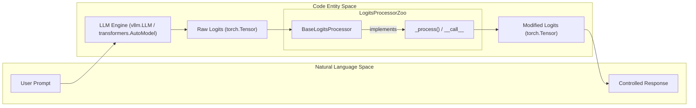
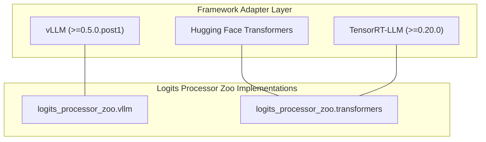

<!-- source: DeepWiki mcp.deepwiki.com · repo NVIDIA/logits-processor-zoo · page 1 Overview · fetched 2026-10-26 -->

# Overview

<details>
<summary>Relevant source files</summary>

The following files were used as context for generating this wiki page:

- [README.md](README.md)
- [docs/logo.jpg](docs/logo.jpg)
- [logits_processor_zoo/transformers/__init__.py](logits_processor_zoo/transformers/__init__.py)
- [logits_processor_zoo/vllm/__init__.py](logits_processor_zoo/vllm/__init__.py)
- [pyproject.toml](pyproject.toml)

</details>


The Logits Processor Zoo is a specialized toolkit designed to provide precise control over Large Language Model (LLM) generation behavior. This library offers a collection of logits processors that modify token probabilities during text generation to achieve specific output patterns, enforce constraints, and enhance LLM capabilities for targeted tasks.

## Purpose and Scope

This document introduces the key components, architecture, and usage patterns of the `logits-processor-zoo`. It provides a high-level understanding of how logits processors can be used to influence LLM outputs beyond traditional generation techniques.

For detailed installation instructions and basic usage, see [Getting Started](#1.1). For practical demonstrations, see [Examples and Notebooks](#1.2).

Sources: [pyproject.toml:2-5](), [README.md:8-10]()

## What Are Logits Processors?

Logits processors are specialized components that intercept and modify the raw token probabilities (logits) produced by an LLM during text generation. By strategically adjusting these probabilities, the processors can:

- Encourage or discourage certain tokens or sequences.
- Enforce structural constraints on generated text.
- Implement custom logic for specific generation requirements (e.g., time limits or hallucination prevention).

This approach provides more granular control than prompt engineering or traditional decoding strategies alone.

### Logits Manipulation Flow

The following diagram bridges the conceptual "Natural Language Space" with the "Code Entity Space" by showing how raw model output is transformed by the `LogitsProcessor` classes.



Sources: [README.md:25-56](), [logits_processor_zoo/transformers/__init__.py:18-28]()

## Key Components

The library is organized by framework integration, providing parallel implementations of processors for different backends.

### Available Processors

The zoo provides several specialized processors, each addressing different generation control needs:

| Processor Class | Purpose | Key Parameters |
|:---|:---|:---|
| `GenLengthLogitsProcessor` | Adjusts EOS likelihood based on length | `boost_factor`, `p` |
| `CiteFromPromptLogitsProcessor` | Boosts tokens found in the prompt | `boost_factor`, `boost_eos` |
| `ForceLastPhraseLogitsProcessor` | Injects a phrase before final EOS | `phrase`, `tokenizer` |
| `MultipleChoiceLogitsProcessor` | Constrains output to specific choices | `choices`, `boost_first_words` |
| `TriggerPhraseLogitsProcessor` | Inserts phrases at specific triggers | `trigger_token_phrase`, `phrase` |
| `PreventHallucinationLogitsProcessor` | Fallback phrase on low confidence | `threshold`, `fallback_phrase` |
| `MaxTimeLogitsProcessor` | Enforces EOS after a time limit | `max_time`, `complete_sentences` |

Sources: [README.md:61-94](), [logits_processor_zoo/transformers/__init__.py:18-24](), [logits_processor_zoo/vllm/__init__.py:18-24]()

## Framework Integrations

The Logits Processor Zoo supports three major LLM inference frameworks. The codebase maintains a parallel structure to ensure consistent behavior across these backends.



Sources: [README.md:18-21](), [pyproject.toml:12-14]()

## Basic Usage Pattern

While specific implementation details vary by framework, the general usage pattern involves passing a list of processor instances to the generation call.

**Example: vLLM Integration**
The library allows passing multiple processors to `vllm.SamplingParams`.

```python
from logits_processor_zoo.vllm import GenLengthLogitsProcessor
# ... model initialization ...
logits_processors = [GenLengthLogitsProcessor(tokenizer, boost_factor=-0.2, p=1)]
model.generate(prompts, vllm.SamplingParams(logits_processors=logits_processors))
```

Sources: [README.md:25-56]()

## Installation and Dependencies

The package is managed using Poetry and can be installed via pip.

| Dependency | Version | Note |
|:---|:---|:---|
| **Python** | `>=3.10` | Core Requirement |
| **transformers** | `>=4.41.2` | Core Requirement |
| **vllm** | `>=0.5.0.post1` | Optional Extra (`[vllm]`) |
| **accelerate** | `>=0.26.1` | Support Library |

Sources: [pyproject.toml:9-17](), [README.md:14-16]()

---

