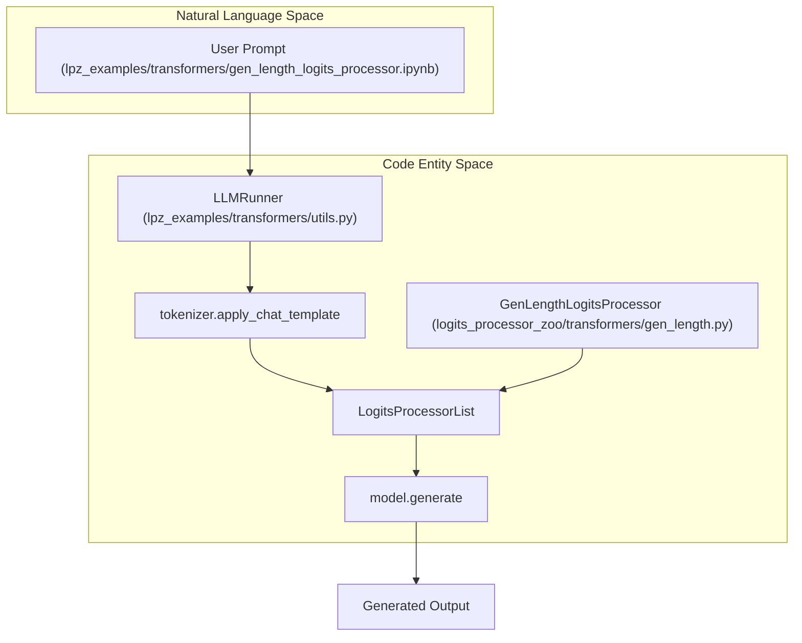
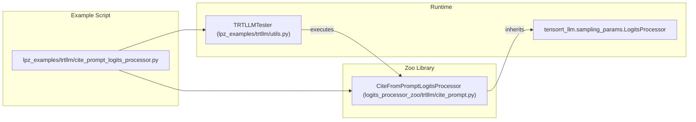

<!-- source: DeepWiki mcp.deepwiki.com · repo NVIDIA/logits-processor-zoo · page 1.2 Examples and Notebooks · fetched 2026-10-26 -->

# Examples and Notebooks

Relevant source files

The following files were used as context for generating this wiki page:

- [lpz_examples/transformers/cite_prompt_logits_processor.ipynb](lpz_examples/transformers/cite_prompt_logits_processor.ipynb)
- [lpz_examples/transformers/force_last_phrase_logits_processor.ipynb](lpz_examples/transformers/force_last_phrase_logits_processor.ipynb)
- [lpz_examples/transformers/gen_length_logits_processor.ipynb](lpz_examples/transformers/gen_length_logits_processor.ipynb)
- [lpz_examples/transformers/max_time_logits_processor.ipynb](lpz_examples/transformers/max_time_logits_processor.ipynb)
- [lpz_examples/transformers/multiple_choice_logits_processor.ipynb](lpz_examples/transformers/multiple_choice_logits_processor.ipynb)
- [lpz_examples/transformers/prevent_hallucination_logits_processor.ipynb](lpz_examples/transformers/prevent_hallucination_logits_processor.ipynb)
- [lpz_examples/transformers/trigger_phrase_logits_processor.ipynb](lpz_examples/transformers/trigger_phrase_logits_processor.ipynb)
- [lpz_examples/transformers/utils.py](lpz_examples/transformers/utils.py)
- [lpz_examples/trtllm/README.md](lpz_examples/trtllm/README.md)
- [lpz_examples/trtllm/cite_prompt_logits_processor.py](lpz_examples/trtllm/cite_prompt_logits_processor.py)
- [lpz_examples/trtllm/gen_length_logits_processor.py](lpz_examples/trtllm/gen_length_logits_processor.py)
- [lpz_examples/trtllm/last_phrase_logits_processor.py](lpz_examples/trtllm/last_phrase_logits_processor.py)
- [lpz_examples/trtllm/max_time_logits_processor.py](lpz_examples/trtllm/max_time_logits_processor.py)
- [lpz_examples/trtllm/multiple_choice_logits_processor.py](lpz_examples/trtllm/multiple_choice_logits_processor.py)
- [lpz_examples/trtllm/prevent_hallucination_logits_processor.py](lpz_examples/trtllm/prevent_hallucination_logits_processor.py)
- [lpz_examples/trtllm/trigger_phrase_logits_processor.py](lpz_examples/trtllm/trigger_phrase_logits_processor.py)
- [lpz_examples/trtllm/utils.py](lpz_examples/trtllm/utils.py)
- [lpz_examples/vllm/cite_prompt_logits_processor.ipynb](lpz_examples/vllm/cite_prompt_logits_processor.ipynb)
- [lpz_examples/vllm/force_last_phrase_logits_processor.ipynb](lpz_examples/vllm/force_last_phrase_logits_processor.ipynb)
- [lpz_examples/vllm/gen_length_logits_processor.ipynb](lpz_examples/vllm/gen_length_logits_processor.ipynb)
- [lpz_examples/vllm/max_time_logits_processor.ipynb](lpz_examples/vllm/max_time_logits_processor.ipynb)
- [lpz_examples/vllm/multiple_choice_logits_processor.ipynb](lpz_examples/vllm/multiple_choice_logits_processor.ipynb)
- [lpz_examples/vllm/performance_profiling.ipynb](lpz_examples/vllm/performance_profiling.ipynb)
- [lpz_examples/vllm/prevent_hallucination_logits_processor.ipynb](lpz_examples/vllm/prevent_hallucination_logits_processor.ipynb)
- [lpz_examples/vllm/trigger_phrase_logits_processor.ipynb](lpz_examples/vllm/trigger_phrase_logits_processor.ipynb)
- [lpz_examples/vllm/utils.py](lpz_examples/vllm/utils.py)
- [lpz_examples/vllm/vllm_serve.ipynb](lpz_examples/vllm/vllm_serve.ipynb)

The `lpz_examples/` directory provides a comprehensive suite of demonstrations for the `logits-processor-zoo` library. These examples are organized by framework—`transformers`, `vLLM`, and `TensorRT-LLM`—and showcase how to implement specific logit manipulation behaviors such as length control, citation enforcement, and hallucination mitigation.

## Overview of Example Structure

The repository maintains a parallel structure for examples across different backends. Each framework directory contains a `utils.py` file that abstracts the model loading and generation logic, allowing the example scripts/notebooks to focus on the configuration of the processors.

| Directory | Format | Primary Tooling |
| :--- | :--- | :--- |
| `lpz_examples/transformers/` | Jupyter Notebooks (`.ipynb`) | `AutoModelForCausalLM`, `LogitsProcessorList` |
| `lpz_examples/vllm/` | Jupyter Notebooks (`.ipynb`) | `vLLM.LLM`, `SamplingParams` |
| `lpz_examples/trtllm/` | Python Scripts (`.py`) | `tensorrt_llm`, `TRTLLMTester` |

**Sources:** [lpz_examples/transformers/utils.py:1-43](), [lpz_examples/trtllm/README.md:1-60]()

---

## Transformers Examples

The Transformers examples utilize the `LLMRunner` class to manage generation. This helper class applies chat templates and handles the `LogitsProcessorList` integration.

### Implementation Flow
The following diagram illustrates how the examples bridge high-level user prompts to the `transformers` generation loop using the library's processors.

**Diagram: Transformers Example Data Flow**

**Sources:** [lpz_examples/transformers/utils.py:5-34](), [lpz_examples/transformers/gen_length_logits_processor.ipynb:36-45]()

### Key Notebooks
*   **`cite_prompt_logits_processor.ipynb`**: Demonstrates boosting tokens found in the input prompt to encourage grounding. It uses `CiteFromPromptLogitsProcessor` with a `conditional_boost_factor` to ensure the model stays on topic [lpz_examples/transformers/cite_prompt_logits_processor.ipynb:36-57]().
*   **`prevent_hallucination_logits_processor.ipynb`**: Shows how to monitor token confidence. When the model's confidence drops below a threshold, the `PreventHallucinationLogitsProcessor` injects a fallback phrase like "I don't know actually" [lpz_examples/transformers/prevent_hallucination_logits_processor.ipynb:122-156]().
*   **`max_time_logits_processor.ipynb`**: Demonstrates interrupting long-running generations (e.g., DeepSeek reasoning chains) after a specific wall-clock time limit using `MaxTimeLogitsProcessor` [lpz_examples/transformers/max_time_logits_processor.ipynb:217-221]().

---

## vLLM Examples

The vLLM examples focus on the integration with `SamplingParams`. Because vLLM handles requests asynchronously, these notebooks emphasize the need for the `logits_processors` argument in the sampling configuration.

### Key Demonstrations
*   **`multiple_choice_logits_processor.ipynb`**: Constrains the model to specific options (e.g., "0, 1, 2, 3" or "a, b, c, d") by masking all other tokens.
*   **`trigger_phrase_logits_processor.ipynb`**: Shows how to insert specific text (like a "Thinking..." prefix) when a trigger condition is met during the generation stream.
*   **`performance_profiling.ipynb`**: Provides benchmarks for the overhead introduced by various processors when running in a high-throughput vLLM environment.

---

## TensorRT-LLM Examples

The TensorRT-LLM examples are provided as Python scripts and require a compiled engine. These examples use a custom `TRTLLMTester` utility to interface with the `tensorrt_llm` runtime.

**Diagram: TensorRT-LLM Integration Architecture**

**Sources:** [lpz_examples/trtllm/cite_prompt_logits_processor.py:1-17](), [lpz_examples/trtllm/README.md:16-25]()

### Running the Scripts
To run the TensorRT-LLM examples, you must be inside a container with `tensorrt_llm` installed (version >= 0.20.0).

1.  **Length Control**: 
    `python lpz_examples/trtllm/gen_length_logits_processor.py` [lpz_examples/trtllm/README.md:10-14]()
2.  **Citation Enforcement**:
    `python lpz_examples/trtllm/cite_prompt_logits_processor.py -p "Your Prompt Here"` [lpz_examples/trtllm/README.md:16-25]()
3.  **Phrase Injection**:
    `python lpz_examples/trtllm/last_phrase_logits_processor.py` [lpz_examples/trtllm/README.md:27-31]()

### Configuration Details
The scripts use a common `get_parser()` to accept model names and prompts via the CLI [lpz_examples/trtllm/cite_prompt_logits_processor.py:7-10]().
*   **`ForceLastPhraseLogitsProcessor`**: In the TRT-LLM example, this is configured to inject a signature phrase: `"\n\nThanks for trying our application!..."` before the EOS token is allowed [lpz_examples/trtllm/last_phrase_logits_processor.py:12-13]().
*   **`GenLengthLogitsProcessor`**: Demonstrates both encouraging brevity (`boost_factor=1.0`) and forcing longer responses (`boost_factor=-1.0`) [lpz_examples/trtllm/gen_length_logits_processor.py:12-16]().

**Sources:** [lpz_examples/trtllm/last_phrase_logits_processor.py:1-16](), [lpz_examples/trtllm/gen_length_logits_processor.py:1-17](), [lpz_examples/trtllm/README.md:1-60]()

---

