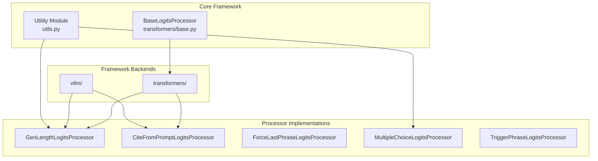
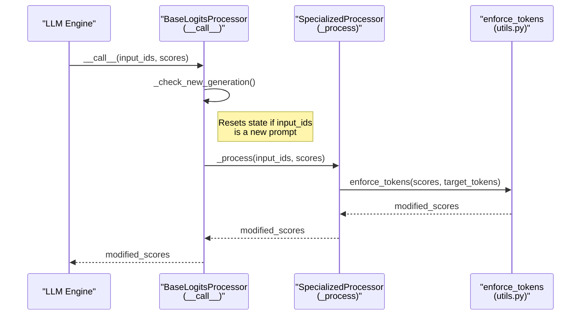

<!-- source: DeepWiki mcp.deepwiki.com · repo NVIDIA/logits-processor-zoo · page 2 Architecture and Design Principles · fetched 2026-10-26 -->

# Architecture and Design Principles

Relevant source files

The following files were used as context for generating this wiki page:

- [logits_processor_zoo/transformers/__init__.py](logits_processor_zoo/transformers/__init__.py)
- [logits_processor_zoo/transformers/base.py](logits_processor_zoo/transformers/base.py)
- [logits_processor_zoo/utils.py](logits_processor_zoo/utils.py)
- [logits_processor_zoo/vllm/__init__.py](logits_processor_zoo/vllm/__init__.py)
- [pyproject.toml](pyproject.toml)
- [tests/test_utils.py](tests/test_utils.py)

This document describes the core architecture and design principles of the Logits Processor Zoo. It explains how the library components are organized, how they interact with each other, and the design patterns used throughout the codebase.

## Core Architecture

The Logits Processor Zoo follows a modular design with clear separation of concerns. The library is organized around these key components:

1.  **Base Logits Processor**: A core base class in `logits_processor_zoo/transformers/base.py` that manages state and the generation lifecycle for the Transformers backend [logits_processor_zoo/transformers/base.py:21-52]().
2.  **Specialized Processors**: Implementations that extend the base class or follow framework-specific protocols to modify logits [logits_processor_zoo/transformers/__init__.py:18-24]().
3.  **Framework Integrations**: Parallel implementations for Transformers, vLLM, and TensorRT-LLM [logits_processor_zoo/transformers/__init__.py:1-28](), [logits_processor_zoo/vllm/__init__.py:1-28]().
4.  **Utility Functions**: Shared helper functions in `logits_processor_zoo/utils.py` used for token manipulation and boundary detection [logits_processor_zoo/utils.py:23-65]().

### Component Relationship

The following diagram maps high-level system components to their specific code entities.

Sources: [logits_processor_zoo/transformers/base.py:21-22](), [logits_processor_zoo/utils.py:1-65](), [logits_processor_zoo/transformers/__init__.py:18-24](), [logits_processor_zoo/vllm/__init__.py:18-24]()

## Logit Manipulation Lifecycle

For the Transformers backend, the lifecycle is managed by `BaseLogitsProcessor`. It handles the transition between different generation calls by tracking `prompt_token_ids` and `prev_token_ids` [logits_processor_zoo/transformers/base.py:23-24]().

1.  **Generation Check**: `_check_new_generation` determines if a new sequence has started [logits_processor_zoo/transformers/base.py:29-43]().
2.  **Reset**: If a new sequence is detected, `_reset()` is called to clear internal processor state [logits_processor_zoo/transformers/base.py:26-27]().
3.  **Processing**: The `_process()` hook is where subclasses implement their specific logit modification logic [logits_processor_zoo/transformers/base.py:45-46]().

For details, see [BaseLogitsProcessor and Lifecycle](#2.1).

## Design Patterns

### Parallel Framework Implementation
The library implements a "Parallel Backend" pattern. Instead of a single complex adapter, each framework (Transformers, vLLM) has its own directory with optimized implementations of the processors. This ensures that framework-specific requirements, such as the `clone()` method for vLLM or the specific `__call__` signature for Transformers, are handled natively [logits_processor_zoo/transformers/__init__.py:18-24](), [logits_processor_zoo/vllm/__init__.py:18-24]().

### Shared Utility Strategy
Common logic that is agnostic of the inference engine is centralized in `utils.py`. This includes:
*   **Tokenization Helpers**: `text_to_token` for safe string-to-ID conversion [logits_processor_zoo/utils.py:23-37]().
*   **Logit Masking**: `enforce_tokens` for boosting specific token IDs while suppressing others [logits_processor_zoo/utils.py:46-52]().
*   **Boundary Detection**: `SentenceChecker` for identifying sentence endings across different input formats [logits_processor_zoo/utils.py:55-65]().

For details, see [Utilities and Helper Functions](#2.2).

## Token Generation Workflow

This diagram illustrates how code entities interact during a single forward pass of an LLM.

Sources: [logits_processor_zoo/transformers/base.py:48-51](), [logits_processor_zoo/utils.py:46-52]()

## Code Organization

The repository structure reflects the separation between core utilities and framework-specific implementations:

| Path | Purpose |
| :--- | :--- |
| `logits_processor_zoo/transformers/` | Processors following the Hugging Face `LogitsProcessor` interface [logits_processor_zoo/transformers/__init__.py:1-28](). |
| `logits_processor_zoo/vllm/` | Processors optimized for vLLM's sampling parameters [logits_processor_zoo/vllm/__init__.py:1-28](). |
| `logits_processor_zoo/utils.py` | Cross-framework helper functions and classes [logits_processor_zoo/utils.py:1-65](). |
| `pyproject.toml` | Dependency management (e.g., optional `vllm` support) [pyproject.toml:14-17](). |

Sources: [pyproject.toml:1-25](), [logits_processor_zoo/utils.py:1-65]()

---

