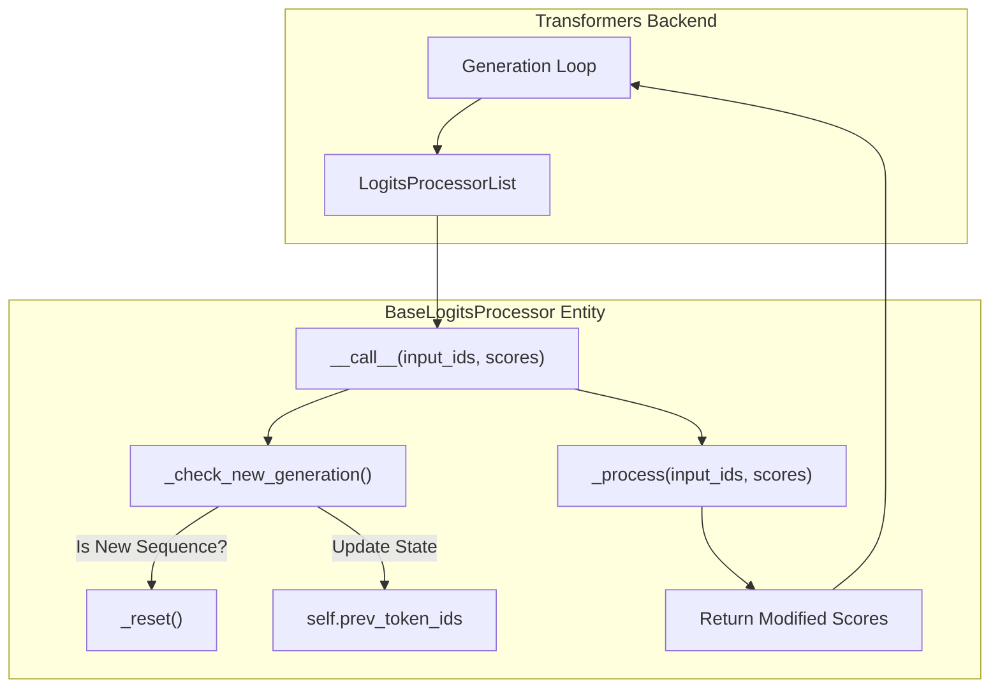

<!-- source: DeepWiki mcp.deepwiki.com · repo NVIDIA/logits-processor-zoo · page 2.1 BaseLogitsProcessor and Lifecycle · fetched 2026-10-26 -->

# BaseLogitsProcessor and Lifecycle

<details>
<summary>Relevant source files</summary>

The following files were used as context for generating this wiki page:

- [logits_processor_zoo/transformers/__init__.py](logits_processor_zoo/transformers/__init__.py)
- [logits_processor_zoo/transformers/base.py](logits_processor_zoo/transformers/base.py)
- [logits_processor_zoo/vllm/__init__.py](logits_processor_zoo/vllm/__init__.py)

</details>


The `BaseLogitsProcessor` serves as the foundational class for all logits processors within the `transformers` backend of the `logits-processor-zoo`. It provides a standardized interface for state management and logit manipulation, ensuring that processors can distinguish between the start of a new generation sequence and the continuation of an existing one.

### Purpose and Scope

In the Hugging Face `transformers` library, a `LogitsProcessor` is called at every step of the decoding process. However, the library does not natively provide a mechanism to reset internal state (like counters or timers) when a new generation starts. `BaseLogitsProcessor` implements this lifecycle management, allowing developers to focus on the `_process` logic while the base class handles state tracking via `_check_new_generation`.

---

### The BaseLogitsProcessor Class

Defined in `logits_processor_zoo/transformers/base.py`, this class establishes the internal state variables and the execution flow for subclasses.

| Attribute | Type | Description |
| :--- | :--- | :--- |
| `prompt_token_ids` | `torch.LongTensor` | Stores the initial prompt IDs to detect when a new sequence begins. [logits_processor_zoo/transformers/base.py:23-23]() |
| `prev_token_ids` | `torch.LongTensor` | Stores the `input_ids` from the previous step to validate sequence continuity. [logits_processor_zoo/transformers/base.py:24-24]() |

#### Methods and Hooks

*   **`_reset()`**: A hook intended to be overridden by subclasses. It is called whenever a new generation is detected. [logits_processor_zoo/transformers/base.py:26-27]()
*   **`_process(input_ids, scores)`**: The core logic hook. Subclasses implement their specific logit manipulation here. [logits_processor_zoo/transformers/base.py:45-46]()
*   **`__call__(input_ids, scores)`**: The entry point used by the `transformers` generation loop. [logits_processor_zoo/transformers/base.py:48-51]()

**Sources:**
* [logits_processor_zoo/transformers/base.py:21-52]()

---

### The Lifecycle Flow

The lifecycle is governed by the `__call__` method, which orchestrates sequence validation before applying logit transformations.

#### Sequence Detection Logic (`_check_new_generation`)
This method determines if the current `input_ids` belong to a new generation request or a continuation of the previous one. It triggers `_reset()` if:
1.  `prompt_token_ids` is `None` (the very first call). [logits_processor_zoo/transformers/base.py:30-33]()
2.  The current `input_ids` (excluding the last token) do not match the `prev_token_ids` from the last step. [logits_processor_zoo/transformers/base.py:35-41]()

#### Data Flow Diagram: Transformer Lifecycle
The following diagram illustrates how the `transformers` backend interacts with the `BaseLogitsProcessor` entities.



**Sources:**
* [logits_processor_zoo/transformers/base.py:29-51]()

---

### Implementation Details

The implementation relies on `torch.equal` to compare tensors across generation steps. This is critical for batch processing and ensuring that processors like `MaxTimeLogitsProcessor` or `TriggerPhraseLogitsProcessor` correctly reset their internal clocks or indices when the model starts a fresh prompt.

#### Lifecycle Execution Trace
The following sequence diagram maps the Natural Language generation steps to the Code Entity Space.

```mermaid
sequenceDiagram
    participant T as "transformers.GenerationMixin"
    participant B as "BaseLogitsProcessor"
    participant S as "Subclass (e.g., GenLengthLogitsProcessor)"

    Note over T, S: Step 1: First Token Generation
    T->>B: __call__(input_ids, scores)
    activate B
    B->>B: _check_new_generation()
    B->>S: _reset()
    B->>S: _process(input_ids, scores)
    S-->>B: scores
    B-->>T: scores
    deactivate B

    Note over T, S: Step 2: Subsequent Token Generation
    T->>B: __call__(input_ids, scores)
    activate B
    B->>B: _check_new_generation()
    Note right of B: same_gen == True; No _reset()
    B->>S: _process(input_ids, scores)
    S-->>B: scores
    B-->>T: scores
    deactivate B
```

**Sources:**
* [logits_processor_zoo/transformers/base.py:29-51]()
* [logits_processor_zoo/transformers/__init__.py:18-28]()

### Subclass Integration
All processors in the `transformers` directory (e.g., `GenLengthLogitsProcessor`, `CiteFromPromptLogitsProcessor`) inherit from this base class to ensure consistent behavior across the zoo.

**Sources:**
* [logits_processor_zoo/transformers/__init__.py:18-24]()

---

