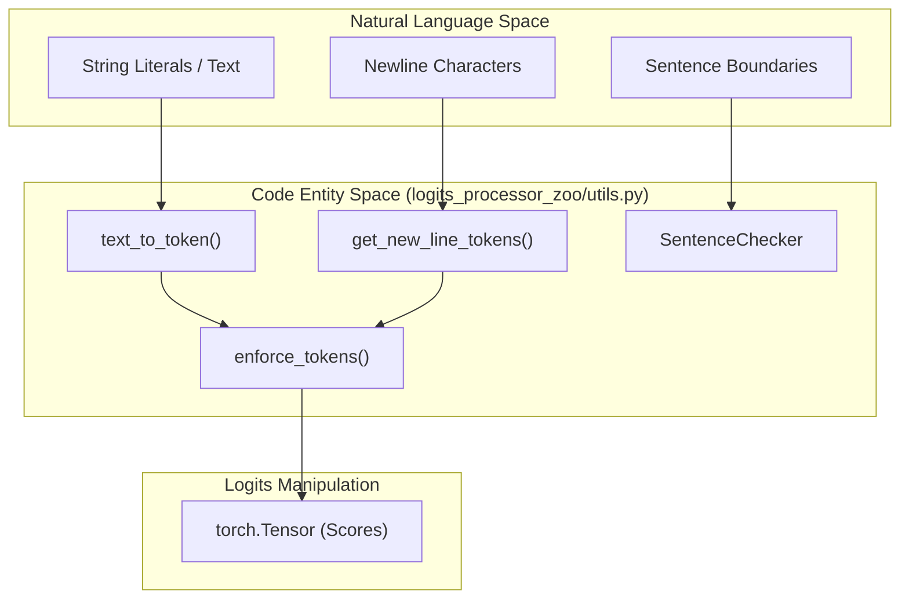
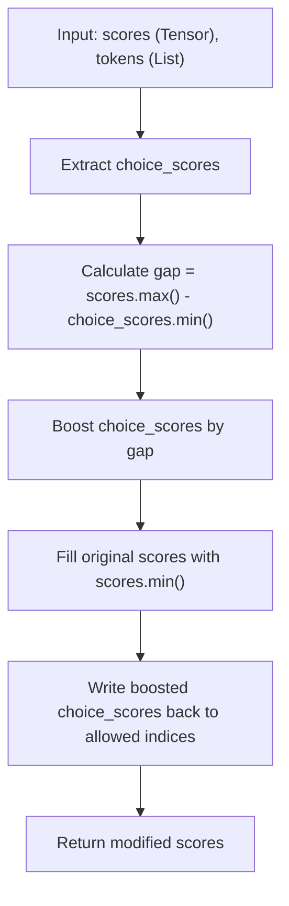
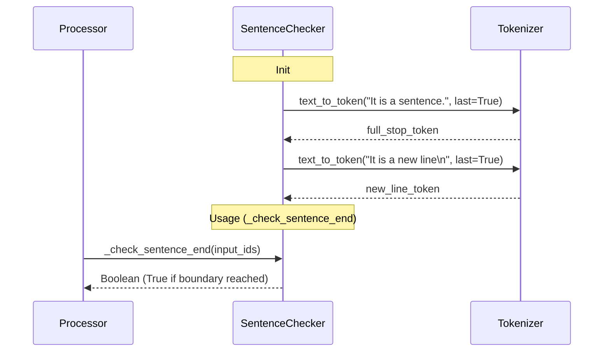

<!-- source: DeepWiki mcp.deepwiki.com · repo NVIDIA/logits-processor-zoo · page 2.2 Utilities and Helper Functions · fetched 2026-10-26 -->

# Utilities and Helper Functions

Relevant source files

The following files were used as context for generating this wiki page:

- [logits_processor_zoo/utils.py](logits_processor_zoo/utils.py)
- [tests/test_utils.py](tests/test_utils.py)

This page documents the utility functions and helper classes in `logits_processor_zoo/utils.py` that support all processors across the library. These utilities provide essential token validation, logit manipulation, and boundary detection capabilities used to bridge the gap between natural language strings and the model's logit space.

## Overview of Utility Functions

The `utils.py` module contains stateless functions for token conversion and logit masking, as well as the `SentenceChecker` class for stateful or structural boundary detection.

Sources: [logits_processor_zoo/utils.py:1-65]()

## Token Conversion and Validation

### Function: text_to_token
This function converts a text string into a single token ID. It includes safety checks to ensure that the provided text does not decompose into multiple tokens unless explicitly permitted.

**Implementation Details:**
- It uses `tokenizer.encode(text, add_special_tokens=False)` [logits_processor_zoo/utils.py:24]().
- It accounts for tokenizers that automatically prepend a BOS (Beginning of Sentence) token or a prefix space [logits_processor_zoo/utils.py:28-31]().
- If `last=False`, the function raises an exception if the text results in more tokens than the allowed `max_token_count` (usually 1 or 2) [logits_processor_zoo/utils.py:33-34]().
- If `last=True`, it simply returns the final token ID in the sequence [logits_processor_zoo/utils.py:36]().

Sources: [logits_processor_zoo/utils.py:23-37]()

### Function: get_new_line_tokens
This function scans the entire tokenizer vocabulary to identify all tokens that represent or end with a newline character (`\n`). This is critical for processors like `GenLengthLogitsProcessor` that need to detect paragraph ends.

**Implementation Details:**
- Iterates through `tokenizer.get_vocab().values()` [logits_processor_zoo/utils.py:40]().
- Decodes each token and checks if it `endswith("\n")` [logits_processor_zoo/utils.py:41]().
- Returns a `set` for O(1) lookup during the logit processing loop [logits_processor_zoo/utils.py:43]().

Sources: [logits_processor_zoo/utils.py:39-43]()

## Logit Manipulation

### Function: enforce_tokens
This function modifies the `scores` tensor to ensure that only a specific subset of tokens can be sampled. It is used extensively by the `MultipleChoiceLogitsProcessor`.

**Logic Flow:**
1. Clones the scores of the allowed tokens [logits_processor_zoo/utils.py:47]().
2. Calculates a `gap` between the global maximum and the minimum allowed score to ensure allowed tokens remain competitive after shifting [logits_processor_zoo/utils.py:48-49]().
3. Fills the entire `scores` tensor with the minimum possible value [logits_processor_zoo/utils.py:50]().
4. Restores the allowed tokens with their boosted scores [logits_processor_zoo/utils.py:51]().

Sources: [logits_processor_zoo/utils.py:46-52](), [tests/test_utils.py:22-29]()

## Boundary Detection

### Class: SentenceChecker
The `SentenceChecker` class provides a standardized way to determine if the current generation has reached a sentence or line boundary.

**Initialization:**
Upon instantiation, it identifies the specific token IDs for a full stop (`.`) and a newline (`\n`) by encoding sample sentences [logits_processor_zoo/utils.py:57-58]().

**Method: _check_sentence_end:**
- Supports both `vLLM` (list/tuple of IDs) and `transformers` (torch.Tensor) input formats [logits_processor_zoo/utils.py:61-64]().
- Checks if the last generated token (`input_ids[-1]`) matches the stored `full_stop_token` or `new_line_token` [logits_processor_zoo/utils.py:62-64]().

Sources: [logits_processor_zoo/utils.py:55-65]()

## Summary Table of Utilities

| Entity | Type | Purpose | Key Dependency |
| :--- | :--- | :--- | :--- |
| `text_to_token` | Function | Safe string-to-ID conversion | `PreTrainedTokenizer` |
| `get_new_line_tokens` | Function | Vocabulary-wide newline search | `tokenizer.get_vocab()` |
| `enforce_tokens` | Function | Hard-masking logits for specific tokens | `torch.Tensor` |
| `SentenceChecker` | Class | Detecting sentence/paragraph endings | `text_to_token` |

Sources: [logits_processor_zoo/utils.py:1-65]()

---

