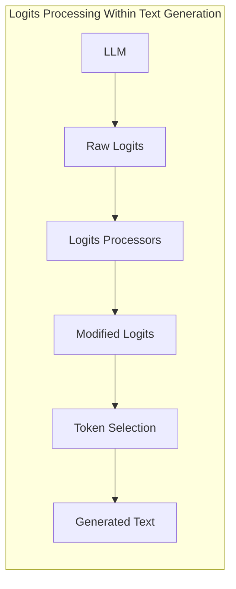
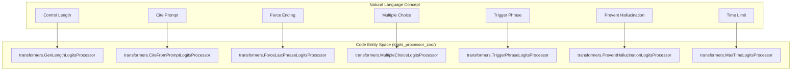
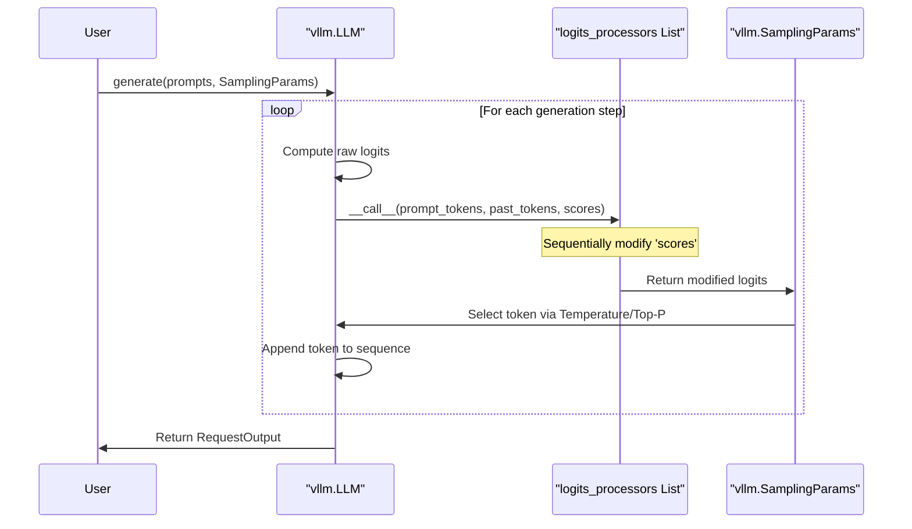

<!-- source: DeepWiki mcp.deepwiki.com · repo NVIDIA/logits-processor-zoo · page 3 Logits Processors · fetched 2026-10-26 -->

# Logits Processors

Relevant source files

The following files were used as context for generating this wiki page:

- [README.md](README.md)
- [logits_processor_zoo/transformers/__init__.py](logits_processor_zoo/transformers/__init__.py)
- [logits_processor_zoo/vllm/__init__.py](logits_processor_zoo/vllm/__init__.py)

## Purpose and Scope

Logits processors are specialized components that modify token probabilities (logits) during LLM text generation to control model outputs in precise ways. This page documents the core concept of logits processors and provides an overview of the available processors in the `logits-processor-zoo`. For information about framework-specific integrations, see [Framework Integrations](#4).

## What Are Logits Processors?

Logits processors intercept and modify the probability distribution over the vocabulary that an LLM produces at each generation step. By strategically adjusting these probabilities, processors can guide the model toward producing specific outputs—such as enforcing a specific length, citing a prompt, or choosing from a list—without requiring model retraining [README.md:8-10]().

### Logits Processing Pipeline

Sources: [README.md:8-10]()

## Code Entity Mapping

The following diagram bridges the conceptual "Natural Language Space" to the "Code Entity Space" by mapping processor types to their specific class implementations in the `transformers` and `vLLM` sub-packages.

### Processor Class Mapping

Sources: [logits_processor_zoo/transformers/__init__.py:18-28](), [logits_processor_zoo/vllm/__init__.py:18-28]()

## Available Logits Processors

The library provides several specialized logits processors. Detailed technical documentation for each can be found in their respective child pages.

### [GenLengthLogitsProcessor](#3.1)
Adjusts the likelihood of the end-of-sequence (EOS) token based on the current sequence length [README.md:63-64](). It uses a `boost_factor` and a power parameter `p` to encourage or discourage shorter answers.

### [CiteFromPromptLogitsProcessor](#3.2)
Boosts or diminishes the likelihood of tokens present in the prompt [README.md:66-67](). This encourages the model to generate tokens similar to those seen in the input or vice versa.

### [ForceLastPhraseLogitsProcessor](#3.3)
Forces the LLM to use a specific phrase before finalizing the answer with an EOS token [README.md:69-70](). This is commonly used for adding mandatory references or specific closing formatting.

### [MultipleChoiceLogitsProcessor](#3.4)
Constrains the model to answer multiple-choice questions with exactly one of the provided choices [README.md:72-81](). It identifies valid tokens from a prompt's options list.

### [TriggerPhraseLogitsProcessor](#3.5)
Triggers the injection of a specific phrase when a certain token is encountered or after a specified time [README.md:83-84](). For example, it can force a `python` code block immediately after a `</think>` tag [README.md:87-89]().

### [PreventHallucinationLogitsProcessor](#3.6)
Mitigates hallucinated outputs by enforcing a predefined fallback phrase when token confidence (min-p) falls below a threshold for a set number of tokens [README.md:90-91]().

### [MaxTimeLogitsProcessor](#3.7)
Enforces the EOS token after a specified wall-clock time limit has passed [README.md:93-94](). It can optionally wait for a full sentence completion before stopping.

Sources: [README.md:61-94](), [logits_processor_zoo/transformers/__init__.py:18-24]()

## Logits Processor Integration Flow

The following sequence diagram illustrates how multiple processors are integrated into the generation loop, specifically showing how they are passed via `logits_processors` lists in frameworks like vLLM.

### Generation Loop with LogitsProcessors

Sources: [README.md:25-56]()

## Framework Implementation Overview

The library maintains a parallel structure across supported frameworks. While the logic remains consistent, the interfaces are adapted for `transformers`, `vLLM`, and `TensorRT-LLM`.

| Processor | Transformers | vLLM | TensorRT-LLM |
| :--- | :---: | :---: | :---: |
| **GenLength** | Yes | Yes | Yes |
| **CiteFromPrompt** | Yes | Yes | Yes |
| **ForceLastPhrase** | Yes | Yes | Yes |
| **MultipleChoice** | Yes | Yes | Yes |
| **TriggerPhrase** | Yes | Yes | Yes |
| **PreventHallucination** | Yes | Yes | Yes |
| **MaxTime** | Yes | Yes | Yes |

Sources: [logits_processor_zoo/transformers/__init__.py:26-28](), [logits_processor_zoo/vllm/__init__.py:26-28](), [README.md:18-21]()

For detailed information about each processor, see:
- [GenLengthLogitsProcessor](#3.1)
- [CiteFromPromptLogitsProcessor](#3.2)
- [ForceLastPhraseLogitsProcessor](#3.3)
- [MultipleChoiceLogitsProcessor](#3.4)
- [TriggerPhraseLogitsProcessor](#3.5)
- [PreventHallucinationLogitsProcessor](#3.6)
- [MaxTimeLogitsProcessor](#3.7)

---

