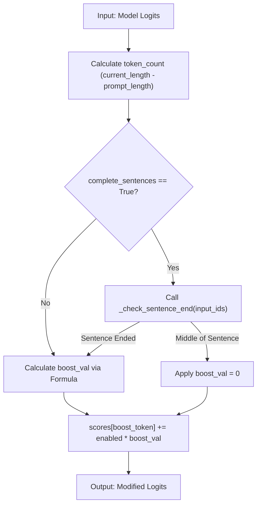
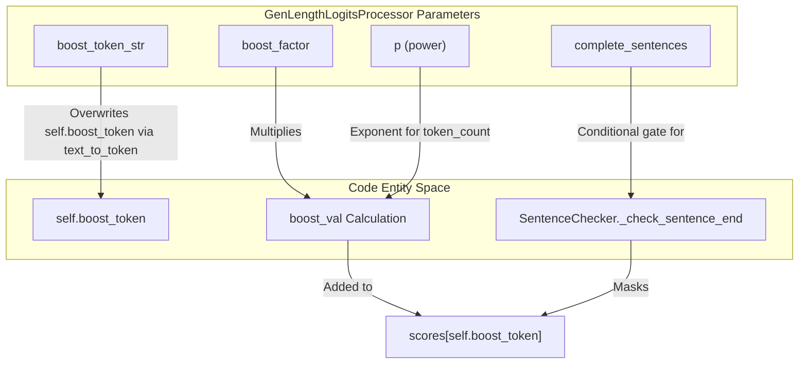
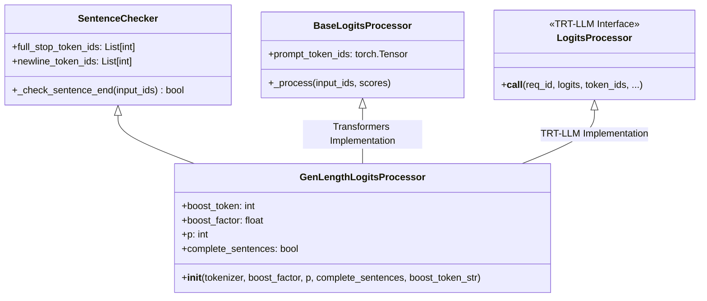

<!-- source: DeepWiki mcp.deepwiki.com · repo NVIDIA/logits-processor-zoo · page 3.1 GenLengthLogitsProcessor · fetched 2026-10-26 -->

# GenLengthLogitsProcessor

<details>
<summary>Relevant source files</summary>

The following files were used as context for generating this wiki page:

- [logits_processor_zoo/transformers/generation_length.py](logits_processor_zoo/transformers/generation_length.py)
- [logits_processor_zoo/trtllm/generation_length.py](logits_processor_zoo/trtllm/generation_length.py)
- [logits_processor_zoo/vllm/generation_length.py](logits_processor_zoo/vllm/generation_length.py)
- [tests/transformers/test_generation_length.py](tests/transformers/test_generation_length.py)

</details>


## Purpose and Overview

The `GenLengthLogitsProcessor` is a specialized logits processor that controls the length of text generated by Large Language Models (LLMs). It achieves this by dynamically adjusting the probability of the end-of-sequence (EOS) token (or a custom boost token) based on the current length of the generated text. This processor can be configured to either encourage shorter responses (by making the EOS token more likely as generation progresses) or longer responses (by suppressing the EOS token).

Sources: [logits_processor_zoo/transformers/generation_length.py:24-29](), [logits_processor_zoo/vllm/generation_length.py:24-28]()

## How It Works

The `GenLengthLogitsProcessor` modifies token probabilities during text generation by:

1. Tracking the number of tokens generated so far.
2. Calculating a non-linear boost value based on the token count and the power parameter `p`.
3. Applying this boost to the specified token (usually the EOS token).
4. Optionally enforcing complete sentences by only applying the boost when the last token is a sentence terminator (period or newline).

### Non-Linear Boost Formula
The boost value applied to the logits is calculated as follows:
`boost_val = boost_factor * (token_count ** p) / (10 ** p)`

Sources: [logits_processor_zoo/transformers/generation_length.py:52-63](), [logits_processor_zoo/vllm/generation_length.py:60-62]()

### Operation Flow Diagram



Sources: [logits_processor_zoo/transformers/generation_length.py:52-63](), [logits_processor_zoo/vllm/generation_length.py:58-69]()

## Parameters and Configuration

The `GenLengthLogitsProcessor` accepts the following parameters:

| Parameter | Type | Description | Default |
|-----------|------|-------------|---------|
| `tokenizer` | `PreTrainedTokenizer` | The tokenizer used by the LLM. | Required |
| `boost_factor` | `float` | Factor to adjust EOS token likelihood (-1.0 to 1.0 suggested). | Required |
| `p` | `int` | Power for scaling with token count. | 2 |
| `complete_sentences` | `bool` | If True, only boost EOS at full stops or new lines. | False |
| `boost_token_str` | `str` | Custom string to tokenize and boost (e.g., `"</think>"`). | None |

Sources: [logits_processor_zoo/transformers/generation_length.py:40-50](), [logits_processor_zoo/vllm/generation_length.py:39-52]()

### Parameter Effects Diagram



Sources: [logits_processor_zoo/transformers/generation_length.py:41-60](), [logits_processor_zoo/vllm/generation_length.py:46-68]()

## Implementation Details

The processor inherits from `SentenceChecker` to access boundary detection logic and, in the Transformers implementation, from `BaseLogitsProcessor` to manage prompt/generation lifecycle.

### Technical Architecture



Sources: [logits_processor_zoo/transformers/generation_length.py:24](), [logits_processor_zoo/vllm/generation_length.py:24](), [logits_processor_zoo/trtllm/generation_length.py:25]()

### Framework Specifics

- **Transformers**: Calculates `token_count` by subtracting `self.prompt_token_ids.shape[1]` from current `input_ids.shape[1]`. [logits_processor_zoo/transformers/generation_length.py:52]()
- **vLLM**: Uses `len(past_token_ids)` directly as the generation length. It also includes a safety check to avoid boosting if the `boost_token` is already present in `past_token_ids`. [logits_processor_zoo/vllm/generation_length.py:54-58]()
- **TensorRT-LLM**: Manages an internal `self.token_count` state which is incremented manually at the end of each `__call__`. [logits_processor_zoo/trtllm/generation_length.py:51-70]()

## Usage Examples

### Example: Transformers Integration
To encourage shorter responses while ensuring natural endings:

```python
from logits_processor_zoo.transformers import GenLengthLogitsProcessor

processor = GenLengthLogitsProcessor(
    tokenizer=tokenizer,
    boost_factor=0.5,
    p=2,
    complete_sentences=True
)
# Use in model.generate(..., logits_processor=[processor])
```

Sources: [tests/transformers/test_generation_length.py:21-30]()

## Best Practices and Considerations

1. **Lifecycle Management**: In the Transformers implementation, create a new object before every `model.generate` call because `token_count` is derived from the initial prompt set during the first call. [logits_processor_zoo/transformers/generation_length.py:28-29]()
2. **Boost Factor Tuning**:
   - Positive values (e.g., `0.1` to `1.0`) make EOS more likely (shorter text).
   - Negative values make EOS less likely (longer text).
3. **Custom Stop Tokens**: Use `boost_token_str` for specialized models (e.g., reasoning models using `</think>`) to force transitions out of specific blocks rather than ending the entire sequence. [logits_processor_zoo/transformers/generation_length.py:38]()

Sources: [logits_processor_zoo/transformers/generation_length.py:28-41](), [logits_processor_zoo/vllm/generation_length.py:32-37]()

---

