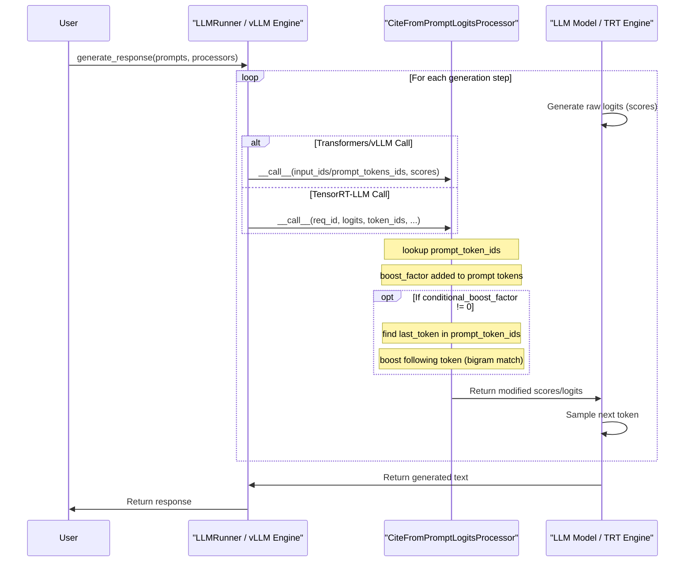
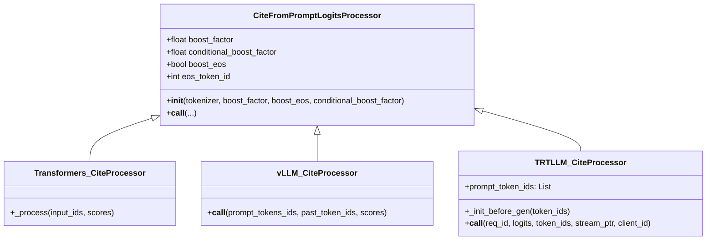

<!-- source: DeepWiki mcp.deepwiki.com · repo NVIDIA/logits-processor-zoo · page 3.2 CiteFromPromptLogitsProcessor · fetched 2026-10-26 -->

# CiteFromPromptLogitsProcessor

<details>
<summary>Relevant source files</summary>

The following files were used as context for generating this wiki page:

- [logits_processor_zoo/transformers/cite_prompt.py](logits_processor_zoo/transformers/cite_prompt.py)
- [logits_processor_zoo/trtllm/cite_prompt.py](logits_processor_zoo/trtllm/cite_prompt.py)
- [logits_processor_zoo/trtllm/last_phrase.py](logits_processor_zoo/trtllm/last_phrase.py)
- [logits_processor_zoo/vllm/cite_prompt.py](logits_processor_zoo/vllm/cite_prompt.py)
- [tests/transformers/test_cite_prompt.py](tests/transformers/test_cite_prompt.py)

</details>


## Overview

The `CiteFromPromptLogitsProcessor` is a specialized logits processor that influences the likelihood of tokens from the input prompt appearing in the model's generated output. By adjusting a boost factor, this processor can either encourage the model to cite/reuse content from the prompt (positive boost) or discourage prompt token reuse (negative boost). It supports simple unigram boosting as well as a conditional bigram lookup mechanism to influence generation based on the previous token.

Sources: [logits_processor_zoo/transformers/cite_prompt.py:23-36](), [logits_processor_zoo/vllm/cite_prompt.py:23-35]()

## How It Works

The processor modifies the probability distribution of tokens during text generation by applying two types of boosts:

1.  **Global Boost**: Applies `boost_factor` to any token present in the prompt.
2.  **Conditional (Bigram) Boost**: Applies `conditional_boost_factor` to a token if it followed the current "last token" in the original prompt.

### Data Flow and Code Entity Mapping

The following diagram bridges the logical generation flow with the specific code entities across different frameworks.



Sources: [logits_processor_zoo/transformers/cite_prompt.py:45-63](), [logits_processor_zoo/vllm/cite_prompt.py:47-63](), [logits_processor_zoo/trtllm/cite_prompt.py:49-75]()

## Implementation Details

The implementation varies slightly across frameworks to accommodate batching and memory layout requirements.

### Bigram Lookup Mechanism
If `conditional_boost_factor` is non-zero, the processor scans the prompt for occurrences of the most recently generated token (`last_token`). If `prompt[i] == last_token`, then `prompt[i+1]` receives the conditional boost. This encourages the model to follow the same sequences found in the source text.

### Vocabulary Safety Checks
All implementations include safety checks to ensure token IDs do not exceed the logit tensor dimensions (vocabulary size), preventing index-out-of-bounds errors.
- **Transformers**: `t < voc_size` [logits_processor_zoo/transformers/cite_prompt.py:52]()
- **vLLM**: `t < scores.shape[0]` [logits_processor_zoo/vllm/cite_prompt.py:52]()
- **TRT-LLM**: `t < logits.shape[-1]` [logits_processor_zoo/trtllm/cite_prompt.py:59]()

### Class Structure



Sources: [logits_processor_zoo/transformers/cite_prompt.py:23-43](), [logits_processor_zoo/vllm/cite_prompt.py:23-45](), [logits_processor_zoo/trtllm/cite_prompt.py:24-44]()

## Parameters

| Parameter | Type | Default | Description |
|-----------|------|---------|-------------|
| `tokenizer` | `PreTrainedTokenizer` | Required | The tokenizer used by the LLM. vLLM also accepts a string path. |
| `boost_factor` | `float` | `1.0` | Factor to adjust token scores from the prompt. |
| `boost_eos` | `bool` | `True` | Whether to boost the EOS token score alongside prompt tokens. |
| `conditional_boost_factor` | `float` | `0.0` | Factor to boost tokens based on the previous token (bigram matching). |

**Warning**: In the Transformers implementation, you must create a new object before every `model.generate` call because `prompt_token_ids` are captured from the batch during the first step of generation.

Sources: [logits_processor_zoo/transformers/cite_prompt.py:27-38](), [logits_processor_zoo/vllm/cite_prompt.py:36-37]()

## Framework Specifics

### TensorRT-LLM Integration
The TRT-LLM implementation uses an `_init_before_gen` helper to capture the prompt tokens from the first beam of the request. It also handles CUDA streams via `torch.cuda.ExternalStream(stream_ptr)` to ensure the logit modifications are synchronized with the engine's execution.

Sources: [logits_processor_zoo/trtllm/cite_prompt.py:46-63]()

### vLLM Integration
The vLLM implementation is stateless regarding the prompt; it receives `prompt_tokens_ids` and `past_token_ids` directly in every `__call__`, making it natively compatible with vLLM's batched scheduling.

Sources: [logits_processor_zoo/vllm/cite_prompt.py:47-55]()

## Testing and Validation

The processor is validated by checking the intersection of tokens between the prompt and the output. A successful test confirms that applying the processor results in a higher token overlap compared to default generation.

```python
# From tests/transformers/test_cite_prompt.py
logits_processors = [CiteFromPromptLogitsProcessor(llm_runner.tokenizer, boost_factor=50.0, 
                                                   conditional_boost_factor=50.0)]
processed_gen_output = llm_runner.generate_response(example_prompts, logits_processors, max_new_tokens=10)

# Validation logic
assert len(processed_shared_tokens) > len(default_shared_tokens)
```

Sources: [tests/transformers/test_cite_prompt.py:21-41]()

---

