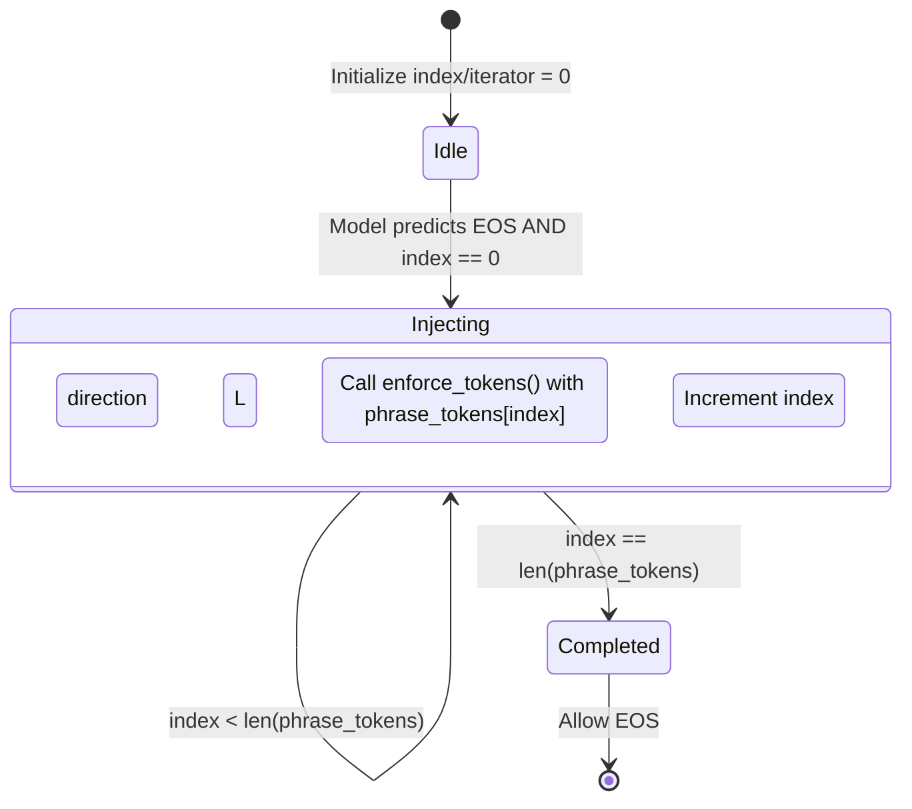
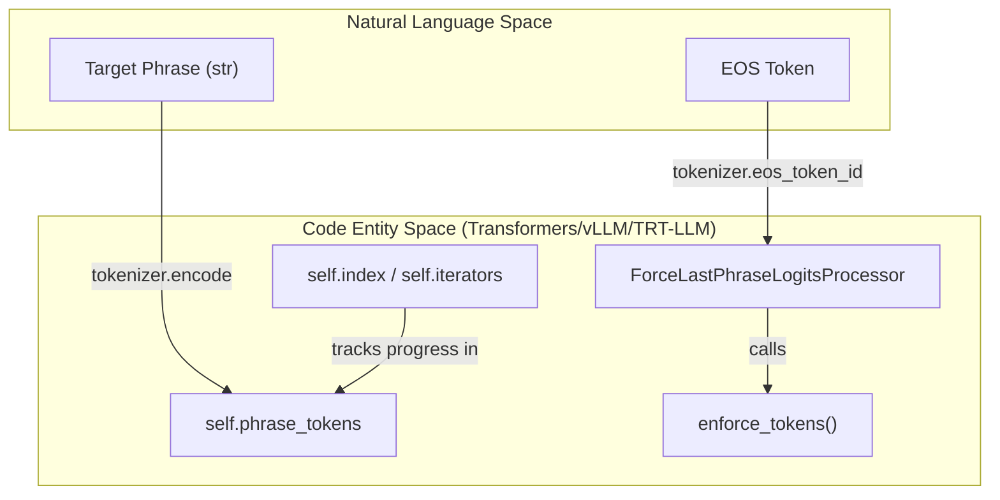
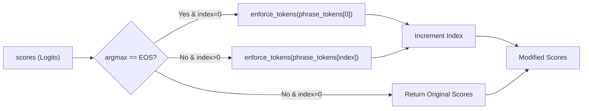

<!-- source: DeepWiki mcp.deepwiki.com · repo NVIDIA/logits-processor-zoo · page 3.3 ForceLastPhraseLogitsProcessor · fetched 2026-10-26 -->

# ForceLastPhraseLogitsProcessor

Relevant source files

The following files were used as context for generating this wiki page:

- [logits_processor_zoo/transformers/last_phrase.py](logits_processor_zoo/transformers/last_phrase.py)
- [logits_processor_zoo/transformers/multiple_choice.py](logits_processor_zoo/transformers/multiple_choice.py)
- [logits_processor_zoo/trtllm/cite_prompt.py](logits_processor_zoo/trtllm/cite_prompt.py)
- [logits_processor_zoo/trtllm/last_phrase.py](logits_processor_zoo/trtllm/last_phrase.py)
- [logits_processor_zoo/vllm/last_phrase.py](logits_processor_zoo/vllm/last_phrase.py)
- [tests/transformers/test_last_phrase.py](tests/transformers/test_last_phrase.py)

## Purpose and Overview

The `ForceLastPhraseLogitsProcessor` is a specialized logits processor that forces Language Models (LLMs) to insert a specific phrase before concluding their generation. This processor is particularly useful for applications that require consistent output formats, such as automatically appending references, adding thank you messages, or ensuring specific closing statements are included in the generated text. It functions by intercepting the End-of-Sequence (EOS) token and injecting the target phrase tokens into the generation stream.

Sources: [logits_processor_zoo/transformers/last_phrase.py:24-35](), [logits_processor_zoo/vllm/last_phrase.py:24-33](), [logits_processor_zoo/trtllm/last_phrase.py:25-29]()

## How It Works

The processor operates as a state machine that monitors the model's output. It remains idle until the model's highest-scoring token is the EOS token. At that point, it "hijacks" the generation to inject the phrase.

### Phrase Injection State Machine

Title: State Machine for Phrase Injection

Sources: [logits_processor_zoo/vllm/last_phrase.py:56-61](), [logits_processor_zoo/transformers/last_phrase.py:46-53](), [logits_processor_zoo/trtllm/last_phrase.py:54-60]()

### Key Mechanism

1.  **EOS Interception**: The processor checks if the `argmax()` of the current `scores` (logits) matches the `self.eos_token_id` [logits_processor_zoo/vllm/last_phrase.py:56]().
2.  **Token Enforcement**: If EOS is predicted and the phrase hasn't started (`index == 0`), it uses `enforce_tokens` to mask all logits except for the first token of the target phrase [logits_processor_zoo/vllm/last_phrase.py:57]().
3.  **Sequential Injection**: Once the phrase has started, the processor continues to force the next token in `self.phrase_tokens` regardless of what the model predicts, until the entire phrase is exhausted [logits_processor_zoo/transformers/last_phrase.py:51-53]().
4.  **Completion**: After the last token of the phrase is injected, the processor stops interfering, allowing the model to naturally generate the EOS token [logits_processor_zoo/vllm/last_phrase.py:59-61]().

Sources: [logits_processor_zoo/vllm/last_phrase.py:52-63](), [logits_processor_zoo/transformers/last_phrase.py:45-55]()

## Implementation Details

The library provides parallel implementations for Transformers, vLLM, and TensorRT-LLM to handle their respective batching and state requirements.

### Code Entity Mapping

Title: Mapping Concepts to Code Entities

Sources: [logits_processor_zoo/transformers/last_phrase.py:36-40](), [logits_processor_zoo/vllm/last_phrase.py:34-42](), [logits_processor_zoo/utils.py:61-68]()

### Framework-Specific Behaviors

#### Transformers Implementation
The Transformers version inherits from `BaseLogitsProcessor` [logits_processor_zoo/transformers/last_phrase.py:24](). It manages state for a batch using a `torch.Tensor` of `iterators` [logits_processor_zoo/transformers/last_phrase.py:43]().
*   **Warning**: Users must create a new object before every `model.generate` call to reset the iterators, or ensure the internal `_reset()` is called [logits_processor_zoo/transformers/last_phrase.py:28-29]().

#### vLLM Implementation
The vLLM version includes a `clone()` method [logits_processor_zoo/vllm/last_phrase.py:46-47]().
*   **Clone Requirement**: vLLM requires mutable processors to be cloneable to prevent state leakage between different prompts in a batch [logits_processor_zoo/vllm/last_phrase.py:44-45]().
*   **State**: Uses a simple integer `self.index` as it is cloned per-sequence [logits_processor_zoo/vllm/last_phrase.py:50]().

#### TensorRT-LLM Implementation
Inherits from `tensorrt_llm.sampling_params.LogitsProcessor` [logits_processor_zoo/trtllm/last_phrase.py:25]().
*   **Beam Support**: It initializes iterators based on the `beam_width` during the `_init_before_gen` hook [logits_processor_zoo/trtllm/last_phrase.py:40-41]().
*   **CUDA Streams**: Wraps logit manipulation in `torch.cuda.stream(stream)` to ensure compatibility with the TRT-LLM runtime [logits_processor_zoo/trtllm/last_phrase.py:52-53]().

## Technical Specifications

### Parameters

| Parameter | Type | Framework | Description |
| :--- | :--- | :--- | :--- |
| `phrase` | `str` | All | The text to be injected before EOS. |
| `tokenizer` | `PreTrainedTokenizer` | All | Used to encode the phrase and identify EOS. |
| `batch_size` | `int` | Transformers | Required to initialize the iterator tensor for batched inference. |

Sources: [logits_processor_zoo/transformers/last_phrase.py:36](), [logits_processor_zoo/vllm/last_phrase.py:34](), [logits_processor_zoo/trtllm/last_phrase.py:35]()

### Data Flow

Title: Logit Manipulation Logic

Sources: [logits_processor_zoo/vllm/last_phrase.py:52-63](), [logits_processor_zoo/transformers/last_phrase.py:45-55]()

## Technical Considerations

1.  **Tokenization Consistency**: The phrase is encoded using `add_special_tokens=False` [logits_processor_zoo/vllm/last_phrase.py:40](). Ensure the tokenizer provided matches the one used by the LLM to avoid "broken" phrases due to differing vocabularies.
2.  **Batching State**: In the Transformers implementation, `self.iterators` is a tensor of size `batch_size` [logits_processor_zoo/transformers/last_phrase.py:43](). If the generation involves sequences finishing at different times, the processor correctly tracks each sequence's progress through the phrase independently [logits_processor_zoo/transformers/last_phrase.py:46-53]().
3.  **Enforce Mechanism**: The `enforce_tokens` utility is used to set the logit of the target token to a very high value while suppressing others, ensuring the sampler picks the correct phrase token [logits_processor_zoo/utils.py:61-68]().

Sources: [logits_processor_zoo/transformers/last_phrase.py:43-53](), [logits_processor_zoo/vllm/last_phrase.py:40](), [logits_processor_zoo/utils.py:61-68]()

---

