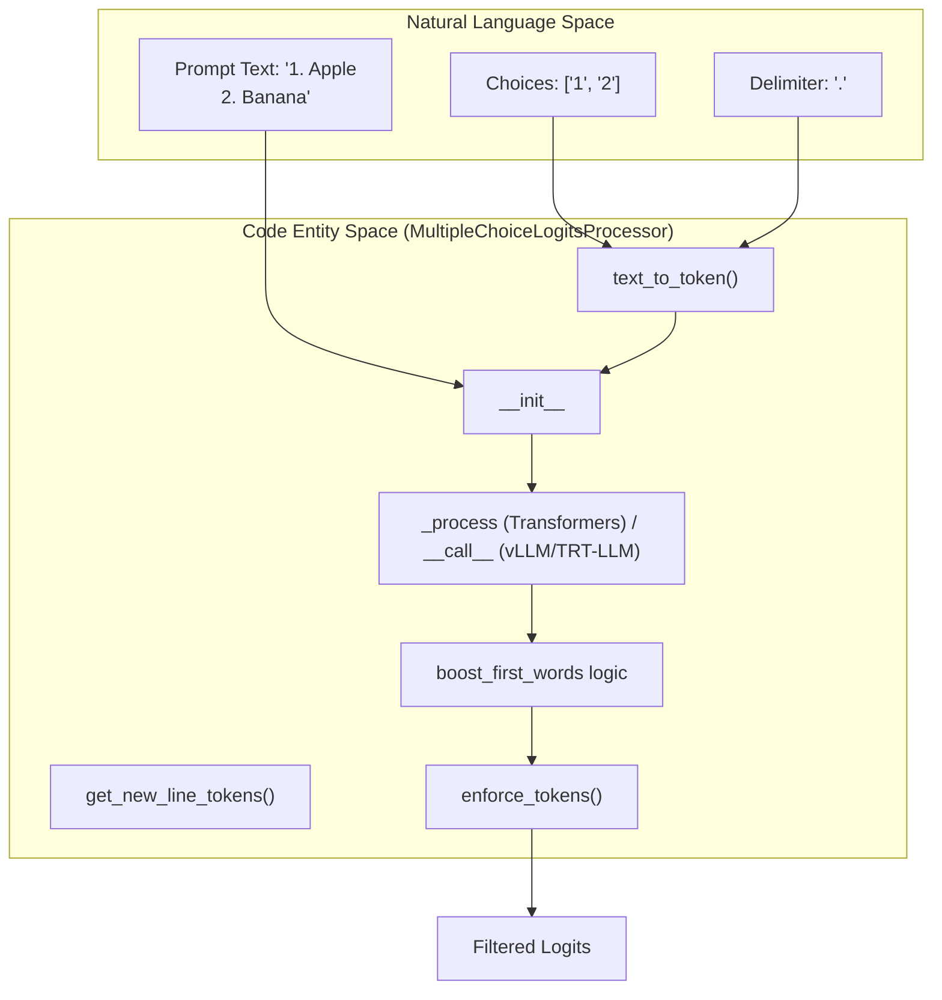
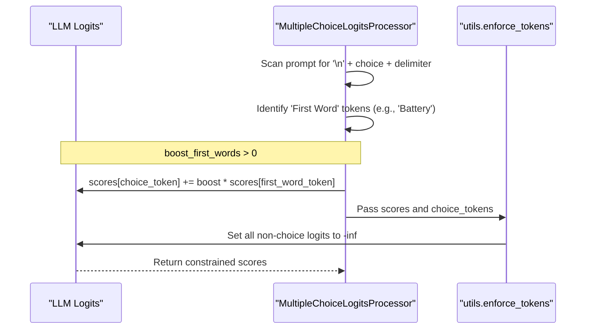

<!-- source: DeepWiki mcp.deepwiki.com · repo NVIDIA/logits-processor-zoo · page 3.4 MultipleChoiceLogitsProcessor · fetched 2026-10-26 -->

# MultipleChoiceLogitsProcessor

<details>
<summary>Relevant source files</summary>

The following files were used as context for generating this wiki page:

- [logits_processor_zoo/transformers/last_phrase.py](logits_processor_zoo/transformers/last_phrase.py)
- [logits_processor_zoo/transformers/multiple_choice.py](logits_processor_zoo/transformers/multiple_choice.py)
- [logits_processor_zoo/trtllm/multiple_choice.py](logits_processor_zoo/trtllm/multiple_choice.py)
- [logits_processor_zoo/vllm/multiple_choice.py](logits_processor_zoo/vllm/multiple_choice.py)
- [tests/transformers/test_multiple_choice.py](tests/transformers/test_multiple_choice.py)

</details>


## Purpose and Overview

The `MultipleChoiceLogitsProcessor` is a specialized logits processor designed to constrain a language model's output to a specific set of multiple-choice options (e.g., "A", "B", "C", "D" or "1", "2", "3"). It identifies the relevant choice tokens and manipulates the logit distribution to ensure the model selects one of the valid options as its next token.

This processor is particularly useful for:
- Creating robust question-answering systems with fixed answer schemas.
- Implementing multiple-choice assessments where the model must output exactly one identifier.
- Improving model performance on complex choices using the `boost_first_words` heuristic.

Sources: [logits_processor_zoo/transformers/multiple_choice.py:25-34](), [logits_processor_zoo/vllm/multiple_choice.py:24-33]()

## Implementation Details

The library provides parallel implementations for **Transformers**, **vLLM**, and **TensorRT-LLM**. While the core logic remains consistent, the internal handling of batching and prompt access varies by framework.

### Choice Token Identification
During initialization, the processor converts the provided text choices and delimiters into their respective token IDs using the provided tokenizer. It specifically uses `text_to_token(..., last=False)` to ensure it captures the token representation as it would appear at the start or middle of a sequence.

Sources: [logits_processor_zoo/transformers/multiple_choice.py:45-53](), [logits_processor_zoo/vllm/multiple_choice.py:44-57](), [logits_processor_zoo/trtllm/multiple_choice.py:45-52]()

### Logic Flow and Data Transformation
The following diagram illustrates how the processor moves from natural language choices to code-level logit manipulation.


Sources: [logits_processor_zoo/transformers/multiple_choice.py:45-84](), [logits_processor_zoo/utils.py:21-21]()

## Key Parameters

| Parameter | Type | Default | Description |
|-----------|------|---------|-------------|
| `tokenizer` | `PreTrainedTokenizer` | Required | The tokenizer used by the LLM to map strings to IDs. |
| `choices` | `List[str]` | `["1", "2", "3", "4"]` | The allowed single-character answer identifiers. |
| `delimiter` | `str` | `"."` | The character following the choice in the prompt (e.g., `.` in `1.` or `)` in `A)`). |
| `boost_first_words` | `float` | `0.0` | Heuristic factor to boost choice IDs based on the likelihood of the content following them. |

Sources: [logits_processor_zoo/transformers/multiple_choice.py:37-44](), [logits_processor_zoo/vllm/multiple_choice.py:36-43]()

## Advanced Features

### Delimiter-Based Prompt Parsing
The processor scans the `prompt_token_ids` to find patterns matching `\n` + `choice` + `delimiter`. This allows it to locate exactly where the options are described in the input text.

Sources: [logits_processor_zoo/transformers/multiple_choice.py:63-71](), [logits_processor_zoo/vllm/multiple_choice.py:66-74]()

### Boost First Words Heuristic
If `boost_first_words` is non-zero, the processor identifies the "first word" (the token at index `i + 3` relative to the newline) for each choice. It then adds a portion of that first word's logit score back to the choice identifier's score. This helps models that struggle to link a choice label (like "A") with its descriptive text (like "Operating System").


Sources: [logits_processor_zoo/transformers/multiple_choice.py:59-82](), [logits_processor_zoo/vllm/multiple_choice.py:62-83]()

### Masking Step
Regardless of boosting, the final step always calls `enforce_tokens`. This utility function ensures that only the `choice_tokens` have non-negative infinity values in the logits tensor, effectively forcing the model to pick from the allowed list.

Sources: [logits_processor_zoo/utils.py:82-89](), [logits_processor_zoo/transformers/multiple_choice.py:81-82]()

## Framework Specifics

### Transformers
Inherits from `BaseLogitsProcessor`. It accesses the prompt via `self.prompt_token_ids` which is automatically captured by the base class during the first call. It iterates through the batch dimension to apply logic to each sequence.
Sources: [logits_processor_zoo/transformers/multiple_choice.py:25-58]()

### vLLM
The `__call__` method receives `prompt_tokens_ids` directly as an argument. Since vLLM handles sequences individually or in managed batches, the processor applies the logic directly to the provided `scores` tensor.
Sources: [logits_processor_zoo/vllm/multiple_choice.py:60-84]()

### TensorRT-LLM
Implements the `tensorrt_llm.sampling_params.LogitsProcessor` interface. It uses `_init_choice_first_words` to cache the identified first tokens to avoid re-scanning the prompt during every step of generation. It also handles CUDA streams via `torch.cuda.ExternalStream(stream_ptr)`.
Sources: [logits_processor_zoo/trtllm/multiple_choice.py:25-93]()

## Usage Example

The following test case demonstrates using a custom delimiter `)` and alphanumeric choices.

```python
# From tests/transformers/test_multiple_choice.py
choices = ["a", "b", "c", "d"]
# delimiter=")" matches "a) Camera", "b) Screen", etc.
mclp = MultipleChoiceLogitsProcessor(tokenizer, choices=choices, delimiter=")")
processed_gen_output = llm_runner.generate_response(prompts, [mclp], max_new_tokens=1)
```
Sources: [tests/transformers/test_multiple_choice.py:44-46]()

---

