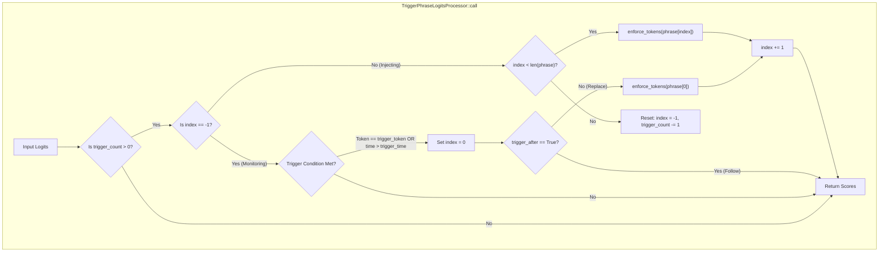
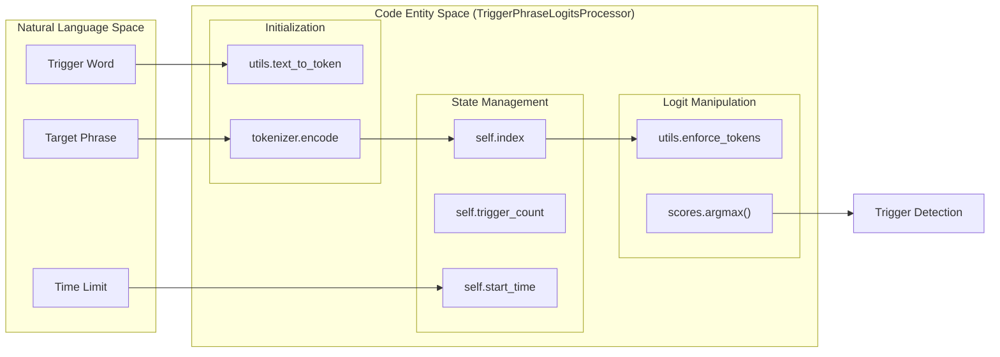

<!-- source: DeepWiki mcp.deepwiki.com · repo NVIDIA/logits-processor-zoo · page 3.5 TriggerPhraseLogitsProcessor · fetched 2026-10-26 -->

# TriggerPhraseLogitsProcessor

<details>
<summary>Relevant source files</summary>

The following files were used as context for generating this wiki page:

- [logits_processor_zoo/transformers/trigger_phrase.py](logits_processor_zoo/transformers/trigger_phrase.py)
- [logits_processor_zoo/trtllm/__init__.py](logits_processor_zoo/trtllm/__init__.py)
- [logits_processor_zoo/trtllm/trigger_phrase.py](logits_processor_zoo/trtllm/trigger_phrase.py)
- [logits_processor_zoo/vllm/trigger_phrase.py](logits_processor_zoo/vllm/trigger_phrase.py)
- [tests/transformers/test_trigger_phrase.py](tests/transformers/test_trigger_phrase.py)

</details>


## Purpose and Scope

The `TriggerPhraseLogitsProcessor` is a specialized logits processor that forces an LLM to generate a specified phrase when it encounters a designated trigger point. Unlike simpler processors, it supports both **content-based triggers** (specific tokens) and **temporal triggers** (wall-clock time). This processor provides precise control over text generation by allowing you to inject specific content at predetermined points, useful for enforcing specific formats, injecting standard phrases, or guiding the model's thought process.

This document covers the implementation, configuration, and usage across the Transformers, vLLM, and TensorRT-LLM backends.

Sources: [logits_processor_zoo/vllm/trigger_phrase.py:25-37](), [logits_processor_zoo/transformers/trigger_phrase.py:26-39](), [logits_processor_zoo/trtllm/trigger_phrase.py:26-38]()

## Core Concepts

The `TriggerPhraseLogitsProcessor` works by monitoring the generation stream for a trigger condition. Once met, it intercepts the logit distribution and forces the model to generate a predefined phrase by applying `enforce_tokens` to the logits of the phrase's constituent tokens.

Key features include:
- **Token-based Triggering**: Activates when a specific `trigger_token` is predicted as the most likely next token.
- **Temporal Triggering**: Activates if the generation has exceeded a specified `trigger_time` (wall-clock seconds).
- **Placement Control**: The `trigger_after` toggle determines if the phrase follows the trigger token or overwrites it.
- **Stateful Management**: Tracks phrase progress (`index`), remaining triggers (`trigger_count`), and timing (`start_time`).

### Logic Flow and State Transition



Sources: [logits_processor_zoo/vllm/trigger_phrase.py:75-97](), [logits_processor_zoo/transformers/trigger_phrase.py:66-88](), [logits_processor_zoo/trtllm/trigger_phrase.py:62-91]()

## Implementation Details

### Parameters

The processor accepts the following configuration:

| Parameter | Type | Description |
|-----------|------|-------------|
| `tokenizer` | `PreTrainedTokenizer` | Used to encode the `phrase` and identify the `trigger_token`. |
| `phrase` | `str` | The text to be forced into the output. |
| `trigger_token_phrase` | `Optional[str]` | A string representing a single token that acts as a content trigger. |
| `trigger_time` | `Optional[float]` | Wall-clock time (seconds) after which the phrase is triggered regardless of content. |
| `trigger_count` | `int` | Maximum number of times the phrase can be triggered per sequence. |
| `trigger_after` | `bool` | If `True`, the phrase follows the trigger; if `False`, the phrase replaces the trigger token. |

Sources: [logits_processor_zoo/vllm/trigger_phrase.py:39-41](), [logits_processor_zoo/transformers/trigger_phrase.py:41-43](), [logits_processor_zoo/trtllm/trigger_phrase.py:40-43]()

### Code Entity Space Mapping

The following diagram maps the logical components of the processor to the actual class attributes and utility functions used in the codebase.



Sources: [logits_processor_zoo/vllm/trigger_phrase.py:51-62](), [logits_processor_zoo/transformers/trigger_phrase.py:51-59](), [logits_processor_zoo/utils.py:23-55]()

## Framework-Specific Implementations

### Transformers Implementation
The Transformers version inherits from `BaseLogitsProcessor` [logits_processor_zoo/transformers/trigger_phrase.py:26](). It manages state across a batch using tensors for `iterators` and `trigger_count` [logits_processor_zoo/transformers/trigger_phrase.py:62-63](). It implements the `_process` hook which iterates through the batch dimension of the `scores` tensor [logits_processor_zoo/transformers/trigger_phrase.py:66-67]().

### vLLM Implementation
The vLLM implementation requires a `clone()` method [logits_processor_zoo/vllm/trigger_phrase.py:66-68](). Because vLLM can share sampling parameters across sequences, mutable processors must be cloned to ensure each sequence maintains its own `index`, `trigger_count`, and `start_time` [logits_processor_zoo/vllm/trigger_phrase.py:64-65]().

### TensorRT-LLM Implementation
Inherits from `tensorrt_llm.sampling_params.LogitsProcessor` [logits_processor_zoo/trtllm/trigger_phrase.py:26](). It features an `_init_before_gen` method to set up `iterators` and `trigger_counts` based on the `beam_width` [logits_processor_zoo/trtllm/trigger_phrase.py:58-60](). It also handles `torch.cuda.ExternalStream` to ensure synchronization with the TRT-LLM runtime [logits_processor_zoo/trtllm/trigger_phrase.py:69-71]().

## State Management and Reset Lifecycle

The processor must reset its internal counters and timers at the start of every new generation request.

- **vLLM**: Checks if `past_token_ids` is empty to trigger `_reset()` [logits_processor_zoo/vllm/trigger_phrase.py:76-77]().
- **Transformers**: Relies on the `BaseLogitsProcessor` lifecycle which calls `_reset()` when a change in `input_ids` length indicates a new sequence [logits_processor_zoo/transformers/base.py:42-45]().
- **TRT-LLM**: Uses the `_init_before_gen` call inside the first `__call__` execution [logits_processor_zoo/trtllm/trigger_phrase.py:66-67]().

| State Variable | Initial Value | Reset Trigger |
|----------------|---------------|---------------|
| `index` / `iterators` | `-1` | New Request Start |
| `trigger_count` | `initial_trigger_count` | New Request Start |
| `start_time` | `time.time()` | New Request OR Phrase Completion |

Sources: [logits_processor_zoo/vllm/trigger_phrase.py:70-73](), [logits_processor_zoo/transformers/trigger_phrase.py:61-64](), [logits_processor_zoo/trtllm/trigger_phrase.py:88-91]()

## Usage Example

### Token-Based Triggering (Transformers)
```python
from logits_processor_zoo.transformers import TriggerPhraseLogitsProcessor

# Trigger " (Reflecting...)" immediately after the model predicts "thought"
lp = TriggerPhraseLogitsProcessor(
    tokenizer=tokenizer,
    batch_size=1,
    phrase=" (Reflecting...)",
    trigger_token_phrase="thought",
    trigger_after=True,
    trigger_count=1
)
```
Sources: [tests/transformers/test_trigger_phrase.py:21-36]()

### Temporal Triggering (vLLM)
```python
from logits_processor_zoo.vllm import TriggerPhraseLogitsProcessor

# Force the phrase " [TIMEOUT WARNING] " if generation takes longer than 5 seconds
lp = TriggerPhraseLogitsProcessor(
    tokenizer=tokenizer,
    phrase=" [TIMEOUT WARNING] ",
    trigger_time=5.0,
    trigger_after=False,
    trigger_count=1
)
```
Sources: [tests/transformers/test_trigger_phrase.py:42-60](), [logits_processor_zoo/vllm/trigger_phrase.py:39-41]()

---

