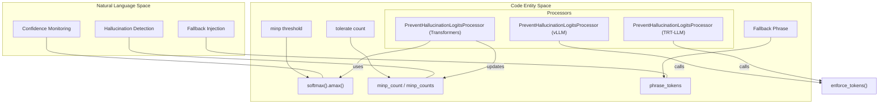
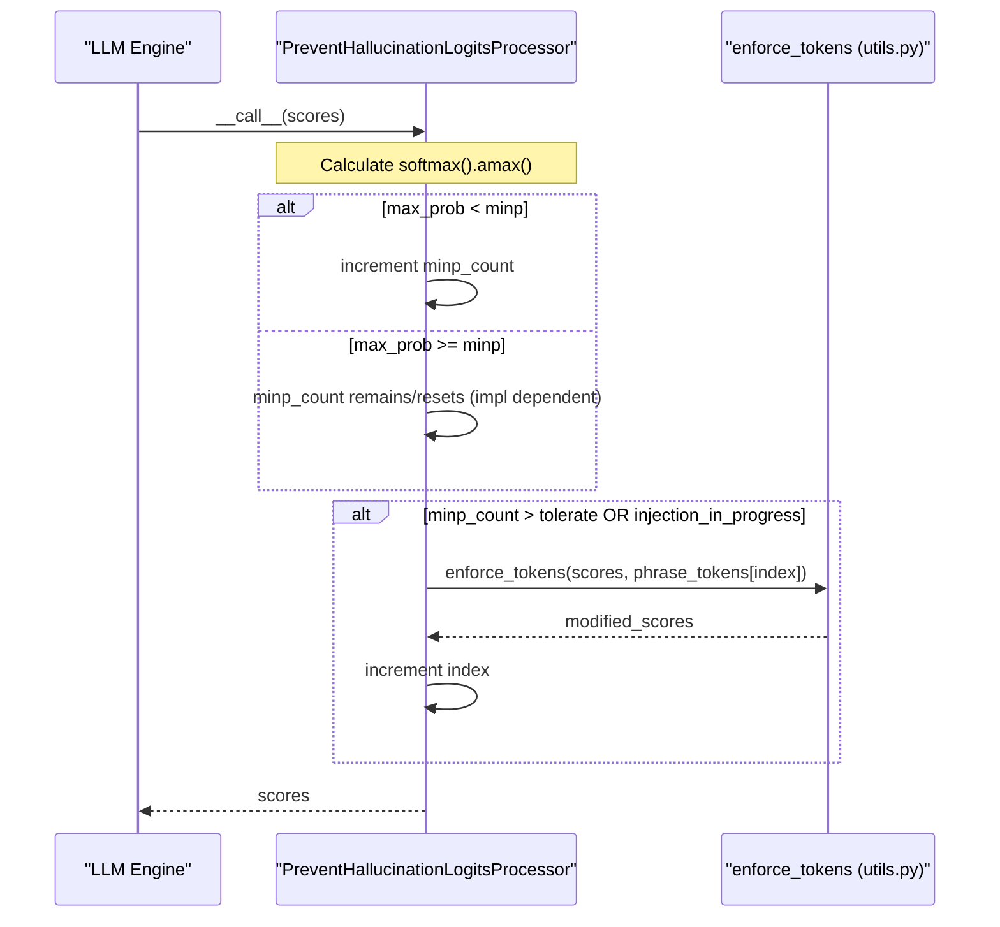

<!-- source: DeepWiki mcp.deepwiki.com · repo NVIDIA/logits-processor-zoo · page 3.6 PreventHallucinationLogitsProcessor · fetched 2026-10-26 -->

# PreventHallucinationLogitsProcessor

Relevant source files

The following files were used as context for generating this wiki page:

- [logits_processor_zoo/transformers/prevent_hallucination.py](logits_processor_zoo/transformers/prevent_hallucination.py)
- [logits_processor_zoo/trtllm/prevent_hallucination.py](logits_processor_zoo/trtllm/prevent_hallucination.py)
- [logits_processor_zoo/vllm/prevent_hallucination.py](logits_processor_zoo/vllm/prevent_hallucination.py)
- [tests/transformers/test_prevent_hallucination.py](tests/transformers/test_prevent_hallucination.py)

The `PreventHallucinationLogitsProcessor` is designed to mitigate hallucinated model outputs by monitoring token confidence during the generation process. It uses a minimum probability threshold (`minp`) to identify low-confidence tokens. If the model produces more than a specified number of consecutive low-confidence tokens (`tolerate`), the processor intercepts the generation and injects a predefined fallback phrase (e.g., "...I don't know actually.\n") to gracefully indicate uncertainty [logits_processor_zoo/transformers/prevent_hallucination.py:25-31]().

## Implementation Overview

The processor maintains internal state to track consecutive low-confidence tokens and the progress of phrase injection. It is implemented across three frameworks: `transformers`, `vLLM`, and `TensorRT-LLM`.

### Core Parameters
| Parameter | Type | Description |
| :--- | :--- | :--- |
| `tokenizer` | `PreTrainedTokenizer` | Used to encode the fallback phrase into token IDs [logits_processor_zoo/transformers/prevent_hallucination.py:52-53](). |
| `minp` | `float` | The probability threshold. Tokens with a maximum softmax probability below this are flagged [logits_processor_zoo/transformers/prevent_hallucination.py:54](). |
| `tolerate` | `int` | The number of consecutive low-confidence tokens allowed before triggering the fallback [logits_processor_zoo/transformers/prevent_hallucination.py:55](). |
| `phrase` | `str` | The string to inject when hallucination is detected [logits_processor_zoo/transformers/prevent_hallucination.py:50](). |

**Sources:** [logits_processor_zoo/transformers/prevent_hallucination.py:33-56](), [logits_processor_zoo/vllm/prevent_hallucination.py:33-53]()

---

## Code Entity Space Mapping

The following diagram maps the logical components of the hallucination prevention system to their specific implementations in the codebase.

**Hallucination Prevention Entity Map**

**Sources:** [logits_processor_zoo/transformers/prevent_hallucination.py:24-48](), [logits_processor_zoo/vllm/prevent_hallucination.py:24-46](), [logits_processor_zoo/trtllm/prevent_hallucination.py:25-47](), [logits_processor_zoo/utils.py:21-21]()

---

## Generation Lifecycle and Data Flow

The processor operates by checking the maximum probability of the next token in the `scores` (logits) tensor. If the confidence is too low, it increments a counter. Once the counter exceeds the `tolerate` limit, it uses `enforce_tokens` to force the model to output the next token from the `phrase_tokens` list.

**Token Confidence and Injection Flow**

**Sources:** [logits_processor_zoo/transformers/prevent_hallucination.py:62-78](), [logits_processor_zoo/vllm/prevent_hallucination.py:62-78](), [logits_processor_zoo/trtllm/prevent_hallucination.py:61-87]()

---

## Framework-Specific Details

### Transformers Integration
The Transformers version inherits from `BaseLogitsProcessor` [logits_processor_zoo/transformers/prevent_hallucination.py:24](). It manages state for a batch of sequences using `torch.Tensor` trackers:
* `self.iterators`: Tracks the current position within the fallback phrase for each sequence in the batch [logits_processor_zoo/transformers/prevent_hallucination.py:59]().
* `self.minp_count`: Tracks consecutive low-confidence tokens per sequence [logits_processor_zoo/transformers/prevent_hallucination.py:60]().

### vLLM Integration
In vLLM, the processor is intended for single-sequence execution or cloned for batching.
* **State Management**: Uses simple integer counters (`self.index` and `self.minp_count`) [logits_processor_zoo/vllm/prevent_hallucination.py:59-60]().
* **Clone Method**: Implements `clone()` to ensure that when vLLM forks a request, the processor state is safely replicated [logits_processor_zoo/vllm/prevent_hallucination.py:55-56]().

### TensorRT-LLM Integration
The TRT-LLM implementation inherits from `tensorrt_llm.sampling_params.LogitsProcessor` [logits_processor_zoo/trtllm/prevent_hallucination.py:25]().
* **CUDA Streams**: Explicitly handles CUDA external streams using `torch.cuda.ExternalStream(stream_ptr)` to ensure logit manipulation happens on the correct device stream [logits_processor_zoo/trtllm/prevent_hallucination.py:69-71]().
* **Beam Search**: Iterates over the `beam_width` dimension of the logits tensor to apply the hallucination check to every active beam [logits_processor_zoo/trtllm/prevent_hallucination.py:72-87]().

**Sources:** [logits_processor_zoo/transformers/prevent_hallucination.py:58-78](), [logits_processor_zoo/vllm/prevent_hallucination.py:55-78](), [logits_processor_zoo/trtllm/prevent_hallucination.py:57-87]()

---

