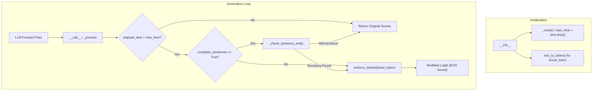
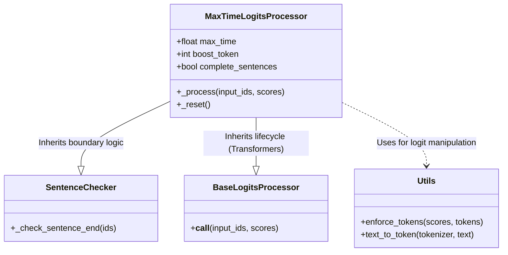

<!-- source: DeepWiki mcp.deepwiki.com · repo NVIDIA/logits-processor-zoo · page 3.7 MaxTimeLogitsProcessor · fetched 2026-10-26 -->

# MaxTimeLogitsProcessor

Relevant source files

The following files were used as context for generating this wiki page:

- [logits_processor_zoo/transformers/max_time.py](logits_processor_zoo/transformers/max_time.py)
- [logits_processor_zoo/trtllm/max_time.py](logits_processor_zoo/trtllm/max_time.py)
- [logits_processor_zoo/vllm/max_time.py](logits_processor_zoo/vllm/max_time.py)
- [tests/transformers/test_max_time.py](tests/transformers/test_max_time.py)

The `MaxTimeLogitsProcessor` is a temporal control mechanism designed to enforce the termination of text generation based on wall-clock time rather than token count. This is particularly useful for real-time applications, Service Level Agreement (SLA) enforcement, or preventing infinite generation loops in models that fail to produce an EOS token naturally.

## Overview

Unlike length-based processors (e.g., `GenLengthLogitsProcessor`) which operate on discrete token counts, `MaxTimeLogitsProcessor` monitors the elapsed time since the start of the generation process. Once the `max_time` threshold is crossed, the processor manipulates the logits to force the selection of an End-of-Sentence (EOS) token or a custom termination token.

### Key Capabilities
*   **Temporal Enforcement**: Guarantees generation halts after a specific number of seconds [logits_processor_zoo/transformers/max_time.py:33]().
*   **Sentence Integrity**: Optionally waits for a natural sentence boundary (full stop or newline) before enforcing termination [logits_processor_zoo/transformers/max_time.py:34-35]().
*   **Custom Termination**: Allows overriding the default EOS token with a custom string [logits_processor_zoo/transformers/max_time.py:36]().
*   **Multi-Framework Support**: Implementations are available for Hugging Face `transformers`, `vLLM`, and `TensorRT-LLM`.

Sources: [logits_processor_zoo/transformers/max_time.py:25-38](), [logits_processor_zoo/vllm/max_time.py:25-38](), [logits_processor_zoo/trtllm/max_time.py:26-38]()

---

## Implementation Details

The processor inherits from `SentenceChecker` to support the `complete_sentences` logic and framework-specific base classes to integrate into the respective generation loops.

### Data Flow and State Management
The processor initializes a `start_time` using `time.time()` when generation begins. For every forward pass, it calculates the `elapsed_time`. If `elapsed_time > max_time`, it triggers the logit masking logic via `enforce_tokens`.

#### Diagram: Temporal Control Logic
This diagram illustrates how the `MaxTimeLogitsProcessor` interacts with the LLM generation loop across different frameworks.

Sources: [logits_processor_zoo/transformers/max_time.py:55-70](), [logits_processor_zoo/utils.py:22-22](), [logits_processor_zoo/vllm/max_time.py:82-91]()

### Class Structure and Framework Mapping
The implementation varies slightly across frameworks to accommodate their specific batching and state handling requirements.

| Feature | Transformers | vLLM | TensorRT-LLM |
| :--- | :--- | :--- | :--- |
| **Base Class** | `BaseLogitsProcessor` | `SentenceChecker` | `LogitsProcessor` |
| **State Reset** | `_reset()` hook | `_reset()` in `__init__` | `__init__` timestamp |
| **Batching** | Handled in `_process` loop | Requires `clone()` | Handled via `req_id` |
| **Sentence Check** | `self._check_sentence_end(input_ids)` | `self._check_sentence_end(past_token_ids)` | `self._check_sentence_end(ids)` |

#### Diagram: Code Entity Space Association
This diagram maps the logical components of the time-based control to specific code entities within the repository.

Sources: [logits_processor_zoo/transformers/max_time.py:25-25](), [logits_processor_zoo/vllm/max_time.py:25-25](), [logits_processor_zoo/trtllm/max_time.py:26-26](), [logits_processor_zoo/utils.py:1-23]()

---

## Configuration Parameters

| Parameter | Type | Description |
| :--- | :--- | :--- |
| `tokenizer` | `PreTrainedTokenizer` | Used for decoding tokens to check sentence boundaries and encoding the `boost_token_str`. |
| `max_time` | `float` | The hard limit in seconds. [logits_processor_zoo/transformers/max_time.py:33]() |
| `complete_sentences` | `bool` | If `True`, the processor will wait for a punctuation mark (`.`, `?`, `!`) or a newline before forcing EOS, even if `max_time` is exceeded. [logits_processor_zoo/transformers/max_time.py:34-35]() |
| `boost_token_str` | `str` | Optional override for the EOS token. If provided, `text_to_token` converts this to an ID. [logits_processor_zoo/transformers/max_time.py:50-51]() |

Sources: [logits_processor_zoo/transformers/max_time.py:40-53](), [logits_processor_zoo/vllm/max_time.py:40-57]()

---

## Framework-Specific Considerations

### vLLM Cloning
In `vLLM`, logits processors are often shared across requests in a batch. Since `MaxTimeLogitsProcessor` maintains internal state (`start_time`), it implements the `clone()` method. This ensures that every individual request in a vLLM batch has its own independent timer.
*   **Implementation**: [logits_processor_zoo/vllm/max_time.py:62-68]()

### TensorRT-LLM Stream Handling
The TRT-LLM implementation accounts for CUDA streams. It uses `torch.cuda.ExternalStream(stream_ptr)` to ensure that logit manipulation happens on the correct device stream used by the engine.
*   **Implementation**: [logits_processor_zoo/trtllm/max_time.py:70-72]()

### Sentence Boundary Detection
The `complete_sentences` mode leverages `SentenceChecker._check_sentence_end`. This function inspects the most recently generated tokens to determine if they constitute a natural stopping point. If the time limit is reached but the model is mid-sentence, the processor will defer enforcement until the `SentenceChecker` returns `True`.
*   **Logic**: [logits_processor_zoo/transformers/max_time.py:63-64]()

---

## Comparison with Length-based Control

| Feature | `MaxTimeLogitsProcessor` | `GenLengthLogitsProcessor` |
| :--- | :--- | :--- |
| **Control Variable** | Seconds (Wall-clock) | Token Count |
| **Primary Use Case** | Latency/SLA management | Output size constraints |
| **Determinism** | Non-deterministic (hardware dependent) | Deterministic |
| **Sentence Handling** | Optional boundary wait | Optional boundary wait |

Sources: [logits_processor_zoo/transformers/max_time.py:26-38](), [logits_processor_zoo/transformers/gen_length.py:25-45]()

---

