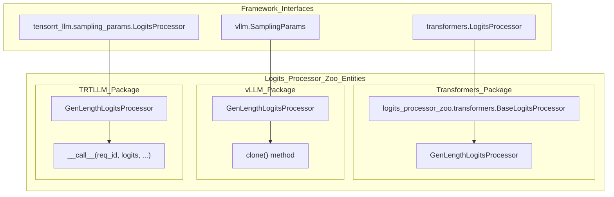
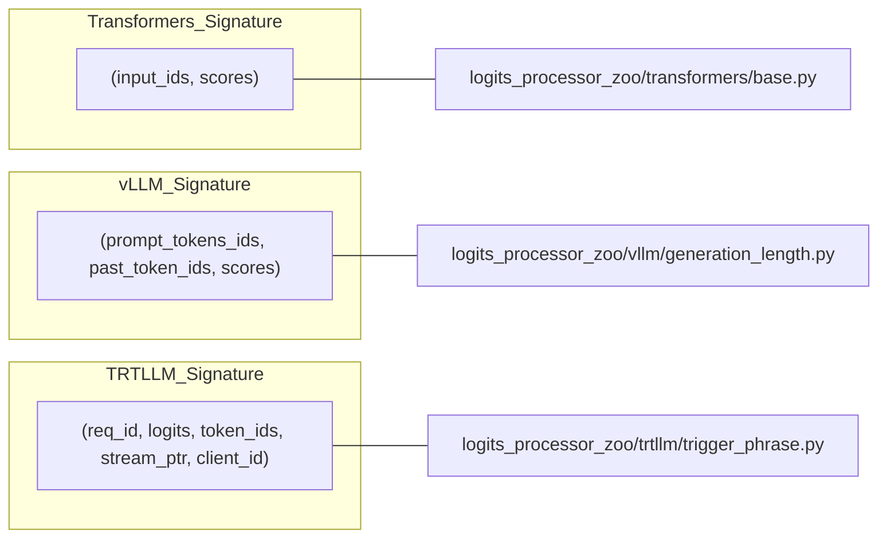

<!-- source: DeepWiki mcp.deepwiki.com · repo NVIDIA/logits-processor-zoo · page 4 Framework Integrations · fetched 2026-10-26 -->

# Framework Integrations

<details>
<summary>Relevant source files</summary>

The following files were used as context for generating this wiki page:

- [README.md](README.md)
- [logits_processor_zoo/transformers/__init__.py](logits_processor_zoo/transformers/__init__.py)
- [logits_processor_zoo/trtllm/__init__.py](logits_processor_zoo/trtllm/__init__.py)
- [logits_processor_zoo/trtllm/trigger_phrase.py](logits_processor_zoo/trtllm/trigger_phrase.py)
- [logits_processor_zoo/vllm/__init__.py](logits_processor_zoo/vllm/__init__.py)

</details>


This document provides an overview of how the `logits-processor-zoo` integrates with different LLM frameworks. The library is designed to work with multiple popular LLM frameworks through consistent interfaces while respecting the unique architecture and call signatures of each system.

For detailed information about specific framework integrations, see:
- [Transformers Integration](#4.1)
- [vLLM Integration](#4.2)
- [TensorRT-LLM Integration](#4.3)

## Supported Frameworks

The Logits Processor Zoo currently integrates with three major LLM inference frameworks:

| Framework | Description | Integration Path |
|-----------|-------------|-----------------|
| **Transformers** | Hugging Face's framework for transformer models | `logits_processor_zoo/transformers/` |
| **vLLM** | High-throughput inference engine with PagedAttention | `logits_processor_zoo/vllm/` |
| **TensorRT-LLM** | NVIDIA's optimized framework for LLM inference (>=0.20.0) | `logits_processor_zoo/trtllm/` |

Sources: [README.md:18-21](), [logits_processor_zoo/transformers/__init__.py:18-24](), [logits_processor_zoo/vllm/__init__.py:18-24](), [logits_processor_zoo/trtllm/__init__.py:18-24]()

## Integration Architecture

The library employs a parallel implementation pattern. While the logic for a specific processor (e.g., `GenLengthLogitsProcessor`) remains conceptually similar across frameworks, the class definitions are replicated within framework-specific subdirectories to match the expected base classes and call signatures of the target engine.

### Framework Implementation Map

The following diagram bridges the high-level framework concepts to the specific code entities in the zoo.



Sources: [logits_processor_zoo/transformers/base.py:23-25](), [logits_processor_zoo/vllm/generation_length.py:22-24](), [logits_processor_zoo/trtllm/trigger_phrase.py:23-26]()

## Interface Differences

The primary difference between integrations lies in the `__call__` signature and state management required by the underlying engine.

### Call Signature Comparison



*   **Transformers**: Uses a simple `(input_ids, scores)` signature. The zoo uses a `BaseLogitsProcessor` to handle internal state resets via `_check_new_generation`. For details, see [Transformers Integration](#4.1).
*   **vLLM**: Requires a `(prompt_tokens_ids, past_token_ids, scores)` signature. Because vLLM can share processor instances across sequences in a batch, mutable processors must implement a `clone()` method. For details, see [vLLM Integration](#4.2).
*   **TensorRT-LLM**: Uses a complex signature including `req_id` and `stream_ptr`. It supports beam search and requires handling CUDA streams via `torch.cuda.ExternalStream(stream_ptr)`. For details, see [TensorRT-LLM Integration](#4.3).

Sources: [logits_processor_zoo/transformers/base.py:53-54](), [logits_processor_zoo/vllm/generation_length.py:52-53](), [logits_processor_zoo/trtllm/trigger_phrase.py:62-64]()

## Common Usage Pattern

Regardless of the backend, the user experience follows a consistent "Initialize -> Configure -> Generate" flow.

```python
# 1. Import from the relevant framework subpackage
from logits_processor_zoo.vllm import GenLengthLogitsProcessor

# 2. Configure the processor
lp = GenLengthLogitsProcessor(tokenizer, boost_factor=-0.2)

# 3. Pass to the framework's generation method
model.generate(prompts, vllm.SamplingParams(logits_processors=[lp]))
```

Sources: [README.md:25-56]()

## Summary of Child Pages

- **[Transformers Integration](#4.1)**: Deep dive into the `LogitsProcessorList` usage and the `_check_new_generation` mechanism used to reset state between sequences in Hugging Face.
- **[vLLM Integration](#4.2)**: Details on per-sequence state isolation and the mandatory `clone()` pattern for processors like `TriggerPhraseLogitsProcessor`.
- **[TensorRT-LLM Integration](#4.3)**: Technical requirements for the `LogitsProcessor` base class, handling beam width, and managing CUDA streams for high-performance inference.

---

