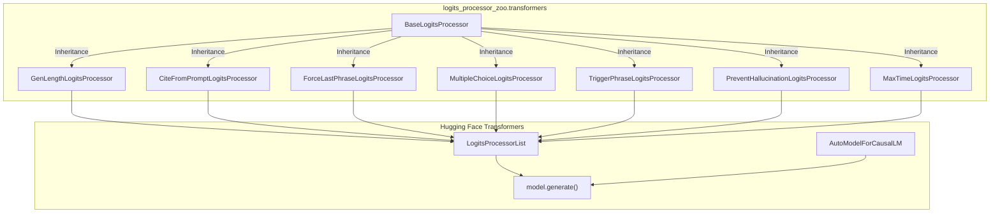
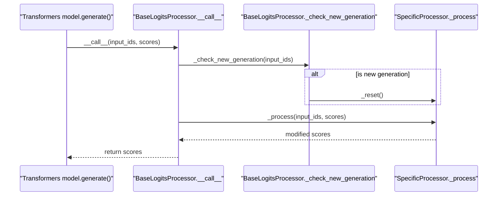

<!-- source: DeepWiki mcp.deepwiki.com · repo NVIDIA/logits-processor-zoo · page 4.1 Transformers Integration · fetched 2026-10-26 -->

# Transformers Integration

<details>
<summary>Relevant source files</summary>

The following files were used as context for generating this wiki page:

- [logits_processor_zoo/transformers/__init__.py](logits_processor_zoo/transformers/__init__.py)
- [logits_processor_zoo/transformers/base.py](logits_processor_zoo/transformers/base.py)
- [logits_processor_zoo/transformers/cite_prompt.py](logits_processor_zoo/transformers/cite_prompt.py)
- [logits_processor_zoo/transformers/generation_length.py](logits_processor_zoo/transformers/generation_length.py)
- [logits_processor_zoo/transformers/last_phrase.py](logits_processor_zoo/transformers/last_phrase.py)
- [logits_processor_zoo/transformers/max_time.py](logits_processor_zoo/transformers/max_time.py)
- [logits_processor_zoo/transformers/multiple_choice.py](logits_processor_zoo/transformers/multiple_choice.py)
- [logits_processor_zoo/transformers/trigger_phrase.py](logits_processor_zoo/transformers/trigger_phrase.py)
- [logits_processor_zoo/vllm/__init__.py](logits_processor_zoo/vllm/__init__.py)
- [tests/transformers/test_cite_prompt.py](tests/transformers/test_cite_prompt.py)

</details>


This document explains how to use the logits processors from the `logits-processor-zoo` with the Hugging Face Transformers library. The integration enables controlling text generation behavior by modifying token probabilities (logits) during inference.

## Architecture Overview

The Transformers integration provides implementations of logits processors compatible with Hugging Face's `LogitsProcessor` interface. All processors in the zoo inherit from `BaseLogitsProcessor` [logits_processor_zoo/transformers/base.py:21](), which implements the standard `(input_ids, scores)` call signature required by Transformers [logits_processor_zoo/transformers/base.py:48-51]().



Sources: [logits_processor_zoo/transformers/base.py:21-52](), [logits_processor_zoo/transformers/__init__.py:18-28]()

## BaseLogitsProcessor and Lifecycle

The `BaseLogitsProcessor` class manages the state transition between different generation calls and batch handling. 

### The `__call__` Lifecycle
When `model.generate()` is executed, the `LogitsProcessorList` invokes the `__call__` method of each processor at every step. The lifecycle follows these stages:
1. **New Generation Check**: `_check_new_generation(input_ids)` is called to determine if this is a fresh prompt or a continuation of the current generation [logits_processor_zoo/transformers/base.py:49]().
2. **Reset**: If a new generation is detected (i.e., `input_ids` no longer matches `prev_token_ids`), the `_reset()` hook is triggered to clear internal state like counters or timers [logits_processor_zoo/transformers/base.py:32,39]().
3. **Processing**: The `_process(input_ids, scores)` method is called to perform the actual logit manipulation [logits_processor_zoo/transformers/base.py:50]().

### Batch Handling
The processors are designed to handle batched `input_ids` and `scores`. For instance, `CiteFromPromptLogitsProcessor` iterates over the batch dimension of the scores tensor to apply boosts based on per-prompt token sets [logits_processor_zoo/transformers/cite_prompt.py:47-53]().



Sources: [logits_processor_zoo/transformers/base.py:21-52](), [logits_processor_zoo/transformers/cite_prompt.py:45-63]()

## Available Processors

The following processors are available for the Transformers framework:

| Processor | Purpose | Key Implementation Details |
|-----------|---------|----------------------------|
| `GenLengthLogitsProcessor` | Controls generation length | Uses `_check_sentence_end` and non-linear boosting [logits_processor_zoo/transformers/generation_length.py:54-60]() |
| `CiteFromPromptLogitsProcessor` | Encourages prompt citations | Implements bigram lookup with `conditional_boost_factor` [logits_processor_zoo/transformers/cite_prompt.py:55-61]() |
| `ForceLastPhraseLogitsProcessor` | Forces a specific suffix | Intercepts `eos_token_id` and uses an internal iterator [logits_processor_zoo/transformers/last_phrase.py:46-53]() |
| `MultipleChoiceLogitsProcessor` | Constrains to specific options | Parses prompts for delimiters and enforces `choice_tokens` [logits_processor_zoo/transformers/multiple_choice.py:57-82]() |
| `TriggerPhraseLogitsProcessor` | Inserts phrases on triggers | Monitors `trigger_token` or `trigger_time` to inject tokens [logits_processor_zoo/transformers/trigger_phrase.py:66-85]() |
| `MaxTimeLogitsProcessor` | Enforces wall-clock limits | Uses `time.time()` and `enforce_tokens` on the boost token [logits_processor_zoo/transformers/max_time.py:58-70]() |
| `PreventHallucinationLogitsProcessor` | Mitigates low-confidence tokens | Monitors min-p thresholds to trigger fallback phrases [logits_processor_zoo/transformers/__init__.py:23]() |

Sources: [logits_processor_zoo/transformers/__init__.py:18-28]()

## Implementation Examples

### Constraining to Multiple Choice
The `MultipleChoiceLogitsProcessor` uses `enforce_tokens` from the utility module to mask all logits except those corresponding to the allowed choices [logits_processor_zoo/transformers/multiple_choice.py:82](). It can also boost the likelihood of choices based on their appearance in the prompt [logits_processor_zoo/transformers/multiple_choice.py:59-79]().

### Temporal Control
The `MaxTimeLogitsProcessor` records a `start_time` during the `_reset()` call [logits_processor_zoo/transformers/max_time.py:56](). During `_process`, it calculates `elapsed_time` and, if the limit is exceeded, uses `enforce_tokens` to force the `boost_token` (usually EOS) [logits_processor_zoo/transformers/max_time.py:59-69]().

## Integration Steps

1. **Initialize Components**:
   ```python
   from transformers import AutoModelForCausalLM, AutoTokenizer, LogitsProcessorList
   from logits_processor_zoo.transformers import CiteFromPromptLogitsProcessor

   tokenizer = AutoTokenizer.from_pretrained("model_path")
   model = AutoModelForCausalLM.from_pretrained("model_path")
   ```

2. **Configure Processor**:
   Note that some processors require the `tokenizer` to identify special tokens like `eos_token_id` [logits_processor_zoo/transformers/cite_prompt.py:41]().
   ```python
   # Encourage the model to use words from the prompt
   cite_processor = CiteFromPromptLogitsProcessor(tokenizer, boost_factor=2.0)
   ```

3. **Generate**:
   Pass the processor inside a `LogitsProcessorList`.
   ```python
   output = model.generate(
       **inputs,
       logits_processor=LogitsProcessorList([cite_processor]),
       max_new_tokens=50
   )
   ```

## State Management Warning
Many processors in the Transformers integration (e.g., `GenLengthLogitsProcessor`, `ForceLastPhraseLogitsProcessor`) maintain internal state such as `token_count` or `iterators`. Because these are updated during the generation loop, you must **create a new processor instance** for every `model.generate()` call to ensure the state is correctly initialized for the new batch [logits_processor_zoo/transformers/generation_length.py:28](), [logits_processor_zoo/transformers/last_phrase.py:28]().

Sources: [logits_processor_zoo/transformers/base.py:21-52](), [logits_processor_zoo/transformers/generation_length.py:24-63](), [logits_processor_zoo/transformers/last_phrase.py:24-55]()

---

