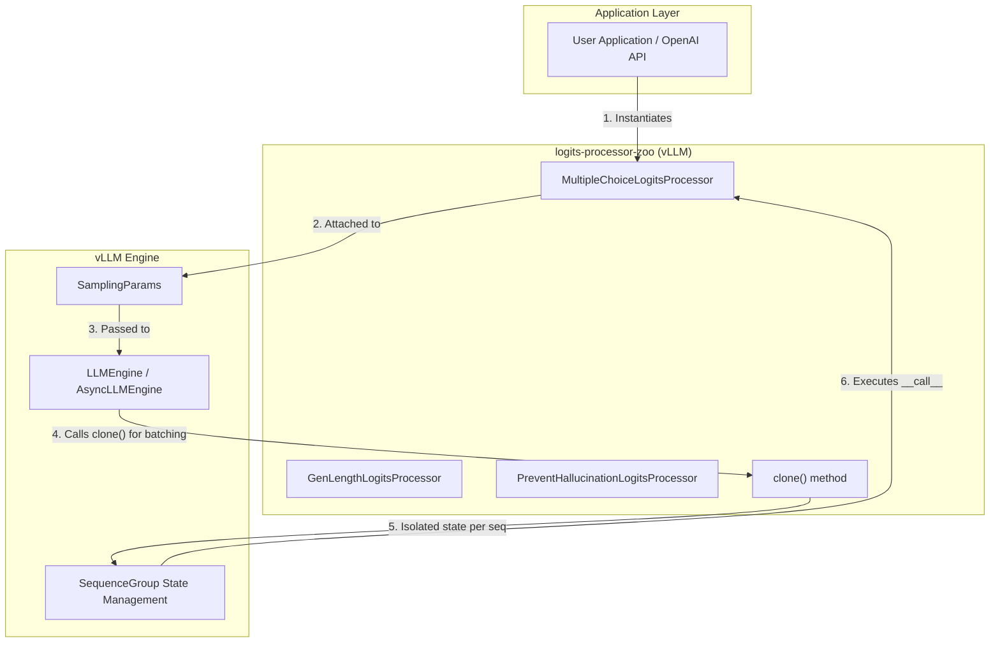
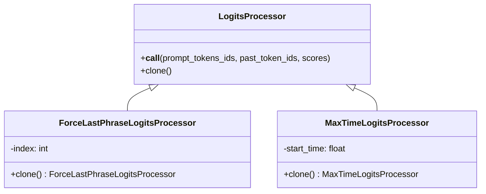

<!-- source: DeepWiki mcp.deepwiki.com · repo NVIDIA/logits-processor-zoo · page 4.2 vLLM Integration · fetched 2026-10-26 -->

# vLLM Integration

<details>
<summary>Relevant source files</summary>

The following files were used as context for generating this wiki page:

- [logits_processor_zoo/transformers/prevent_hallucination.py](logits_processor_zoo/transformers/prevent_hallucination.py)
- [logits_processor_zoo/vllm/cite_prompt.py](logits_processor_zoo/vllm/cite_prompt.py)
- [logits_processor_zoo/vllm/generation_length.py](logits_processor_zoo/vllm/generation_length.py)
- [logits_processor_zoo/vllm/last_phrase.py](logits_processor_zoo/vllm/last_phrase.py)
- [logits_processor_zoo/vllm/max_time.py](logits_processor_zoo/vllm/max_time.py)
- [logits_processor_zoo/vllm/multiple_choice.py](logits_processor_zoo/vllm/multiple_choice.py)
- [logits_processor_zoo/vllm/prevent_hallucination.py](logits_processor_zoo/vllm/prevent_hallucination.py)
- [logits_processor_zoo/vllm/trigger_phrase.py](logits_processor_zoo/vllm/trigger_phrase.py)
- [lpz_examples/vllm/performance_profiling.ipynb](lpz_examples/vllm/performance_profiling.ipynb)
- [lpz_examples/vllm/vllm_serve.ipynb](lpz_examples/vllm/vllm_serve.ipynb)

</details>


This page documents the integration of the `logits-processor-zoo` with vLLM, a high-throughput and memory-efficient library for LLM inference. This integration enables users to apply custom logits processors to control and modify the output generation of LLMs running on the vLLM framework.

## Overview

The vLLM integration provides implementations of logits processors specifically designed to work with vLLM's model serving architecture. Unlike the Transformers implementation which often handles batching within a single processor instance, vLLM's architecture expects processors to be applied per-sequence, necessitating specific state management and cloning behaviors.



Sources: [logits_processor_zoo/vllm/trigger_phrase.py:64-68](), [logits_processor_zoo/vllm/multiple_choice.py:24-45](), [lpz_examples/vllm/vllm_serve.ipynb:135-141]()

## Call Signature and Data Flow

The vLLM framework uses a specific call signature for logits processors. Every processor in the `logits_processor_zoo/vllm/` directory implements this interface.

### The `__call__` Interface
The `__call__` method receives the following arguments:
- `prompt_tokens_ids` (List[int]): The original input prompt tokens.
- `past_token_ids` (List[int]): The tokens generated in the current decoding session so far.
- `scores` (torch.Tensor): The raw logits for the current step, typically of shape `(vocab_size,)`.

```python
def __call__(self, prompt_tokens_ids: List[int], past_token_ids: List[int], scores: torch.Tensor) -> torch.Tensor:
    if not past_token_ids:  # Logic for first token of new generation
        self._reset()
    # ... manipulation logic ...
    return scores
```

Sources: [logits_processor_zoo/vllm/trigger_phrase.py:75-78](), [logits_processor_zoo/vllm/last_phrase.py:52-54](), [logits_processor_zoo/vllm/cite_prompt.py:47-48]()

## State Management and the `clone()` Requirement

In vLLM, when a request is batched, the framework clones the provided logits processors to ensure that stateful processors (those tracking indices or counters) do not leak state between different sequences in the same batch.

### Mutable Processors
Processors that maintain internal counters (like `self.index` or `self.start_time`) must implement a `clone()` method. This method returns a fresh instance of the processor with the same initial configuration but reset state.

| Processor | Mutable State | Purpose of State |
|-----------|---------------|------------------|
| `ForceLastPhraseLogitsProcessor` | `self.index` | Tracks position in the forced ending phrase [logits_processor_zoo/vllm/last_phrase.py:50-61](). |
| `TriggerPhraseLogitsProcessor` | `self.index`, `self.trigger_count`, `self.start_time` | Manages phrase injection after specific triggers or time [logits_processor_zoo/vllm/trigger_phrase.py:70-73](). |
| `MaxTimeLogitsProcessor` | `self.start_time` | Tracks wall-clock time elapsed for the specific sequence [logits_processor_zoo/vllm/max_time.py:70-71](). |
| `PreventHallucinationLogitsProcessor` | `self.index`, `self.minp_count` | Monitors consecutive low-confidence tokens per sequence [logits_processor_zoo/vllm/prevent_hallucination.py:58-60](). |



Sources: [logits_processor_zoo/vllm/last_phrase.py:46-47](), [logits_processor_zoo/vllm/max_time.py:62-68](), [logits_processor_zoo/vllm/trigger_phrase.py:66-68]()

## Integration with SamplingParams

To use these processors in vLLM, they are passed into the `logits_processors` argument of `SamplingParams`. This can be done via the Python API or via the OpenAI-compatible server using `extra_body`.

### Programmatic Usage
```python
from vllm import SamplingParams
from logits_processor_zoo.vllm import MultipleChoiceLogitsProcessor

mclp = MultipleChoiceLogitsProcessor(tokenizer, choices=["a", "b", "c", "d"])
sampling_params = SamplingParams(logits_processors=[mclp])
```

### Server Usage (OpenAI API)
When running `vllm serve`, processors can be requested dynamically by providing the `qualname` and `kwargs`.

```json
{
    "model": "model_name",
    "messages": [{"role": "user", "content": "..."}],
    "extra_body": {
        "logits_processors": [{
            "qualname": "logits_processor_zoo.vllm.GenLengthLogitsProcessor",
            "kwargs": {"tokenizer": "model_name", "boost_factor": 0.2, "complete_sentences": true}
        }]
    }
}
```

Sources: [lpz_examples/vllm/performance_profiling.ipynb:121-125](), [lpz_examples/vllm/vllm_serve.ipynb:29-30](), [lpz_examples/vllm/vllm_serve.ipynb:135-141]()

## Implementation Details

### Per-Sequence State Isolation
Unlike the Transformers backend where the processor often manages a tensor of states for the whole batch (e.g., `self.iterators = torch.zeros(self.batch_size)` in [logits_processor_zoo/transformers/prevent_hallucination.py:59]()), the vLLM processors handle a single sequence at a time. 

For example, in `CiteFromPromptLogitsProcessor`, the `prompt_tokens_ids` are converted to a set and used to directly index the `scores` tensor for the specific sequence being processed:
- `tokens = set(prompt_tokens_ids)` [logits_processor_zoo/vllm/cite_prompt.py:48]()
- `scores[tokens] += self.boost_factor` [logits_processor_zoo/vllm/cite_prompt.py:53]()

### Handling New Generations
Because vLLM might reuse processor objects or handle preemption, processors check if `past_token_ids` is empty to trigger a `_reset()` of internal state variables.
- `if not past_token_ids: self._reset()` [logits_processor_zoo/vllm/trigger_phrase.py:76-77]()

Sources: [logits_processor_zoo/vllm/cite_prompt.py:47-53](), [logits_processor_zoo/vllm/trigger_phrase.py:75-77](), [logits_processor_zoo/vllm/prevent_hallucination.py:62-64]()

---

