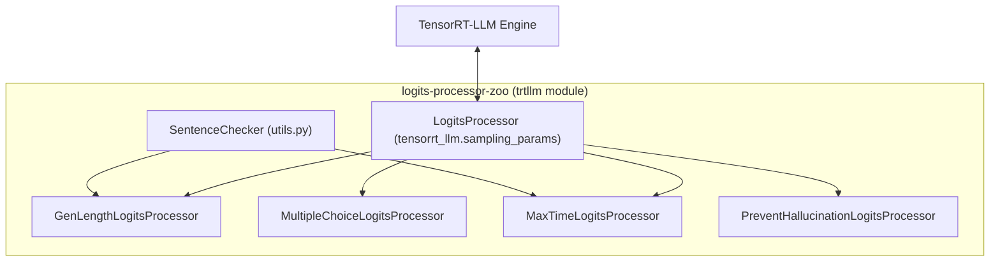
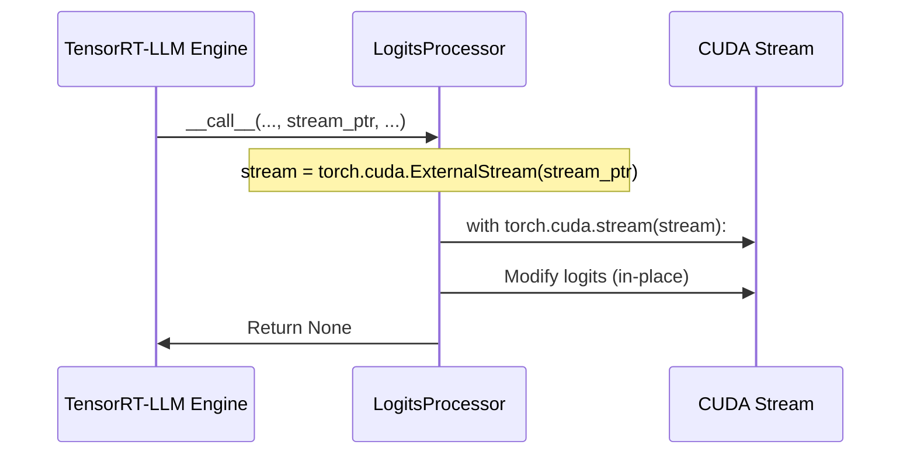
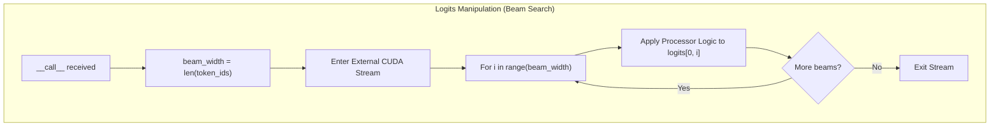

<!-- source: DeepWiki mcp.deepwiki.com · repo NVIDIA/logits-processor-zoo · page 4.3 TensorRT-LLM Integration · fetched 2026-10-26 -->

# TensorRT-LLM Integration

<details>
<summary>Relevant source files</summary>

The following files were used as context for generating this wiki page:

- [logits_processor_zoo/trtllm/__init__.py](logits_processor_zoo/trtllm/__init__.py)
- [logits_processor_zoo/trtllm/cite_prompt.py](logits_processor_zoo/trtllm/cite_prompt.py)
- [logits_processor_zoo/trtllm/generation_length.py](logits_processor_zoo/trtllm/generation_length.py)
- [logits_processor_zoo/trtllm/last_phrase.py](logits_processor_zoo/trtllm/last_phrase.py)
- [logits_processor_zoo/trtllm/max_time.py](logits_processor_zoo/trtllm/max_time.py)
- [logits_processor_zoo/trtllm/multiple_choice.py](logits_processor_zoo/trtllm/multiple_choice.py)
- [logits_processor_zoo/trtllm/prevent_hallucination.py](logits_processor_zoo/trtllm/prevent_hallucination.py)
- [logits_processor_zoo/trtllm/trigger_phrase.py](logits_processor_zoo/trtllm/trigger_phrase.py)
- [lpz_examples/trtllm/README.md](lpz_examples/trtllm/README.md)

</details>


## Purpose and Scope

This document details the integration between the Logits Processor Zoo and NVIDIA's TensorRT-LLM framework (versions >= 0.20.0). It explains how to utilize the library to control LLM outputs during high-performance inference. The integration adheres to the `tensorrt_llm.sampling_params.LogitsProcessor` base class and supports advanced features like beam search and CUDA stream synchronization.

Sources: [logits_processor_zoo/trtllm/generation_length.py:21-25](), [lpz_examples/trtllm/README.md:5-6]()

## Overview

The TensorRT-LLM integration provides a suite of processors optimized for the TensorRT-LLM runtime. These processors manipulate `torch.Tensor` logits directly within the engine's sampling loop.



Title: TensorRT-LLM Integration Hierarchy

Sources: [logits_processor_zoo/trtllm/generation_length.py:21-25](), [logits_processor_zoo/trtllm/max_time.py:22-26](), [logits_processor_zoo/trtllm/multiple_choice.py:21-25]()

## Implementation Details

### Call Signature and Data Flow

Unlike the Transformers or vLLM backends, TensorRT-LLM processors implement a specific `__call__` signature designed for integration with the C++ runtime via PyBind11.

| Argument | Type | Description |
| :--- | :--- | :--- |
| `req_id` | `int` | The unique identifier for the request. |
| `logits` | `torch.Tensor` | The raw logits tensor from the model. |
| `token_ids` | `List[List[int]]` | A list of sequences (beams) containing historical token IDs. |
| `stream_ptr` | `Optional[int]` | A pointer to the CUDA stream used by the engine. |
| `client_id` | `Optional[int]` | Identifier for the client making the request. |

Sources: [logits_processor_zoo/trtllm/max_time.py:58-65](), [logits_processor_zoo/trtllm/generation_length.py:53-55]()

### CUDA Stream Handling

To maintain high performance and prevent synchronization bottlenecks, all TensorRT-LLM processors in the zoo wrap their tensor operations in an external CUDA stream provided by the engine.



Title: CUDA Stream Synchronization Flow

Sources: [logits_processor_zoo/trtllm/max_time.py:70-72](), [logits_processor_zoo/trtllm/multiple_choice.py:85-87]()

## Available Processors

The `logits_processor_zoo.trtllm` module includes several specialized processors:

| Processor | File Path | Key Logic |
| :--- | :--- | :--- |
| `GenLengthLogitsProcessor` | [logits_processor_zoo/trtllm/generation_length.py]() | Boosts EOS based on `token_count ** p`. |
| `MaxTimeLogitsProcessor` | [logits_processor_zoo/trtllm/max_time.py]() | Forces EOS after `max_time` elapsed. |
| `MultipleChoiceLogitsProcessor` | [logits_processor_zoo/trtllm/multiple_choice.py]() | Masks all tokens except specific choices. |
| `TriggerPhraseLogitsProcessor` | [logits_processor_zoo/trtllm/trigger_phrase.py]() | Injects phrases upon seeing a trigger token. |
| `PreventHallucinationLogitsProcessor` | [logits_processor_zoo/trtllm/prevent_hallucination.py]() | Monitors `minp` and injects fallback phrase. |
| `CiteFromPromptLogitsProcessor` | [logits_processor_zoo/trtllm/cite_prompt.py]() | Boosts tokens found in the input prompt. |
| `ForceLastPhraseLogitsProcessor` | [logits_processor_zoo/trtllm/last_phrase.py]() | Intercepts EOS to inject a mandatory closing. |

Sources: [logits_processor_zoo/trtllm/__init__.py:18-28]()

## Technical Deep Dive: Beam Search Support

The processors are designed to handle beam search by iterating over the `token_ids` list of lists. The `logits` tensor typically has a shape representing the beams.

*   **Prompt Access**: Processors like `CiteFromPromptLogitsProcessor` and `MultipleChoiceLogitsProcessor` access the prompt by taking the first beam (`token_ids[0]`) during the first call, as all beams share the same prompt. [logits_processor_zoo/trtllm/cite_prompt.py:46-53](), [logits_processor_zoo/trtllm/multiple_choice.py:80-82]()
*   **State Tracking**: Processors maintain internal state (like `iterators` or `token_count`) per beam to ensure consistency across the beam search tree. [logits_processor_zoo/trtllm/trigger_phrase.py:58-60](), [logits_processor_zoo/trtllm/prevent_hallucination.py:57-59]()



Title: Beam-Aware Logits Processing

Sources: [logits_processor_zoo/trtllm/multiple_choice.py:84-93](), [logits_processor_zoo/trtllm/last_phrase.py:53-60]()

## Setup Requirements

1.  **Environment**: It is recommended to use TensorRT-LLM release containers (>= 0.20.0). [lpz_examples/trtllm/README.md:3-6]()
2.  **Dependencies**: The integration requires `tensorrt_llm` and `torch` to be available in the environment. [logits_processor_zoo/trtllm/max_time.py:21-22]()
3.  **Initialization**: Processors are initialized with a `transformers.PreTrainedTokenizer` to handle token-to-text mapping before the generation loop starts. [logits_processor_zoo/trtllm/generation_length.py:40-41]()

## Usage Example

To use a processor with the TensorRT-LLM `LLM` API:

```python
from tensorrt_llm import LLM, SamplingParams
from logits_processor_zoo.trtllm import MultipleChoiceLogitsProcessor

# Initialize model and tokenizer
llm = LLM(model="path/to/engine")
tokenizer = llm.get_tokenizer()

# Create processor
mc_processor = MultipleChoiceLogitsProcessor(
    tokenizer=tokenizer, 
    choices=["A", "B", "C"], 
    delimiter="."
)

# Add to sampling params
sampling_params = SamplingParams(logits_processor=mc_processor)

# Generate
outputs = llm.generate(["Question... 0. A 1. B 2. C"], sampling_params=sampling_params)
```

Sources: [lpz_examples/trtllm/README.md:33-41](), [logits_processor_zoo/trtllm/multiple_choice.py:25-46]()

---

