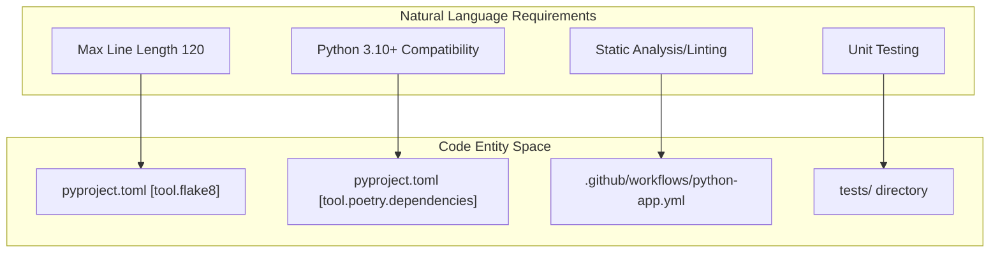
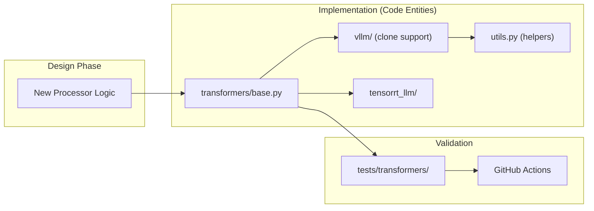

<!-- source: DeepWiki mcp.deepwiki.com · repo NVIDIA/logits-processor-zoo · page 5.2 Contributing and CI/CD · fetched 2026-10-26 -->

# Contributing and CI/CD

Relevant source files

The following files were used as context for generating this wiki page:

- [.gitattributes](.gitattributes)
- [.github/workflows/python-app.yml](.github/workflows/python-app.yml)
- [.gitignore](.gitignore)
- [CONTRIBUTING.md](CONTRIBUTING.md)
- [LICENSE](LICENSE)
- [pyproject.toml](pyproject.toml)

This page documents the development lifecycle for the `logits-processor-zoo` repository. It covers the contribution workflow, coding standards, the automated CI/CD pipeline powered by GitHub Actions, and the process for extending the library with new processors.

## Contribution Process

The project follows a standard open-source contribution model focused on issue tracking and Pull Requests (PRs). All contributors are required to "sign-off" on their commits using the `-s` or `--signoff` flag to certify compliance with the Developer Certificate of Origin (DCO) [CONTRIBUTING.md:41-54]().

### Workflow Steps
1.  **Issue Identification**: Find an existing issue or file a new feature request/bug report [CONTRIBUTING.md:3-15]().
2.  **Fork and Branch**: Create a fork and a descriptive branch (e.g., `fix-documentation`) [CONTRIBUTING.md:24-25]().
3.  **Implementation**: Write code and include corresponding unit tests and benchmarks [CONTRIBUTING.md:26-27]().
4.  **Verification**: Run local tests and linting. Open a draft PR to trigger CI without requesting immediate review [CONTRIBUTING.md:28-29]().
5.  **Review and Merge**: Address reviewer feedback until approval is granted for merging [CONTRIBUTING.md:30-31]().

**Sources:** [CONTRIBUTING.md:1-54]()

---

## Code Style and Linting

The project enforces strict code style guidelines to ensure maintainability across the zoo's various framework implementations.

*   **Linter**: `flake8` is used for static analysis [pyproject.toml:24-26]().
*   **Max Line Length**: Set to **120** characters [pyproject.toml:25-25]().
*   **Formatting**: The project uses `Flake8-pyproject` to respect configurations defined within `pyproject.toml` during CI runs [.github/workflows/python-app.yml:29-29]().

### Contribution Space to Code Entity Mapping
The following diagram maps the logical contribution requirements to the specific configuration files that enforce them.

**Contribution Requirement Mapping**

**Sources:** [pyproject.toml:9-26](), [.github/workflows/python-app.yml:22-36]()

---

## CI/CD Pipeline

The project utilizes GitHub Actions to automate testing and linting for every push and pull request targeting the `main` branch [.github/workflows/python-app.yml:6-11]().

### Pipeline Stages
The `build` job runs on `ubuntu-latest` and performs the following steps [.github/workflows/python-app.yml:16-20]():

1.  **Environment Setup**: Initializes Python 3.10 [.github/workflows/python-app.yml:22-25]().
2.  **Dependency Installation**: 
    *   Upgrades `pip`.
    *   Installs `poetry`, `flake8`, `Flake8-pyproject`, `pytest`, and `pytest-cov`.
    *   Installs the local package in editable mode (`pip install -e .`) [.github/workflows/python-app.yml:26-30]().
3.  **Linting**: Executes `poetry run flake8` to verify style compliance [.github/workflows/python-app.yml:31-33]().
4.  **Testing**: Runs `pytest` on the `tests/` directory with coverage reporting enabled via `--cov` [.github/workflows/python-app.yml:34-36]().

**Sources:** [.github/workflows/python-app.yml:1-36]()

---

## Adding a New Processor

To add a new processor to the zoo, a developer must typically implement it across the supported backends to maintain parity.

### Implementation Checklist
1.  **Core Logic**: Define the processor in `logits_processor_zoo/transformers/` by inheriting from `BaseLogitsProcessor`.
2.  **vLLM Support**: Create a corresponding implementation in `logits_processor_zoo/vllm/`. If the processor maintains state (e.g., counters or timers), ensure a `clone()` method is implemented for batched inference.
3.  **TensorRT-LLM Support**: Implement the interface in `logits_processor_zoo/tensorrt_llm/` following the `tensorrt_llm.sampling_params.LogitsProcessor` signature.
4.  **Utilities**: Leverage existing helpers in `logits_processor_zoo/utils.py` for tasks like token masking or sentence boundary detection.

### Data Flow: Adding a Processor
The following diagram illustrates how a new processor idea moves through the codebase structure.

**Processor Integration Flow**

**Sources:** [CONTRIBUTING.md:17-32](), [pyproject.toml:1-15]()

---

## Build and Release Workflow

The project uses **Poetry** as its primary build system and dependency manager [pyproject.toml:1-22]().

*   **Dependency Management**: Dependencies are defined in `[tool.poetry.dependencies]`. `vllm` is marked as an optional extra [pyproject.toml:9-17]().
*   **Build Backend**: Uses `poetry.core.masonry.api` [pyproject.toml:20-22]().
*   **Version Control**: The version is tracked in `pyproject.toml` (currently `0.2.1`) [pyproject.toml:3-3]().
*   **Artifacts**: Distribution files (wheels/sdist) are ignored by git via `.gitignore` [.gitignore:11-26]().

**Sources:** [pyproject.toml:1-26](), [.gitignore:104-104]()

---

