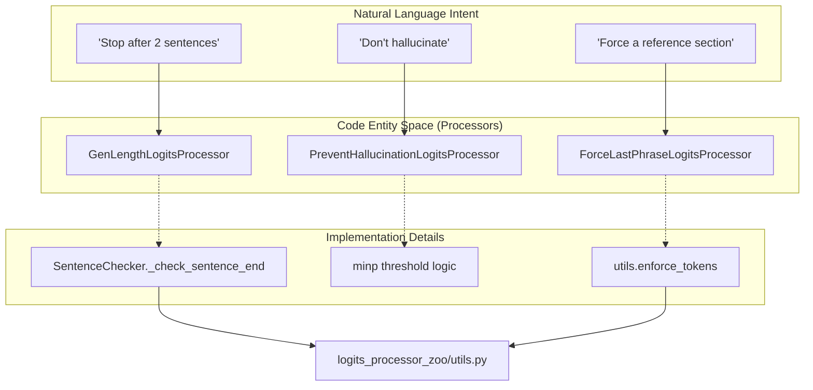
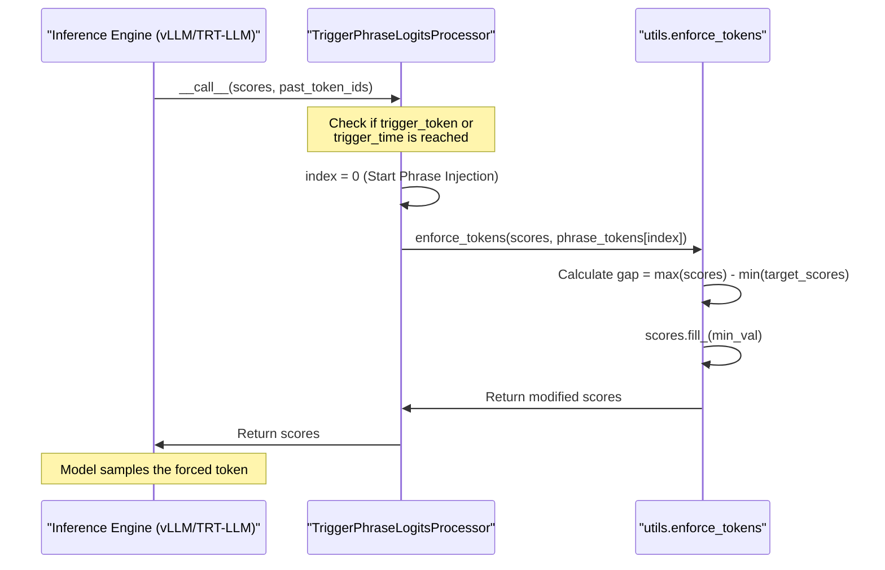

<!-- source: DeepWiki mcp.deepwiki.com · repo NVIDIA/logits-processor-zoo · page 6 Glossary · fetched 2026-10-26 -->

# Glossary

Relevant source files

The following files were used as context for generating this wiki page:

- [README.md](README.md)
- [logits_processor_zoo/transformers/__init__.py](logits_processor_zoo/transformers/__init__.py)
- [logits_processor_zoo/transformers/prevent_hallucination.py](logits_processor_zoo/transformers/prevent_hallucination.py)
- [logits_processor_zoo/trtllm/__init__.py](logits_processor_zoo/trtllm/__init__.py)
- [logits_processor_zoo/trtllm/trigger_phrase.py](logits_processor_zoo/trtllm/trigger_phrase.py)
- [logits_processor_zoo/utils.py](logits_processor_zoo/utils.py)
- [logits_processor_zoo/vllm/__init__.py](logits_processor_zoo/vllm/__init__.py)
- [logits_processor_zoo/vllm/generation_length.py](logits_processor_zoo/vllm/generation_length.py)
- [logits_processor_zoo/vllm/prevent_hallucination.py](logits_processor_zoo/vllm/prevent_hallucination.py)
- [logits_processor_zoo/vllm/trigger_phrase.py](logits_processor_zoo/vllm/trigger_phrase.py)
- [pyproject.toml](pyproject.toml)
- [tests/test_utils.py](tests/test_utils.py)

This glossary defines technical terms, domain-specific concepts, and architectural components used throughout the `logits-processor-zoo` codebase. It serves as a reference for onboarding engineers to understand how natural language constraints are translated into logit manipulations across different inference frameworks.

## Core Concepts

### Logits Processor
A component that intercepts and modifies the raw prediction scores (logits) generated by a Large Language Model (LLM) before the sampling or greedy decoding step. In this library, processors are implemented across three primary backends: `transformers`, `vLLM`, and `TensorRT-LLM` [README.md:18-21]().

### Logit Manipulation (Enforcement)
The process of forcing specific tokens to be selected by the model. The utility function `enforce_tokens` achieves this by calculating the gap between the current maximum logit and the target tokens' logits, then boosting the target tokens while suppressing all others [logits_processor_zoo/utils.py:46-52]().

### Framework-Specific Call Signatures
Each integration requires a specific method signature to match the backend's internal generation loop:
*   **Transformers**: `__call__(self, input_ids: torch.LongTensor, scores: torch.FloatTensor)` [logits_processor_zoo/transformers/prevent_hallucination.py:62]().
*   **vLLM**: `__call__(self, prompt_tokens_ids: List[int], past_token_ids: List[int], scores: torch.Tensor)` [logits_processor_zoo/vllm/trigger_phrase.py:75]().
*   **TensorRT-LLM**: `__call__(self, req_id: int, logits: torch.Tensor, token_ids: List[List[int]], stream_ptr: Optional[int], client_id: Optional[int])` [logits_processor_zoo/trtllm/trigger_phrase.py:62-64]().

---

## Architectural Mapping

The following diagram illustrates how high-level generation goals are mapped to specific code entities and data structures within the zoo.

**Natural Language to Code Entity Mapping**

**Sources:** [logits_processor_zoo/vllm/generation_length.py:24-38](), [logits_processor_zoo/vllm/prevent_hallucination.py:24-44](), [logits_processor_zoo/utils.py:55-65]().

---

## Terminology

### `boost_factor`
A scalar value used to modify the logit of a specific token (often the EOS token).
*   In `GenLengthLogitsProcessor`, it scales the length-based penalty/reward: $boost\_val = \frac{boost\_factor \cdot gen\_length^p}{10^p}$ [logits_processor_zoo/vllm/generation_length.py:60-62]().
*   In `CiteFromPromptLogitsProcessor`, it directly increases the likelihood of tokens found in the input prompt [README.md:66-68]().

### `clone()`
A mandatory method for mutable processors in the **vLLM** backend. Because vLLM processes requests in batches, mutable state (like counters or timers) must be isolated per sequence. The `clone()` method returns a fresh instance of the processor for each sequence in a batch [logits_processor_zoo/vllm/trigger_phrase.py:64-68]().

### `minp` (Minimum Probability)
A confidence threshold used primarily in `PreventHallucinationLogitsProcessor`. If the maximum softmax probability of the next token falls below this value, the model is considered "uncertain" [logits_processor_zoo/vllm/prevent_hallucination.py:37-38]().

### `SentenceChecker`
A utility class that identifies if the generation has reached a logical conclusion (full stop or newline) by comparing the last generated token ID against known punctuation/newline tokens [logits_processor_zoo/utils.py:55-65]().

---

## Data Flow: Token Enforcement

The following diagram shows the lifecycle of a logit modification when a processor decides to "force" a specific phrase (e.g., in `TriggerPhraseLogitsProcessor`).

**Token Enforcement Data Flow**

**Sources:** [logits_processor_zoo/vllm/trigger_phrase.py:75-97](), [logits_processor_zoo/utils.py:46-52](), [logits_processor_zoo/trtllm/trigger_phrase.py:79-86]().

---

## Technical Abbreviations

| Abbreviation | Full Term | Context in Codebase |
| :--- | :--- | :--- |
| **EOS** | End of Sequence | The token ID used to terminate generation, targeted by `GenLengthLogitsProcessor` [logits_processor_zoo/vllm/generation_length.py:46](). |
| **TRT-LLM** | TensorRT-LLM | NVIDIA's high-performance inference framework supported in `logits_processor_zoo/trtllm/` [logits_processor_zoo/trtllm/__init__.py:1-29](). |
| **BOS** | Beginning of Sequence | Handled in `text_to_token` to ensure correct token mapping when prefixes are present [logits_processor_zoo/utils.py:28-31](). |
| **LPZ** | Logits Processor Zoo | Short-hand for the library itself, often used in example directory names (`lpz_examples`) [README.md:59](). |

**Sources:** [README.md:1-94](), [logits_processor_zoo/utils.py:18-65](), [logits_processor_zoo/vllm/generation_length.py:1-71]().