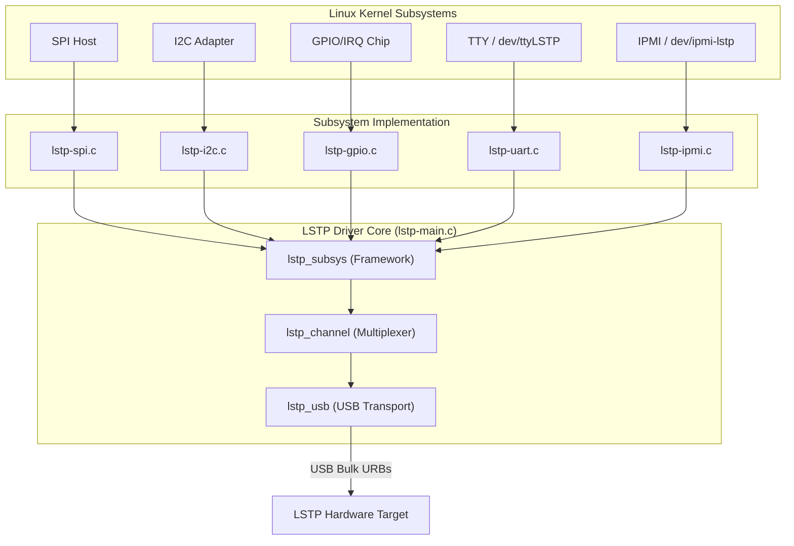
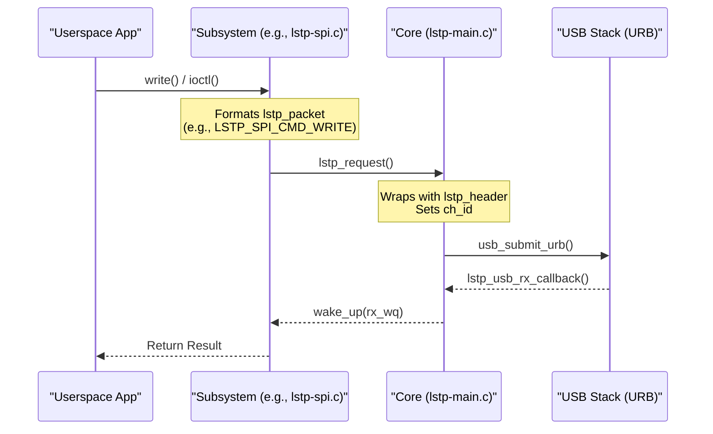

<!-- source: DeepWiki mcp.deepwiki.com · repo NVIDIA/lstp_module · page 1 LSTP Driver Overview · fetched 2026-10-26 -->

# LSTP Driver Overview

Relevant source files

The following files were used as context for generating this wiki page:

- [AGENTS.md](AGENTS.md)
- [LICENSE](LICENSE)
- [LSTP Specification 1.0 -- 08-03-2026.pdf](LSTP Specification 1.0 -- 08-03-2026.pdf)
- [README.md](README.md)

The **Low-Speed Transport Protocol (LSTP)** Linux kernel driver provides a unified transport for multiplexing multiple low-speed peripheral protocols over a single USB interface. It is designed to bridge host systems (such as Ubuntu-based servers or OpenBMC controllers) to various hardware targets including ASICs, FPGAs, and microcontrollers [AGENTS.md:7-14]().

The driver functions as an out-of-tree kernel module that translates standard Linux subsystem requests (SPI, I2C, GPIO, etc.) into LSTP-formatted USB packets [README.md:1-3]().

## System Architecture

The LSTP driver is organized into a core manager and several protocol-specific subsystems. The core manages the USB lifecycle and channel multiplexing, while subsystems handle the translation to specific Linux kernel frameworks.

### High-Level Component Mapping

The following diagram bridges the conceptual protocol layers to the primary code entities within the repository.

**LSTP Component Overview**

**Sources:** [README.md:126-146](), [AGENTS.md:44-46]()

## Protocol and Background
LSTP was developed to solve the problem of managing numerous low-speed pins and buses on modern hardware without requiring dozens of dedicated USB interfaces or complex cabling. It uses a logical channel system (supporting up to 256 channels) to tunnel traffic for:
*   **SPI** (Serial Peripheral Interface)
*   **I2C** (Inter-Integrated Circuit)
*   **GPIO** (General Purpose I/O and LEDs)
*   **UART** (Universal Asynchronous Receiver-Transmitter)
*   **IPMI** (Intelligent Platform Management Interface)
*   **MMIO** (Memory Mapped I/O)

For a deep dive into the wire format, headers, and hardware compatibility, see **[Project Background and Protocol Specification](#1.1)**.

**Sources:** [LSTP Specification 1.0 -- 08-03-2026.pdf:1-13](), [README.md:3]()

## Driver Operations

The driver supports dynamic discovery of peripherals via the LSTP protocol itself, as well as static configuration via Device Tree or ACPI [AGENTS.md:11-14](). 

### Data Flow and Code Entities

This diagram illustrates how a standard Linux system call (like `write()`) travels through the LSTP stack to the wire.

**Request-Response Data Flow**

**Sources:** [AGENTS.md:48-55](), [README.md:159-167]()

## Navigation Guide

This wiki is organized to assist both system administrators deploying the driver and developers extending its functionality.

| Section | Description |
| :--- | :--- |
| **[Project Background and Protocol Specification](#1.1)** | Detailed look at the LSTP Spec 1.0, wire formats, and target hardware. |
| **[Getting Started: Build, Install, and Load](#1.2)** | Instructions for building the out-of-tree module, cross-compilation, and Secure Boot signing. |
| **[Security and Licensing](#1.3)** | Information on GPL-2.0 licensing and the NVIDIA PSIRT vulnerability reporting process. |
| **Core Driver Architecture** | (Section 2) Technical details on URB management, channel multiplexing, and the internal API. |
| **Transport Subsystems** | (Section 3) Deep dives into the individual SPI, I2C, GPIO, UART, IPMI, and MMIO implementations. |
| **Device Tree Bindings** | (Section 4) Documentation for firmware nodes and hardware description schemas. |
| **Development and Tooling** | (Section 5) Coding standards, `clang-format` rules, and contribution guidelines. |

## Quick Start Summary
To get the driver running on a standard Linux host:
1.  **Install dependencies**: `build-essential` and `linux-headers`.
2.  **Build**: Run `make build`.
3.  **Sign (if required)**: Use `sign-file` for UEFI Secure Boot environments.
4.  **Load**: Run `make load`.
5.  **Verify**: Check `dmesg` and the `/sys/bus/usb/drivers/lstp` directory.

For detailed steps, see **[Getting Started: Build, Install, and Load](#1.2)**.

**Sources:** [README.md:9-31](), [README.md:97-112]()

---

