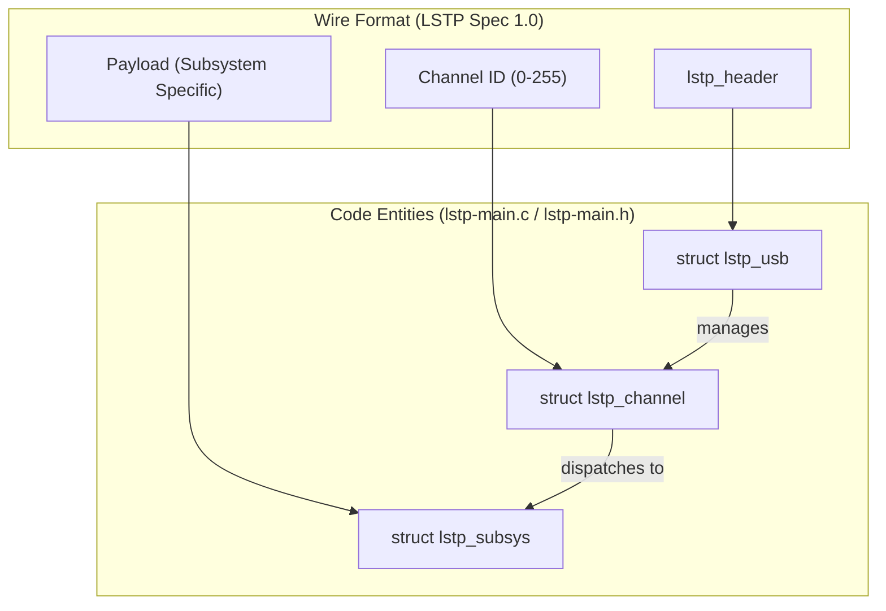
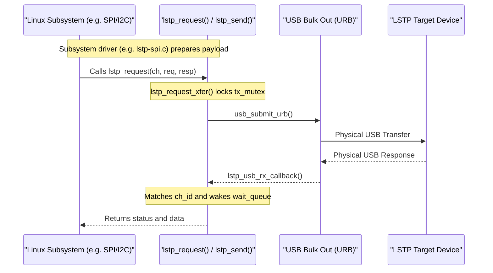

<!-- source: DeepWiki mcp.deepwiki.com · repo NVIDIA/lstp_module · page 1.1 Project Background and Protocol Specification · fetched 2026-10-26 -->

# Project Background and Protocol Specification

Relevant source files

The following files were used as context for generating this wiki page:

- [AGENTS.md](AGENTS.md)
- [LSTP Specification 1.0 -- 08-03-2026.pdf](LSTP Specification 1.0 -- 08-03-2026.pdf)
- [README.md](README.md)

The Low-Speed Transport Protocol (LSTP) is a multiplexing transport protocol designed to bridge low-speed hardware peripherals over a single USB interface. It enables a host system (such as an x86 Ubuntu server or an ARM-based OpenBMC controller) to interact with SPI, I2C, GPIO, UART, IPMI, and MMIO controllers located on a remote ASIC, FPGA, or microcontroller via USB bulk endpoints `[README.md:1-3, AGENTS.md:7-14]()`.

## Protocol Purpose and Scope

LSTP addresses the challenge of managing numerous low-speed interfaces without requiring dedicated USB interfaces for every peripheral. By multiplexing up to 256 logical channels over a single pair of USB Bulk IN/OUT endpoints, it reduces hardware complexity and pin count on target devices `[README.md:126-146, AGENTS.md:11-12]()`.

### Target Environments
*   **Hosts:** Ubuntu-style Linux distributions (x86_64) and OpenBMC (arm64/armv7l) `[AGENTS.md:11-12, README.md:63-66]()`.
*   **Targets:** ASICs, FPGAs, and microcontrollers implementing the LSTP Specification 1.0 `[AGENTS.md:11-12, README.md:3]()`.
*   **Discovery:** Supports both dynamic firmware-reported channel discovery (via Channel 0) and static configuration via Device Tree (DT) or ACPI `[AGENTS.md:12-13, README.md:169-217]()`.

## Wire-Format Concepts

The protocol relies on a structured packet format to ensure reliable communication and command dispatching. All multi-byte fields are transmitted in **Little-Endian** format (`__le16`, `__le32`) unless otherwise specified by the subsystem `[AGENTS.md:37-39]()`.

### Packet Structure
Every LSTP transaction begins with a standard header, followed by an optional payload. The driver uses `BUILD_BUG_ON` assertions to ensure these structures fit within the minimum USB endpoint size `[AGENTS.md:48-50]()`.

| Field | Type | Description |
| :--- | :--- | :--- |
| `ch_id` | `u8` | Logical channel ID (0-255). Channel 0 is reserved for management. |
| `cmd_status` | `u8` | Command ID (Request) or Status Code (Response). Bit 7 indicates an IRQ/Unsolicited message. |
| `length` | `__le16` | Length of the payload following the header. |

**Sources:** `[AGENTS.md:37-50]()`

### Channel Multiplexing
LSTP allows a single USB physical link to represent a complex hierarchy of devices. The driver maps these logical channels to standard Linux kernel subsystems.

**Entity Mapping: Protocol to Code**
The following diagram illustrates how wire-format concepts map to specific data structures in the driver implementation.

**Sources:** `[AGENTS.md:7-14, README.md:126-146]()`

## Supported Peripherals (Subsystems)

The driver implements several subsystems that translate Linux-native requests into LSTP packets.

1.  **SPI:** Supports multiple chip-selects and high-frequency transfers. Can automatically bind `spidev` if configured `[README.md:77-92, README.md:186-204]()`.
2.  **I2C:** Implements standard I2C algorithms including repeated START and SMBus block reads `[README.md:134-140]()`.
3.  **GPIO/LED:** Provides a `gpio_chip` and `irq_chip` for digital I/O and a pattern engine for LEDs `[README.md:141-144]()`.
4.  **UART:** Exposes virtual TTY devices (`/dev/ttyLSTP`) with flow control and break detection support `[AGENTS.md:17-20]()`.
5.  **IPMI:** Bridges IPMI messages to a character device, often used for BMC-to-Host communication `[README.md:206-210]()`.
6.  **MMIO:** Allows direct memory-mapped I/O access to target registers for debugging or low-level control.

## System Architecture and Data Flow

The LSTP driver acts as a manager that sits between the USB core and the various Linux peripheral subsystems.

**Data Flow: Host to Target**
This diagram bridges the natural language flow of a request to the internal code functions responsible for handling it.

**Sources:** `[AGENTS.md:7-14, AGENTS.md:51-55]()`

## Compatibility and Stability

The LSTP driver is built with strict compatibility requirements. Because the protocol is already deployed in production environments, the following interfaces are considered stable "Compatibility Surfaces" `[AGENTS.md:16-20]`:
*   **Packet Formats:** The layout of `lstp_header` and subsystem-specific payloads.
*   **Sysfs Hierarchy:** The structure under `/sys/bus/usb/devices/.../lstp/`.
*   **Module Parameters:** Such as `auto_bind_spidev`.
*   **Device Tree Bindings:** The `nvidia,lstp` schema and its child nodes.

Any extensions to the driver must maintain backward compatibility with existing firmware and userspace tools `[AGENTS.md:19-20]`.

**Sources:**
* `AGENTS.md:1-69`
* `README.md:1-218`
* `LSTP Specification 1.0 -- 08-03-2026.pdf:1-23`

---

