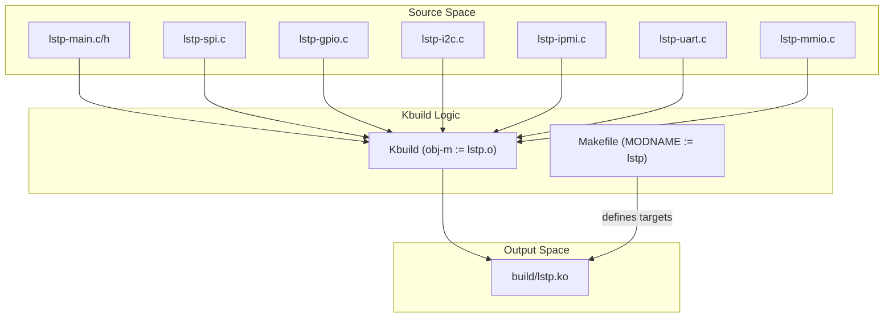
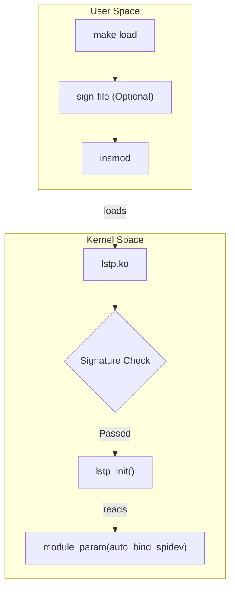

<!-- source: DeepWiki mcp.deepwiki.com · repo NVIDIA/lstp_module · page 1.2 Getting Started: Build, Install, and Load · fetched 2026-10-26 -->

# Getting Started: Build, Install, and Load

<details>
<summary>Relevant source files</summary>

The following files were used as context for generating this wiki page:

- [.gitignore](.gitignore)
- [Kbuild](Kbuild)
- [Kconfig](Kconfig)
- [Makefile](Makefile)
- [README.md](README.md)

</details>


This page provides a comprehensive technical guide for building, installing, and managing the LSTP (Low-Speed Transport Protocol) out-of-tree Linux kernel module. It covers the build system architecture, cross-compilation workflows, module parameters, and security requirements for Secure Boot environments.

## Build System Overview

The LSTP driver uses a standard Linux Kbuild-compatible `Makefile` designed to handle both local host builds and cross-compilation for embedded targets (arm64, armv7l). The build process utilizes a staging directory (`/build/`) to isolate generated artifacts from the source tree [Makefile:24-25]().

### Makefile Targets and Logic

The `Makefile` defines several key targets for the module lifecycle:

| Target | Action |
| :--- | :--- |
| `build` | Compiles the `lstp.ko` module using the local kernel headers [Makefile:57-59](). |
| `install` | Copies the module to `/lib/modules/$(uname -r)/extra/` and runs `depmod` [Makefile:70-74](). |
| `load` | Inserts the module into the running kernel using `insmod`, passing `MODPARAMS` [Makefile:84-87](). |
| `unload` | Removes the module from the kernel using `rmmod` [Makefile:80-82](). |
| `reload` | Sequential execution of `unload`, `build`, and `load` for rapid development [Makefile:68](). |
| `clean` | Removes the `/build/` staging directory [Makefile:65-66](). |

### Build Artifacts Association

The following diagram illustrates how the build system maps source files to the final kernel object.

**Diagram: Build Entity Mapping**

Sources: [Kbuild:14-16](), [Makefile:16-17](), [Makefile:58-59]()

## Compilation Workflows

### Local Host Build
To build for the currently running kernel, ensure `build-essential` and `linux-headers` are installed [README.md:11-14]().
```bash
make build
```
The `Makefile` automatically detects the local kernel version using `uname -r` [Makefile:19]() and sets the kernel directory `KDIR` to `/lib/modules/$(UNAME_R)/build` [Makefile:22]().

### Cross-Compilation
The driver supports cross-compilation for different architectures by overriding `ARCH` and `CROSS_COMPILE` [Makefile:31-40]().

*   **arm64 (aarch64):** Uses `aarch64-linux-gnu-` [Makefile:33]().
*   **armv7l (arm):** Uses `arm-linux-gnueabihf-` [Makefile:39]().
*   **x86_64:** Uses host tools [Makefile:36]().

For Raspberry Pi or OpenBMC targets, point `KDIR` (or `KERNEL_SRC` for the `build_rpi` target) to a pre-configured and `modules_prepare`'d kernel source tree [README.md:68-74]().

Sources: [Makefile:31-40](), [README.md:56-74]()

## Module Loading and Parameters

The module can be loaded using `make load`, which utilizes `insmod` [Makefile:85](). Users can pass parameters directly to the make command:
```bash
make load auto_bind_spidev=1
```

### Key Module Parameters

| Parameter | Type | Description |
| :--- | :--- | :--- |
| `auto_bind_spidev` | bool | If `1`, the driver creates `spidev` child devices for SPI channels that lack explicit firmware (DT/ACPI) descriptions [README.md:77-88](). |

The default value for `auto_bind_spidev` is determined at compile time by the `CONFIG_USB_LSTP_SPI_SPIDEV` Kconfig option [Kconfig:22-34]().

Sources: [Kconfig:22-34](), [README.md:77-92](), [Makefile:51-53]()

## Secure Boot and Module Signing

On systems with UEFI Secure Boot enabled (e.g., Ubuntu, OpenBMC), the kernel will reject the LSTP module unless it is signed by a trusted key [README.md:32-38]().

### Signing Workflow
1.  **Generate MOK (Machine Owner Key):** Create a self-signed X.509 certificate [README.md:43-44]().
2.  **Enroll Key:** Use `mokutil --import` and reboot to enroll the key in the system firmware [README.md:45-48]().
3.  **Sign Module:** Use the kernel's `sign-file` script to sign the `.ko` after every build [README.md:52-54]().

**Diagram: Module Loading Data Flow**

Sources: [README.md:32-54](), [Makefile:84-85](), [Kconfig:31-32]()

## Installation and Verification

### Persistent Installation
Using `make install` places the module in the `extra` directory, ensuring it persists across reboots and can be loaded via `modprobe lstp` [Makefile:70-74]().

### Verification
After loading, verify the driver status via `dmesg` or by inspecting the sysfs hierarchy:
*   **Logs:** `sudo dmesg | grep -i lstp` [README.md:97-100]().
*   **Sysfs Path:** Bound interfaces appear under `/sys/bus/usb/drivers/lstp/` [README.md:105-112]().
*   **Topology:** Each channel is visible at `/sys/bus/usb/devices/.../lstp/channel/N/` [README.md:126-146]().

Sources: [Makefile:70-74](), [README.md:95-146]()

---

