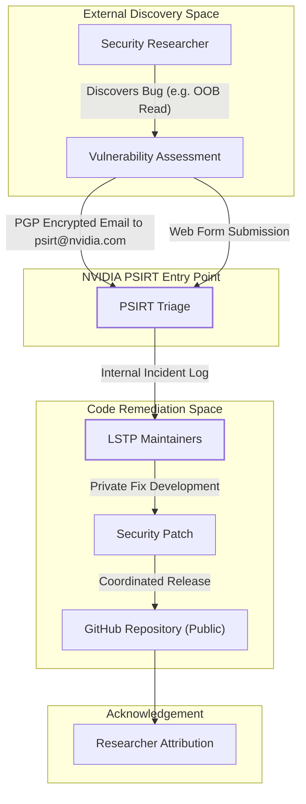
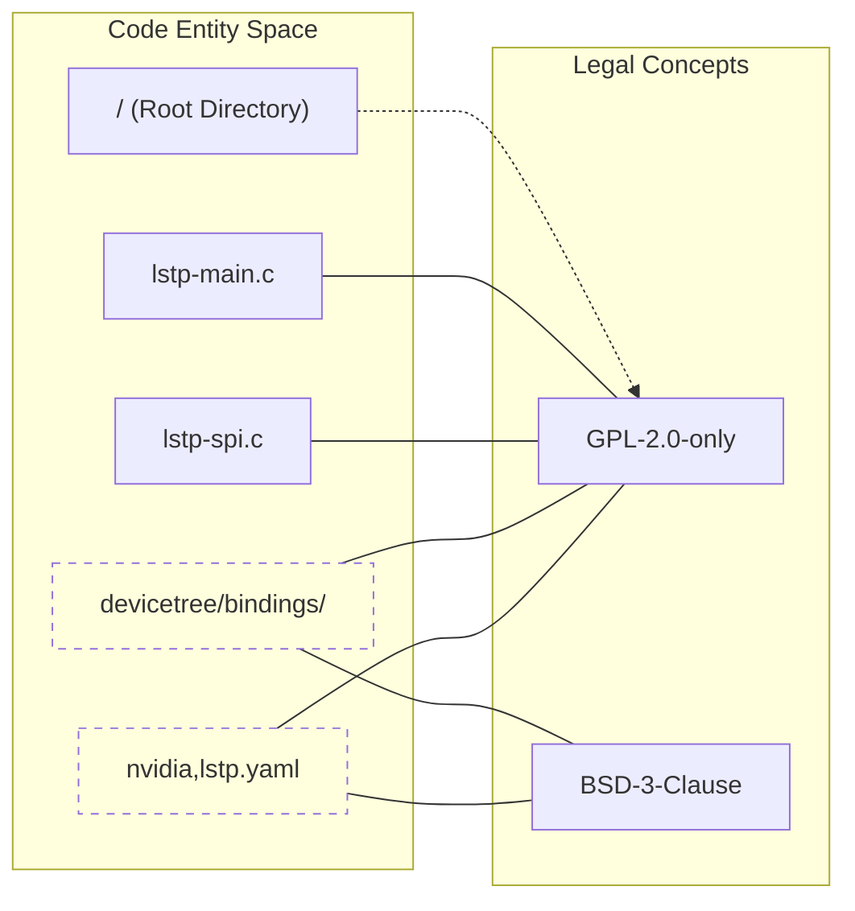

<!-- source: DeepWiki mcp.deepwiki.com · repo NVIDIA/lstp_module · page 1.3 Security and Licensing · fetched 2026-10-26 -->

# Security and Licensing

<details>
<summary>Relevant source files</summary>

The following files were used as context for generating this wiki page:

- [LICENSE](LICENSE)
- [SECURITY.md](SECURITY.md)

</details>


This page details the legal governance and security protocols for the LSTP (Low-Speed Transport Protocol) driver. The project adheres to standard Linux kernel licensing expectations while providing specific dual-licensing for hardware description components and a formal pipeline for vulnerability management through NVIDIA PSIRT.

## Licensing Framework

The LSTP codebase is governed by two primary licenses depending on the nature of the file (logic vs. hardware description). This ensures compatibility with the Linux kernel's GPL requirements while allowing flexibility for firmware and devicetree bindings that may be consumed by non-GPL environments.

### License Distribution
| Component | License | SPDX Identifier |
| :--- | :--- | :--- |
| **Kernel Driver Logic** | GPL-2.0-only | `GPL-2.0-only` |
| **Devicetree Bindings** | GPL-2.0-only OR BSD-3-Clause | `GPL-2.0-only OR BSD-3-Clause` |

Most files in the repository are licensed under **GPL-2.0-only** [LICENSE:3-3](). This includes the core transport logic in `lstp-main.c` and all subsystem implementations (SPI, I2C, GPIO, UART, IPMI, MMIO). 

Files located under `devicetree/bindings/` are **dual-licensed** under **GPL-2.0-only OR BSD-3-Clause** [LICENSE:3-3](). The BSD-3-Clause option allows for redistribution in source and binary forms provided that copyright notices and disclaimers are maintained [LICENSE:8-16]().

### SPDX Metadata Implementation
To ensure automated compliance and clarity, every source file must include an SPDX-License-Identifier header. This header serves as the machine-readable authority on the file's licensing terms.

**Example: Driver Source Header**
```c
// SPDX-License-Identifier: GPL-2.0-only
/*
 * Copyright (c) 2026 NVIDIA CORPORATION & AFFILIATES. All rights reserved.
 */
```

**Example: Devicetree Binding Header**
```yaml
# SPDX-License-Identifier: (GPL-2.0-only OR BSD-3-Clause)
%YAML 1.2
---
$id: http://devicetree.org/schemas/bus/nvidia,lstp.yaml#
$schema: http://devicetree.org/meta-schemas/core.yaml#
```

**Sources:**
- [LICENSE:1-3]()
- [LICENSE:6-16]()
- [LICENSE:20-48]()

---

## Security Vulnerability Reporting

NVIDIA manages security concerns for the LSTP driver through the **Product Security Incident Response Team (PSIRT)**. The project follows a **Coordinated Vulnerability Disclosure (CVD)** policy.

### Reporting Process
Contributors and users are strictly prohibited from reporting security vulnerabilities via GitHub Issues or Public Pull Requests [SECURITY.md:5-5](). All potential vulnerabilities (e.g., buffer overflows, denial of service, or unauthorized code execution) must be submitted through official channels.

#### Submission Channels
*   **Web Portal:** [Security Vulnerability Submission Form](https://www.nvidia.com/object/submit-security-vulnerability.html) [SECURITY.md:10-10]()
*   **Email:** `psirt@nvidia.com` [SECURITY.md:11-11]()
    *   NVIDIA encourages the use of **PGP-encrypted email** for sensitive disclosures. The public PGP key is available at the [NVIDIA Security Portal](https://www.nvidia.com/en-us/security/pgp-key) [SECURITY.md:12-12]().

### Required Information for Disclosures
When submitting a report, the following technical details must be included to facilitate triage [SECURITY.md:13-19]():
1.  **Product/Driver Identification:** Specifically mention the LSTP driver and the affected branch/version.
2.  **Vulnerability Type:** Classification (e.g., integer overflow in `lstp_packet` length parsing).
3.  **Reproduction Steps:** Clear instructions to trigger the issue.
4.  **Proof-of-Concept (PoC):** Exploit code or scripts demonstrating the flaw.
5.  **Impact Assessment:** How an attacker could exploit the vulnerability and the potential consequences.

### Bug Bounty and Recognition
NVIDIA **does not** currently operate a bug bounty program for this driver [SECURITY.md:20-20](). However, external researchers are acknowledged once a reported issue is addressed, provided they adhere to the coordinated disclosure policy [SECURITY.md:20-20]().

**Sources:**
- [SECURITY.md:1-24]()

---

## Security Data Flow: Vulnerability Handling

The following diagram illustrates the flow of a security report from discovery to resolution, mapping the natural language process to the organizational entities.

### Security Reporting Pipeline


**Sources:**
- [SECURITY.md:7-20]()

---

## Licensing and Entity Mapping

This diagram bridges the "Natural Language" license requirements to the specific "Code Entities" (files and directories) they govern within the `lstp_module` repository.

### Code Entity License Mapping


**Sources:**
- [LICENSE:3-3]()
- [LICENSE:6-6]()
- [LICENSE:20-20]()

---

