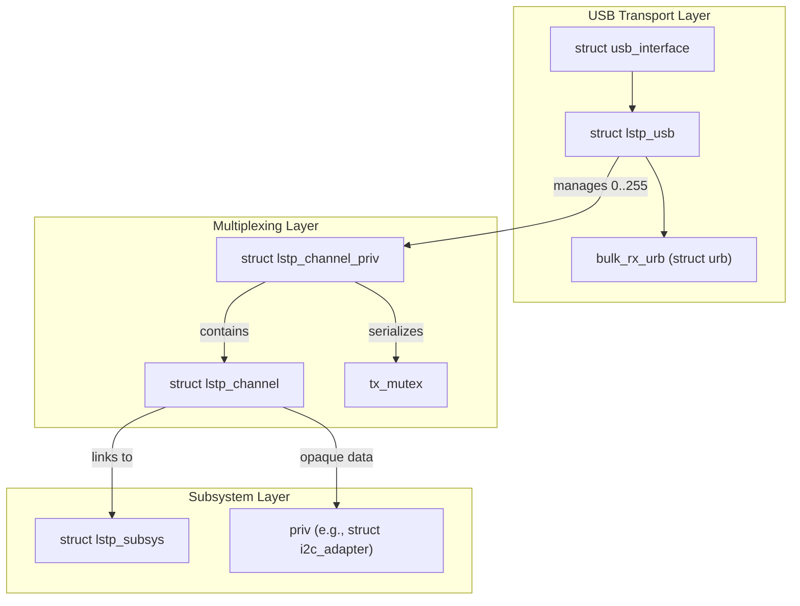

<!-- source: DeepWiki mcp.deepwiki.com · repo NVIDIA/lstp_module · page 2 Core Driver Architecture · fetched 2026-10-26 -->

# Core Driver Architecture

<details>
<summary>Relevant source files</summary>

The following files were used as context for generating this wiki page:

- [lstp-main.c](lstp-main.c)
- [lstp-main.h](lstp-main.h)

</details>


The LSTP (Low-Speed Transport Protocol) driver is designed as a modular framework that multiplexes multiple low-speed peripheral protocols (SPI, I2C, GPIO, etc.) over a single USB transport. The core architecture follows a **Manager-Subsystem** model where `lstp-main.c` handles the USB lifecycle and protocol multiplexing, while specialized subsystems handle the translation to Linux kernel frameworks.

## System Overview

The driver is anchored by the `lstp_usb` structure, which represents a single LSTP-capable USB interface. This interface manages up to 256 logical channels, each represented by an `lstp_channel`.

### Code-to-Entity Mapping: Core Structures
The following diagram illustrates how the logical protocol concepts map to specific C structures and their relationships.


**Sources:** [lstp-main.h:145-162](), [lstp-main.h:180-206](), [lstp-main.c:66-89]()

---

## USB Transport and Channel Multiplexing
The transport layer manages the physical movement of data via USB Bulk endpoints. All logical channels share the same physical USB Bulk-IN and Bulk-OUT endpoints. The driver uses a 4-byte `lstp_header` to route incoming packets to the correct logical channel.

*   **RX Path:** A single `bulk_rx_urb` is kept constantly in flight. Upon completion, `lstp_usb_rx_callback` parses the header and dispatches the payload to either a waiting synchronous request or an asynchronous IRQ callback.
*   **TX Path:** Each channel maintains its own `tx_mutex` to ensure that only one request-response exchange is active per logical channel at a time, preventing protocol interleaving within a single channel.

For details, see [USB Transport and Channel Multiplexing](#2.1).

**Sources:** [lstp-main.c:105-106](), [lstp-main.c:125-126](), [lstp-main.h:121-128]()

---

## Wire Protocol and Framing
The LSTP wire protocol defines a compact framing mechanism for requests and responses. Every packet starts with an `lstp_header` containing the `ch_id`, a command/status byte, and a 16-bit length field.

| Field | Size | Description |
| :--- | :--- | :--- |
| `ch_id` | 8 bits | The logical channel index (0-255). |
| `status` / `cmd` | 8 bits | Bit 7: 0 for Request, 1 for Response. Bits 0-6: Opcode or Status code. |
| `length` | 16 bits | Length of the payload in bytes (Little Endian). |

Channel 0 is reserved for management tasks, such as discovering available channels and reading/writing configuration descriptors (`lstp_ch_desc`).

For details, see [Wire Protocol: Packet Format and Status Codes](#2.2).

**Sources:** [lstp-main.h:121-133](), [lstp-main.h:103-107](), [lstp-main.c:24-28]()

---

## Subsystem Registration Framework
The driver uses a registration-based model to support different peripheral types. Each subsystem (like SPI or I2C) defines an `lstp_subsys` structure and registers itself with the core.

### Code-to-Entity Mapping: Dispatch Flow
This diagram shows how a packet received from USB is dispatched to the correct subsystem handler.

```mermaid
graph TD
    [USB_Completion] --> RX_CB["lstp_usb_rx_callback()"]
    RX_CB --> VALIDATE["lstp_validate_rx_pkt()"]
    VALIDATE --> DISPATCH{"Is Bit 7 Set?"}
    
    DISPATCH -- "Yes (Response)" --> SYNC_WAIT["Wake rx_wq for lstp_request()"]
    DISPATCH -- "No (Unsolicited/IRQ)" --> IRQ_CB["subsys->irq_callback()"]
    
    subgraph "Subsystem Implementations"
        IRQ_CB -.-> SPI["lstp-spi.c"]
        IRQ_CB -.-> GPIO["lstp-gpio.c"]
        IRQ_CB -.-> UART["lstp-uart.c"]
    end
```
**Sources:** [lstp-main.c:105-105](), [lstp-main.c:192-192](), [lstp-main.h:175-175](), [lstp-main.c:292-315]()

When a new LSTP USB device is probed, the core reads the channel configuration from the device and matches each channel to a registered subsystem using `lstp_subsys_by_channel_type()`.

For details, see [Subsystem Registration Framework](#2.3).

**Sources:** [lstp-main.c:487-501](), [lstp-main.h:218-232]()

---

## Request/Response API
Subsystems interact with the hardware through a set of synchronous and asynchronous APIs. The primary synchronous entry point is `lstp_request()`, which handles the full lifecycle of a command:
1.  Acquiring the channel `tx_mutex`.
2.  Formatting the `lstp_packet`.
3.  Submitting the `bulk_tx_urb`.
4.  Waiting on `rx_wq` for the response or a timeout (`LSTP_USB_RESPONSE_TIMEOUT_MS`).

For details, see [Request/Response API and Synchronization](#2.4).

**Sources:** [lstp-main.c:416-435](), [lstp-main.h:28-29]()

---

## Sysfs and Firmware Integration
The driver exposes the LSTP hierarchy via sysfs under the USB interface device. The structure follows `/sys/bus/usb/devices/.../interface/lstp/channel/N/`.
*   **Sysfs:** Users can view channel names and toggle the `enable` attribute, which triggers a `LSTP_CH0_CMD_WRITE_CONFIG` to the hardware.
*   **Firmware:** The driver attempts to match logical channels with Device Tree or ACPI nodes using the `reg` property (matching the `ch_id`). This allows standard Linux drivers (like `spidev` or `i2c-dev`) to bind to LSTP-backed controllers.

For details, see [Sysfs Hierarchy and Firmware Node Integration](#2.5).

**Sources:** [lstp-main.c:142-159](), [lstp-main.c:704-723](), [lstp-main.c:795-812]()

---

