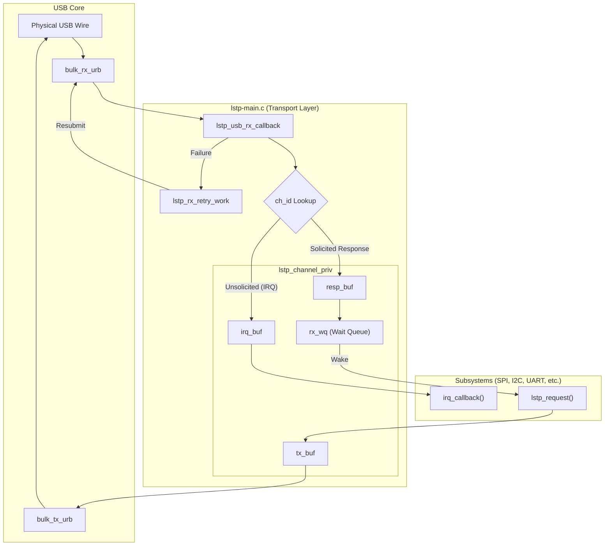
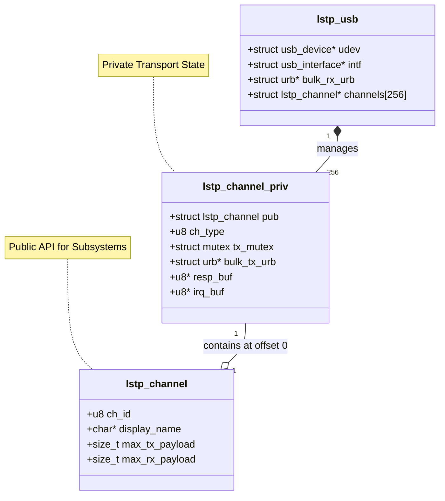

<!-- source: DeepWiki mcp.deepwiki.com · repo NVIDIA/lstp_module · page 2.1 USB Transport and Channel Multiplexing · fetched 2026-10-26 -->

# USB Transport and Channel Multiplexing

Relevant source files

The following files were used as context for generating this wiki page:

- [lstp-main.c](lstp-main.c)
- [lstp-main.h](lstp-main.h)

The LSTP (Low-Speed Transport Protocol) driver manages a single USB interface to provide a multiplexed transport layer for up to 256 logical channels. This page details the lifecycle of USB Request Blocks (URBs), the mechanism for solicited and unsolicited (IRQ) communication, and how logical channels are isolated over shared physical bulk endpoints.

## Architectural Overview

The transport layer is centered around the `lstp_usb` structure, which represents the physical USB interface, and the `lstp_channel_priv` structure, which manages the state and buffers for individual logical channels.

### Key Data Structures

| Structure | Role | Definition |
| :--- | :--- | :--- |
| `lstp_usb` | Manages the USB device, interface, and global RX URB. | [lstp-main.h:145-161]() |
| `lstp_channel` | Public state visible to subsystems (SPI, I2C, etc.). | [lstp-main.h:206-221]() |
| `lstp_channel_priv` | Framework-private state, including per-channel URBs and synchronization. | [lstp-main.c:66-89]() |
| `lstp_header` | The 4-byte wire-format header (Channel ID, Command/Status, Length). | [lstp-main.h:121-128]() |

**Sources:** [lstp-main.c:66-89](), [lstp-main.h:121-161](), [lstp-main.h:206-221]()

## USB URB Lifecycle

LSTP utilizes USB bulk endpoints for all communications. To ensure high availability and low latency, the driver maintains a continuous "RX loop" and per-channel serialized TX paths.

### RX Path and Dispatcher
The driver submits a single `bulk_rx_urb` during initialization [lstp-main.c:832-840](). When data arrives, the `lstp_usb_rx_callback` acts as the central dispatcher:

1.  **Validation**: The packet is checked for basic wire-format integrity via `lstp_validate_rx_pkt` [lstp-main.c:192-232]().
2.  **Channel Lookup**: The `ch_id` in the `lstp_header` is used to index the `dev->channels[]` array [lstp-main.c:266-267]().
3.  **Solicited vs. Unsolicited**:
    *   **Solicited (Bit 7 of Status = 1)**: The packet is a response to a previous request. The dispatcher copies the payload into the channel's `resp_buf` and wakes the `rx_wq` [lstp-main.c:286-302]().
    *   **Unsolicited (Bit 7 of Status = 0)**: The packet is an IRQ/Event. The dispatcher copies the data to `irq_buf` and executes the subsystem's `irq_callback` in atomic context [lstp-main.c:304-323]().
4.  **Resubmission**: The URB is resubmitted to the USB core. If resubmission fails (e.g., due to memory pressure), the `lstp_rx_retry` delayed work is scheduled [lstp-main.c:334-345]().

### TX Path and Serialization
Outbound requests are serialized per-channel using `tx_mutex` [lstp-main.c:72](). This ensures that only one request is in flight per logical channel, simplifying response matching. Subsystems use `lstp_request_xfer()` to perform synchronous exchanges [lstp-main.c:541-610]().

### Diagram: USB URB Data Flow
This diagram illustrates how data moves from the physical USB wire through the URB completion handlers to the logical subsystems.

**Sources:** [lstp-main.c:105-106](), [lstp-main.c:255-350](), [lstp-main.c:541-610](), [lstp-main.h:139-143]()

## Channel Multiplexing

LSTP supports up to 256 logical channels [lstp-main.h:32](). Channel 0 is reserved for management (configuration and discovery), while channels 1-255 are assigned to specific peripheral subsystems.

### Logical Channel Structure
Each channel is represented by a `lstp_channel_priv` object. The association between a USB packet and a channel is strictly determined by the `ch_id` field in the `lstp_header` [lstp-main.h:121-128]().

### Channel Discovery (Channel 0)
At probe time, the driver queries Channel 0 to discover the available hardware configuration:
1.  **READ_CONFIG**: The driver sends `LSTP_CH0_CMD_READ_CONFIG` to retrieve the `lstp_ch0_config` [lstp-main.c:377-393]().
2.  **Channel Enumeration**: The driver iterates from `ch_id` 1 to `num_channels`, reading the `lstp_ch_desc` for each [lstp-main.c:1134-1148]().
3.  **Subsystem Matching**: For each channel, the driver matches the `ch_type` against the registered `lstp_subsystems[]` and initializes the corresponding subsystem [lstp-main.c:1150-1165]().

### Diagram: Logical Channel Multiplexing
This diagram maps the relationship between the physical `lstp_usb` interface and the logical `lstp_channel` entities.

**Sources:** [lstp-main.c:66-89](), [lstp-main.c:98-99](), [lstp-main.h:32](), [lstp-main.h:145-161](), [lstp-main.h:206-221]()

## RX Retry Mechanism

USB URB submission can fail due to transient conditions (e.g., `-ENOMEM`). To prevent the RX loop from dying, the driver implements a retry mechanism using `lstp_rx_retry`.

*   **Failure Handling**: If `usb_submit_urb` fails in `lstp_usb_rx_callback` or during initial probe, the error is recorded in `bulk_rx_retry.last_err` [lstp-main.c:338-344]().
*   **Backoff**: The `lstp_rx_retry_work` function attempts to resubmit the URB. It uses a `delayed_work` to avoid tight-looping during persistent failure conditions [lstp-main.c:352-373]().
*   **Recovery**: Once the URB is successfully accepted by the USB core, the normal completion callback flow resumes.

**Sources:** [lstp-main.c:334-373](), [lstp-main.h:139-143]()

## Synchronization and Locking

The transport layer employs several locking primitives to ensure thread safety:

1.  **`tx_mutex`**: Serializes access to the `bulk_tx_urb` and the channel's `tx_buf`. This ensures that a request-response pair is atomic from the perspective of the USB wire [lstp-main.c:72]().
2.  **`resp_buffer_lock`**: A bit-lock used to protect the `resp_buf` during the hand-off between the RX callback (interrupt context) and the `lstp_request` caller (process context) [lstp-main.c:74]().
3.  **`cfg_lock`**: Protects read-modify-write operations on Channel 0 configuration, specifically during sysfs-initiated channel enable/disable toggling [lstp-main.c:73]().

**Sources:** [lstp-main.c:72-76](), [lstp-main.c:125-126](), [lstp-main.c:286-302]()

---

