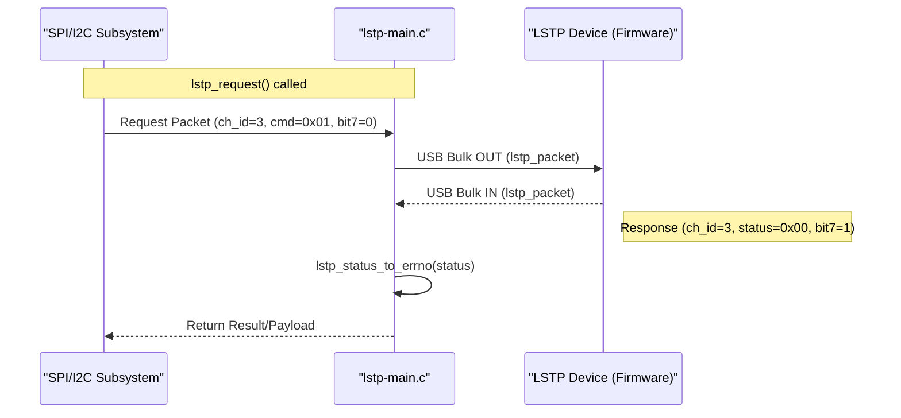
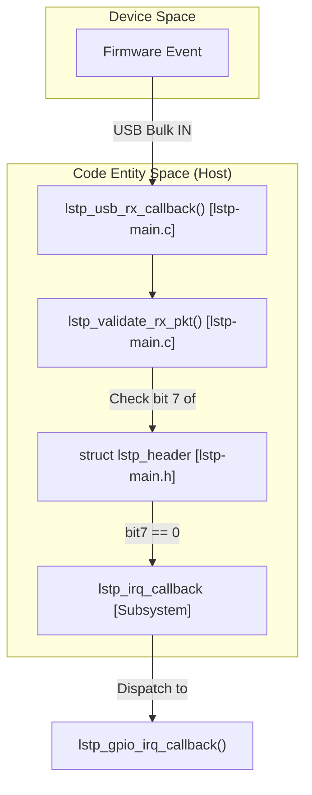

<!-- source: DeepWiki mcp.deepwiki.com · repo NVIDIA/lstp_module · page 2.2 Wire Protocol: Packet Format and Status Codes · fetched 2026-10-26 -->

# Wire Protocol: Packet Format and Status Codes

<details>
<summary>Relevant source files</summary>

The following files were used as context for generating this wiki page:

- [LSTP Specification 1.0 -- 08-03-2026.pdf](LSTP Specification 1.0 -- 08-03-2026.pdf)
- [lstp-main.c](lstp-main.c)
- [lstp-main.h](lstp-main.h)

</details>


The LSTP (Low-Speed Transport Protocol) wire protocol defines a compact, binary-efficient framing mechanism for multiplexing peripheral traffic (SPI, I2C, UART, etc.) over USB bulk endpoints. The protocol uses a fixed-size header followed by a variable-length payload, with specific bit-packing for command and status identification.

## 1. Packet Structure

All LSTP communication is encapsulated in `struct lstp_packet`, which consists of a 4-byte `struct lstp_header` and an optional payload.

### 1.1. LSTP Header (`struct lstp_header`)
The header is defined in [lstp-main.h:121-128](). It uses little-endian byte order for multi-byte fields and is marked `__packed` to ensure no compiler padding.

| Offset | Field | Type | Description |
| :--- | :--- | :--- | :--- |
| 0 | `ch_id` | `u8` | Logical channel ID (0-255). |
| 1 | `cmd` / `status` | `u8` | Bit-packed field for operation or result. |
| 2-3 | `length` | `__le16` | Length of the payload in bytes (excluding header). |

**Command/Status Byte Bit-Packing:**
The second byte of the header serves a dual purpose depending on the direction of the packet and the nature of the transaction [lstp-main.h:40-42]():
*   **Bit 7 (Direction/Type):** 
    *   `0`: Request (Host to Device) or Unsolicited Request (Device to Host IRQ).
    *   `1`: Response (Device to Host).
*   **Bits 0-6 (Opcode/Status):**
    *   In a Request: Contains the subsystem-specific command opcode.
    *   In a Response: Contains the `lstp_status` code.

### 1.2. Packet Definition
```c
struct lstp_packet {
	struct lstp_header hdr;
	u8 payload[];
} __packed;
```
[lstp-main.h:130-133]()

The framework uses `BUILD_BUG_ON` assertions to ensure that these structures match the physical wire specification exactly [lstp-main.c:2152-2153]().

## 2. Status Codes and Error Handling

LSTP defines a standard set of status codes in `enum lstp_status` [lstp-main.h:71-80](). When the host receives a response (Bit 7 of byte 1 is set), it extracts the status from bits 0-6 and maps it to a standard Linux `errno`.

### 2.1. Status Mapping Table
The mapping is implemented via the `lstp_errno_map` array [lstp-main.c:162-171]().

| LSTP Status | Value | Linux Errno | Description |
| :--- | :--- | :--- | :--- |
| `LSTP_SUCCESS` | 0x00 | `0` | Operation completed successfully. |
| `LSTP_ERROR` | 0x01 | `-EIO` | General I/O error. |
| `LSTP_TIMEOUT` | 0x02 | `-ETIMEDOUT` | Hardware-level timeout. |
| `LSTP_BUSY` | 0x03 | `-EBUSY` | Resource is currently locked or busy. |
| `LSTP_NACK` | 0x04 | `-ENXIO` | No acknowledgement (e.g., I2C address NACK). |
| `LSTP_ARB_LOST` | 0x05 | `-EAGAIN` | Arbitration lost (e.g., I2C multi-master). |
| `LSTP_NOT_SUPP` | 0x06 | `-EOPNOTSUPP` | Command or feature not supported. |
| `LSTP_TOO_LARGE` | 0x07 | `-EFBIG` | Payload exceeds device limits. |

The function `lstp_status_to_errno()` performs this conversion during packet processing [lstp-main.c:179-185]().

## 3. Channel 0: Management Protocol

Channel 0 is reserved for protocol management, including device discovery and configuration. It supports three primary commands defined in `enum lstp_ch0_cmd` [lstp-main.c:24-28]().

### 3.1. Management Commands
*   **`LSTP_CH0_CMD_READ_CONFIG` (0x08):** Reads the configuration block for a specific channel.
*   **`LSTP_CH0_CMD_WRITE_CONFIG` (0x09):** Updates the configuration (e.g., enabling/disabling a channel).
*   **`LSTP_CH0_CMD_LOCK` (0x0A):** Finalizes configuration (often used by firmware).

### 3.2. Configuration Structures
Channel descriptors provide the identity of each logical channel.

**`struct lstp_ch_desc`** [lstp-main.h:103-107]():
*   `ch_type`: The subsystem type (SPI, GPIO, etc.) [lstp-main.h:60-69]().
*   `ch_flags`: Status flags (e.g., `LSTP_CH_FLAG_ENABLE`).
*   `ch_name`: A 16-character string identifier.

**`struct lstp_ch0_read_resp`** [lstp-main.h:116-119]():
This is the payload returned by a `READ_CONFIG` request. It contains the fixed `lstp_ch_desc` followed by a variable-length `ch_config` byte array specific to the subsystem (e.g., SPI bus speed, GPIO pin count).

## 4. Protocol Flow Diagrams

### 4.1. Request/Response Transaction
This diagram shows how the `lstp_header` fields change during a standard host-initiated synchronous request.

Title: LSTP Synchronous Request-Response Flow

Sources: [lstp-main.c:179-185](), [lstp-main.c:542-560](), [lstp-main.h:121-128]()

### 4.2. Unsolicited Request (IRQ)
LSTP supports asynchronous notifications from the device (e.g., GPIO interrupts or UART RX data). These are distinguished by Bit 7 of the command byte being `0` when sent from the device to the host.

Title: LSTP Unsolicited IRQ Flow

Sources: [lstp-main.c:192-220](), [lstp-main.c:292-320](), [lstp-main.h:175-176]()

## 5. Implementation Assertions
To prevent protocol breakage due to architecture-specific padding or alignment, the driver uses `static_assert` and `BUILD_BUG_ON` for all wire-format structures.

*   `struct lstp_header` must be exactly 4 bytes [lstp-main.c:2152]().
*   `struct lstp_ch_desc` must be exactly 18 bytes [lstp-main.c:2155]().
*   `struct lstp_ch0_read_req` must be exactly 5 bytes [lstp-main.c:2156]().

Sources:
*   Protocol structure definitions: [lstp-main.h:89-133]()
*   Status codes and mapping: [lstp-main.h:71-80](), [lstp-main.c:162-185]()
*   Channel 0 commands: [lstp-main.c:24-28]()
*   Size assertions: [lstp-main.c:2150-2160]()

---

