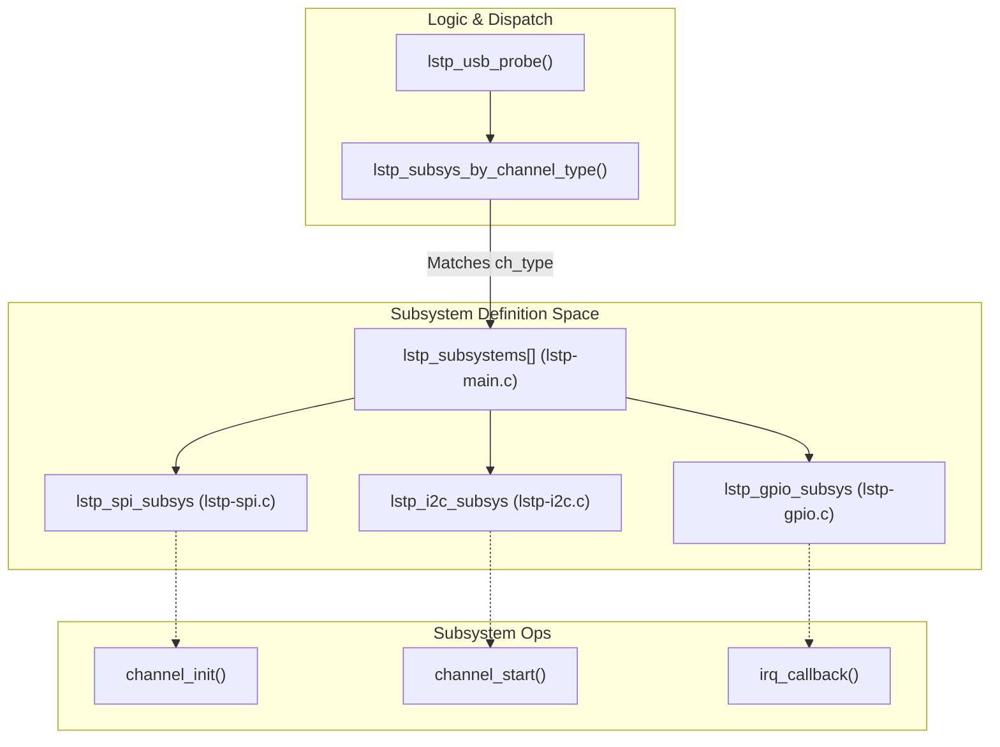
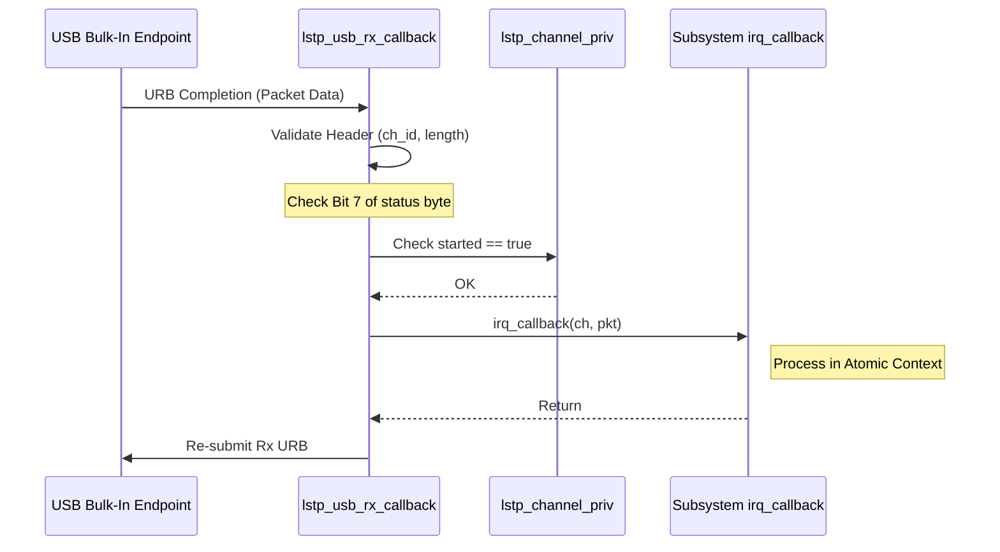

<!-- source: DeepWiki mcp.deepwiki.com · repo NVIDIA/lstp_module · page 2.3 Subsystem Registration Framework · fetched 2026-10-26 -->

# Subsystem Registration Framework

Relevant source files

The following files were used as context for generating this wiki page:

- [lstp-main.c](lstp-main.c)
- [lstp-main.h](lstp-main.h)

The LSTP Subsystem Registration Framework provides a standardized interface for protocol-specific drivers (SPI, I2C, GPIO, etc.) to plug into the LSTP core. It manages the lifecycle of logical channels multiplexed over USB, handling everything from initial discovery and firmware matching to runtime interrupt dispatching and cleanup.

### Subsystem Definition and Discovery

Subsystems are defined using `struct lstp_subsys`, which acts as a template for handling specific LSTP channel types. Each subsystem must provide handlers for initialization, startup, and shutdown.

#### The `lstp_subsys` Structure
The structure [lstp-main.h:208-228]() defines the contract between the core driver and the protocol implementation:
*   `type`: The `enum lstp_channel_type` this subsystem handles.
*   `name`: A string identifier used for logging and sysfs.
*   `channel_init`: Allocates subsystem-specific resources (e.g., `i2c_adapter`).
*   `channel_start`: Activates the hardware/logical channel (e.g., registering with the Linux SPI framework).
*   `channel_stop`: Deactivates the channel before removal.
*   `irq_callback`: (Optional) Handles unsolicited packets (bit 7 of status byte set).

#### Registration Macros
Subsystems are not registered at runtime via a dynamic list; instead, they are declared and referenced using a pair of macros to ensure link-time visibility within the `lstp_subsystems[]` array [lstp-main.c:265-274]().

*   `LSTP_SUBSYS_DECLARE(name)`: Declares the external symbol for the subsystem struct [lstp-main.h:234]().
*   `LSTP_SUBSYS_REF(name)`: References the symbol for inclusion in the global array [lstp-main.h:235]().
*   `LSTP_SUBSYS(name, ...)`: Defines the actual `struct lstp_subsys` instance [lstp-main.h:237-243]().

**Sources:** [lstp-main.h:60-69](), [lstp-main.h:208-243](), [lstp-main.c:265-274]()

### Subsystem Dispatch Architecture

When the LSTP core probes a USB interface, it iterates through all available channels reported by the hardware. For each channel, it identifies the correct subsystem using `lstp_subsys_by_channel_type()` [lstp-main.c:276-288]().

#### Data Entity Mapping: Subsystem to Code
The following diagram maps the conceptual "Subsystem" entities to their implementation in the code.

**Sources:** [lstp-main.c:265-288](), [lstp-main.c:1202-1240]()

### Channel Lifecycle

The framework manages a strict state machine for channels. This ensures that resources are allocated before the channel is exposed to the Linux kernel and that interrupts are only dispatched when the subsystem is ready.

| Phase | Function | Responsibility |
| :--- | :--- | :--- |
| **Discovery** | `lstp_create_channels` | Reads Channel 0 config to find `ch_type` [lstp-main.c:1130](). |
| **Init** | `channel_init` | Allocates `lstp_channel->priv` and sets up `fwnode` [lstp-main.c:1164](). |
| **Startup** | `channel_start` | Registers the device with Linux (e.g., `spi_register_controller`) [lstp-main.c:1225](). |
| **Runtime** | `irq_callback` | Dispatches unsolicited LSTP packets to the subsystem [lstp-main.c:380](). |
| **Shutdown** | `channel_stop` | Unregisters the Linux device; called during USB disconnect [lstp-main.c:1048](). |
| **Cleanup** | `devres` | Automatically frees memory allocated during `init` [lstp-main.c:1175](). |

#### Channel Initialization Flow
During `lstp_usb_probe()`, the driver calls `lstp_create_channels()`. This function performs a `READ_CONFIG` on Channel 0 to fetch the `lstp_ch_desc` [lstp-main.h:103-107]() for every hardware channel. It then allocates a `struct lstp_channel_priv` [lstp-main.c:66-89]() which contains the public `lstp_channel` [lstp-main.h:180-206]() shared with subsystems.

**Sources:** [lstp-main.c:1120-1195](), [lstp-main.c:1202-1240](), [lstp-main.h:103-107]()

### Interrupt (IRQ) Dispatching

LSTP supports "unsolicited requests," which function as hardware interrupts. These are identified by bit 7 of the status byte in the LSTP header [lstp-main.h:40]().

When the `lstp_usb_rx_callback` [lstp-main.c:317]() receives a packet where bit 7 is set:
1.  The framework identifies the target channel via `hdr.ch_id`.
2.  It verifies if the channel has been started (`priv->started == true`) [lstp-main.c:372]().
3.  It invokes the subsystem's `irq_callback` in **atomic context** [lstp-main.c:380]().

#### Data Flow: USB URB to Subsystem IRQ

**Sources:** [lstp-main.c:317-390](), [lstp-main.h:175-176]()

### Devres-Managed Cleanup

The framework heavily utilizes the Linux `devres` (Device Managed Resources) pattern to prevent memory leaks during hot-unplug or probe failure.

1.  **Memory Allocation**: `lstp_create_channel` uses `devm_kzalloc` to allocate the `lstp_channel_priv` structure [lstp-main.c:1085]().
2.  **Sysfs Integration**: The per-channel sysfs directory (`/sys/bus/usb/devices/.../lstp/channel/N`) is managed via `kobject_init_and_add` [lstp-main.c:1100]().
3.  **Teardown**: When the USB device is removed, `lstp_usb_disconnect` calls `lstp_teardown` [lstp-main.c:1040-1060](), which invokes `channel_stop` for all active channels. Because resources were allocated via `devm`, they are automatically freed once the parent USB interface device is destroyed.

**Sources:** [lstp-main.c:1040-1060](), [lstp-main.c:1085-1110]()

---

