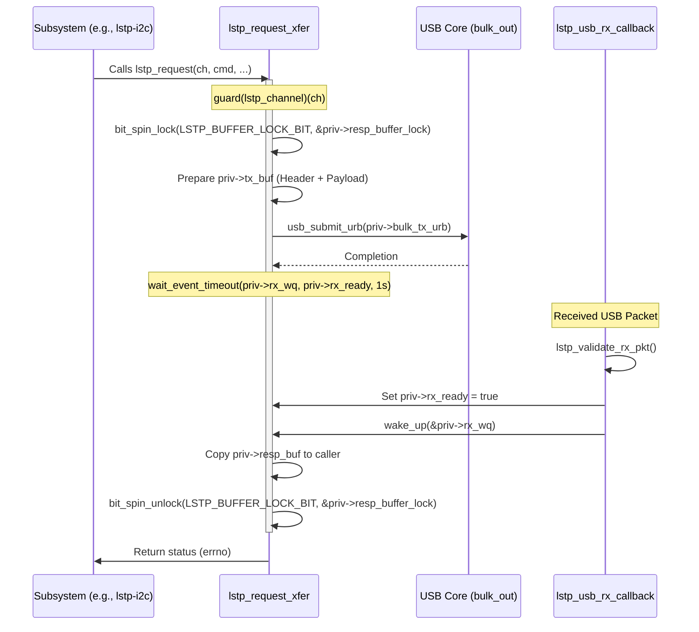
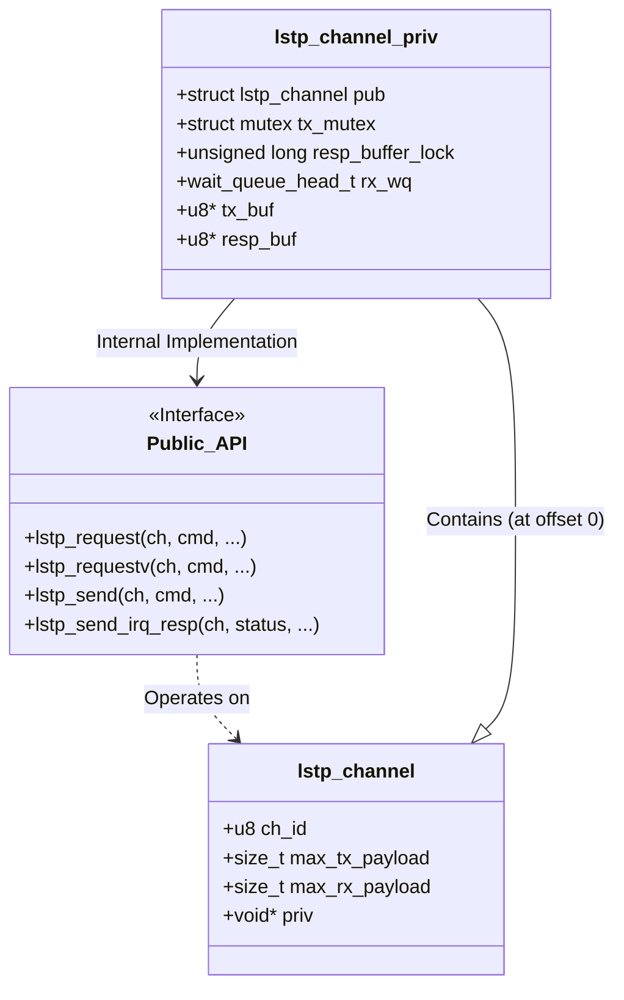

<!-- source: DeepWiki mcp.deepwiki.com · repo NVIDIA/lstp_module · page 2.4 Request/Response API and Synchronization · fetched 2026-10-26 -->

# Request/Response API and Synchronization

Relevant source files

The following files were used as context for generating this wiki page:

- [lstp-main.c](lstp-main.c)
- [lstp-main.h](lstp-main.h)

The LSTP driver provides a unified Request/Response API that allows subsystems (SPI, I2C, GPIO, etc.) to communicate with remote peripherals over a multiplexed USB transport. This API handles packet framing, USB URB lifecycle management, and thread-safe synchronization to ensure that logical channel transactions remain atomic and isolated from one another.

## Public API Functions

Subsystems interact with the LSTP core using a set of exported functions defined in `lstp-main.c`. These functions handle the transition from Linux kernel subsystem calls to LSTP wire-format packets.

### Synchronous Request/Response
*   **`lstp_request()`**: The primary synchronous interface. It sends a command and waits for a response from the device. It handles the full `lstp_request_xfer` pipeline, including timeouts and status code translation [lstp-main.c:548-571]().
*   **`lstp_requestv()`**: A scatter-gather variant of `lstp_request()`. It accepts a `kvec` array, allowing subsystems to frame packets without performing intermediate memory copies (zero-copy framing). This is extensively used by the I2C subsystem for combined transactions [lstp-main.c:587-611]().

### Unidirectional and IRQ Support
*   **`lstp_send()`**: A "fire-and-forget" synchronous send. It transmits a request but does not wait for an LSTP-level response. It only ensures the USB transport accepted the data [lstp-main.c:523-535]().
*   **`lstp_send_irq_resp()`**: Used by subsystems to respond to unsolicited requests (IRQs) sent by the device. Unlike standard requests, IRQ responses use a dedicated `bulk_tx_resp_urb` to avoid head-of-line blocking against pending outbound requests [lstp-main.c:623-652]().

### Configuration Access
*   **`lstp_ch0_read_config()`**: A wrapper around `lstp_request()` targeting Channel 0. It retrieves the `lstp_ch_desc` and any subsystem-specific configuration data for a given channel [lstp-main.c:286-319]().
*   **`lstp_read_config_table()`**: A high-level helper that iterates through all available channels on an interface to discover their types and names during the probe phase [lstp-main.c:331-360]().

**Sources:** [lstp-main.c:523-652](), [lstp-main.c:286-360](), [lstp-main.h:216-241]()

---

## The `lstp_request_xfer` Pipeline

The core logic for every synchronous exchange resides in `lstp_request_xfer()`. This function manages the lifecycle of a request from buffer preparation to response validation.

### Data Flow and Code Entities
The following diagram maps the natural language flow of a request to the specific code entities and locks involved.

**Request/Response Sequence and Synchronization**

**Sources:** [lstp-main.c:426-508](), [lstp-main.c:125-126](), [lstp-main.c:664-709]()

---

## Synchronization and Locking

LSTP employs a multi-layered locking strategy to ensure high performance while maintaining strict atomicity for channel operations.

### Channel Guard and `tx_mutex`
Each channel has a `tx_mutex` [lstp-main.c:72](). The framework provides a `DEFINE_GUARD(lstp_channel, ...)` macro [lstp-main.c:125-126]() that is used at the entry point of all `lstp_send` and `lstp_request` calls. This ensures:
1.  Only one request is in flight per logical channel at any time.
2.  The shared `tx_buf` (scratch buffer) for that channel is protected from concurrent access [lstp-main.c:80]().

### Response Buffer Bit-Lock
Because the RX path (`lstp_usb_rx_callback`) runs in atomic/interrupt context and the TX path (`lstp_request_xfer`) runs in process context, a bit-lock is used to guard the `resp_buf` [lstp-main.c:74]().
*   The `LSTP_BUFFER_LOCK_BIT` is set via `bit_spin_lock` before a request is sent [lstp-main.c:452]().
*   The RX callback checks this bit to determine if a synchronous waiter is expecting the incoming packet [lstp-main.c:703]().
*   This prevents the RX path from overwriting a buffer while the process context is still reading from it.

### Wait Queues and Timeouts
The driver uses `wait_event_timeout` on `priv->rx_wq` to sleep the calling thread while waiting for the device's response [lstp-main.c:475](). 
*   **Timeout Constants**: Both `LSTP_USB_RESPONSE_TIMEOUT_MS` and `LSTP_USB_REQUEST_TIMEOUT_MS` are set to 1000ms [lstp-main.h:28-29]().
*   If a timeout occurs, the bit-lock is released, and the function returns `-ETIMEDOUT` [lstp-main.c:482]().

**Sources:** [lstp-main.c:66-89](), [lstp-main.c:426-508](), [lstp-main.h:28-29](), [lstp-main.h:54-55]()

---

## Status Code Mapping

LSTP status codes returned by the hardware are mapped to standard Linux `errno` values via `lstp_status_to_errno()` [lstp-main.c:179-185]().

| LSTP Status | Linux Errno | Description |
| :--- | :--- | :--- |
| `LSTP_SUCCESS` | `0` | Operation completed successfully. |
| `LSTP_ERROR` | `-EIO` | General I/O error. |
| `LSTP_TIMEOUT` | `-ETIMEDOUT` | Hardware-side timeout. |
| `LSTP_BUSY` | `-EBUSY` | Resource temporarily unavailable. |
| `LSTP_NACK` | `-ENXIO` | No device responded (I2C/SPI). |
| `LSTP_ARB_LOST` | `-EAGAIN` | Bus arbitration lost. |
| `LSTP_NOT_SUPP` | `-EOPNOTSUPP` | Command not supported by firmware. |
| `LSTP_TOO_LARGE` | `-EFBIG` | Request exceeded hardware buffers. |

**Sources:** [lstp-main.c:162-171](), [lstp-main.h:71-80]()

---

## Structural Overview: Code Entity Space

The following diagram illustrates the relationship between the public API, the private channel structures, and the synchronization primitives.

**API to Implementation Mapping**

**Sources:** [lstp-main.c:66-89](), [lstp-main.c:98-99](), [lstp-main.h:180-206]()

---

