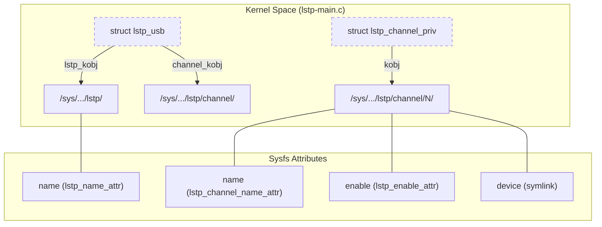

<!-- source: DeepWiki mcp.deepwiki.com · repo NVIDIA/lstp_module · page 2.5 Sysfs Hierarchy and Firmware Node Integration · fetched 2026-10-26 -->

# Sysfs Hierarchy and Firmware Node Integration

<details>
<summary>Relevant source files</summary>

The following files were used as context for generating this wiki page:

- [README.md](README.md)
- [lstp-main.c](lstp-main.c)
- [lstp-main.h](lstp-main.h)

</details>


The LSTP driver exposes a structured sysfs hierarchy under the bound USB interface device. This hierarchy provides a mechanism for userspace to discover LSTP channels, identify them by stable names, and control their operational state. Additionally, the driver integrates with firmware nodes (Device Tree or ACPI) to associate logical LSTP channels with platform-level hardware descriptions.

## Sysfs Topology

The driver creates a root `lstp/` directory under the USB interface device (`/sys/bus/usb/devices/.../interface/lstp/`). This directory serves as the anchor for interface-wide attributes and the per-channel subdirectory.

### Hierarchy Structure
- **`lstp/name`**: The interface-level name (e.g., "HOST_INTERFACE") [lstp-main.c:128-128]().
- **`lstp/channel/`**: A container directory for all logical channels discovered on the interface [lstp-main.h:160-160]().
- **`lstp/channel/N/`**: Per-channel directory, where `N` is the decimal `ch_id` [lstp-main.c:66-89]().
    - **`name`**: The stable, firmware-defined string name for the channel (e.g., "SPI_PORT_A") [lstp-main.c:145-146]().
    - **`enable`**: A read-write attribute (0/1) to control the channel's active state [lstp-main.c:142-143]().
    - **`device`**: A symbolic link to the underlying Linux subsystem device (e.g., `spi_master/spi7`, `gpiochip2`) [lstp-main.c:88-88]().

### Code Entity to Sysfs Mapping
The following diagram illustrates how internal driver structures relate to the visible sysfs filesystem nodes.

**Diagram: Sysfs KObject Mapping**

Sources: [lstp-main.h:145-162](), [lstp-main.c:66-89](), [lstp-main.c:128-159]()

## Channel Enablement and Read-Modify-Write Flow

The `enable` attribute allows userspace to dynamically start or stop a channel. Changing this value triggers a Read-Modify-Write (RMW) operation on Channel 0 (Management Channel) to update the device-side configuration.

1.  **Store Operation**: `lstp_channel_enable_store` is called when userspace writes to the `enable` file [lstp-main.c:486-530]().
2.  **Read Configuration**: The driver calls `lstp_ch0_read_config()` to fetch the current `struct lstp_ch_desc` from the device [lstp-main.c:508-508]().
3.  **Modify**: The `LSTP_CH_FLAG_ENABLE` bit in `ch_flags` is set or cleared based on the input [lstp-main.c:514-517]().
4.  **Write Configuration**: The driver calls `lstp_ch0_write_config()` to push the updated descriptor back to the device [lstp-main.c:520-520]().
5.  **Lifecycle Sync**: If enabling, `lstp_channel_start()` is invoked to register the Linux subsystem device; if disabling, `lstp_channel_stop()` is invoked [lstp-main.c:524-527]().

Sources: [lstp-main.c:486-530](), [lstp-main.h:52-52](), [lstp-main.h:103-107]()

## Firmware Node Integration

The driver supports matching LSTP channels to platform firmware (Device Tree or ACPI) using the `reg` property, which must match the hardware `ch_id`.

### Discovery and Matching
During initialization, `lstp_find_channel_fwnode` iterates through the child nodes of the USB interface's firmware node [lstp-main.c:634-656]().

- **Matching Logic**: The function looks for a child node where the `reg` property matches the `ch_id` discovered via LSTP Channel 0 [lstp-main.c:646-649]().
- **Subsystem Assignment**: If a match is found, the `fwnode` is assigned to `struct lstp_channel`, allowing the subsequent subsystem probe (e.g., SPI or I2C) to inherit the firmware properties (such as clock speeds or child peripheral definitions) [lstp-main.c:687-687]().

**Diagram: Firmware Matching Data Flow**
```mermaid
flowchart LR
    subgraph "Firmware (DT/ACPI)"
        NodeA["interface@2"] -->|child| NodeB["channel@1 { reg=1; }"]
    end

    subgraph "Driver Probe (lstp-main.c)"
        Discovery["ch0 READ_CONFIG"] -->|ID=1| Match["lstp_find_channel_fwnode"]
        Match -->|device_get_next_child_node| NodeB
        Match -->|fwnode_property_read_u32| Val["reg value"]
        Val == Discovery -->|Success| Bind["Assign ch->fwnode"]
    end

    subgraph "Subsystem Probe"
        Bind --> Sub["lstp_spi_init / lstp_i2c_init"]
        Sub -->|"devm_spi_register_controller"| Linux["Linux Subsystem Device"]
    end
```
Sources: [lstp-main.c:634-656](), [lstp-main.c:670-700](), [README.md:181-211]()

## KObject Lifecycle

The driver manages three distinct kobject levels to ensure memory safety during USB hot-unplug:

| KObject | Parent | Responsibility |
| :--- | :--- | :--- |
| `lstp_kobj` | `usb_interface->dev.kobj` | Root `/lstp` directory [lstp-main.c:757-768](). |
| `channel_kobj` | `lstp_kobj` | The `/lstp/channel` container [lstp-main.c:773-779](). |
| `priv->kobj` | `channel_kobj` | The per-channel directory `/lstp/channel/N` [lstp-main.c:714-722](). |

The per-channel kobject is released via `lstp_channel_kobj_release`, which is the final stage of the channel's cleanup, ensuring that the `lstp_channel_priv` structure is not freed while sysfs attributes are being accessed [lstp-main.c:542-550]().

Sources: [lstp-main.c:66-89](), [lstp-main.c:542-550](), [lstp-main.c:714-780]()

---

