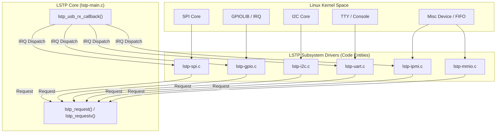
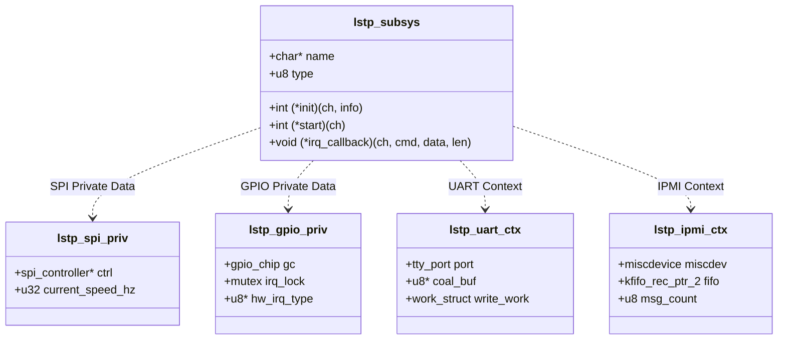

<!-- source: DeepWiki mcp.deepwiki.com · repo NVIDIA/lstp_module · page 3 Transport Subsystems · fetched 2026-10-26 -->

# Transport Subsystems

Relevant source files

The following files were used as context for generating this wiki page:

- [Kbuild](Kbuild)
- [Kconfig](Kconfig)
- [lstp-gpio.c](lstp-gpio.c)
- [lstp-i2c.c](lstp-i2c.c)
- [lstp-ipmi.c](lstp-ipmi.c)
- [lstp-mmio.c](lstp-mmio.c)
- [lstp-spi.c](lstp-spi.c)
- [lstp-uart.c](lstp-uart.c)

The LSTP (Low-Speed Transport Protocol) driver acts as a bridge between the Linux kernel's standard peripheral subsystems and the LSTP USB transport layer. It implements six protocol-specific subsystem drivers that translate standard Linux I/O requests into LSTP-formatted USB packets.

Each subsystem is implemented as an `lstp_subsys` structure [lstp-main.h:320-336](), providing callbacks for initialization, lifecycle management, and unsolicited data (IRQ) handling.

### Subsystem Architecture Overview

The following diagram illustrates how the protocol subsystems bridge the gap between Linux kernel APIs and the LSTP wire protocol.

**Subsystem Integration Map**

**Sources:** [lstp-main.c:15-16](), [lstp-main.h:320-336](), [Kbuild:14-16]()

---

### SPI Subsystem (`lstp-spi.c`)
The SPI subsystem implements a `spi_controller` [lstp-spi.c:61](). It translates `spi_transfer` requests into LSTP SPI opcodes. A key optimization is the embedding of Chip Select (CS) assertion/deassertion directly into the command byte [lstp-spi.c:34-37](), avoiding extra USB round-trips for CS management.

*   **Key Opcodes:** `LSTP_SPI_CMD_READ`, `WRITE`, `WRITE_READ`, `POSTED_WRITE` [lstp-spi.c:26-31]().
*   **CS Mapping:** Supports multiple chip selects mapped via `lstp_spi_cs_map` [lstp-spi.c:45-48]().
*   **For details, see [SPI Subsystem (lstp-spi.c)](#3.1).**

**Sources:** [lstp-spi.c:26-63](), [lstp-spi.c:168-215]()

---

### GPIO Subsystem (`lstp-gpio.c`)
This subsystem exposes pins as a `gpio_chip` and an `irq_chip` [lstp-gpio.c:154-158](). It supports standard GPIO operations, interrupt delivery via an ordered workqueue (`lstp_gpio_wq`), and an integrated LED pattern engine for pins with `led_support` [lstp-gpio.c:147-151]().

*   **IRQ Pattern:** Uses a sleepable bus-lock pattern (`irq_bus_lock`/`irq_bus_sync_unlock`) to handle the high-latency USB transport [lstp-gpio.c:158]().
*   **LED Integration:** Registers pins with `LEDS_CLASS` and supports complex hardware-accelerated brightness patterns [lstp-gpio.c:78-83]().
*   **For details, see [GPIO Subsystem (lstp-gpio.c)](#3.2).**

**Sources:** [lstp-gpio.c:41-48](), [lstp-gpio.c:154-182]()

---

### I2C Subsystem (`lstp-i2c.c`)
The I2C subsystem implements an `i2c_adapter` using the `lstp_i2c_algorithm` [lstp-i2c.c:90-93](). It handles standard I2C transfers, including repeated-START sequences by detecting combined message pairs and setting the `LSTP_I2C_CMD_FLAG_NO_STOP` flag [lstp-i2c.c:33]().

*   **SMBus Support:** Includes specific support for SMBus Block Reads [lstp-i2c.c:59-63]().
*   **Error Handling:** Implements specialized retry logic for `LSTP_BUSY` and `LSTP_ARB_LOST` status codes [lstp-i2c.c:95-98]().
*   **For details, see [I2C Subsystem (lstp-i2c.c)](#3.3).**

**Sources:** [lstp-i2c.c:24-31](), [lstp-i2c.c:78-86]()

---

### UART Subsystem (`lstp-uart.c`)
Exposes LSTP channels as `/dev/ttyLSTP` devices [lstp-uart.c:98-115](). It features a two-stage TX coalescing mechanism where writes are buffered in `coal_buf` and then snapshotted for USB transmission [lstp-uart.c:90-97]().

*   **Reliability:** Implements NACK retry logic to handle cases where the remote firmware's TX FIFO is temporarily full [lstp-uart.c:80-81]().
*   **Line Status:** Maps LSTP tags (Carrier Down, Break Detect, Overrun) to TTY status flags [lstp-uart.c:65-70]().
*   **For details, see [UART Subsystem (lstp-uart.c)](#3.4).**

**Sources:** [lstp-uart.c:38-43](), [lstp-uart.c:98-115]()

---

### IPMI Subsystem (`lstp-ipmi.c`)
Provides a bridge for Intelligent Platform Management Interface (IPMI) messages via a character device [lstp-ipmi.c:83-96](). It uses a `kfifo_rec_ptr_2` to buffer inbound requests [lstp-ipmi.c:93]().

*   **Postcodes:** Includes a sub-device for handling BIOS/Firmware postcodes (NetFn 0x2C), which can be routed to a separate miscdevice for performance [Kconfig:36-43](), [lstp-ipmi.c:95]().
*   **Atomicity:** Uses a rolling `msg_count` tag to ensure responses are matched to the correct requests [lstp-ipmi.c:94]().
*   **For details, see [IPMI Subsystem (lstp-ipmi.c and lstp-ipmi-postcodes.h)](#3.5).**

**Sources:** [lstp-ipmi.c:44-53](), [lstp-ipmi.c:83-96]()

---

### MMIO Subsystem (`lstp-mmio.c`)
The Memory-Mapped I/O subsystem provides a raw memory access interface via `/dev/lstp_mmio_X` [lstp-mmio.c:50-58](). It allows userspace to perform chunked reads and writes to a 32-bit address space [lstp-mmio.c:40-49]().

*   **Transfer Loop:** Automatically breaks large userspace I/O requests into smaller chunks that fit within the USB endpoint's `max_rx_payload` and `max_tx_payload` [lstp-mmio.c:149-151]().
*   **Serialization:** Uses a per-context `mutex` to serialize access to the shared `xfer_buf` [lstp-mmio.c:55-56]().
*   **For details, see [MMIO Subsystem (lstp-mmio.c)](#3.6).**

**Sources:** [lstp-mmio.c:35-58](), [lstp-mmio.c:149-175]()

---

### Subsystem Data Structures

The following diagram bridges the high-level subsystem names to their primary internal context structures.

**Code Entity Association**

**Sources:** [lstp-main.h:320-336](), [lstp-spi.c:60-63](), [lstp-gpio.c:154-166](), [lstp-uart.c:98-115](), [lstp-ipmi.c:83-96]()

---

