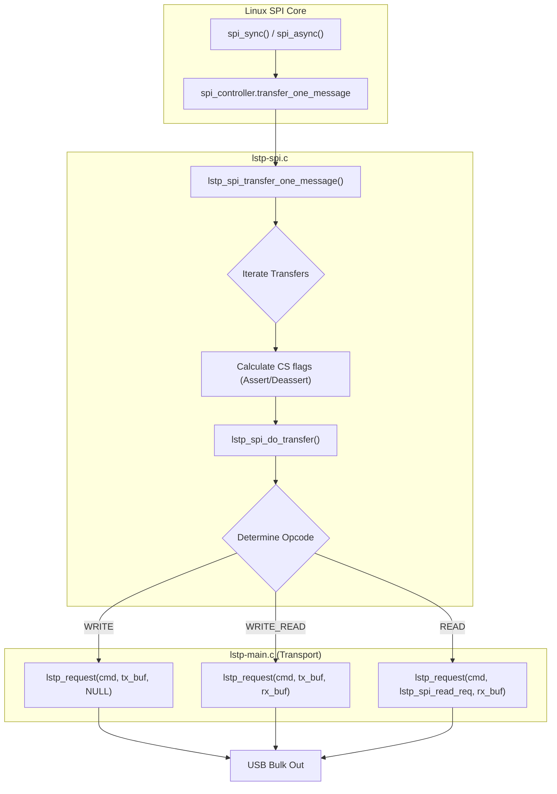
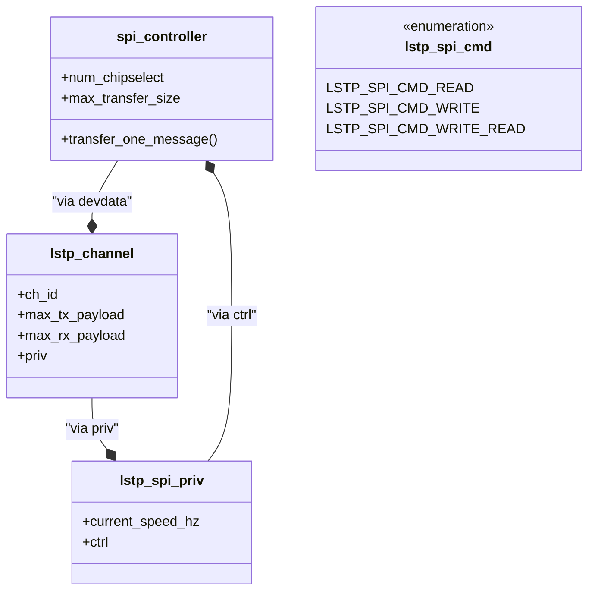

<!-- source: DeepWiki mcp.deepwiki.com · repo NVIDIA/lstp_module · page 3.1 SPI Subsystem (lstp-spi.c) · fetched 2026-10-26 -->

# SPI Subsystem (lstp-spi.c)

Relevant source files

The following files were used as context for generating this wiki page:

- [Kconfig](Kconfig)
- [lstp-spi.c](lstp-spi.c)

The SPI subsystem provides a bridge between the Linux SPI framework and the LSTP protocol. It registers an `spi_controller` for each LSTP SPI channel, allowing standard SPI peripheral drivers (e.g., flash memory, sensors) or `spidev` to operate over the USB transport.

## Overview and Registration

The SPI subsystem is defined via the `LSTP_SUBSYS` descriptor, which links the LSTP core to the SPI-specific initialization and lifecycle functions [lstp-spi.c:286-291](). When the LSTP core identifies a channel of type `LSTP_CH_TYPE_SPI`, it invokes `lstp_spi_init` to set up the controller [lstp-spi.c:237-284]().

### Initialization Flow
1.  **Allocation**: The driver uses `devm_spi_alloc_host` to create the `spi_controller` [lstp-spi.c:250]().
2.  **Configuration Parsing**: It attempts to read the `lstp_spi_config` from the hardware via `lstp_ch0_read_config` [lstp-spi.c:256](). If the hardware does not provide configuration, it falls back to defaults (2 devices, 18.75 MHz) [lstp-spi.c:65-67]().
3.  **Controller Setup**: The driver sets the `transfer_one_message` callback, which is the primary entry point for SPI I/O [lstp-spi.c:272]().
4.  **Payload Limits**: The `max_transfer_size` is calculated based on the LSTP channel's `max_tx_payload` and `max_rx_payload`, accounting for the LSTP command overhead [lstp-spi.c:275-276]().
5.  **Device Discovery**: The driver enumerates child devices from the Device Tree [lstp-spi.c:281](). If no children are found and the `auto_bind_spidev` module parameter is enabled, it automatically creates `spidev` nodes for all available chip selects [lstp-spi.c:282]().

### Natural Language to Code Entity Mapping: SPI Controller

| System Concept | Code Entity | File Reference |
| :--- | :--- | :--- |
| **Subsystem Descriptor** | `lstp_spi_subsys` | [lstp-spi.c:286-291]() |
| **Command Opcodes** | `enum lstp_spi_cmd` | [lstp-spi.c:26-31]() |
| **Private Data** | `struct lstp_spi_priv` | [lstp-spi.c:60-63]() |
| **Configuration Data** | `struct lstp_spi_config` | [lstp-spi.c:54-57]() |
| **CS Management** | `lstp_spi_cs_map` | [lstp-spi.c:45-48]() |

Sources: [lstp-spi.c:26-67](), [lstp-spi.c:237-291]()

## Command and Protocol Logic

Unlike traditional SPI controllers that use a separate `set_cs` GPIO-style callback, the LSTP SPI protocol embeds Chip Select (CS) state directly into the command byte of each transfer [lstp-spi.c:149-152]().

### Command Byte Bit-Packing
The LSTP SPI command byte is constructed by OR-ing three components:
1.  **Opcode**: `READ`, `WRITE`, `WRITE_READ`, or `POSTED_WRITE` [lstp-spi.c:26-31]().
2.  **CS Selection**: `LSTP_SPI_CMD_CS0` or `LSTP_SPI_CMD_CS1` [lstp-spi.c:40-43]().
3.  **CS Toggle**: `LSTP_SPI_CMD_CS_ASSERT` (assert before transfer) and `LSTP_SPI_CMD_CS_DEASSERT` (deassert after transfer) [lstp-spi.c:34-37]().

### Data Flow: Message Execution

The following diagram illustrates how a standard `spi_message` containing multiple `spi_transfer` objects is translated into LSTP packets.

**SPI Message Translation Flow**

Sources: [lstp-spi.c:91-142](), [lstp-spi.c:168-215]()

## Key Functions

### `lstp_spi_transfer_one_message`
This function handles the logic for a sequence of transfers within a single SPI message [lstp-spi.c:168](). It tracks the `cs_active` state to ensure `LSTP_SPI_CMD_CS_ASSERT` is only sent on the first transfer and `LSTP_SPI_CMD_CS_DEASSERT` is sent based on the `xfer->cs_change` flag or when the message ends [lstp-spi.c:189-198]().

### `lstp_spi_do_transfer`
This function maps the `spi_transfer` buffers to LSTP requests [lstp-spi.c:91]().
*   **Full Duplex**: If both `tx_buf` and `rx_buf` are present, it uses `LSTP_SPI_CMD_WRITE_READ` [lstp-spi.c:117-120]().
*   **Read Only**: Uses `LSTP_SPI_CMD_READ`. Since the LSTP protocol requires the request to specify the number of bytes to read, it encapsulates the length in a `struct lstp_spi_read_req` [lstp-spi.c:125-128]().
*   **Write Only**: Uses `LSTP_SPI_CMD_WRITE` [lstp-spi.c:121-123]().

### SPI Controller Setup and Constraints
The driver enforces hardware constraints during `lstp_spi_init`:
*   **Max Payload**: The driver limits `max_transfer_size` to the minimum of the channel's TX and RX payload capacities [lstp-spi.c:275-276]().
*   **Speed**: The `current_speed_hz` is cached from the firmware config and reported back to the SPI core in `xfer->effective_speed_hz` [lstp-spi.c:104]().

### Logic Entity Association: SPI Transfer

Sources: [lstp-spi.c:26-31](), [lstp-spi.c:60-63](), [lstp-spi.c:170](), [lstp-spi.c:250]()

## Device Tree and Spidev Fallback

The driver supports two methods for populating child devices under the SPI controller:
1.  **Firmware Description**: Standard Device Tree child nodes are enumerated via `devm_spi_register_controller` [lstp-spi.c:281]().
2.  **Auto-bind Spidev**: If the `auto_bind_spidev` module parameter is set (or the `USB_LSTP_SPI_SPIDEV` Kconfig option is enabled), the driver will manually create `spidev` devices for every chip select not already claimed by the Device Tree [lstp-spi.c:282](), [Kconfig:22-34]().

Sources: [lstp-spi.c:281-282](), [Kconfig:22-34]()

---

