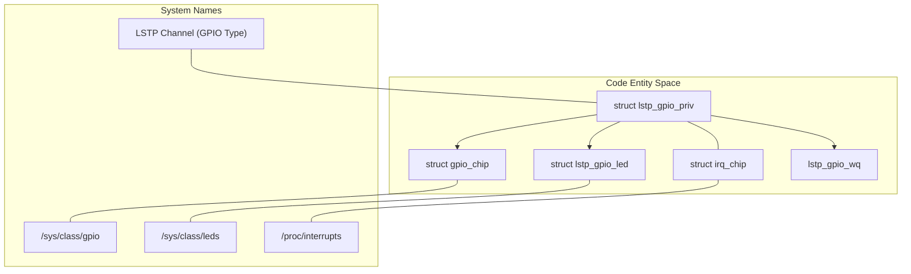
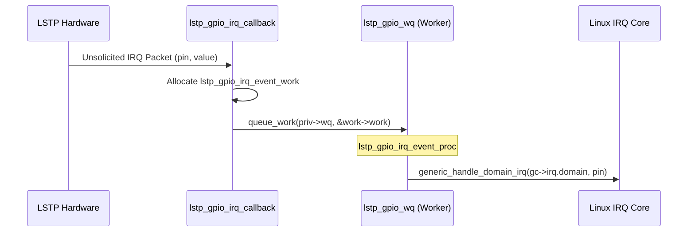

<!-- source: DeepWiki mcp.deepwiki.com · repo NVIDIA/lstp_module · page 3.2 GPIO Subsystem (lstp-gpio.c) · fetched 2026-10-26 -->

# GPIO Subsystem (lstp-gpio.c)

Relevant source files

The following files were used as context for generating this wiki page:

- [lstp-gpio.c](lstp-gpio.c)

The GPIO subsystem implements a bridge between the Linux kernel's GPIO/IRQ/LED frameworks and the LSTP hardware. It presents a `gpio_chip` for standard digital I/O, an `irq_chip` for interrupt management, and registers `led_classdev` instances for pins identified as LEDs in the device configuration.

## Pin Classification and Data Structures

The driver distinguishes between standard GPIO pins and LED-capable pins based on the `lstp_gpio_pin_config` retrieved during initialization.

### Data Entities

| Entity | Description |
| :--- | :--- |
| `struct lstp_gpio_priv` | The main state container for a GPIO channel, including the `gpio_chip`, `irq_chip` metadata, and an ordered workqueue. |
| `struct lstp_gpio_pin_config` | Wire-format structure defining a pin's direction, bias, drive strength, and LED support [lstp-gpio.c:103-116](). |
| `struct lstp_gpio_led` | A wrapper for `led_classdev` that associates a specific LSTP pin with the Linux LED subsystem [lstp-gpio.c:177-181](). |

### Logical Mapping

**Sources:** [lstp-gpio.c:154-181]()

## GPIO Chip Implementation

The driver implements standard `gpio_chip` callbacks to translate Linux GPIO requests into LSTP USB packets.

*   **Get/Set Value**: Uses `LSTP_GPIO_CMD_GET_VALUE` and `LSTP_GPIO_CMD_SET_VALUE` [lstp-gpio.c:264-325]().
*   **Multiple Pin Operations**: `lstp_gpio_get_multiple` and `lstp_gpio_set_multiple` iterate through the requested bitmask, issuing individual USB requests for each pin [lstp-gpio.c:327-376]().
*   **Direction Control**: `lstp_gpio_direction_input` and `lstp_gpio_direction_output` use `lstp_ch0_write_config` to modify the hardware configuration table on the device [lstp-gpio.c:232-262]().

**Sources:** [lstp-gpio.c:232-376](), [lstp-gpio.c:41-43]()

## IRQ Chip and Sleepable Bus-Lock

Because LSTP operates over USB, interrupt configuration requires sleepable context to perform I/O. The driver implements the "bus-lock" pattern to handle this.

### Shadow vs. Hardware State
To avoid synchronous USB transfers inside atomic IRQ contexts (like `irq_set_type`), the driver maintains two state arrays in `lstp_gpio_priv`:
1.  **`shadow_irq_type`**: Stores the desired IRQ configuration set by the kernel [lstp-gpio.c:159]().
2.  **`hw_irq_type`**: Stores the actual configuration currently programmed into the hardware [lstp-gpio.c:160]().

### Configuration Flow
1.  **`lstp_gpio_irq_bus_lock`**: Acquires the `priv->irq_lock` mutex [lstp-gpio.c:474-479]().
2.  **`lstp_gpio_irq_set_type`**: Updates the `shadow_irq_type` in memory [lstp-gpio.c:459-472]().
3.  **`lstp_gpio_irq_bus_sync_unlock`**: Compares shadow and HW states. If they differ, it sends `LSTP_GPIO_CMD_SET_IRQ_CONFIG` to the hardware before releasing the mutex [lstp-gpio.c:481-518]().

**Sources:** [lstp-gpio.c:158-160](), [lstp-gpio.c:459-518]()

## IRQ Event Delivery

Interrupts are delivered as unsolicited `LSTP_GPIO_CMD_IRQ_EVENT` packets from the hardware.

### Ordered Workqueue
Because USB RX callbacks occur in atomic/tasklet context, the driver offloads IRQ processing to an ordered workqueue (`lstp_gpio_wq`) to ensure events are processed in the order they were received [lstp-gpio.c:542-553]().

### Event Processing Sequence

**Sources:** [lstp-gpio.c:520-575](), [lstp-gpio.c:73-76]()

## LED Class Integration

Pins configured with `led_support` (either `LSTP_GPIO_LED_MODE_HOLD` or `INTERPOLATE`) are registered as LED class devices [lstp-gpio.c:147-151]().

### LED Pattern Engine
The driver supports the hardware's native pattern engine via the `pattern_set` callback.
*   **`lstp_led_set_pattern`**: Converts a Linux LED pattern (array of brightness/delta_t) into `struct lstp_led_pattern` steps [lstp-gpio.c:641-696]().
*   **Repeat Logic**: Linux's `repeat = -1` is translated to `LSTP_LED_REPEAT_FOREVER` (wire value 0) [lstp-gpio.c:36-37]().
*   **Brightness**: Simple brightness updates use a 1-step pattern with `LSTP_LED_REPEAT_FOREVER` to hold the state [lstp-gpio.c:595-618]().

**Sources:** [lstp-gpio.c:50-54](), [lstp-gpio.c:78-83](), [lstp-gpio.c:641-696]()

## Initialization and Probe

During `lstp_gpio_probe`, the driver performs the following steps:
1.  **Read Config**: Fetches the `lstp_gpio_config` table from Channel 0 [lstp-gpio.c:753-764]().
2.  **Allocate Priv**: Sets up the `lstp_gpio_priv` and pin metadata [lstp-gpio.c:766-785]().
3.  **Setup Workqueue**: Creates the ordered `lstp_gpio_wq` [lstp-gpio.c:796-802]().
4.  **GPIO Chip Registration**: Configures `gc->get`, `gc->set`, and `gc->direction_*` [lstp-gpio.c:825-842]().
5.  **IRQ Chip Registration**: Sets up the `irq_chip` with the bus-lock handlers [lstp-gpio.c:846-860]().
6.  **LED Registration**: Iterates through pins and registers `led_classdev` for those with LED support [lstp-gpio.c:871-887]().

**Sources:** [lstp-gpio.c:733-900]()

---

