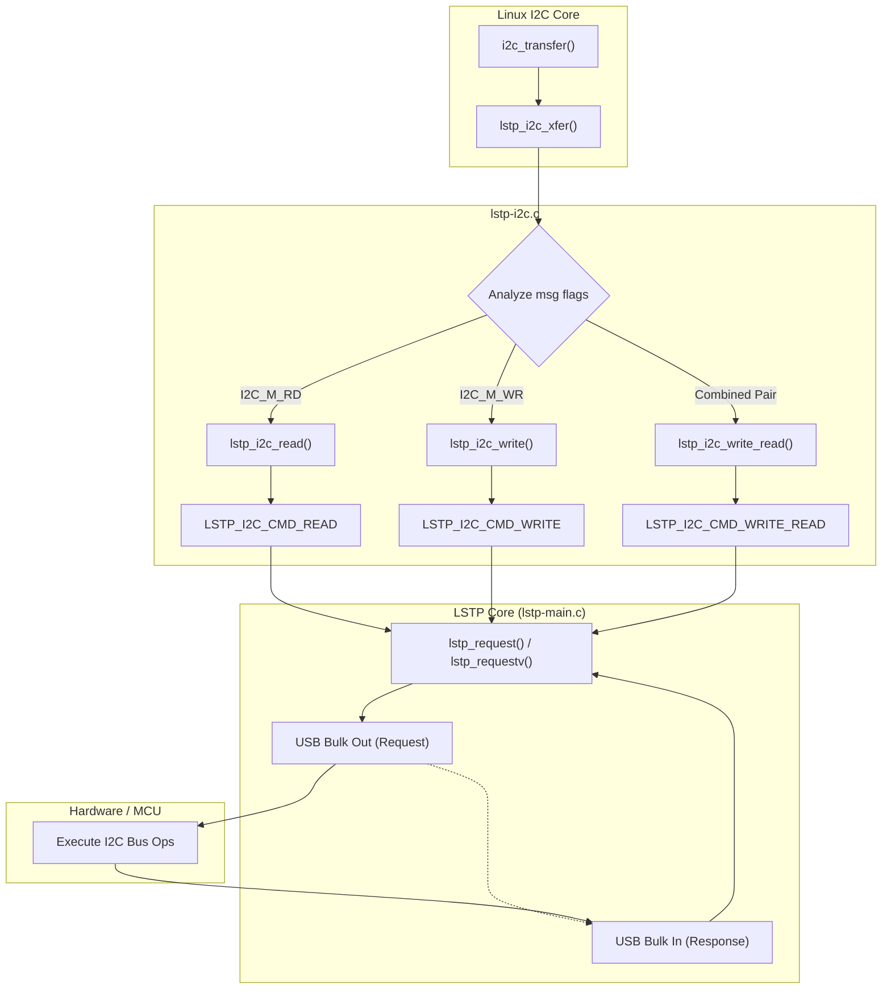
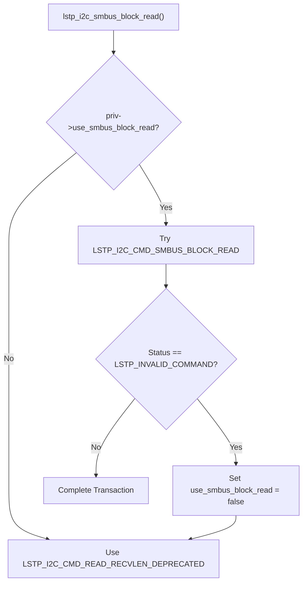

<!-- source: DeepWiki mcp.deepwiki.com · repo NVIDIA/lstp_module · page 3.3 I2C Subsystem (lstp-i2c.c) · fetched 2026-10-26 -->

# I2C Subsystem (lstp-i2c.c)

Relevant source files

The following files were used as context for generating this wiki page:

- [lstp-i2c.c](lstp-i2c.c)

The I2C subsystem implements a standard Linux I2C adapter driver that bridges kernel I2C/SMBus transactions to the LSTP protocol over USB. It supports standard read/write operations, repeated-START transactions, SMBus block reads, and bus recovery procedures.

## Architecture and Data Flow

The I2C subsystem is defined as an LSTP subsystem using the `LSTP_SUBSYS` macro [lstp-i2c.c:668-675](). It registers an `i2c_adapter` for each identified I2C channel during the `lstp_i2c_init` and `lstp_i2c_start` lifecycle [lstp-i2c.c:595-650]().

The core of the driver is the `lstp_i2c_algorithm` [lstp-i2c.c:541-545](), which provides the `master_xfer` and `smbus_xfer` callbacks used by the Linux I2C core to dispatch transactions.

### System Mapping: Linux I2C to LSTP Opcodes

The following diagram illustrates how standard I2C messages are transformed into LSTP-specific commands and sent over the USB transport.

**I2C Transaction Dispatch Flow**

**Sources:** [lstp-i2c.c:157-195](), [lstp-i2c.c:205-247](), [lstp-i2c.c:310-359](), [lstp-i2c.c:438-539]()

## Transaction Types and Opcodes

The driver supports several I2C/SMBus specific opcodes defined in `enum lstp_i2c_cmd` [lstp-i2c.c:24-31]():

| Opcode | Command | Description |
| :--- | :--- | :--- |
| `0x00` | `LSTP_I2C_CMD_BUS_RECOVERY` | Triggers a hardware-level bus recovery (e.g., toggling SCL) [lstp-i2c.c:111-124](). |
| `0x01` | `LSTP_I2C_CMD_READ` | Standard I2C read using `lstp_i2c_read_req` [lstp-i2c.c:39-42](). |
| `0x02` | `LSTP_I2C_CMD_WRITE` | Standard I2C write using `lstp_i2c_write_req` [lstp-i2c.c:44-47](). |
| `0x04` | `LSTP_I2C_CMD_WRITE_READ` | Combined write-then-read transaction (Repeated START) [lstp-i2c.c:53-57](). |
| `0x05` | `LSTP_I2C_CMD_SMBUS_BLOCK_READ` | Modern SMBus block read with optional PEC [lstp-i2c.c:59-63](). |

### Combined-Pair Detection
The `lstp_i2c_xfer` function optimizes transactions by looking ahead at the message array. If it detects a write message followed immediately by a read message to the same address, it collapses them into a single `LSTP_I2C_CMD_WRITE_READ` request [lstp-i2c.c:476-492](). This reduces USB overhead and ensures the hardware performs a Repeated START instead of a STOP-START sequence.

### Repeated START and NO_STOP Flag
For transactions that are not collapsed but still require a Repeated START (i.e., multiple messages in one transfer), the driver uses the `LSTP_I2C_CMD_FLAG_NO_STOP` (0x40) [lstp-i2c.c:33](). If a message is not the last one in the sequence, this flag is ORed into the command byte [lstp-i2c.c:185-186](), [lstp-i2c.c:240-241]().

## SMBus Block Read Evolution

The driver handles SMBus block reads through two distinct mechanisms to maintain compatibility with different firmware versions:

1.  **Modern (`LSTP_I2C_CMD_SMBUS_BLOCK_READ`)**: The preferred method. It supports Packet Error Checking (PEC) via `LSTP_I2C_SMBUS_BLOCK_READ_FLAG_PEC` [lstp-i2c.c:35-37]().
2.  **Fallback (Deprecated)**: If the MCU returns `LSTP_INVALID_COMMAND` for the modern opcode, the driver sets `priv->use_smbus_block_read = false` [lstp-i2c.c:396-398]() and falls back to `LSTP_I2C_CMD_READ_RECVLEN_DEPRECATED` (0x03) for subsequent attempts [lstp-i2c.c:406-414]().

**SMBus Block Read Logic**

**Sources:** [lstp-i2c.c:90-93](), [lstp-i2c.c:361-436]()

## Implementation Details

### Zero-Copy Framing with kvec
To avoid unnecessary memory copies when prepending LSTP headers to I2C data, the driver utilizes `lstp_requestv()` with `kvec` arrays [lstp-i2c.c:210-213](). For a write operation:
*   `vecs[0]` contains the `lstp_i2c_write_req` header (address).
*   `vecs[1]` points directly to the `msg->buf` provided by the I2C client.

### Retry and Error Policy
The driver implements a specific retry policy based on the `lstp_status` returned by the hardware:
*   **Retriable Errors**: `LSTP_BUSY` and `LSTP_ARB_LOST` trigger an `-EAGAIN` return, allowing the I2C core to retry the transaction [lstp-i2c.c:95-98]().
*   **Suppressed Logs**: Errors like `LSTP_NACK` are considered "normal" bus conditions and do not flood the kernel log with error messages [lstp-i2c.c:100-103]().

### Configuration (lstp_i2c_config)
The I2C bus parameters are parsed from firmware via `struct lstp_i2c_config` [lstp-i2c.c:78-86](). This includes:
*   `speed`: Supports 100kHz, 400kHz, 1MHz, and 3.4MHz [lstp-i2c.c:71-76]().
*   Hardware-specific tunables: `output_drive_strength`, `slew_rate`, `input_debounce_time`, and `glitch_filter_width` [lstp-i2c.c:80-83]().
*   `bus_arbitration_retries`: Number of times the hardware should attempt to win bus arbitration [lstp-i2c.c:85]().

**Sources:**
*   `lstp_i2c_priv` definition: [lstp-i2c.c:90-93]()
*   Command/Flag enums: [lstp-i2c.c:24-37]()
*   Request structures: [lstp-i2c.c:39-63]()
*   `lstp_i2c_algorithm`: [lstp-i2c.c:541-545]()
*   Subsystem declaration: [lstp-i2c.c:668-675]()

---

