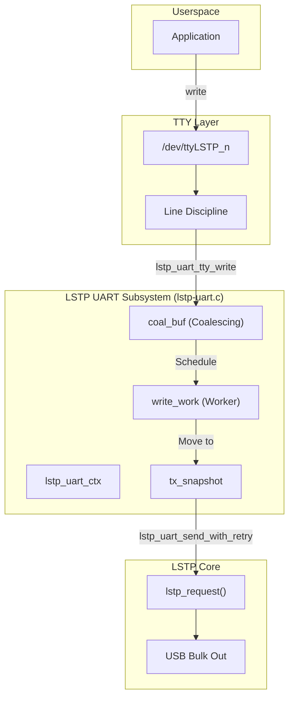
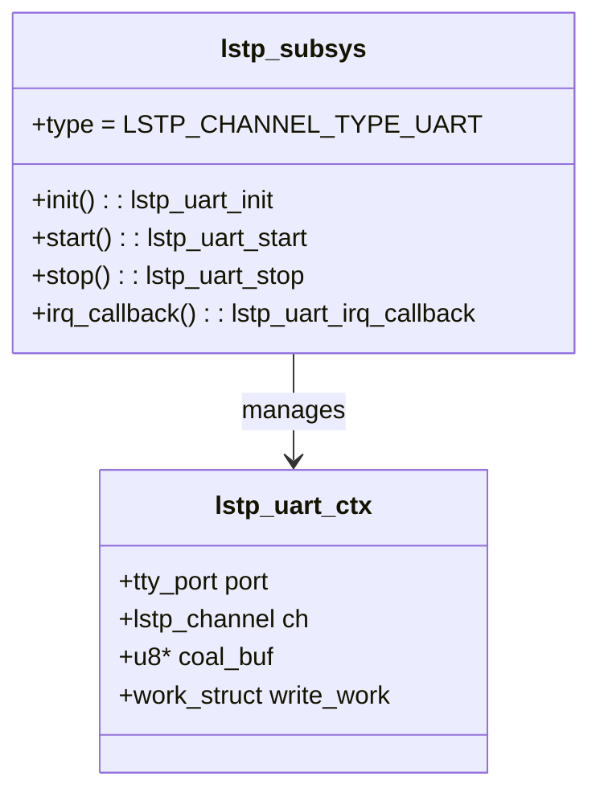

<!-- source: DeepWiki mcp.deepwiki.com · repo NVIDIA/lstp_module · page 3.4 UART Subsystem (lstp-uart.c) · fetched 2026-10-26 -->

# 3.4 UART Subsystem (lstp-uart.c)

Relevant source files

The following files were used as context for generating this wiki page:

- [lstp-uart.c](lstp-uart.c)

The LSTP UART subsystem provides a TTY driver interface that exposes logical LSTP channels as `/dev/ttyLSTP` devices. It translates standard Linux TTY operations (read, write, termios configuration) into LSTP wire protocol packets. The driver is designed to handle high-latency USB transport by implementing a two-stage TX coalescing mechanism and robust NACK retry logic for firmware flow control.

## Driver Architecture and Context
Each UART channel is managed by a `struct lstp_uart_ctx`, which encapsulates the `tty_port`, minor number, and buffers required for asynchronous TX operations [lstp-uart.c:98-115](). The subsystem utilizes the `tty_driver` framework to integrate with the Linux serial core [lstp-uart.c:117]().

### Context Management
*   **Minor Numbers:** Managed via a global IDR (`lstp_minors`) to support up to 256 concurrent UART devices [lstp-uart.c:119-120]().
*   **Reference Counting:** The driver uses `tty_port_get` and `tty_port_put` to ensure the `lstp_uart_ctx` remains valid during hot-unplug events until all userspace file descriptors are closed [lstp-uart.c:150-151]().

### Data Flow Overview
The following diagram illustrates the path of data from userspace to the physical wire and back.

**UART Data Path: Userspace to Wire**

**Sources:** [lstp-uart.c:98-115](), [lstp-uart.c:378-410](), [lstp-uart.c:317-362]()

## Protocol and Command Tags
The UART subsystem uses the `LSTP_UART_CMD_WRITE` (0x00) opcode for all data transfers [lstp-uart.c:34-36](). Specific UART events are signaled using "tags" bit-packed into the command byte of the LSTP header [lstp-uart.c:65-74]().

| Tag | Bit | Direction | Description |
| :--- | :--- | :--- | :--- |
| `LSTP_UART_TAG_CARRIER_DOWN` | BIT(6) | Device → Host | Signals loss of carrier (DCD). |
| `LSTP_UART_TAG_TX_OVERRUN` | BIT(5) | Device → Host | Device-side TX buffer overflowed; data lost. |
| `LSTP_UART_TAG_BREAK_DET` | BIT(4) | Device → Host | Remote serial break detected. |
| `LSTP_UART_TAG_GEN_BREAK` | BIT(3) | Host → Device | Instructs device to assert a break condition. |

**Sources:** [lstp-uart.c:65-74]()

## Transmit (TX) Pipeline
TX operations are optimized for USB's natural frame intervals (~1ms).

### Two-Stage Coalescing
To prevent flooding the USB bus with small packets, the driver implements a two-stage buffer system [lstp-uart.c:90-97]():
1.  **`coal_buf`**: When `lstp_uart_tty_write` is called, data is appended to this buffer and `write_work` is scheduled [lstp-uart.c:395-404]().
2.  **`tx_snapshot`**: When the worker runs, it moves data from `coal_buf` to `tx_snapshot`. This stable copy is then passed to the LSTP core [lstp-uart.c:328-335]().
While a USB transfer is in-flight (`tx_in_flight == true`), incoming writes continue to accumulate in `coal_buf` for the next batch [lstp-uart.c:348-350]().

### NACK Retry Logic
If the firmware's internal TX FIFO is full, it returns `LSTP_STATUS_NAK`. The function `lstp_uart_send_with_retry` implements a retry loop [lstp-uart.c:273-305]():
*   **Max Retries:** 5 attempts [lstp-uart.c:80]().
*   **Delay:** 10ms between attempts [lstp-uart.c:81]().
This allows the firmware approximately 50ms to drain its buffer (sufficient for 500 bytes at 115200 baud) before the host reports an error [lstp-uart.c:77-79]().

**Sources:** [lstp-uart.c:77-82](), [lstp-uart.c:90-115](), [lstp-uart.c:273-305]()

## Receive (RX) Path
Incoming data is delivered via `lstp_uart_irq_callback`. The driver handles both raw data and status tags.

1.  **Tag Processing:** The driver checks for `LSTP_UART_TAG_BREAK_DET` and `LSTP_UART_TAG_TX_OVERRUN`, updating internal `iocount` statistics and signaling the TTY layer [lstp-uart.c:427-440]().
2.  **Flip-Buffer Push:** Valid data is pushed into the TTY flip-buffer using `tty_insert_flip_string` and committed with `tty_flip_buffer_push` [lstp-uart.c:442-445]().

**Sources:** [lstp-uart.c:412-447]()

## Termios and Configuration
At initialization, the driver reads the hardware's current configuration using `lstp_ch0_read_config` [lstp-uart.c:492-498]().

### Mapping Helpers
The driver translates between `struct lstp_uart_config` (wire format) and Linux `termios` flags:
*   **`lstp_build_cflag`**: Maps baud rate, data bits (5-8), stop bits, and parity (None, Odd, Even, Mark, Space) to `c_cflag` [lstp-uart.c:186-231]().
*   **`lstp_build_iflag`**: Maps XON/XOFF flow control to `c_iflag` [lstp-uart.c:233-238]().

### Baud Rate Mapping
A static map `lstp_baud_to_speed` converts raw numeric baud rates (e.g., 115200) to Linux `Bxxx` constants (e.g., `B115200`) [lstp-uart.c:159-182]().

**Sources:** [lstp-uart.c:38-61](), [lstp-uart.c:159-238]()

## Subsystem Registration
The UART subsystem is defined using the `LSTP_SUBSYS_DECLARE` macro, linking it into the core LSTP dispatch logic.

**UART Subsystem Definition**

**Sources:** [lstp-uart.c:542-550](), [lstp-uart.c:98-115]()

### Initialization Sequence
1.  **`lstp_uart_init`**: Allocates the `lstp_uart_ctx`, initializes the TTY port, and sets up the TX workqueue and spinlocks [lstp-uart.c:461-488]().
2.  **`lstp_uart_start`**: Allocates a minor number, reads the initial hardware config, and registers the TTY device via `tty_port_register_device` [lstp-uart.c:490-523]().
3.  **`lstp_uart_stop`**: Unregisters the TTY device and releases the minor number [lstp-uart.c:525-540]().

**Sources:** [lstp-uart.c:461-540]()

---

