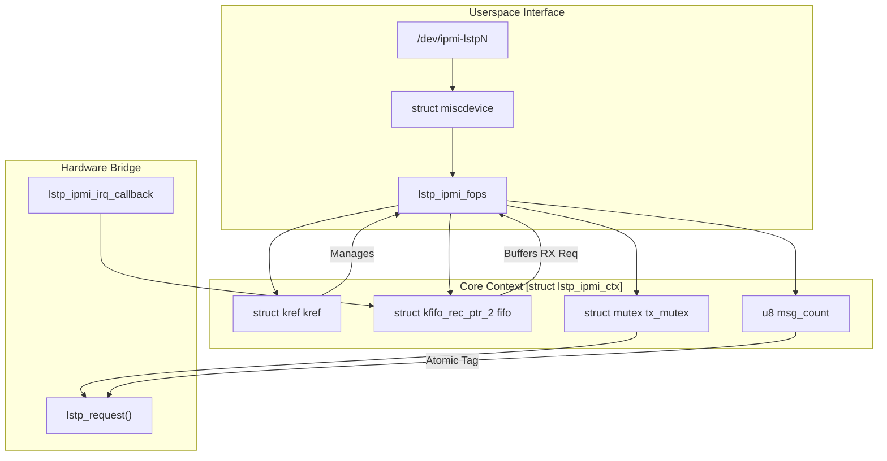
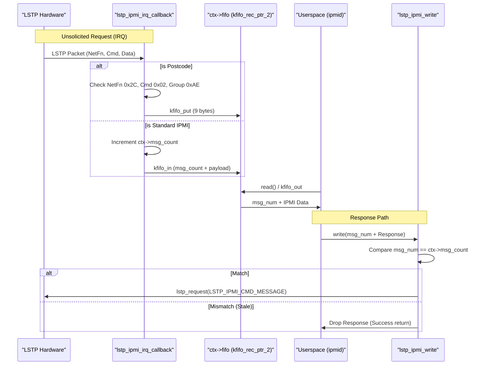

<!-- source: DeepWiki mcp.deepwiki.com · repo NVIDIA/lstp_module · page 3.5 IPMI Subsystem (lstp-ipmi.c and lstp-ipmi-postcodes.h) · fetched 2026-10-26 -->

# IPMI Subsystem (lstp-ipmi.c and lstp-ipmi-postcodes.h)

Relevant source files

The following files were used as context for generating this wiki page:

- [Kconfig](Kconfig)
- [lstp-ipmi-postcodes.h](lstp-ipmi-postcodes.h)
- [lstp-ipmi.c](lstp-ipmi.c)

The IPMI subsystem provides a bridge between the LSTP USB transport and userspace IPMI stack (typically OpenBMC `ipmid`). It exposes a `miscdevice` character device for bidirectional IPMI messaging and an optional secondary device for high-throughput BIOS postcodes. The implementation focuses on atomicity between requests and responses and safe lifecycle management during USB hot-unplug events.

## Architecture and Data Flow

The subsystem is built around `struct lstp_ipmi_ctx`, which manages the state for a single IPMI channel. It utilizes a `kfifo_rec_ptr_2` to handle variable-length IPMI messages (requests) coming from the hardware and a `msg_count` tag to ensure that responses sent from userspace match the current hardware state.

### Code Entity Mapping: Natural Language to Code Space

The following diagram maps high-level system concepts to the specific data structures and functions implemented in `lstp-ipmi.c`.

**IPMI Subsystem Components**

**Sources:** [lstp-ipmi.c:49-96](), [lstp-ipmi.c:172-178](), [lstp-ipmi.c:380-417]()

## Character Device Interface

The driver registers a character device under `/dev/ipmi-lstpN`. The naming is handled by an IDA (`lstp_ipmi_ida`) or a firmware-provided label [lstp-ipmi.c:37-37, 517-531]().

### Request-Response Atomicity
To prevent userspace from responding to a stale request (e.g., if a new request arrives before the previous one was processed), the driver uses a rolling `u8 msg_count` [lstp-ipmi.c:94-94]().
1.  **RX Path:** When a message arrives via `lstp_ipmi_irq_callback`, the `msg_count` is incremented and prepended to the message in the FIFO [lstp-ipmi.c:398-406]().
2.  **Read Path:** `lstp_ipmi_read` provides the message and the `msg_num` to userspace [lstp-ipmi.c:266-276]().
3.  **Write Path:** Userspace must include the `msg_num` in the `ipmi_lstp_msg` header. `lstp_ipmi_write` verifies that this matches the current `ctx->msg_count`. If it does not, the response is dropped as stale [lstp-ipmi.c:317-322]().

### Buffer Management
The request buffer is a 4096-byte `kfifo_rec_ptr_2` [lstp-ipmi.c:35-35, 93-93]().
*   **Policy:** It implements a "drop-oldest" policy. If the FIFO is full when a new IRQ arrives, the driver calls `kfifo_skip_rec` until enough space is cleared for the new message [lstp-ipmi.c:403-408]().
*   **Capacity:** At typical OpenBMC rates, this absorbs ~1 second of userspace stall [lstp-ipmi.c:28-34]().

### Lifecycle and Hot-Unplug
The subsystem uses `struct kref` to ensure memory safety during USB disconnection [lstp-ipmi.c:84-84]().
*   **Exclusive Open:** Only one userspace process can open the device at a time, tracked by `ctx->running` [lstp-ipmi.c:88-88, 225-231]().
*   **Safe Unplug:** When the USB device is removed, `lstp_ipmi_stop` sets `ctx->stopped`, wakes pending readers, and unregisters the `miscdevice` [lstp-ipmi.c:475-497](). The underlying `ctx` memory is only freed via `lstp_ipmi_ctx_release` once the last userspace file descriptor is closed [lstp-ipmi.c:135-146]().

**Sources:** [lstp-ipmi.c:28-35](), [lstp-ipmi.c:135-166](), [lstp-ipmi.c:212-246](), [lstp-ipmi.c:302-330](), [lstp-ipmi.c:395-410]()

## Postcodes Sub-device

When `CONFIG_SEPARATE_LSTP_IPMI_POSTCODES` is enabled, the driver can peel off specific IPMI messages and route them to a dedicated `/dev/ipmi-lstpN-postcodes` device [Kconfig:36-45](), [lstp-ipmi-postcodes.h:209-209]().

### Identification and Extraction
The driver inspects incoming IPMI IRQs in `lstp_ipmi_irq_callback`. If the message matches the following OEM Group Extension criteria, it is treated as a postcode [lstp-ipmi-postcodes.h:33-41]():
*   **NetFn:** 0x2C (Group Extension)
*   **Cmd:** 0x02 (OEM Command)
*   **Group:** 0xAE (NVIDIA OEM Group)

If matched, the driver extracts 9 bytes of postcode data starting at offset 3 [lstp-ipmi-postcodes.h:43-44]().

### Postcode FIFO Policy
Unlike the main IPMI path, the postcode path uses a standard `kfifo` of 1024 bytes [lstp-ipmi-postcodes.h:45-45, 64-64]().
*   **Overflow:** If the postcode FIFO overflows, it is completely reset (`kfifo_reset`) to ensure that userspace only receives contiguous, recent postcode sequences rather than fragmented data [lstp-ipmi-postcodes.h:258-262]().

**Sources:** [lstp-ipmi-postcodes.h:33-45](), [lstp-ipmi-postcodes.h:250-265](), [lstp-ipmi.c:388-393]()

## Key Implementation Functions

| Function | File | Description |
| :--- | :--- | :--- |
| `lstp_ipmi_irq_callback` | `lstp-ipmi.c` | Entry point for unsolicited LSTP packets. Dispatches to postcodes or the request FIFO. |
| `lstp_ipmi_read` | `lstp-ipmi.c` | Dequeues one IPMI request record from the kfifo and copies it to userspace. |
| `lstp_ipmi_write` | `lstp-ipmi.c` | Validates the `msg_num` tag and sends the response to hardware via `lstp_request`. |
| `lstp_ipmi_postcodes_init` | `lstp-ipmi-postcodes.h` | Allocates the postcode FIFO and prepares the `miscdevice` structure. |
| `lstp_ipmi_stop` | `lstp-ipmi.c` | Quiesces the channel, sets the `stopped` flag, and triggers devres-managed cleanup. |

**Sources:** [lstp-ipmi.c:248-295](), [lstp-ipmi.c:297-347](), [lstp-ipmi.c:380-417](), [lstp-ipmi.c:475-502](), [lstp-ipmi-postcodes.h:193-226]()

## Data Flow Diagram

The following diagram illustrates the path of an IPMI message from the USB wire to userspace and back.

**IPMI Message Data Flow**

**Sources:** [lstp-ipmi.c:266-285](), [lstp-ipmi.c:317-336](), [lstp-ipmi.c:395-412](), [lstp-ipmi-postcodes.h:250-265]()

---

