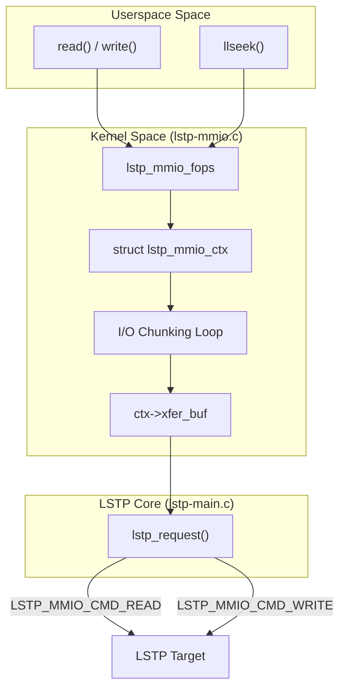
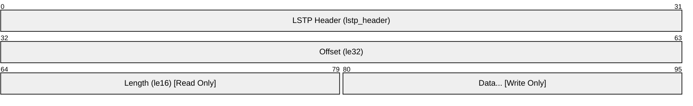

<!-- source: DeepWiki mcp.deepwiki.com · repo NVIDIA/lstp_module · page 3.6 MMIO Subsystem (lstp-mmio.c) · fetched 2026-10-26 -->

# MMIO Subsystem (lstp-mmio.c)

Relevant source files

The following files were used as context for generating this wiki page:

- [lstp-mmio.c](lstp-mmio.c)

The MMIO (Memory-Mapped I/O) subsystem provides a mechanism for the host to perform arbitrary memory-mapped read and write operations over the LSTP transport. It exposes these capabilities to userspace via a `miscdevice` character device node (`/dev/lstp_mmio_X`), allowing standard file operations like `read()`, `write()`, and `llseek()` to be translated into LSTP wire protocol commands.

### Architecture and Data Flow

The subsystem acts as a bridge between the Linux VFS (Virtual File System) and the LSTP core. Each LSTP channel of type MMIO results in a unique character device. The driver handles the complexity of protocol constraints, such as maximum payload sizes and 32-bit address space limitations, by transparently chunking large I/O requests.

#### System Entity Mapping
The following diagram illustrates how userspace file operations map to internal code structures and LSTP protocol commands.

**Diagram: MMIO Request Translation**

**Sources:** [lstp-mmio.c:35-58](), [lstp-mmio.c:267-274]()

---

### Implementation Details

#### Context Management and Lifecycle
The subsystem uses a `struct lstp_mmio_ctx` to maintain the state of an MMIO channel. Because multiple file descriptors can be open against a single `/dev/lstp_mmio_X` node, the driver employs a `kref` for reference counting to ensure the context remains valid until the last file descriptor is closed and the underlying LSTP channel is stopped.

*   **Naming:** Devices are named using a global IDA (`lstp_mmio_ida`) to generate unique indices for the `/dev/lstp_mmio_X` nodes [lstp-mmio.c:33](), [lstp-mmio.c:64-65]().
*   **Serialization:** A `mutex` (`ctx->lock`) serializes access to the `xfer_buf` and protects against race conditions during channel hot-unplug (the `stopped` flag) [lstp-mmio.c:55-58]().
*   **Buffer Management:** A single `xfer_buf` is allocated per context to avoid repeated memory allocations during I/O. Its size is determined by the maximum of `max_rx_payload` and `max_tx_payload` during initialization [lstp-mmio.c:56]().

#### I/O Operations and Chunking
The MMIO protocol supports 32-bit offsets [lstp-mmio.c:41]() and 16-bit length fields per packet [lstp-mmio.c:42](). When a user requests a read or write larger than the transport's capabilities, the driver performs "chunked I/O."

| Constraint | Value / Source |
| :--- | :--- |
| **Max Address** | `U32_MAX` (4GB) [lstp-mmio.c:94]() |
| **Max Packet Length** | `U16_MAX` (65535 bytes) [lstp-mmio.c:150]() |
| **Transport Limit** | `ch->max_rx_payload` or `ch->max_tx_payload` [lstp-mmio.c:150](), [lstp-mmio.c:221]() |

**Read Loop Logic (`lstp_mmio_read`):**
1. Validates the range to ensure it does not exceed `U32_MAX` [lstp-mmio.c:124]().
2. Calculates `chunk` size as the minimum of remaining `count`, `max_rx_payload`, and `U16_MAX` [lstp-mmio.c:150]().
3. Issues `LSTP_MMIO_CMD_READ` via `lstp_request()` [lstp-mmio.c:162]().
4. Copies data from `ctx->xfer_buf` to userspace [lstp-mmio.c:169]().
5. Updates `*ppos` and repeats until `done == count`.

**Write Loop Logic (`lstp_mmio_write`):**
1. Calculates `chunk` size, accounting for the `lstp_mmio_write_req` header overhead [lstp-mmio.c:221]().
2. Copies data from userspace into `req->data` (located within `xfer_buf`) [lstp-mmio.c:228]().
3. Issues `LSTP_MMIO_CMD_WRITE` [lstp-mmio.c:235]().
4. Updates `*ppos` and repeats.

**Sources:** [lstp-mmio.c:115-185](), [lstp-mmio.c:187-253]()

---

### Protocol Structures

The MMIO subsystem uses specific wire-format structures for requests. All fields are little-endian as per the LSTP specification.

| Structure | Purpose | Fields |
| :--- | :--- | :--- |
| `lstp_mmio_read_req` | Defines the address and length to read. | `offset` (u32), `length` (u16) [lstp-mmio.c:40-43]() |
| `lstp_mmio_write_req` | Defines the address and trailing data to write. | `offset` (u32), `data[]` (flexible array) [lstp-mmio.c:45-48]() |

The driver uses `BUILD_BUG_ON` assertions to ensure that the minimum LSTP packet size can accommodate these headers, preventing runtime failures on hardware with extremely small buffers [lstp-mmio.c:137](), [lstp-mmio.c:211]().

**Diagram: MMIO Wire Format**

**Sources:** [lstp-mmio.c:40-48](), [lstp-mmio.c:137]()

---

### Subsystem Lifecycle

The MMIO subsystem implements the standard `lstp_subsys` interface.

1.  **`lstp_mmio_init`**:
    *   Allocates `lstp_mmio_ctx` [lstp-mmio.c:281]().
    *   Allocates a unique ID from `lstp_mmio_ida` [lstp-mmio.c:33]().
    *   Allocates `xfer_buf` based on channel payload limits.
    *   Registers the `miscdevice` with a name format `lstp_mmio_%d`.
2.  **`lstp_mmio_start`**:
    *   Currently a placeholder for channel-specific startup logic.
3.  **`lstp_mmio_stop`**:
    *   Sets `ctx->stopped = true` under `ctx->lock` [lstp-mmio.c:57]().
    *   Ensures that any subsequent `read()` or `write()` calls return `-ENODEV` [lstp-mmio.c:130](), [lstp-mmio.c:203]().
    *   Unregisters the `miscdevice`.
    *   Drops the initial `kref` reference to allow cleanup once all userspace handles are closed [lstp-mmio.c:79]().

**Sources:** [lstp-mmio.c:50-85](), [lstp-mmio.c:276-290]()

---

