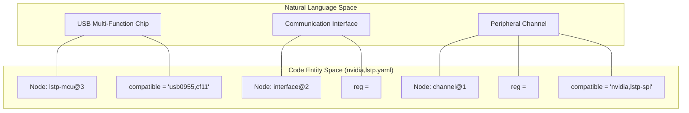
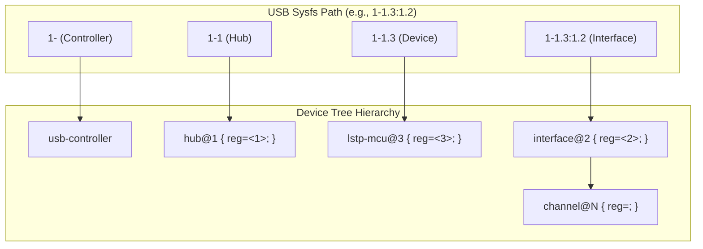

<!-- source: DeepWiki mcp.deepwiki.com · repo NVIDIA/lstp_module · page 4 Device Tree Bindings · fetched 2026-10-26 -->

# Device Tree Bindings

Relevant source files

The following files were used as context for generating this wiki page:

- [devicetree/bindings/nvidia,lstp.yaml](devicetree/bindings/nvidia,lstp.yaml)

The LSTP (Low-Speed Transport Protocol) driver utilizes Device Tree (DT) bindings to describe how multi-function USB hardware is represented in firmware. These bindings allow the Linux kernel to associate specific USB interfaces and logical channels with their respective subsystem drivers (SPI, I2C, GPIO, etc.) and to enumerate child devices sitting on those buses.

The schema files are located under `devicetree/bindings/` and follow a hierarchical structure that mirrors the physical USB topology and the logical LSTP channel architecture.

### Hardware Hierarchy and Matching

LSTP hardware is organized into a three-tier hierarchy within the Device Tree:
1.  **USB Device**: Identified by the NVIDIA VID/PID `0955:cf11` and the compatible string `usb0955,cf11` [devicetree/bindings/nvidia,lstp.yaml:22-22]().
2.  **USB Interface**: A child node representing the specific `bInterfaceNumber` used for LSTP multiplexing [devicetree/bindings/nvidia,lstp.yaml:23-23]().
3.  **Logical Channel**: Child nodes under the interface that represent specific peripherals (e.g., a SPI controller or GPIO bank). These are matched using a combination of a `compatible` string and a `reg` property that must correspond to the firmware-reported Channel ID [devicetree/bindings/nvidia,lstp.yaml:30-31]().

#### Logical to Physical Mapping
The following diagram illustrates how the natural language concept of a "USB Peripheral" maps to specific Device Tree entities and properties defined in the schema.

**Diagram: DT Entity Mapping**

Sources: [devicetree/bindings/nvidia,lstp.yaml:7-31](), [devicetree/bindings/nvidia,lstp.yaml:45-46]()

### Top-Level LSTP USB Device Binding

The root of the LSTP binding is defined in `nvidia,lstp.yaml`. This file acts as the primary dispatcher for the entire device. It defines the requirements for the USB device node and the `interface@N` nodes. Crucially, it uses an `allOf: if-then` schema pattern to delegate the validation of specific channel nodes to their respective peripheral-specific YAML files based on the `compatible` string [devicetree/bindings/nvidia,lstp.yaml:100-130]().

For details on the root device properties and the two-step firmware-discovery matching process, see **[Top-Level LSTP USB Device Binding (nvidia,lstp.yaml)](#4.1)**.

### Per-Peripheral Channel Bindings

Each supported LSTP subsystem has a dedicated binding file that describes its specific properties and constraints. These nodes reside as children of the `interface@N` node.

| Subsystem | Compatible String | Key Properties |
| :--- | :--- | :--- |
| **SPI** | `nvidia,lstp-spi` | `spi-max-frequency`, CS constraints, child `spidev` nodes. |
| **GPIO** | `nvidia,lstp-gpio` | `gpio-controller`, `interrupt-controller`, `gpio-line-names`. |
| **I2C** | `nvidia,lstp-i2c` | Standard I2C bus properties for child device enumeration. |
| **IPMI** | `nvidia,lstp-ipmi` | `label` for device identification. |
| **UART** | `nvidia,lstp-uart` | Standard UART/TTY properties. |

The `reg` property in these nodes is mandatory and must match the logical Channel ID assigned by the device firmware [devicetree/bindings/nvidia,lstp.yaml:92-98]().

For detailed property definitions and examples for each subsystem, see **[Per-Peripheral Channel Bindings](#4.2)**.

### Structural Overview
The relationship between the sysfs path and the Device Tree hierarchy is strictly defined to ensure consistent discovery across different host controllers.

**Diagram: USB Path to DT Hierarchy**

Sources: [devicetree/bindings/nvidia,lstp.yaml:33-43](), [devicetree/bindings/nvidia,lstp.yaml:150-165]()

---

