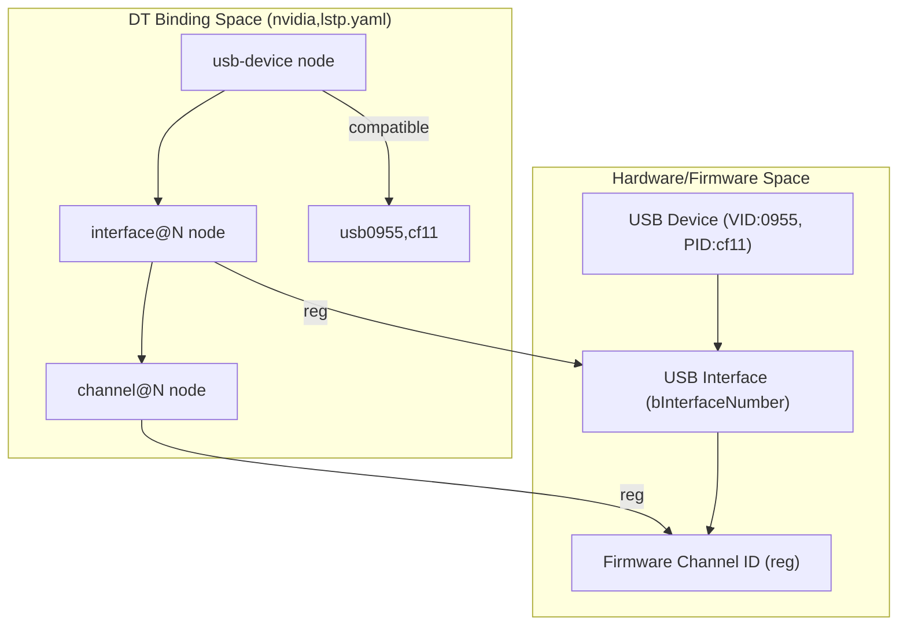
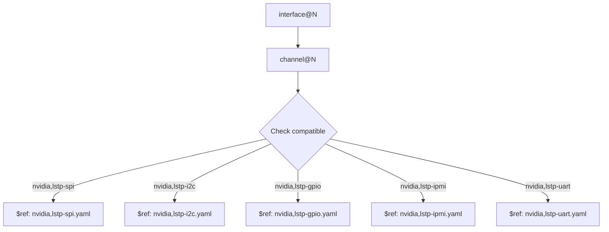

<!-- source: DeepWiki mcp.deepwiki.com · repo NVIDIA/lstp_module · page 4.1 Top-Level LSTP USB Device Binding (nvidia,lstp.yaml) · fetched 2026-10-26 -->

# Top-Level LSTP USB Device Binding (nvidia,lstp.yaml)

<details>
<summary>Relevant source files</summary>

The following files were used as context for generating this wiki page:

- [README.md](README.md)
- [devicetree/bindings/nvidia,lstp.yaml](devicetree/bindings/nvidia,lstp.yaml)

</details>


The `nvidia,lstp.yaml` binding defines the schema for the NVIDIA Low-Speed Transport Protocol (LSTP) USB Multi-Function Device. It describes a hierarchy where a single USB interface multiplexes multiple logical channels (SPI, I2C, GPIO, UART, IPMI) using a lightweight packet protocol [devicetree/bindings/nvidia,lstp.yaml:9-13]().

## Binding Overview

The root of the binding identifies the hardware via the specific NVIDIA USB Vendor/Product ID (VID/PID) `0955:cf11`. In the Device Tree, this is represented by the `usb0955,cf11` compatible string [devicetree/bindings/nvidia,lstp.yaml:22-46]().

### Hierarchy Structure
The LSTP binding follows a three-tier hierarchy to match the physical and logical structure of the USB device:

1.  **USB Device Node**: Matches the physical USB device on a specific hub port.
2.  **Interface Node**: Matches the `bInterfaceNumber` within the USB device that carries the LSTP protocol.
3.  **Channel Nodes**: Represent individual functional sub-devices (e.g., a specific SPI master or I2C bus) [devicetree/bindings/nvidia,lstp.yaml:20-28]().

### Logical Hierarchy Diagram

The following diagram bridges the Device Tree structure to the corresponding hardware and logical entities.

"LSTP Device Tree Hierarchy"

**Sources:** [devicetree/bindings/nvidia,lstp.yaml:20-31](), [devicetree/bindings/nvidia,lstp.yaml:44-98]()

## Device Discovery and Matching

The LSTP driver employs a two-step process to bind functional drivers to channels. This process ensures that firmware-reported capabilities are correctly mapped to the Device Tree descriptions.

1.  **Firmware Discovery**: At probe time, the device firmware reports available Channel IDs and types to the host driver [devicetree/bindings/nvidia,lstp.yaml:30-31]().
2.  **DT Matching**: The driver searches for a `channel@N` node under the corresponding `interface@N` where the `reg` property matches the firmware-reported Channel ID [devicetree/bindings/nvidia,lstp.yaml:17-18]().

### Sysfs to DT Mapping
Because USB is a dynamic bus, the sysfs path must be mapped to the static Device Tree hierarchy. The following table illustrates this mapping for a device located at USB path `1-1.3:1.2` (Bus 1, Port Path 1.3, Interface 2).

| Sysfs Segment | DT Node | `reg` Value | Description |
| :--- | :--- | :--- | :--- |
| `1-` | `usb-controller/` | N/A | The root host controller. |
| `1-1` | `hub@1` | `<1>` | First level hub on port 1. |
| `1-1.3` | `lstp-mcu@3` | `<3>` | LSTP device on hub port 3. |
| `1-1.3:1.2` | `interface@2` | `<2>` | LSTP interface (`bInterfaceNumber` 2). |

**Sources:** [devicetree/bindings/nvidia,lstp.yaml:33-42]()

## Schema Dispatching

The top-level `nvidia,lstp.yaml` acts as a dispatcher. It uses an `allOf: if-then` pattern to validate child channel nodes against their specific peripheral bindings based on the `compatible` string [devicetree/bindings/nvidia,lstp.yaml:100-130]().

### Dispatch Logic Diagram

"Binding Dispatch Flow"

**Sources:** [devicetree/bindings/nvidia,lstp.yaml:84-130]()

## Usage Example

A complete Device Tree representation for an LSTP device includes the interface and its associated channels. Each channel node contains peripheral-specific properties (e.g., `spi-max-frequency` for SPI or `gpio-controller` for GPIO) [devicetree/bindings/nvidia,lstp.yaml:147-210]().

```devicetree
lstp-mcu@3 {
    compatible = "usb0955,cf11";
    reg = <3>;
    #address-cells = <1>;
    #size-cells = <0>;

    interface@2 {
        reg = <2>;
        #address-cells = <1>;
        #size-cells = <0>;

        channel@1 {
            compatible = "nvidia,lstp-spi";
            reg = <1>;
            #address-cells = <1>;
            #size-cells = <0>;

            spidev@0 {
                compatible = "nvidia,lstp-spidev";
                reg = <0>;
                spi-max-frequency = <24000000>;
            };
        };

        channel@3 {
            compatible = "nvidia,lstp-gpio";
            reg = <3>;
            gpio-controller;
            #gpio-cells = <2>;
            gpio-line-names = "LED", "INT";
        };
    };
};
```
**Sources:** [devicetree/bindings/nvidia,lstp.yaml:155-210](), [README.md:171-217]()

---

