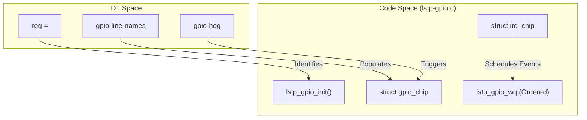
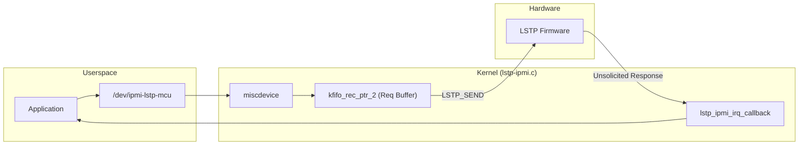

<!-- source: DeepWiki mcp.deepwiki.com · repo NVIDIA/lstp_module · page 4.2 Per-Peripheral Channel Bindings · fetched 2026-10-26 -->

# Per-Peripheral Channel Bindings

Relevant source files

The following files were used as context for generating this wiki page:

- [devicetree/bindings/nvidia,lstp-gpio.yaml](devicetree/bindings/nvidia,lstp-gpio.yaml)
- [devicetree/bindings/nvidia,lstp-i2c.yaml](devicetree/bindings/nvidia,lstp-i2c.yaml)
- [devicetree/bindings/nvidia,lstp-ipmi.yaml](devicetree/bindings/nvidia,lstp-ipmi.yaml)
- [devicetree/bindings/nvidia,lstp-spi.yaml](devicetree/bindings/nvidia,lstp-spi.yaml)
- [devicetree/bindings/nvidia,lstp-uart.yaml](devicetree/bindings/nvidia,lstp-uart.yaml)

This page documents the individual Device Tree (DT) bindings for the specific peripheral types supported by the LSTP (Low-Speed Transport Protocol) driver. While the top-level LSTP USB device binding manages the interface and discovery, these per-peripheral bindings define the configuration, constraints, and child device enumeration for each logical channel.

In all LSTP channel bindings, the `reg` property represents the **Firmware Channel ID** [devicetree/bindings/nvidia,lstp-gpio.yaml:37-39](), which must match the ID reported by the device during the `READ_CONFIG` phase of the LSTP protocol.

## SPI Channel Binding (`nvidia,lstp-spi.yaml`)

The SPI channel binding represents a bus master controller. It allows for the definition of SPI child nodes that the Linux SPI core will auto-enumerate.

### Key Properties
*   **`compatible`**: Must be `nvidia,lstp-spi` [devicetree/bindings/nvidia,lstp-spi.yaml:24-25]().
*   **`reg`**: The LSTP channel ID [devicetree/bindings/nvidia,lstp-spi.yaml:27-29]().
*   **`spi-max-frequency`**: (Child node property) Defines the maximum clock speed. It must not exceed the hardware limit reported by the firmware [devicetree/bindings/nvidia,lstp-spi.yaml:51-54]().
*   **`nvidia,lstp-spidev`**: A specific compatible string used for generic userspace SPI access via `spidev` [devicetree/bindings/nvidia,lstp-spi.yaml:76-80]().

### Constraints
The driver supports up to 2 chip-selects (CS0 and CS1) [devicetree/bindings/nvidia,lstp-spi.yaml:17-18](). The `reg` property in child nodes corresponds to these chip-select indices [devicetree/bindings/nvidia,lstp-spi.yaml:46-49]().

**Sources:** [devicetree/bindings/nvidia,lstp-spi.yaml:1-87]()

## GPIO Channel Binding (`nvidia,lstp-gpio.yaml`)

The GPIO binding enables the LSTP channel to act as both a `gpio-chip` and an `interrupt-controller`.

### Configuration and Hogs
*   **`gpio-controller`**: Enables phandle references for consumers like `gpio-leds` [devicetree/bindings/nvidia,lstp-gpio.yaml:41]().
*   **`interrupt-controller`**: Allows the GPIO pins to serve as interrupt sources [devicetree/bindings/nvidia,lstp-gpio.yaml:50]().
*   **`gpio-line-names`**: An optional list of strings to name pins, overriding the names provided by firmware [devicetree/bindings/nvidia,lstp-gpio.yaml:59-63]().
*   **GPIO Hogs**: Supported via pattern properties `^.+-hog(-[0-9]+)?$` for boot-time pin state configuration [devicetree/bindings/nvidia,lstp-gpio.yaml:75-92]().

### Operational Constraints
Because the GPIO controller communicates over USB, all operations are **inherently sleeping** (`can_sleep = true`) [devicetree/bindings/nvidia,lstp-gpio.yaml:29-31](). Furthermore, the firmware-reported pin direction is authoritative and cannot be changed at runtime for interrupt lines [devicetree/bindings/nvidia,lstp-gpio.yaml:23-25]().

### Data Flow: GPIO to Code Mapping
The following diagram illustrates how DT properties map to the internal `lstp-gpio.c` logic.

**GPIO Entity Mapping**

**Sources:** [devicetree/bindings/nvidia,lstp-gpio.yaml:1-154]()

## I2C Channel Binding (`nvidia,lstp-i2c.yaml`)

The I2C binding defines an LSTP channel as a Linux I2C adapter.

### Bus Management
*   **`retries`**: Defines how many times the host re-issues a transfer on `-EAGAIN`. However, if the firmware reports `bus_arbitration_retries`, the host-side retries are forced to 0 to avoid redundant attempts [devicetree/bindings/nvidia,lstp-i2c.yaml:40-48]().
*   **`clock-frequency`**: Standard I2C clock definitions (e.g., 100,000 for Standard Mode) [devicetree/bindings/nvidia,lstp-i2c.yaml:34-38]().

Child nodes are auto-enumerated by the I2C core using standard `#address-cells = <1>` and `#size-cells = <0>` conventions [devicetree/bindings/nvidia,lstp-i2c.yaml:28-32]().

**Sources:** [devicetree/bindings/nvidia,lstp-i2c.yaml:1-90]()

## UART Channel Binding (`nvidia,lstp-uart.yaml`)

The UART channel binding exposes a TTY device (`/dev/ttyLSTPN`). 

### Serdev Support
A DT node for a UART channel allows for **serdev** (Serial Device) child nodes. This is required for peripherals like Bluetooth or GNSS modules that are hard-wired to the LSTP UART [devicetree/bindings/nvidia,lstp-uart.yaml:31-38]().

### Runtime Constraints
Baud rate, parity, and flow control are determined by firmware at probe time. While userspace may attempt to change these via `termios`, the driver silently preserves the firmware-defined hardware bits [devicetree/bindings/nvidia,lstp-uart.yaml:12-16]().

**Sources:** [devicetree/bindings/nvidia,lstp-uart.yaml:1-70]()

## IPMI Channel Binding (`nvidia,lstp-ipmi.yaml`)

The IPMI binding creates a character device for raw IPMI message exchange.

### Device Naming
*   **`label`**: If provided, the device is created at `/dev/<label>`. If omitted, the driver defaults to `/dev/ipmi-lstpN` [devicetree/bindings/nvidia,lstp-ipmi.yaml:28-32]().

### IPMI Subsystem Integration
The IPMI channel functions as a bridge, where the `reg` property links the logical LSTP channel to the specific IPMI controller instance in firmware [devicetree/bindings/nvidia,lstp-ipmi.yaml:24-26]().

**IPMI Interaction Model**

**Sources:** [devicetree/bindings/nvidia,lstp-ipmi.yaml:1-53]()

---

