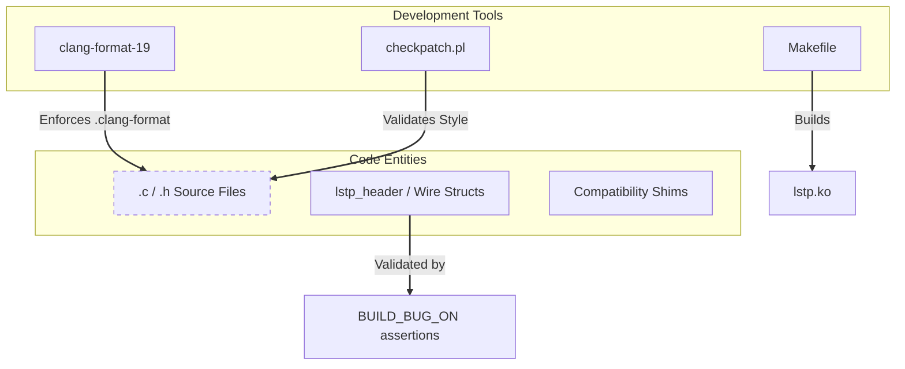
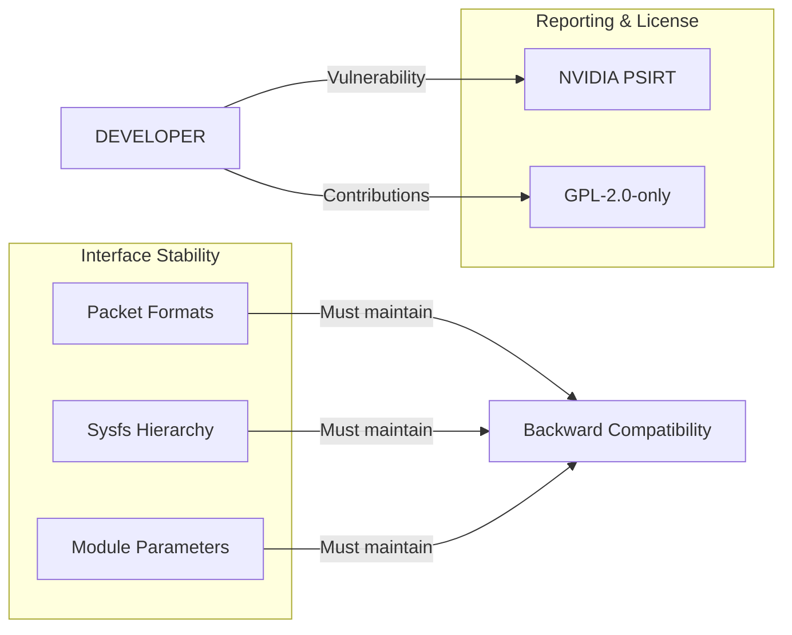

<!-- source: DeepWiki mcp.deepwiki.com · repo NVIDIA/lstp_module · page 5 Development and Tooling · fetched 2026-10-26 -->

# Development and Tooling

Relevant source files

The following files were used as context for generating this wiki page:

- [.clang-format](.clang-format)
- [.gitignore](.gitignore)
- [AGENTS.md](AGENTS.md)
- [SECURITY.md](SECURITY.md)

This page provides an overview of the developer-facing tooling, coding standards, and contribution workflows for the LSTP driver. Maintaining high standards for code quality and protocol compatibility is essential, as the driver supports a wide range of hardware targets including ASICs, FPGAs, and microcontrollers across both OpenBMC and Ubuntu hosts [AGENTS.md:7-12]().

## Code Style and Formatting

The LSTP codebase adheres to a strict formatting policy based on the Linux kernel style. All C source and header files are managed using `clang-format`.

*   **Tooling**: Developers must use `clang-format-19` to ensure consistency [AGENTS.md:59-60]().
*   **Configuration**: The root `.clang-format` file defines the rules, including a `ColumnLimit` of 100, `TabWidth` of 8, and specific `BraceWrapping` behaviors [ .clang-format:32-56]().
*   **Macro Whitelist**: The configuration includes an extensive `ForEachMacros` list (e.g., `list_for_each_entry`, `hash_for_each`) to ensure kernel-style loops are formatted correctly [.clang-format:72-218]().

For details, see [Code Style and Formatting](#5.1).

## Coding Conventions

The driver follows specific patterns to ensure correctness in a concurrent, out-of-tree kernel environment. Key conventions include:

*   **Wire-Format Integrity**: All structures crossing the USB wire must use `__packed` and explicit endianness types (`__le16`, `__le32`, etc.) [AGENTS.md:37-39]().
*   **Safety Assertions**: The codebase uses `BUILD_BUG_ON` to anchor wire-size assumptions at the point of consumption, preventing regressions in protocol alignment [AGENTS.md:48-50]().
*   **Resource Management**: Preference is given to `devres`-managed cleanup patterns and newer kernel APIs, with version-specific shims isolated in compatibility headers [AGENTS.md:31-33]().
*   **Naming**: Stack-allocated request and response structures follow a standard naming convention (`req`, `resp`) while their types are prefixed by the subsystem (e.g., `struct lstp_spi_read_req`) [AGENTS.md:51-56]().

For details, see [Coding Conventions and Compatibility Guidelines](#5.2).

## Development Workflow

### Tooling to Code Mapping
The following diagram illustrates how development tools and conventions interact with specific code entities and files.

**Tooling Integration Map**

Sources: [.clang-format:1-11](), [AGENTS.md:48-50](), [AGENTS.md:59-63]()

### Compatibility and Security
Maintaining backward compatibility is a hard requirement for the LSTP driver. Packet formats, sysfs hierarchies, and module parameters are considered stable interfaces [AGENTS.md:16-20]().

**Security Reporting**: Security vulnerabilities should **not** be reported via GitHub issues. Instead, they must be submitted to the NVIDIA Product Security Incident Response Team (PSIRT) via the official web form or PGP-encrypted email [SECURITY.md:5-12]().

**Security and Compatibility Workflow**

Sources: [AGENTS.md:16-20](), [SECURITY.md:7-12](), [.gitignore:1-7]()

### Contribution Process
1.  **Format**: Run `clang-format-19 -i` on touched files [AGENTS.md:59-63]().
2.  **Verify**: Use `checkpatch.pl` to ensure compliance with kernel coding standards.
3.  **Assert**: Ensure all new wire-bound structures are protected by `BUILD_BUG_ON` [AGENTS.md:48-50]().
4.  **Report**: Direct all security concerns to `psirt@nvidia.com` [SECURITY.md:11]().

Sources: [AGENTS.md:1-68](), [SECURITY.md:1-24](), [.clang-format:1-60]()

---

