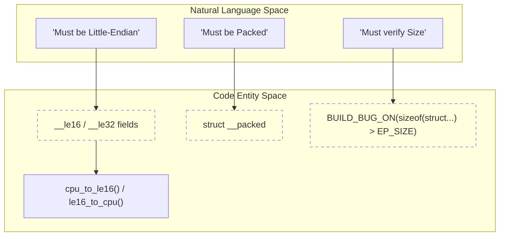
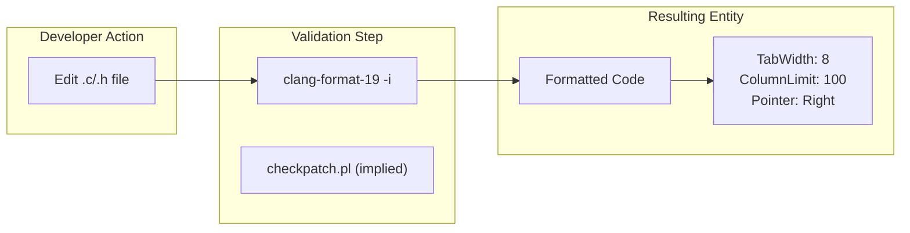

<!-- source: DeepWiki mcp.deepwiki.com · repo NVIDIA/lstp_module · page 5.1 Code Style and Formatting · fetched 2026-10-26 -->

# Code Style and Formatting

Relevant source files

The following files were used as context for generating this wiki page:

- [.clang-format](.clang-format)
- [AGENTS.md](AGENTS.md)

This page documents the coding standards, formatting rules, and automated tooling requirements for the LSTP (Low-Speed Transport Protocol) driver. To maintain consistency with the Linux kernel and ensure long-term maintainability, the project strictly enforces a specific `.clang-format` configuration and set of structural conventions.

## 1. Tooling and Version Requirements

The LSTP codebase requires **clang-format version 19** for all formatting operations. While the `.clang-format` file indicates compatibility with version 11+, the repository instructions specifically mandate version 19 to ensure consistent output across different development environments [AGENTS.md:59-60]().

Developers must run the formatter on every `.c` and `.h` file touched before staging a final commit or amending existing lines [.clang-format:3-4](), [AGENTS.md:59-61]().

| Tool | Recommended Command |
| :--- | :--- |
| **Full File Format** | `clang-format-19 -i <filename>` |
| **Patch-only Format** | `git clang-format --binary clang-format-19 HEAD~1` |

**Sources:** [.clang-format:1-10](), [AGENTS.md:57-68]()

---

## 2. Configuration Details

The project's style is based on the **Linux Kernel Style**, with specific overrides to accommodate the LSTP driver's architectural patterns [.clang-format:11]().

### 2.1. Layout and Spacing
The driver uses a standard 8-character tab width and enforces a 100-character column limit to improve readability on modern displays while respecting kernel-like density.

*   **TabWidth:** 8 [.clang-format:236]()
*   **IndentWidth:** 8 [.clang-format:226]()
*   **ColumnLimit:** 100 [.clang-format:56]()
*   **PointerAlignment:** Right (e.g., `struct lstp_usb *usb`) [.clang-format:241]()

### 2.2. Brace Wrapping
Brace wrapping is configured to follow the "Custom" style, primarily ensuring that functions and namespaces break to a new line, while control statements (if/else/for) keep braces on the same line.

| Context | Wrap Rule |
| :--- | :--- |
| `AfterFunction` | `true` [.clang-format:36]() |
| `AfterControlStatement` | `false` [.clang-format:34]() |
| `AfterStruct` / `AfterUnion` | `false` [.clang-format:39-40]() |
| `SplitEmptyFunction` | `true` [.clang-format:45]() |

**Sources:** [.clang-format:32-56](), [.clang-format:226-241]()

---

## 3. Macro and Loop Handling

The LSTP driver makes extensive use of kernel-style iterator macros. To prevent `clang-format` from misinterpreting these as standard function calls (which would lead to incorrect indentation of the following block), a comprehensive whitelist of `ForEachMacros` is maintained.

### 3.1. Supported Iterators
The configuration includes standard Linux iterators and common subsystem-specific loops. Key macros recognized by the formatter include:
*   `list_for_each_entry` [.clang-format:286]()
*   `hash_for_each` [.clang-format:268]()
*   `rht_for_each` [.clang-format:326]()
*   `device_for_each_child_node` [.clang-format:154]()

### 3.2. Spacing for Control Statements
To distinguish between standard control flow and custom LSTP macros, the project uses `SpaceBeforeParens: ControlStatementsExceptForEachMacros` [.clang-format:245](). This ensures a space exists after `if`, `while`, and `for`, but not necessarily after the specialized iterators defined in the whitelist.

**Sources:** [.clang-format:72-220](), [.clang-format:245-250]()

---

## 4. Coding Conventions (AGENTS.md)

Beyond automated formatting, the repository enforces structural rules to ensure wire-format compatibility and memory safety.

### 4.1. Wire-Bound Structures
Any structure transmitted over the USB wire must adhere to strict alignment and endianness rules:
*   **Packing:** Use `__packed` for all wire structs [AGENTS.md:37]().
*   **Endianness:** Use `__le*` or `__be*` for multi-byte fields; use `u8` for single bytes [AGENTS.md:37-38]().
*   **Access:** Use `cpu_to_le*()` and `le*_to_cpu()` for field access [AGENTS.md:39]().
*   **Validation:** Use `BUILD_BUG_ON` at the consumer site to verify struct sizes against hardware limits (e.g., `LSTP_USB_EP_MIN_SIZE`) [AGENTS.md:48-49]().

### 4.2. Request/Response Naming
To maintain clarity across the six transport subsystems, the following naming convention is required for stack-allocated variables:
*   **Struct Naming:** `<subsystem>_<operation>_(req|resp)` (e.g., `struct lstp_spi_read_req`) [AGENTS.md:44-46]().
*   **Local Variable Naming:** Use `req` and `resp` for locals within the function scope [AGENTS.md:54-55]().
*   **Initialization:** Use designated initializers (e.g., `.field = value`) and scope declarations to the specific branch where they are used [AGENTS.md:53-54]().

**Sources:** [AGENTS.md:35-56]()

---

## 5. Architectural Style Mapping

The following diagrams illustrate how the natural language style requirements map to specific code entities and formatting outcomes.

### Diagram 1: Wire Format Logic Flow
This diagram shows how the coding conventions for wire-bound structures are implemented in the code to ensure hardware compatibility.

**Sources:** [AGENTS.md:35-50]()

### Diagram 2: Formatting Pipeline
This diagram tracks the lifecycle of a code change from the developer's editor to the repository, highlighting the role of the formatting tools.

**Sources:** [.clang-format:56-241](), [AGENTS.md:57-68]()

---

