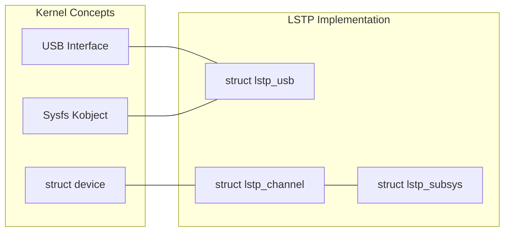

<!-- source: DeepWiki mcp.deepwiki.com · repo NVIDIA/lstp_module · page 5.2 Coding Conventions and Compatibility Guidelines · fetched 2026-10-26 -->

# Coding Conventions and Compatibility Guidelines

<details>
<summary>Relevant source files</summary>

The following files were used as context for generating this wiki page:

- [AGENTS.md](AGENTS.md)
- [lstp-main.h](lstp-main.h)

</details>


This page documents the mandatory coding standards, wire-format conventions, and compatibility requirements for the LSTP (Low-Speed Transport Protocol) Linux kernel driver. Adherence to these rules ensures that the driver remains portable across different host architectures (x86_64, arm64, armv7l) and maintains binary compatibility with existing firmware and userspace tools.

## Purpose and Scope

The LSTP driver is an out-of-tree kernel module that must support a wide range of environments, from OpenBMC to Ubuntu-style hosts, and interact with diverse endpoints including ASICs, FPGAs, and microcontrollers [AGENTS.md:7-14](). Because the protocol and its userspace-visible interfaces (sysfs, module parameters, device tree bindings) are already deployed, all extensions must maintain strict backwards compatibility [AGENTS.md:16-20]().

## Wire-Format Struct Conventions

To ensure cross-platform compatibility and alignment safety, all structures that cross the LSTP wire must follow specific formatting rules.

### Packing and Endianness
*   **Packing**: Every struct intended for the wire must be marked with `__packed` [AGENTS.md:37-37]().
*   **Endianness**: Multi-byte fields must use explicit little-endian (`__le*`) or big-endian (`__be*`) types [AGENTS.md:37-38]().
*   **Byte Fields**: Use plain `u8` for single-byte fields; `__u*` types are reserved for UAPI headers [AGENTS.md:38-38]().
*   **Conversion**: Fields must be converted using `cpu_to_le*()` or `le*_to_cpu()` during access [AGENTS.md:39-39]().

### Alignment and Access
Field access through a `__packed` struct pointer is considered alignment-safe by the compiler. Developers should not use `get_unaligned_le*()` on these pointers; those helpers are reserved for raw byte buffers [AGENTS.md:41-43]().

### Request/Response Naming
To improve code readability and maintainability:
1.  Every opcode variant should be promoted to a top-level struct [AGENTS.md:44-45]().
2.  Naming follows the pattern: `<subsystem>_<operation>_(req|resp)` [AGENTS.md:46-46]().
3.  Anonymous-struct unions over opcodes are prohibited [AGENTS.md:45-46]().

### Size Assertions
Cross-file wire-size assumptions must be anchored with `BUILD_BUG_ON` at the consumer site to prevent silent regressions in packet framing [AGENTS.md:48-50]().

**Example Assertion:**
```c
BUILD_BUG_ON(sizeof(struct lstp_header) + sizeof(*req) > LSTP_USB_EP_MIN_SIZE);
```
*Sources: [AGENTS.md:35-50](), [lstp-main.h:89-133]()*

## Implementation Patterns

### Designated Initializers and Scoping
Per-call request and response structures must use designated initializers in their declaration [AGENTS.md:53-54](). These structures should be scoped to the specific branch that uses them to minimize stack usage [AGENTS.md:54-54]().

Local variables for these structs should be named simply `req` or `resp`, as the struct type itself provides the necessary subsystem context [AGENTS.md:54-55]().

### Memory and Resource Management
The driver heavily utilizes the `devres` (Device Managed Resources) framework for cleanup patterns. Subsystems are expected to use `devm_*` APIs (e.g., `devm_kzalloc`, `devm_spi_alloc_host`) to ensure resources are automatically freed when the underlying USB interface is unbound [lstp-main.h:191-192]().

### Locking and Lifetime
Correctness is critical regarding:
*   **USB URB Lifecycle**: Managing submissions and completions safely [AGENTS.md:8-9]().
*   **Kobject/Sysfs Lifetime**: Ensuring sysfs nodes do not outlive their backing data [AGENTS.md:8-9]().
*   **Atomic Context**: The `lstp_irq_callback` is called in atomic context and **must not sleep** [lstp-main.h:173-175]().

### Compatibility Shims
When newer kernel APIs are available, they should be preferred for safety. However, to support older kernels, differences must be isolated in a compatibility header rather than using `#ifdef LINUX_VERSION_CODE` checks throughout the functional driver logic [AGENTS.md:31-33]().

*Sources: [AGENTS.md:8-9](), [AGENTS.md:31-33](), [AGENTS.md:51-56](), [lstp-main.h:163-175]()*

## System Entity Mapping

The following diagrams bridge the gap between protocol concepts and the specific C entities defined in the codebase.

### Protocol to Code Entity Mapping
This diagram maps LSTP protocol components to their representative C structures.

```mermaid
graph TD
    subgraph "Wire Protocol"
        [LSTP_Packet] --> [LSTP_Header]
        [LSTP_Packet] --> [Payload]
    end

    subgraph "Code Entities (lstp-main.h)"
        HDR["struct lstp_header"]
        PKT["struct lstp_packet"]
        DESC["struct lstp_ch_desc"]
        REQ0["struct lstp_ch0_read_req"]
    end

    [LSTP_Header] --- HDR
    [LSTP_Packet] --- PKT
    [Channel_Descriptor] --- DESC
    [Mgmt_Request] --- REQ0
```
*Sources: [lstp-main.h:89-133]()*

### Driver Resource and Lifecycle Mapping
This diagram associates kernel subsystem management concepts with LSTP-specific implementation structures.


*Sources: [lstp-main.h:145-161](), [lstp-main.h:179-206]()*

## Formatting and Tooling

### Clang-Format
The repository includes a `.clang-format` file. Contributors must run `clang-format-19 -i` on every modified file before staging [AGENTS.md:59-60]().

**Key Style Rules:**
*   **Column Limit**: 100 characters [AGENTS.md:62-63]().
*   **Tab Width**: 8 [AGENTS.md:59-60]().
*   **Scope**: Only format the files actually touched by the change to avoid "noise" in the git history [AGENTS.md:65-66]().

### Binary Compatibility Constraints
The following interfaces are considered "Frozen" compatibility surfaces. Any change to these must be strictly additive and non-breaking:
*   **Sysfs Hierarchy**: The structure under `/sys/.../lstp/` [AGENTS.md:17-18]().
*   **Module Parameters**: Such as `auto_bind_spidev` [AGENTS.md:18-18]().
*   **Wire Format**: Command and status bit-packing (e.g., Bit 7 for Request/Response distinction) [AGENTS.md:16-17](), [lstp-main.h:40-42]().

*Sources: [AGENTS.md:16-20](), [AGENTS.md:57-68](), [lstp-main.h:40-42]()*

---

